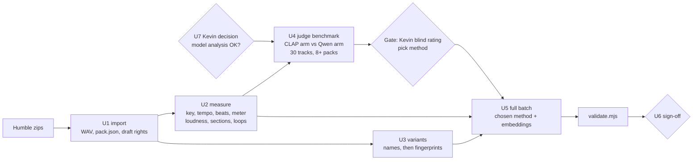

# feat: Pre-process the Sidetrax music library for agents

## Overview

Kevin bought the Humble "Complete Works" bundle on 2026-10-27: 128 products, about 75 GB of human-made royalty-free music by Sidetrax (sidetrax.co.uk), in WAV, MP3 and AAC.

This plan turns every track into a C3 audio card plus an analysis sidecar, so an agent can choose music without listening. The card says what a person would say about the track:
- key and tempo;
- meter;
- energy over time and sections;
- instruments and vocals;
- genre and mood;
- a plain-language caption;
- fit for each game use;
- loop points;
- which files are cuts of the same piece.

It also adds a C2 scope item: audio agents that use the library as inspiration, and later pull elements out of tracks and re-arrange them. Processing runs on Kevin's laptop CPU. The output is a full pre-processed set for Kevin to sign off.

**Recommendation first:**
1. **Measure every number with code**, using tools whose code and weights allow commercial use. This needs no AI model and can start now.
2. **Benchmark two ways to fill in judgments** (mood, game use, genre, caption) on about 30 tracks from at least 8 packs, before any full model run:
   - the cheap way: folder names plus CLAP text-to-audio scoring;
   - a local audio-language model, Qwen3-Omni.
   - Kevin rates both blind. Qwen3-Omni runs over the whole library only if it clearly wins, otherwise only for captions.
3. **Kevin decided (2026-10-27): local AI analysis of Sidetrax audio is OK; no email to the vendor.** It is recorded as an `interpretation` entry. Stems, MIDI extraction and AI-conditioned generation (`derive-audio`) stay off until Kevin grants them.

### Decisions after the spike (2026-10-27/28; these supersede the model names below)

- **CLAP checkpoint:** `laion/clap-htsat-unfused` (Apache-2.0), not `larger_clap_music`. Under transformers 4.57 and 5.x, `larger_clap_music` gives near-uniform scores (logit scale 1.03, cosines near zero) whatever the weights format.
- **Audio-language model:** MiDashengLM-7B-1021 (Apache-2.0, GGUF via a llama.cpp fork) replaced Qwen3-Omni for the comparison. It stops itself at about 60 tokens, so long prompts fail; short single questions work. In Kevin's blind check on three tracks and one sound effect, CLAP won all four (MiDashengLM called a door opening an "alarm" and a "shaver"). **CLAP is the tagger for the whole library; MiDashengLM stays off** unless Kevin asks for it again.
- **Ranking:** CLAP's raw softmax favours some labels on every track ("sunrise", "outer space", "end credits" in the first test), so tags are chosen by lift against the library average (C3 "Music cards").
- **beat_this:** its weights host returned HTTP 500 at first; once the weights loaded, it became the beat tracker. Where it fails, `measure.py` falls back to Essentia beats, records the fallback in the sidecar, and leaves `meter` null. The meter comes from beat_this downbeats (doubled downbeats skipped, rejected when nearly every beat is flagged), else from beat accents (3 or 4), else null.
- **Vendor tags:** Sidetrax WAVs carry the composer's project tempo; it settles half/double tempo ties (`audio.vendor`).
- **Scripts:** `scripts/audio/analyze.py` (code facts, vendor tags, CLAP embeddings, waveform previews, one sidecar per file) and `scripts/audio/build_audio_cards.py` (labels from `labels.py`, lift ranking, cards, validation) replace the planned `judge.py`.
- **Sidecar depth (Kevin, 2026-10-27):** keep it lean: beats, sections with energy, the 1 Hz loudness curve, loop points, the embeddings. No chords or per-instrument timelines.
- **Full run (finished 2026-10-28):** 2,814 audio files (1,472 Sidetrax tracks plus Kenney music and sound effects), 2,814 cards, all valid. Music meter: 4/4 for 1,024 tracks, 3/4 for 13, other values for 48, null for 387 (227 where beat_this raised ValueError and Essentia took over, 160 where the downbeats disagreed and the accents were unclear). Flags: `mood-unverified` on every music card (no human check yet) and `low-confidence` on 2,103 cards. All 1,472 music sidecars have two CLAP excerpts (tracks of 60 s or less use their two halves; 159 were re-run for this). Vendor tags: the files carry tempo, album, year, artist ("SideTrax", the label) and genre, but no composer tag (checked across all 1,472 files: no composer in ffprobe tags, RIFF INFO or ID3). The catalog number is the series number in the album tag ("07 Rock Follies" -> 7), copied as `catalog_no` for 495 tracks; the other albums carry no number. After lift ranking, "space" is the environment on 86 of 1,472 tracks, against nearly all of them before.

---

## Problem Frame

Today the only judgment we can make about audio comes from ffmpeg loudness and brightness. C2 §10 records it: "choosing darker dungeon music meant measuring loudness and brightness, because no track said dark or cheerful."

Sidetrax tracks have one-word titles ("Charge", "Destiny") inside themed packs ("60 Battle", "Music Pack 20 - Darkness"). An agent can't pick "tense music for a goblin ambush" from that.

C3 already defines an `audio` block (duration, loudness, LRA, peak, centroid, tempo, loopable) and admits mood is the weakest field (C3 §6).

**Facts established in the spike (2026-10-27):**
- **Trial pack.** Pack 60: Battle has 10 tracks, 71–291 s long. Most are 44.1 kHz/16-bit; one is 48 kHz and one is 24-bit. They come in WAV, MP3 and AAC, with no license file and no cut-down versions. Loudness runs from −14 to −5.6 LUFS integrated, peaks about −1 dBFS [M].
- **License** ([sidetrax.co.uk terms](https://www.sidetrax.co.uk/page-21/terms.php)):
  - grants a "non-exclusive and non-transferable lifetime worldwide" right to use the music in "games", personal or commercial;
  - forbids claiming the music as our own, registering or selling the original content in any store, and redistributing or sublicensing "other than as part of the relevant project";
  - allows one user;
  - says nothing on editing, derivatives, attribution or AI. The site markets "Human-made music. No AI."
- **Machine.** Intel i7-10710U, 6 cores/12 threads, 31 GB RAM, no CUDA GPU, Python 3.13.
- **Measured on a 208 s track:**
  - Essentia's full extractor: 42 s;
  - EffNet-Discogs embeddings: 17 s;
  - librosa beats: 3.4 s warm.
- **Weak tagging models.** Essentia's genre and mood models gave near-flat, wrong scores on a battle cue (Downtempo 0.13, moods about 0.09) [M]. Pack and folder names are a better seed.

---

## Requirements Trace

**Analysis and tagging**
- **R1.** Every track gets a valid `ogm.asset-card/1.0` audio card (C3) plus a deeper analysis sidecar. This follows the three-depth split: card facets, then sidecar detail, then listening for the rest.
- **R2.** Numeric musical facts are measured by code, never guessed by a model: key, mode and key strength; tempo with half/double alternatives; beats, downbeats and meter; loudness curve and energy; section boundaries; loop points; duration, rate and channels.
- **R3.** Human-style descriptors carry a confidence each and map to the C3 vocabulary, with new terms in `proposed_tags`: caption, instruments, vocals, genre and style, up to 3 moods, era, and fit for each game use.
- **R4.** Key→mood is only a weak prior on valence. Western mode/valence evidence is real but confounded. It is never the sole source of a mood, and the benchmark checks it isn't one in practice.
- **R5.** Cuts of the same piece are grouped into one card, by name first and by fingerprint only if names leave candidates.

**Licensing and privacy**
- **R6.** Tools and weights in the default pipeline allow commercial use. Non-commercial weights are listed and gated behind a Kevin decision.
- **R7.** Rights:
  - the `license` basis holds only what the text grants;
  - uses read from silence are recorded separately as Kevin's interpretation and can be revoked;
  - nothing is confirmed until Kevin confirms it;
  - models never write rights (C3 §5).
- **R8.** Audio never leaves the machine by default: no upload to cloud APIs or to claude.ai pages. Download links stay in `~/.config/ogm/` and never reach the repo.

**Sign-off and scope**
- **R9.** Kevin gets a gate before the long run, and signs off the full set after it. The sign-off has clear pass thresholds.
- **R10.** C2 gains a scope item for audio agents: composing from inspiration, and pulling elements out and augmenting them, each behind its own rights gate.

---

## Scope Boundaries

- No building of the audio-agent tools themselves (stems, MIDI, re-arranging, composing). This plan only scopes them in C2.
- No generative-model spikes (ACE-Step, Stable Audio Open).
- No cloud GPU or paid API. Any spend is a separate ask to Kevin, with a price.
- No Sidetrax audio in any public repo or page. `assets-local/` stays git-ignored.
- No tickets or build order (standing rule until Kevin asks).

### Deferred to Follow-Up Work

- **Audio-agent toolset V1:** separation on demand, transcription, editing, MIDI composing and a Web Audio cue player. Waits for Kevin's rights decision (U7).
- **ACE-Step spike** for reference-guided generation. Only if Sidetrax allows AI conditioning.
- **GPU section labelling** (all-in-one or SongFormer, about $2–4 rented). Only if code boundaries prove too weak at sign-off.
- **Fine-tuned game-use classifier** on Kevin's sign-off labels, over CLAP embeddings.
- **Renaming `vision-input` to `model-input` in C3.** It's a breaking schema change; it only gets proposed (U7).

---

## Context & Research

### Relevant Code and Patterns

- **C3 standard** (`docs/research/v0.5/C3-asset-metadata-standard.md`):
  - card envelope and `audio` block (§3), vocabularies (§4);
  - rights and basis (§5): the strict default is `[vision-input]`, `private`, `none`;
  - writers and provenance (§6);
  - ids, hashes and previews (§7), collections (§8), tagging procedure (§13).
- **Schema and validator:**
  - `schemas/asset-card.schema.json`: `source.files[]` is closed (roles: primary, texture, companion, metadata); top-level `variants` means device tiers; `flag` is a closed enum.
  - `schemas/tools/validate.mjs`: model provenance is allowed only on `describe.*` and five named fields.
  - `schemas/examples/audio-music-kenney-infinite-descent.json` is the card shape to extend.
- **Import pattern:** `scripts/assets/import_synty.py` and `import_kenney_bundle.py` (downloads → `assets-local/packs/<id>/` + `pack.json`), and `build_catalog.py`.
- **Script folder pattern:** `scripts/drive-sync/` (own `.venv`, `requirements.txt`, `test_*.py`).
- **Batch pattern:** the map-export batch, currently only in a session scratchpad. U5 copies it into the repo first. Its contract:
  - a queue file of paths, popped under `flock`;
  - skip when the output exists;
  - one `time|worker|ok/fail|secs|item` line per item in `results.txt`;
  - a watcher that exits only on 3 failures in a row, 30 minutes with no result, or every worker reporting `queue empty`.
- **Earlier research:** `docs/research/v0.4/B5-generative-assets-audio.md`, `B12-asset-sources-and-licensing.md`, and C2 §5 (iOS audio formats) and §10 (tagging).

### External References (spike reports, 2026-10-27)

**Analysis tools:**

| Tool | Use | License | Notes |
|---|---|---|---|
| Essentia (KeyExtractor, RhythmExtractor2013, LoudnessEBUR128) | key, tempo, loudness | AGPL code, run as a local tool | pin `essentia-tensorflow==2.1b6.dev1389` for its Python 3.13 wheel |
| beat_this | beats and downbeats | MIT code and weights | GTZAN beat F1 89.1, downbeat F1 78.3 |
| MSAF / librosa novelty | sections | MIT / ISC | |
| pymusiclooper | loop points | MIT | pulls in system taglib |
| Chromaprint / pyacoustid | fingerprints | LGPL / MIT | |
| LAION-CLAP `larger_clap_music` via transformers `ClapModel` | embeddings, zero-shot scoring | Apache-2.0 weights | the `laion-clap` package pins numpy<2, which has no Python 3.13 wheel |
| Qwen3-Omni-30B-A3B-Instruct, Q4 under llama.cpp | judgment fields | Apache-2.0 | about 45–90 s per 30 s clip [I]; llama.cpp audio support not yet smoke-tested |

**Excluded by default** (non-commercial weights): Essentia TF genre/mood models, MuQ/MuQ-MuLan, MERT, Skey, madmom models, Music Flamingo, MusicGen, YuE2.

**Mode/valence evidence:** a meta-analysis (bioRxiv 10.1101/2023.03.16.532764) finds major reads as positive and minor as negative, but the effect is moderated by culture and expertise and confounded with tempo and loudness.

**Augment and compose tools:**
- Demucs v4: MIT, archived; about 1.5× real time on CPU.
- basic-pitch: Apache-2.0; needs Python 3.11.
- GeneralUser GS soundfont: free for commercial use.
- VSCO-2 CE orchestral samples: CC0.
- Signalsmith Stretch: MIT, with a WASM build.
- Runtime approach: Web Audio vertical layering and horizontal resequencing, driven by a JSON file per cue.

---

## Key Technical Decisions

- **Code measures, a model judges, with the split written into the card.**
  - `audio.*` holds only code facts. New: `key`, `mode`, `key_strength`, `tempo_alternatives`, `meter`, `energy`, `loop_points`, `cuts`.
  - Model output goes under `describe.*`:
    - `describe.description` is the caption, within its existing 300-character limit;
    - new: `describe.genre`, `describe.instruments`, `describe.has_vocals`, `describe.era`, `describe.game_fit`;
    - existing: `describe.moods`.
  - `validate.mjs` then needs no allowlist change.
- **Pack and folder names are the strongest free signal.** "60 Battle", "Darkness", "Country Dreams" and "Loop Pack" seed genre, game use and subkind at draft time (`by: filename`).
- **Judgment method is chosen by benchmark, not assumed** (U4). Two arms run on the same ~30 tracks from at least 8 packs:
  - **(a)** folder seed plus CLAP zero-shot scores over the C3 mood and `game_fit` labels (seconds per track);
  - **(b)** Qwen3-Omni JSON output.
  - Kevin first picks the top moods and best game use himself, then rates both arms' output without knowing which is which.
  - Qwen runs over the library only if it beats (a) on mood or game use by a clear margin, about 15 points of agreement. Otherwise it only writes captions, or is dropped.
  - The Essentia TF heads were rejected: non-commercial weights, and measured as weak on this library.
- **The model's prompt is tested for priming.** In the benchmark each clip runs twice: audio only, and with titles plus key/mode.
  - If the primed run mostly repeats the folder seed, or applies minor → sad, titles and key/mode stay out of the prompt. Code then combines them with the model's answer, with stated weights.
  - Provenance `input` records what the model was shown.
- **Excerpts represent the track, not just its peak.**
  - Long tracks get two clips that don't overlap: one from the section with median energy (what plays most of the time) and one from the loudest section, each labelled in the prompt.
  - A track of 30 s or less is sent whole. A track of 30–60 s sends its first 30 s.
- **Variants: names first, fingerprints only if needed.** After import, count repeated name stems and variant suffixes.
  - Chromaprint offset matching is built only if names leave clear candidates; otherwise R5 is met by names alone.
  - Cuts live in `audio.cuts[]` = {path, role: full | cut-60 | cut-30 | loop | stinger | alt-mix, duration_s, loudness_lufs, peak_dbfs, offset_s}. They appear in `source.files` as `role: companion`.
  - The name `variants` is avoided, since it already means device tiers.
- **Rights: the license basis records only what's granted; interpretation is separate and revocable.**
  - **License basis:** the Sidetrax `license` entry carries `in-game`, `private`, `in-build`.
  - **New C3 basis type `interpretation`:** an admin's reading of terms the license doesn't address, with a reason and date (for example "license silent on AI; vendor asked 2026-10-xx").
    - It can only add uses the license doesn't forbid.
    - It is replaced when a vendor answer arrives.
    - Code shows it apart from granted uses.
  - **New uses:** `edit-audio` (cut, loop, fade, stretch whole tracks) and `derive-audio` (stems, motifs, MIDI, re-arranging, AI conditioning).
  - **Model analysis keeps C3's existing use `vision-input`.** Even the strict default grants it, but given the vendor's "No AI" claim, model stages also require Kevin's explicit decision (U7, U4).
  - **Draft cards** carry the unconfirmed license entry plus a `default` entry, and store the default rights until Kevin confirms.
- **Import: WAV is the source; MP3 only as a flagged fallback.**
  - We unpack WAV into `assets-local/packs/sidetrax-<slug>/`.
  - A product with no WAV imports its MP3s, flagged `lossless: false`.
  - Browser formats are made from the source at build time (C2 §5).
  - Zips stay in Downloads until sign-off.
- **Batch: one queue per stage, several workers for code stages.**
  - Code stages run 4 workers while the map export runs, and 10 after it.
  - The model stage runs as one process using all threads, and only after the map export ends: Wine is using about 15 GB of RAM, and Qwen3-Omni Q4 needs about 18–20 GB [I].
- **Review is local.** The review page has audio players, so it must not be published (Sidetrax redistribution clause). It runs on 127.0.0.1. A claude.ai artifact may show stats and cards with no audio.

---

## Open Questions

### Resolved During Planning

- **Stack:** code DSP plus beat_this plus CLAP; Qwen3-Omni only if the benchmark justifies it.
- **What gates the model stages:** Kevin's recorded decision, ideally after the vendor's answer.

### Deferred to Implementation

- **Whether the full model run is feasible on CPU.** About 60–125 h for 5,000 clips is [I]. U4 starts with a llama.cpp load-and-one-clip smoke test. Fallbacks: Qwen2.5-Omni-7B (Apache-2.0), or another local audio model whose license is checked first.
- **Exact track count and vendor naming patterns.** Known after U1.
- **Whether code section boundaries are good enough.** Judged at sign-off.
- **beat_this weights host** (it returned HTTP 500 during the spike). Mirror the weights locally once fetched.
- **If Sidetrax says no to AI analysis.** Delete the model-written fields and embeddings, and keep the code facts.
- **Whether `game_fit` becomes a closed vocabulary or an open map.** Decided in U7 with the schema change.

---

## Output Structure

    scripts/audio/
      README.md                   # pinned model hashes, excluded-weights deny list
      requirements.txt            # essentia-tensorflow==2.1b6.dev1389, torch/torchaudio CPU (PyTorch index), beat_this, transformers, pyacoustid, pymusiclooper
      import_sidetrax.py
      measure.py
      variants.py                 # only if U3's name check finds candidates
      judge.py                    # CLAP zero-shot arm + Qwen3-Omni arm + vocab mapping
      embed.py
      batch/                      # queue, worker, watcher (copied from the map-export batch)
      review/                     # gate page + sign-off page generator
      test_import.py
      test_measure.py
      test_variants.py
      test_judge.py
      test_assembly.py
    docs/research/v0.5/
      C3-asset-metadata-standard.md
      C2-v1-scope-additions.md
      C4-music-library-preprocessing.md
      schemas/

---

## High-Level Technical Design

> *Directional guidance for review, not implementation specification.*

---

## Implementation Units

- [x] U7. **Rights decision, standards updates** *(first; done 2026-10-27)*

**Goal:** Get Kevin's decision on model analysis, draft the vendor email, and write the card and rights changes into C3, C2 and the schema.

**Requirements:** R6, R7, R10

**Dependencies:** none. The C3 example card comes after U4.

**Files:**
- Modify: `docs/research/v0.5/C3-asset-metadata-standard.md`, `docs/research/v0.5/C2-v1-scope-additions.md`, `docs/research/v0.5/README.md`
- Modify: `docs/research/v0.5/schemas/asset-card.schema.json`, `docs/research/v0.5/schemas/tools/validate.mjs`
- Test: `validate.mjs` run over all examples, plus new negative fixtures

**Approach:**
- **Vendor email: dropped** (Kevin, 2026-10-27).
- **Kevin decided:** model analysis runs now under an `interpretation` basis (local only).
- **C3 changes:**
  - new code-only fields in `audio.*` (see the decisions);
  - new model fields in `describe.*`;
  - `audio.cuts[]`;
  - the sidecar definition;
  - genre and instrument vocabularies, and the `game_fit` keys;
  - new flags `mood-unverified` and `describe-failed`;
  - a card whose describe step failed stays at `status: measured`;
  - the `interpretation` basis type and the `edit-audio` and `derive-audio` uses;
  - the excluded-weights list;
  - the `model-input` rename, as a proposal only.
- **C2 §11, audio agents.** Three levels:
  1. **Inspiration.** Agents get the analysis as text (tempo, key, form, instruments), never Sidetrax audio as composing input. They compose MIDI and render it with GeneralUser GS or VSCO-2 CE. Allowed now.
  2. **Whole-track adaptation.** Cut, loop, stinger, crossfade, tempo ±10%, and a Web Audio cue player with layers and resequencing. Needs `edit-audio`.
  3. **Element extraction and augmentation.** Demucs stems, basic-pitch MIDI, motif reuse, re-arranging, ACE-Step reference generation. Needs `derive-audio`, which needs the vendor's answer.
  - Note: if AI-altered Sidetrax audio ever ships, don't market it as human-made, and follow store rules on AI disclosure.

**Test scenarios:**
- **Happy path:** the new Sidetrax example card validates.
- **Error path:** a card with `derive-audio` and no basis for it is refused.
- **Error path:** a model-provenance value on an `audio.*` field is refused.
- **Edge case:** a draft card (license unconfirmed, default entry present, default rights stored) validates. Adding `confirmed_by` recomputes its rights to `in-game`/`private`/`in-build`.
- **Edge case:** an `interpretation` entry that adds a use the license forbids is refused.

**Verification:**
- The validator passes.
- Kevin's decision is recorded in the collection card's basis.
- C2 and C3 are committed and pushed to `research`.

---

- [ ] U1. **Import the bundle as packs**

**Goal:** Turn the 128 zips into packs under `assets-local/packs/sidetrax-*`, each with a `pack.json` and a draft collection card.

**Requirements:** R1, R7, R8

**Dependencies:** the download finishing (background script; its log is in the session scratchpad)

**Files:**
- Create: `scripts/audio/import_sidetrax.py`, `scripts/audio/README.md`
- Test: `scripts/audio/test_import.py`

**Approach:**
- Slugs come from product names: "Pack 60: Battle" → `sidetrax-pack-60-battle`.
- Skip `__MACOSX`, `.DS_Store`, and AAC/MP3 when WAV exists.
- Inspect the two products under 1 MB ("Pack 38 - Echoes", "Pack 40 - Gold"); they're likely stubs.
- Draft rights as described in the decisions.
- Report repeated name stems and variant suffixes across packs, as input to U3.

**Patterns to follow:** `scripts/assets/import_synty.py`

**Test scenarios:**
- **Happy path:** a zip with `60 Battle/{WAV,MP3,AAC}/` produces only WAVs and a `pack.json` with a track count of 10.
- **Edge case:** a zip with only MP3 imports its MP3s, flagged `lossless: false`.
- **Edge case:** a re-run changes nothing.
- **Edge case:** a zip under 1 MB is reported as not audio and doesn't stop the run.
- **Error path:** a corrupt zip leaves no half-written pack folder and is reported.
- **Integration:** the draft collection card validates (default rights).

**Verification:** all 128 products are imported or flagged with a reason. Totals match the download log.

---

- [ ] U2. **Measure stage + install check + benchmark**

**Goal:** Write the code-measured part of each card and its sidecar. Benchmark 20 tracks before the full run.

**Requirements:** R2, R4, R6

**Dependencies:** U1 (the trial pack is enough to start)

**Files:**
- Create: `scripts/audio/measure.py`, `scripts/audio/requirements.txt`
- Test: `scripts/audio/test_measure.py`

**Approach:**
- **Step zero:** a clean install on Python 3.13, including torch and torchaudio from the PyTorch CPU index and system taglib. Record memory per worker.
- **Essentia:**
  - KeyExtractor with the edma, krumhansl and temperley profiles. Keep the result at least two agree on; if all three disagree, use the strongest and flag low confidence.
  - RhythmExtractor2013, keeping BPM plus the half and double values.
  - LoudnessEBUR128 short-term curve at 1 Hz.
- **beat_this:** beats and downbeats; meter is the median number of beats per bar.
- **Sections:** novelty peaks merged with loudness changes. Labels come from energy rank (`A`, `B`, `build`, `peak`, `outro`).
- **Loops:** pymusiclooper on loop-pack items and on tracks whose endings don't fade, then a seam check that sets `loopable`.
- **Existing C3 audio fields** stay as defined. Provenance is `by: code`, with tool and version.

**Execution note:** Characterize on the 10 Battle tracks first, and hand-check key and tempo for 3 against a listen.

**Test scenarios:**
- **Happy path:** a synthetic 120 BPM 4/4 click with a C-major pad gives tempo 120 ±1, meter 4, and C major with strength above 0.5.
- **Edge case:** a 3/4 synthetic waltz gives meter 3.
- **Edge case:** a 60 BPM track stores 120 as an alternative, not as the main tempo.
- **Edge case:** a 0.3 s stinger gives `loudness_lufs: null` and only a peak.
- **Edge case:** a perfect sine loop is loopable; the same file with a 50 ms click at the seam is not.
- **Error path:** a missing beat_this weight file fails loudly.

**Verification:** a benchmark of seconds per stage and an agreement table from the hand checks, both written into C4.

---

- [ ] U3. **Variant grouping (conditional)**

**Goal:** Group cuts of the same piece into one card.

**Requirements:** R5

**Dependencies:** U1 (stem report), U2 (durations)

**Files:**
- Create: `scripts/audio/variants.py`
- Test: `scripts/audio/test_variants.py`

**Approach:**
- Group by name stem plus the suffixes found in U1.
- Only if names leave candidates (same stem across differently named files, or loops with no stem match), add Chromaprint matching: the shorter file against the longer, at the best offset. The longest file is primary.
- Roles come from the name. Without a name, a file is a stinger only if it is under 10 s and also matches a longer track. Short pieces with no match stay standalone.

**Test scenarios:**
- **Happy path:** `Charge.wav` and `Charge_30s.wav` group, with the cut as `cut-30`.
- **Edge case:** two different tracks with the same tempo and key don't group.
- **Edge case:** a loop cut from the middle of a track groups with it (offset match, fingerprint path only).
- **Edge case:** an 8 s standalone piece with no match stays its own card.

**Verification:** a table of groups per pack. Kevin spot-checks 10 groups by ear at sign-off.

---

- [ ] U4. **Judgment benchmark and gate**

**Goal:** Choose how judgment fields are filled, with evidence, before any full run.

**Requirements:** R3, R4, R6, R8, R9

**Dependencies:**
- U2;
- Kevin's model-analysis decision (U7);
- the map export finishing (RAM), for the Qwen arm only.

**Files:**
- Create: `scripts/audio/judge.py`, `scripts/audio/review/` (gate page)
- Test: `scripts/audio/test_judge.py`

**Approach:**
- **Rights check first:** judge.py refuses to send audio to any model unless the card's effective rights include `vision-input` and the collection basis records Kevin's decision.
- **Smoke test:** load Qwen3-Omni-30B-A3B-Instruct (GGUF Q4_K_M plus its audio projector) under llama.cpp and run one clip. Pin the model file hashes.
- **Sample:** 30 tracks from at least 8 packs of different themes.
- **Arms:**
  - (a) folder seed plus CLAP (transformers `ClapModel`) zero-shot scores against prompts for each mood and `game_fit` key;
  - (b) Qwen JSON (caption, instruments, `has_vocals`, genre, `style_tags`, up to 3 moods, era, `game_fit` scores, a confidence per group), on the excerpts from the decisions;
  - (b′) the same with titles plus key/mode in the prompt.
- **Mapping:** a text-only pass maps free words onto C3 enums; misses go to `proposed_tags`.
- **Gate page** (local):
  - Kevin first picks the top 3 moods and best game use for each track;
  - then he picks which of three tracks best fits each of 5 game uses;
  - then he sees the arms' output, blind.
- **Rule:** Qwen goes library-wide only if it beats arm (a) by about 15 points on mood overlap or top `game_fit`. If (b′) mainly echoes the folder seed, keep titles out of the prompt.

**Test scenarios:**
- **Happy path:** a fixture of model output maps to enums plus `proposed_tags`.
- **Edge case:** four moods returned → keep the top three by confidence.
- **Edge case:** a 12 s loop sends one whole clip; a 45 s cue sends its first 30 s; a 3-minute track sends two clips that don't overlap.
- **Error path:** invalid JSON → one repair retry, then flag `describe-failed` and leave the card at `measured`.
- **Error path:** a card without the rights basis is skipped and flagged, and nothing is sent to the model.
- **Error path:** a missing model file stops the stage before any card is touched.
- **Integration:** a judged card validates, and every `describe.*` field has model provenance with `input` recording what was shown.

**Verification:**
- The agreement table for (a), (b) and (b′) is written into C4.
- Kevin picks the method on the gate page.
- The measured seconds per clip update the full-run estimate.

---

- [ ] U5. **Embeddings, assembly, validation, full batch**

**Goal:** Run every stage over the library, assemble and validate the cards, and index them.

**Requirements:** R1, R2, R3, R5, R8

**Dependencies:** U2, U3, U4 gate passed

**Files:**
- Create: `scripts/audio/embed.py`, `scripts/audio/batch/` (copied from the map-export batch first)
- Modify: `scripts/assets/build_catalog.py`, if packs need registering
- Test: `scripts/audio/test_assembly.py`

**Approach:**
- **Embeddings:** CLAP embeddings per primary file, stored next to the cards, for "more like this".
- **Assembly:**
  - card id `t1:sidetrax-<pack>/<track>@1`;
  - content hashes per C3 §7;
  - a waveform/spectrum strip and a 3 s clip under the private preview prefix;
  - cards written atomically (temp file, then rename).
- **Batch:**
  - per the decisions;
  - the watcher exits only on trouble or completion;
  - the hourly update to Kevin includes audio progress.

**Test scenarios:**
- **Happy path:** fixture inputs give a valid card plus a sidecar.
- **Edge case:** a re-run skips a track when its inputs hash and tool versions match.
- **Error path:** one failing track is logged, the batch continues, and the summary lists it.

**Verification:**
- Every track has a valid card or a failure entry with a reason.
- The validator passes.
- Catalog counts match the import.

---

- [ ] U6. **Sign-off**

**Goal:** Kevin approves the full set in about 20 minutes.

**Requirements:** R9

**Dependencies:** U5

**Files:**
- Create: the sign-off page in `scripts/audio/review/`, `docs/research/v0.5/C4-music-library-preprocessing.md`

**Approach:**
- **Local page:**
  - distribution charts (key, mode, BPM, genre, moods, `game_fit`);
  - 30 new tracks, stratified by pack theme and confidence: Kevin picks first, then sees the tags;
  - 10 variant groups;
  - the flagged list.
  - Fixes save as human edits (locked).
- **Pass rules:** at least 70% mood overlap and at least 70% top-`game_fit` match on the sample.
  - If the sample passes, `mood-unverified` is cleared library-wide.
  - If not, it stays, and the affected stage is re-run.
- **On pass:** the license basis gains Kevin as `confirmed_by`.
- **C4** records the benchmarks, accuracy, sign-off results and remaining gaps.

**Test expectation:** none for the page itself; correctness is Kevin's review.

**Verification:** Kevin signs off, or the fixes are applied and the affected stages re-run.

---

## System-Wide Impact

- **Interaction graph:**
  - `gm assets search` gains music facets (key, BPM range, `game_fit`, moods) and "more like this";
  - the hourly status job reports audio progress;
  - code stages share CPU with the map export until it finishes (about 01:30).
- **State lifecycle risks:**
  - cards are written atomically;
  - re-runs are keyed by content hash plus tool version;
  - if the vendor refuses AI analysis, model fields and embeddings are deleted and code facts kept.
- **Unchanged invariants:**
  - C3's rights rules (narrow only, never written by a model);
  - the current `audio` fields and Kenney/Synty cards, which are only extended;
  - `vision-input` stays the use for model analysis.

---

## Risks & Dependencies

| Risk | Mitigation |
|---|---|
| Qwen3-Omni can't load audio in llama.cpp, or is too slow | Smoke test first in U4; CLAP arm stands alone; Qwen2.5-Omni fallback; or Kevin approves ~$5–20 of rented GPU |
| The model only echoes titles, so its "judgment" is circular | (b′) priming test; titles combined in code if they dominate |
| Excerpts bias tags toward high energy | Median-energy plus loudest excerpts, labelled |
| Systematic tag errors found only after a multi-night run | Pre-run gate with thresholds (U4) |
| Laptop throttles; runs take a week | Code stages first, so cards are useful early; resumable queue |
| Install friction on 3.13 (numpy<2 for laion-clap, taglib, torchaudio index) | transformers `ClapModel`; install check as U2 step zero |
| Signed download links expire | Downloader logs failures; links can be re-read from the open browser page |
| beat_this weights host down | Mirror weights; fallback to Essentia beats plus novelty downbeats, flagged |
| Non-commercial weights slip in | Deny list in README; reviewed at sign-off |
| Essentia is AGPL | Local tool only, never linked into game code |
| Single-user, non-transferable license | `audience: private`; flag again before other users or agents get library access |
| Rights misread | Granted uses and interpretation kept apart; vendor email; Kevin decides; not legal advice |
| Sidetrax audio leaks via a published page | Local review only; private preview prefix; no audio in artifacts or commits |

---

## Documentation / Operational Notes

- Background jobs wake the model only on trouble or completion; Kevin gets hourly pushes.
- After sign-off, with Kevin's OK: delete the vendor MP3/AAC files and the zips (standing cleanup task).

---

## Sources & References

- Sidetrax terms: https://www.sidetrax.co.uk/page-21/terms.php
- Project docs:
  - C3 standard and schemas: `docs/research/v0.5/C3-asset-metadata-standard.md`, `docs/research/v0.5/schemas/`
  - C2: `docs/research/v0.5/C2-v1-scope-additions.md`
  - Earlier audio research: `docs/research/v0.4/B5-generative-assets-audio.md`
- Analysis tools:
  - Essentia models and license: https://essentia.upf.edu/models.html
  - beat_this: https://github.com/CPJKU/beat_this
  - LAION-CLAP music: https://huggingface.co/laion/larger_clap_music
  - llama.cpp multimodal: https://github.com/ggml-org/llama.cpp/blob/master/docs/multimodal.md
  - Qwen3-Omni Instruct: https://huggingface.co/Qwen/Qwen3-Omni-30B-A3B-Instruct
  - pymusiclooper: https://github.com/arkrow/PyMusicLooper
  - pyacoustid: https://pypi.org/project/pyacoustid/
- Mode/valence meta-analysis: https://www.biorxiv.org/content/10.1101/2023.03.16.532764.full.pdf
- Augment and compose:
  - Demucs: https://github.com/facebookresearch/demucs
  - basic-pitch: https://github.com/spotify/basic-pitch
  - GeneralUser GS licence: https://raw.githubusercontent.com/mrbumpy409/GeneralUser-GS/main/documentation/LICENSE.txt
  - VSCO-2 CE: https://github.com/sgossner/VSCO-2-CE
  - ACE-Step 1.5: https://github.com/ace-step/ACE-Step-1.5
  - Stable Audio Open: https://huggingface.co/stabilityai/stable-audio-open-1.0
