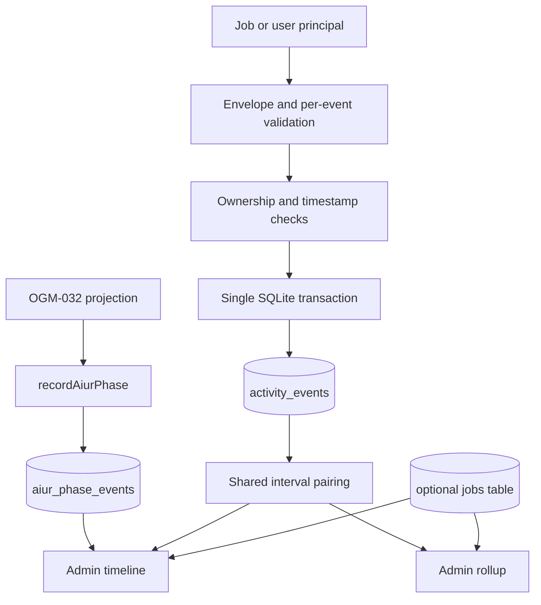

# Build Analytics Ingestion and Admin Reads - Plan

## Goal Capsule

- **Objective:** Add the server-side activity stream that records privacy-safe build work, joins it to aiur phases, and serves family-scoped admin timelines and rollups.
- **Authority:** Issue #33 and the frozen OGM-014 research plan define behavior; existing OGM-010 contracts and current repository conventions define integration shape.
- **Execution profile:** One database migration plus a directory-scanned API context, implemented test-first without new dependencies.
- **Stop conditions:** Stop if implementing the fixed contract requires changing `packages/contracts`, storing non-allow-listed text, or inventing an emitter, projection, UI, or paid service.
- **Tail ownership:** Finish focused API, database, config, typecheck, and lint validation; remove abandoned code; self-review; then deliver a ready PR through the repository's CI policy.

---

## Product Contract

### Summary

Implement strict, transactional activity ingestion, aiur phase recording, admin-only build timelines, family-scoped rollups, and raw-event retention. Keep emitters, aiur projection, usage reconciliation, and presentation surfaces outside this change.

### Problem Frame

Activity cannot be reconstructed reliably from tool logs after a build. OGM must record a fixed taxonomy at the source, retain only bounded metadata, and join that stream to aiur phases without sending custom events into aiur or persisting prompt and source text.

### Requirements

**Storage and privacy**

- R1. Persist contract-valid activity events with family and principal ownership, indexed for build and game time-range reads.
- R2. Persist aiur phase transitions idempotently by build, phase, and timestamp.
- R3. Store only strict `ActivityMeta` keys, truncate `meta.command` to 120 characters, and require a `gm` command prefix for `gm_cli` events.
- R4. Delete raw activity events older than the configured retention period, defaulting to 90 days.

**Ingestion**

- R5. Accept batches of 1-500 events and reject invalid events independently while inserting every accepted event in one transaction.
- R6. Constrain job principals to their token's game and job, and constrain user principals to human events without a job in a game resolved to their family.
- R7. Reject timestamps older than seven days or more than five minutes in the future, and collapse duplicate event identities within a batch.

**Admin reads**

- R8. Require an admin principal for reads and prevent timelines or rollups from crossing the principal's family boundary.
- R9. Return build timelines with ordered aiur phases and activity intervals paired by activity, actor, and source while preserving unmatched starts as open.
- R10. Return game or member rollups over an explicit date range with activity counts, durations, distinct-build counts, and nullable usage.
- R11. Use the jobs table for usage and member ownership when it exists; preserve contract-valid null or principal-based fallbacks before that sibling lands.

### Acceptance Examples

- AE1. A job token submitting the worked playtesting fixture receives two accepted events; adding `meta.prompt` rejects only that event with `meta: unrecognized key prompt`.
- AE2. A job token for game A submitting a game B event receives a per-event `game_mismatch` rejection.
- AE3. A user submission with an agent actor is rejected, while a missing or cross-family game resolution returns `403 game_unresolved` without writing the batch.
- AE4. A start and end become one closed timeline activity, and an unmatched start remains open with `endedAt: null`.
- AE5. Recording the same aiur phase key twice leaves one phase row.
- AE6. A date-range rollup sums closed activity counts and durations, includes every taxonomy key with zero defaults, and excludes another family's rows.
- AE7. A non-admin read receives 403.

### Scope Boundaries

- Emitters in the CLI, skills, editor, SDK, and sandbox-shipping hooks are owned by their sibling tickets.
- The aiur event feed/projection, usage reconciliation, admin charts, and creator-facing gameplay analytics are not part of this change.
- The research plan's suggested rate limiter is deferred because issue #33 does not place it in scope or acceptance; the fixed batch and timestamp limits remain enforced.

---

## Planning Contract

### Key Technical Decisions

- KTD1. Use the existing Drizzle schema and synchronous SQLite transaction APIs. This keeps the batch atomic while matching `@ogm/db`; SQLite and Drizzle both document whole-transaction rollback semantics.
- KTD2. Keep request parsing in two levels: validate the envelope first, then normalize and validate each event with the shared `ActivityEvent` contract. This is the only way to preserve per-event rejection without redefining OGM-010 schemas.
- KTD3. Centralize interval pairing and reuse it for timeline and rollup calculations. Open starts remain visible in timelines but contribute no completed count or duration to rollups.
- KTD4. Detect the optional `jobs` table at read time and query its published snake-case columns only when present. No compile-time dependency is added to an unlanded sibling schema.
- KTD5. Use the current `platformRole === 'admin'` fallback for reads. The future policy package is outside this branch and can replace the narrow authorization helper when it lands.
- KTD6. Start retention from the API process with an immediate sweep followed by an unref'ed daily timer, and keep the sweep callable with an injected clock for deterministic tests.
- KTD7. Normalize every validated event, phase, and query-bound timestamp to UTC before persistence or comparison. ISO strings with different offsets do not sort chronologically as SQLite text, while normalized UTC text preserves ordering and retention cutoffs.

### Assumptions

- The future jobs table follows OGM-013's researched columns `id`, `family_id`, `creator_id`, and `usage_micro_usd`; retry count is derived from recorded rework phase transitions only when a jobs row confirms the build exists.
- A user event whose game cannot be resolved to the caller's family fails the whole request as `game_unresolved`, matching issue #33's explicit authorization rule.
- Rollup `count` means completed intervals and point events; unmatched starts are excluded rather than assigned a guessed duration.
- Rollup queries require `id`, `from`, and `to` because the ticket defines an explicit date-range route and no default range contract.

### High-Level Technical Design

The route layer authenticates and maps HTTP errors; analytics modules own validation, persistence, pairing, and aggregation. Both reads establish the target family from stored data or the optional jobs table before loading response details.

### System-Wide Impact

- **API scanning:** Adding the analytics context changes the shipped route inventory, so the route-scanner integration assertion must include `/api/v1/analytics`.
- **Shared test dependencies:** Extending `AppDeps.config` requires the common API test helper to supply the retention default so unrelated context tests keep using production-shaped dependencies.
- **Configuration:** The new environment name must stay synchronized across the registry, `.env.example`, initializer output, and API README; invalid non-positive values must fail startup without logging the value.
- **Persistence:** The migration is additive and needs no backfill. A code rollback may leave unused tables safely in place because applied migrations are immutable and no existing table is rewritten.
- **Future siblings:** Jobs and policy integration stays behind narrow helpers so later packages can replace feature detection and role fallback without changing analytics contracts or aggregation behavior.

### Risks and Dependencies

- **Privacy leakage:** Free text could reach disk or logs before a validator rejects it. Normalize only the bounded command field, validate strict shared schemas before persistence, parameterize every query, log counts only, and inspect stored/logged data in negative tests.
- **Authorization leakage:** Loading a full timeline before checking family ownership would expose data across families. Resolve only ownership first, compare it to the admin principal, and query response details only after the check.
- **Timestamp corruption:** Offset-bearing ISO strings can sort incorrectly as text. Normalize to UTC at every write/query boundary and test equal instants expressed with different offsets.
- **Batch partial writes:** A constraint error midway through accepted inserts could leave a partial batch. Use one transaction and force a later insert to fail in a test that verifies zero rows remain.
- **Optional schema drift:** OGM-013 can change before landing. Keep jobs detection and column reads isolated, return null/principal fallbacks when absent, and cover both schema states without importing the sibling module.
- **Retention loss or failure:** Retention is intentionally destructive and timer exceptions could crash the API. Delete only `activity_events` older than the UTC cutoff, never phase rows, log failure metadata without values, and keep the returned timer disposable during shutdown/tests.
- **Pairing inflation:** Malformed boundary streams can invent duration. Define repeated starts, orphan ends, points, and open starts deterministically; count only completed or point activities in rollups.

### Sources and Research

- `packages/contracts/src/analytics.ts` owns the taxonomy and request/response schemas.
- `services/api/README.md` owns directory-scanned contexts, principal access, error envelopes, and migration conventions.
- `packages/db/src/open.ts` and `packages/db/src/migrate.ts` own SQLite access and timestamped migration behavior.
- `docs/plans/ogm-v1-build/tickets/OGM-014-plan.md` on the `research` branch provides the pairing and optional-sibling fallbacks.
- SQLite's transaction and conflict-resolution documentation supports atomic batch writes and idempotent phase insertion; Drizzle's transaction documentation confirms the repository ORM exposes the required unit-of-work API.

---

## Implementation Units

### U1. Analytics storage and retention lifecycle

- **Goal:** Add the two analytics tables, typed schemas, indexes, retention configuration, and daily cleanup lifecycle.
- **Requirements:** R1-R4.
- **Dependencies:** None.
- **Files:** Create `packages/db/src/schema/analytics.ts`, `packages/db/migrations/20261101HHMMSS_analytics.sql`, `packages/db/test/analytics.test.ts`, `services/api/src/analytics/retention.ts`, and `services/api/test/analytics-retention.test.ts`; modify `packages/db/src/schema/index.ts`, `packages/config/src/names.ts`, `.env.example`, `packages/config/test/env-example.test.ts`, `packages/config/test/names.test.ts`, `services/api/src/app/env.ts`, `services/api/src/app/types.ts`, `services/api/src/main.ts`, `services/api/test/helpers.ts`, and `services/api/README.md`.
- **Approach:** Mirror the contract fields in snake case, store metadata as JSON text, enforce the nine activities and principal kinds with database checks, make the phase key unique, and expose retention days through the typed config loader.
- **Patterns to follow:** Existing app-meta schema/migration, API environment loading, and timer startup in `services/api/src/main.ts`.
- **Test scenarios:** The migration exposes both tables and indexes; an unknown activity violates the database check; the default retention is 90 days and a non-positive value fails startup; a retention sweep deletes an event older than the UTC cutoff while keeping a newer event and every phase row; a failed migration remains atomic under the existing migration test contract.
- **Verification:** Schema exports compile, config registry/example parity passes, and retention behavior is deterministic under an injected clock.

### U2. Transactional event ingestion

- **Goal:** Implement the job/user ingestion rules and mount `POST /api/v1/analytics/events`.
- **Requirements:** R3, R5-R7; AE1-AE3.
- **Dependencies:** U1.
- **Files:** Create `services/api/src/analytics/ingest.ts`, `services/api/src/analytics/routes.ts`, and `services/api/test/analytics-ingest.test.ts`; modify `services/api/test/routes-scan.test.ts`.
- **Approach:** Parse only the request envelope as a batch, truncate a string command before shared-schema validation, format stable per-event reasons, resolve user games before opening the write transaction, deduplicate accepted identities, and transact all accepted inserts together. Log counts and principal kind only.
- **Execution note:** Start with failing route tests based on the positive and negative contract fixtures.
- **Patterns to follow:** `requirePrincipal`, `HttpError`, context route scanning, job-token middleware, and API test helpers.
- **Test scenarios:** The worked fixture is accepted and receives token job ownership; the prompt fixture rejects only its invalid event; cross-game and cross-job token events reject; user agent events and user job IDs reject; absent and cross-family resolvers return 403 without rows; old/future timestamps reject; offset-bearing timestamps persist as UTC and deduplicate by normalized identity; invalid envelopes return 400; a forced insert failure rolls the whole accepted set back; logs contain counts but no event metadata; the route inventory includes analytics.
- **Verification:** Every acceptance case is exercised through the mounted Hono app and storage assertions prove strict metadata and atomic writes.

### U3. Aiur phase recording and build timelines

- **Goal:** Export idempotent phase recording and serve an authorized merged timeline.
- **Requirements:** R2, R8, R9, R11; AE4, AE5, AE7.
- **Dependencies:** U1.
- **Files:** Create `services/api/src/analytics/phases.ts`, `services/api/src/analytics/timeline.ts`, and `services/api/test/analytics-timeline.test.ts`; extend `services/api/src/analytics/routes.ts`.
- **Approach:** Validate the phase, source, timestamp, and optional transition before an insert-on-conflict-do-nothing. Load events by normalized timestamp plus stable row id and pair by activity/actor/source: a repeated start closes the prior interval at the new start before opening another, an orphan end becomes a zero-length point, a point is zero-length, and an unmatched start remains open. Return nullable usage/retries when jobs data is unavailable. Determine the target family before returning and reject non-admin or cross-family access.
- **Patterns to follow:** Shared contract parsing, typed DB access, API error envelopes, and principal role checks.
- **Test scenarios:** Duplicate phase keys insert once and invalid phases fail; ordered start/end pairs produce one interval; repeated starts, orphan ends, points, and open starts follow deterministic rules; phases are ordered; missing jobs returns nullable metrics; a compatible jobs table supplies usage and enables rework retry counts; non-admin, cross-family, and unknown-build reads fail without leaking data.
- **Verification:** The response parses with `BuildTimeline` and all authorization branches are covered through routes.

### U4. Family-scoped rollups

- **Goal:** Serve game and member activity aggregates over a bounded family-owned date range.
- **Requirements:** R8, R10, R11; AE6, AE7.
- **Dependencies:** U1, U3.
- **Files:** Create `services/api/src/analytics/rollup.ts` and `services/api/test/analytics-rollup.test.ts`; extend `services/api/src/analytics/routes.ts`.
- **Approach:** Reuse interval pairing, initialize all nine activity keys to zero, count closed/point activities, sum durations, count distinct jobs, and sum optional jobs usage for jobs represented in the range. Use job creator ownership when jobs exists and user-principal ownership for editor events or the fallback path.
- **Patterns to follow:** Contract-shaped return values, `resolveGame` family checks, strict Zod query validation, and nullable optional-sibling fields.
- **Test scenarios:** A game range sums paired activity and excludes events outside time/family; member scope uses creator jobs when jobs exists and user principal ownership otherwise; point events count with zero duration and open starts do not count; all taxonomy keys are present; build counts are distinct; usage is summed when available and null otherwise; invalid ranges, non-admins, and cross-family ids fail.
- **Verification:** Responses parse with `Rollup`, aggregation is stable across event ordering, and no query can return another family's data.

---

## Verification Contract

| Gate | Applies to | Expected signal |
|---|---|---|
| `pnpm --filter @ogm/db test` | U1 | Migration and schema behavior pass. |
| `pnpm --filter @ogm/config test` | U1 | Registry and `.env.example` stay synchronized. |
| `pnpm --filter @ogm/api test -- analytics` | U1-U4 | Ingestion, retention, phase, timeline, and rollup cases pass. |
| `pnpm --filter @ogm/api typecheck` | U1-U4 | API and workspace-reference types compile. |
| `pnpm --filter @ogm/db typecheck` | U1 | Database schema types compile. |
| `pnpm -r typecheck` | All | Ticket-required workspace typecheck passes. |
| `pnpm -r lint` | All | Ticket-required workspace lint passes. |

New behavioral tests must fail when their corresponding production module or rule is reverted. Full required CI on the pushed head remains the merge gate.

---

## Definition of Done

- R1-R11 and AE1-AE7 are implemented without modifying the OGM-010 contract family.
- Every feature-bearing unit's focused tests pass and demonstrate failure without the production behavior they guard.
- No raw request body, prompt, source text, environment value, or other unbounded metadata is logged or persisted.
- The migration is timestamped, idempotent through the migration runner, and supplies the declared indexes and constraints.
- Retention configuration is registered and documented without committing real values.
- The diff contains only ticket-owned implementation, tests, the required config/docs wiring, and this plan; abandoned approaches and generated build output are removed.
- The PR body records exact local evidence under the current partial-test policy, the PR is ready rather than draft at handoff, and required CI passes before human review.
