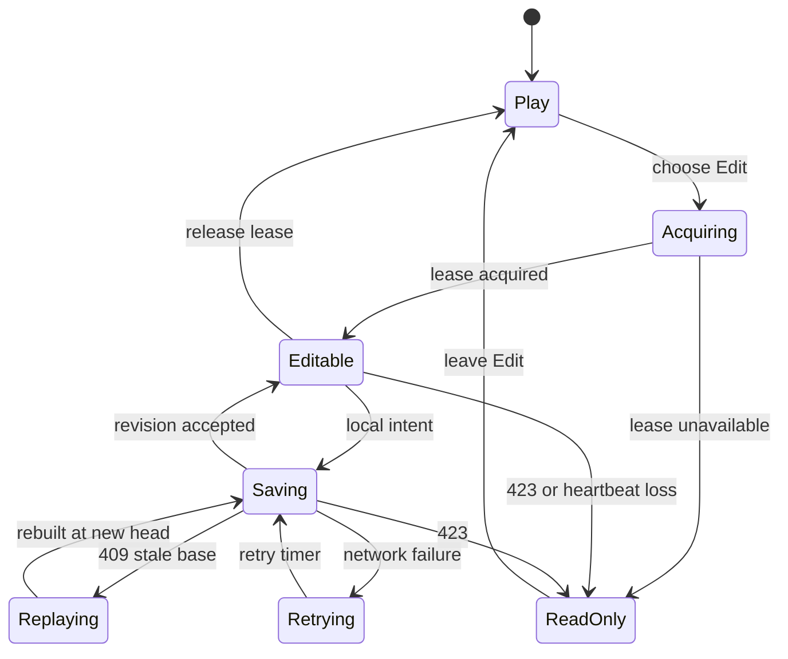
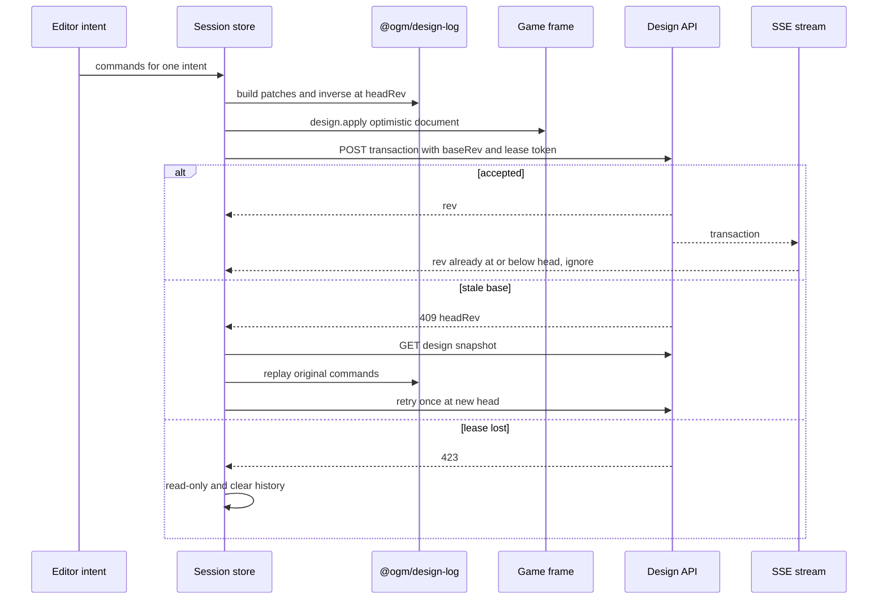

# Game Host and Editor Framework - Plan

## Goal Capsule

- **Objective:** Deliver `/g/:gameId` as the prototype-faithful host for playing and editing a game on a separate origin, with lease-fenced design-log transactions, session undo/redo, manifest-driven editor controls, platform HUD behavior, and a real cross-origin browser fixture.
- **Authority:** Issue #79 and its OGM-075 research contract define behavior; the landed `studio-v0` prototype defines layout, flow, motion, and copy; merged contracts and APIs define executable shapes.
- **Execution profile:** Deep, cross-cutting frontend work across React, `@gm/host`, `@ogm/design-log`, API clients, persistent device preferences, and Playwright.
- **Stop conditions:** Do not redefine consumed contracts, add server routes, redesign the prototype, or weaken origin, lease, payload, or authorization boundaries.
- **Tail ownership:** The implementation owns focused unit and browser tests, package type/lint/build gates, full-diff review, CI handoff, and honest 404 fallbacks for routes owned by later tickets.

---

## Product Contract

### Summary

The game screen hosts the latest branch build in a cross-origin frame and lets a creator move between Play and Edit without leaving the prototype’s established full-screen composition. Edit mode exposes host-owned controls derived from the game manifest and persists each creator intent as a fenced transaction while keeping device-only preferences outside the design log.

### Problem Frame

The existing route is only a placeholder. The reusable foundations now exist, but the web app does not yet coordinate frame security, the branch snapshot, edit lease ownership, optimistic transactions, remote transaction streaming, editor controls, platform HUD behavior, build transitions, or browser evidence as one reliable screen.

### Requirements

**Host and platform behavior**

- R112. `/g/:gameId` reads `v` and `mode`, mounts the branch build through `@gm/host`, preserves the prototype’s Play/Edit bar and full-screen frame, and exposes pause, saves, achievements, settings, draft/published state, and update handling.
  - The host accepts bridge traffic only through `@gm/host`’s configured games origin and shows a retry state when readiness fails instead of leaving a blank frame.
  - Missing later-owned saves, reapply, or published routes hide or skip only that capability and do not prevent play or edit.

**Manifest-driven editing**

- R30. Edit mode renders the rail, palette, inspector, tools, gizmos, hints, scope labels, and snap preferences from the merged manifest and control contracts.
  - Pointer, touch, keyboard, and controller-facing editing actions have equivalent non-drag controls, with 64 px primary and 44 px secondary targets.
  - Device preferences remain outside `DesignDoc`; the game receives only validated `design.apply` payloads and bridge messages.

**Transaction history and collaboration**

- R34. Each creator intent posts one design-log transaction with the current `baseRev` and lease token; a whole drag or stroke is one undo entry, and undo/redo append inverse transactions instead of rewriting history.
  - A 409 reloads the authoritative snapshot and replays the pending command; a 423 transitions the session to read-only and clears local history; a network error remains retryable and reports the truth in the Saved indicator.
  - The transaction stream resumes from `headRev`, applies other-session transactions once, and cannot duplicate the creator’s already-applied optimistic changes.

### Key Flow

- F1. Open and play
  - **Trigger:** A signed-in user opens `/g/:gameId`.
  - **Steps:** Load game metadata and the branch snapshot, mount the snapshot build on the configured games origin, finish the bridge handshake, and forward viewport/settings.
  - **Outcome:** The game is playable or the host presents a retryable load failure.
- F2. Enter edit and save an intent
  - **Trigger:** The creator selects Edit.
  - **Steps:** Acquire the lease, load the working snapshot, send edit mode, optimistically apply one intent, post it with fencing, and reconcile the returned revision.
  - **Outcome:** The effective document and frame agree with the persisted branch head, and Saved reports the actual state.
- F3. Recover from concurrent change or lease loss
  - **Trigger:** A transaction post returns 409 or 423, or the SSE stream delivers another session’s transaction.
  - **Steps:** Rebase and retry once on 409, become read-only on 423, or apply the streamed transaction in revision order.
  - **Outcome:** No silent overwrite, duplicate apply, or false Saved state occurs.
- F4. Adopt a tested build
  - **Trigger:** A job completes and the branch snapshot exposes a new tested build.
  - **Steps:** Fetch the reapply report, show all applicable outcome groups and choices, or switch directly when the route is absent.
  - **Outcome:** The creator sees the consequences before the frame remounts, without blocking on a later-owned route.

### Acceptance Examples

- AE1. Given a 40-step stroke, when the stroke ends, then one transaction is posted and its inverse restores the starting document byte-for-byte.
- AE2. Given a reapply report with 20 carried values, 1 rename, conflicts or choices, and 2 dropped values, when the card renders, then each outcome appears in its correct group and unresolved entries expose a choice.
- AE3. Given a message dispatched from a third origin, when it targets the game frame handshake surface, then the bridge rejects it and the host adapter’s rejected-origin counter increases.
- AE4. Given a 390 by 844 viewport, when the game screen renders, then Play, Edit, Back, and Finish-class actions remain at least 64 px and editor functions remain reachable without drag-only interaction.

### Scope Boundaries

**In scope**

- The web route, host/frame lifecycle, client transaction orchestration, editor framework, platform HUD, build transition UI, update indicator, device preferences, test hook, focused tests, and cross-origin Playwright fixture.

**Deferred to later ticket owners**

- Reapply computation and server-side choice storage, publish/fold and the canonical published route, save storage/outbox, achievement storage, versions/releases/merge screens, room UI, build chat, and network forwarding.

**Out of scope**

- Rendering or camera behavior inside a game, SDK `applyDesign`, bridge transport changes, transaction/lease/SSE server storage, new contracts, new navigation or chrome, and edits to the frozen OGM planning pack or archived prototypes.

### Product Contract Preservation

Product Contract unchanged from OGM-075; the numbered requirements above split its three traced requirements into testable host, editor, and recovery clauses without changing behavior.

---

## Planning Contract

### Key Technical Decisions

- KTD1. **Keep the landed prototype composition.** The game route uses the `studio-v0` Play/Edit bar, full-screen frame, dark glass tokens, motion, and copy rather than introducing a new editor shell. (session-settled: user-directed — chosen over a new editor shell: preserve the landed prototype’s layout, flow, motion, and copy)
- KTD2. **Treat the design snapshot as the bootstrap authority.** `GET /games/:gameId/branches/:branch/design` supplies `doc`, `rev`, and `buildId`; `GET /games/:gameId` supplies title and access-checked metadata. This avoids inventing a branch response the current API does not expose.
- KTD3. **Put transport trust in `@gm/host`.** The screen constructs frames only through `createGameFrame`, passes an explicit `VITE_GAMES_ORIGIN`, and observes `HostBridge.dropped`; a read-only window listener counts wrong-origin message attempts while the game screen is active without parsing or accepting them, and no parallel wildcard `postMessage` path exists.
- KTD4. **Separate pure transaction construction from session effects.** Pure helpers use `@ogm/design-log` to build, replay, coalesce, apply, and invert patches. The Zustand session owns ordering, network retry, history, lease state, stream reconciliation, selection, tool, and Saved status.
- KTD5. **Use command replay for 409 recovery.** The client reloads the snapshot, rebuilds the pending transaction from its original commands, and retries once at the new head. Reusing stale patches would overwrite intervening edits.
- KTD6. **Make lease loss terminal for local edit history.** Any 423 from acquire, heartbeat, release, or transaction posting sets read-only state, clears undo/redo and in-progress gestures, and prevents further writes until Edit is re-entered.
- KTD7. **Represent later-owned features as capability fallbacks.** A 404 from saves, reapply, or published endpoints hides or skips that feature. Other failures remain visible rather than being misreported as absence.
- KTD8. **Use API job state plus branch polling for build transitions.** The existing game-scoped jobs endpoint reports building stages, and the design snapshot identifies a new tested build. The global notification stream may trigger an early refetch, but correctness does not depend on notification delivery.
- KTD9. **Pair entity invoke commands with explicit validated patches.** `makeTransaction` intentionally records `invoke` commands without inventing document patches, so place, delete, and duplicate build explicit entity add/remove patches and exact inverses before `@ogm/design-log` validates and applies them. This keeps the working document, history, and `entity.create`/`entity.delete` command log aligned.

### High-Level Technical Design

The component topology keeps host-owned state and controls outside the untrusted game frame.

```mermaid
flowchart TB
  Route[GameScreen route] --> Queries[Game metadata, jobs, design snapshot]
  Route --> Session[Editor session store]
  Route --> Frame[GameFrame adapter]
  Frame --> Host[@gm/host bridge and origin validation]
  Host --> Iframe[Game build on games origin]
  Session --> Tx[Pure transaction helpers]
  Tx --> Log[@ogm/design-log]
  Session --> Lease[Lease and transaction API]
  Session --> Stream[Branch transaction SSE]
  Session --> Panels[Rail, palette, inspector, tools]
  Session --> Overlay[Canvas and gizmo overlay]
  Queries --> Reapply[Build watcher and reapply card]
  Queries --> Hud[Platform HUD and update indicator]
  Session --> Frame
  Reapply --> Frame
  Hud --> Frame
```

The edit lifecycle makes ownership and Saved state observable.



The transaction sequence prevents stale patches and duplicate stream application.



### Implementation Constraints

- `apps/web/package.json` owns exact workspace dependencies; no root package changes or new third-party dependency is required.
- Manifest extensions not represented in the inferred `GameManifest` type are narrowed locally from bridge data and never redefine the contract family.
- The frame receives `design.apply` only from a successfully parsed server snapshot, a locally generated transaction that passes design-log validation, or a parsed transaction from the authenticated branch stream.
- Device settings and snap preferences use bounded, version-tolerant local storage reads and do not enter `DesignDoc` or undo history.
- The route remains an auto-collected `ScreenRoute`; descendant version and release placeholders remain available for their owning tickets.
- Test-only state is installed only when `?test` is present and exposes the exact `window.__ogmHost.game` fields required by OGM-075.

### Sequencing

U1 establishes typed API and transaction primitives. U2 builds the session lifecycle on those primitives. U3 mounts the secure frame and route shell. U4 and U5 add manifest controls and canvas interaction. U6 and U7 add platform and build lifecycle behavior. U8 proves the integrated flow against a second origin.

### System-Wide Impact

- **Trust boundary:** The browser crosses from the authenticated app origin to a public build origin. Only the existing bridge validates origin, size, rate, and message schema.
- **Persistent truth:** The design log remains authoritative; Zustand and the game frame are projections. Undo/redo append transactions and never mutate server history.
- **Concurrent sessions:** Lease fencing prevents stale writers, while SSE keeps separate sessions current. Revision ordering and optimistic deduplication must be deterministic.
- **Accessibility:** Five focus zones, visible focus, target sizes, reduced motion, semantic mode state, and stepper equivalents are part of the behavior rather than styling polish.
- **Later-ticket seams:** `gameExtras` remains an additive seam for versions/releases/room features, while absent routes are capability fallbacks rather than fake client implementations.

### Risks and Mitigations

- **Iframe overlay steals or loses input:** Edit mode owns pointer capture in a host overlay; Play mode leaves game input to `@gm/host`. Tests cover pick/place and mode changes.
- **StrictMode duplicates effects:** Frame, lease, stream, polling, and timers use idempotent cleanup so development double-mounts do not leak a frame, lease heartbeat, or EventSource.
- **Optimistic update races SSE:** Revisions at or below the reconciled head are ignored, and streamed future revisions are applied in order.
- **Large strokes exceed the bridge or API cap:** Coalescing keeps only the first inverse and final value per patch path; client validation refuses an oversized intent with a visible not-saved reason.
- **Manifest vocabulary is looser than inferred types:** Local parsing defaults missing arrays to empty and ignores unknown fields; controls are never executed as code.
- **Later-owned endpoints are absent on current main:** Exact 404s activate documented fallback behavior, while other statuses remain errors and stay visible.

---

## Implementation Units

### U1. API and Transaction Primitives

- **Goal:** Add the web package dependencies and pure adapters for snapshots, leases, transactions, jobs, saves, published metadata, reapply reports, transaction construction, coalescing, and replay.
- **Requirements:** R34, KTD2, KTD4, KTD5, KTD7, KTD9.
- **Dependencies:** None.
- **Files:** `apps/web/package.json`, `apps/web/src/features/editor/api.ts`, `apps/web/src/features/editor/transactions.ts`, `apps/web/src/features/editor/api.test.ts`, `apps/web/src/features/editor/transactions.test.ts`.
- **Approach:** Consume exported contract types and the existing `api`/`sse` helpers. Preserve original commands for replay, retain the first inverse and final patch per path while coalescing, create explicit entity patch/inverse pairs for place/delete/duplicate invokes, and classify 404, 409, 423, and retryable transport failures explicitly.
- **Patterns to follow:** `apps/web/src/lib/api/client.ts`, `packages/design-log/src/apply.ts`, `services/api/src/design/routes.ts`.
- **Execution note:** Start with failing pure tests for byte-equal inversion, 40-step coalescing, and 409 replay.
- **Test scenarios:**
  - Covers AE1. Build 40 successive set commands for one path, coalesce them, apply the final patches, then apply the inverse and expect the original document byte-for-byte.
  - Build a pending transaction at revision 4, replay its original commands onto a snapshot at revision 7, and expect the rebuilt body to carry `baseRev: 7` without reusing stale patches.
  - Create then undo an entity invoke and expect the create patch plus remove inverse to keep the command log and document byte-equal after inversion.
  - Receive 404, 409, and 423 responses and expect distinct typed results rather than one generic network error.
  - Reject an over-cap transaction before fetch and preserve a visible failure reason.
- **Verification:** Pure helpers produce contract-valid transaction bodies and focused tests prove every response classification and replay invariant.

### U2. Editor Session, Lease, Stream, and History

- **Goal:** Build the Zustand-backed edit lifecycle with honest Saved state, optimistic apply, fencing, retry, session undo/redo, lease heartbeat, and ordered SSE reconciliation.
- **Requirements:** R34, F2, F3, KTD4, KTD5, KTD6.
- **Dependencies:** U1.
- **Files:** `apps/web/src/features/editor/session.ts`, `apps/web/src/features/editor/lease.ts`, `apps/web/src/features/editor/stream.ts`, `apps/web/src/features/editor/session.test.ts`, `apps/web/src/features/editor/lease.test.ts`, `apps/web/src/features/editor/stream.test.ts`.
- **Approach:** Use one store per mounted game/branch session. Serialize writes, rebuild pending commands after a 409, retry transport failures with bounded backoff, append inverses for undo/redo, and tear down lease/stream/timers on mode exit or unmount.
- **Patterns to follow:** `apps/web/src/app/store.ts`, `apps/web/src/lib/notify/feed.ts`, `services/api/src/design/lease.ts`, `services/api/src/design/stream.ts`.
- **Test scenarios:**
  - Covers AE1. End a 40-step stroke and expect one queued post and one undo entry; invoke undo and expect a new inverse post rather than local history rewrite.
  - Return 409 with a newer head, then accept the retry, and expect one snapshot reload, one rebuilt body, and final `saved` state at the accepted revision.
  - Return 423 during a write or heartbeat and expect `readOnly`, empty undo/redo, cancelled gesture state, and no further post.
  - Fail fetch, advance the retry timer, and expect `saving` to become `retrying` and then resend the unchanged intent.
  - Deliver a remote transaction above `headRev` and expect one document/frame apply; deliver a reconciled revision at or below `headRev` and expect no duplicate apply.
  - Mount and unmount twice under StrictMode and expect no surviving timer, lease release duplication, or EventSource.
- **Verification:** Store selectors expose stable `doc`, `headRev`, `saved`, `selection`, tool, and read-only values while lifecycle tests prove cleanup and failure transitions.

### U3. Secure Game Frame and Prototype-Faithful Route Shell

- **Goal:** Replace the placeholder route with the prototype composition, load metadata/snapshot state, mount `@gm/host`, switch Play/Edit modes, and expose the test hook.
- **Requirements:** R112, F1, AE3, KTD1, KTD2, KTD3.
- **Dependencies:** U1, U2.
- **Files:** `apps/web/src/routes/game/route.tsx`, `apps/web/src/routes/game/GameScreen.tsx`, `apps/web/src/routes/game/PlayEditBar.tsx`, `apps/web/src/routes/game/extras.ts`, `apps/web/src/routes/game/game.css`, `apps/web/src/features/editor/frame.ts`, `apps/web/src/features/editor/frame.test.ts`, `apps/web/src/routes/game/GameScreen.test.tsx`.
- **Approach:** Parse `v` and `mode`, query metadata and design snapshot, create exactly one frame for the current build, route all mode/settings/viewport messages through `GameFrame`, and render the prototype’s Games/title/Play/Edit ordering without new chrome or helper copy.
- **Patterns to follow:** `apps/web/src/app/router.tsx`, `apps/web/src/routes/game/route.tsx`, `prototypes/studio-v0/index.html`, `prototypes/studio-v0/app.js`, `packages/host/src/frame.ts`.
- **Test scenarios:**
  - Open without `v` or `mode` and expect branch `main`, Play selected, and the frame created from the snapshot `buildId` on `VITE_GAMES_ORIGIN`.
  - Switch Edit to Play and expect one `mode.set` message plus query state that remains shareable.
  - Covers AE3. Inject a third-origin bridge message and expect no state change plus an incremented dropped count.
  - Let readiness exceed 10 seconds and expect a visible retry control; retry and expect the old frame disposed before a new frame mounts.
  - Navigate Back and expect frame disposal before `/games` navigation.
  - Load with `?test` and expect `window.__ogmHost.game` to report bridge state, revision, Saved state, mode, selection, and dropped messages.
- **Verification:** Component tests match the prototype bar semantics and frame tests prove origin, timeout, cleanup, and mode forwarding.

### U4. Manifest Rail, Palette, Inspector, Tools, Hints, and Preferences

- **Goal:** Render the host editor panels from manifest and design state with exact instance, prefab, and global scope behavior.
- **Requirements:** R30, KTD1.
- **Dependencies:** U2, U3.
- **Files:** `apps/web/src/features/editor/Rail.tsx`, `apps/web/src/features/editor/Palette.tsx`, `apps/web/src/features/editor/Inspector.tsx`, `apps/web/src/features/editor/Tools.tsx`, `apps/web/src/features/editor/HintStrip.tsx`, `apps/web/src/features/editor/SnapPrefs.ts`, `apps/web/src/features/editor/focus.ts`, `apps/web/src/features/editor/editor.css`, `apps/web/src/features/editor/Inspector.test.tsx`, `apps/web/src/features/editor/Palette.test.tsx`, `apps/web/src/features/editor/SnapPrefs.test.ts`.
- **Approach:** Derive selected prefab from `DesignDoc`, map each control widget to bounded native controls, route mutations through session intents, keep pinned global groups visible, and persist snap/grid preferences per game without touching design history.
- **Patterns to follow:** `packages/contracts/src/game.ts`, `apps/web/src/lib/input/focus.tsx`, `apps/web/src/tokens.css`.
- **Test scenarios:**
  - Select a skeleton and render a prefab-scope control, then expect “All skeletons” and a command targeting every matching entity; render instance scope and expect “This skeleton” with only the selected id.
  - Render a choice with four options and expect segmented controls; render five and expect a select.
  - Render a pinned global group with no selection and expect it to remain visible.
  - Change snap/grid, inspect the document and undo stack, and expect both unchanged while versioned device storage updates.
  - Press a count-instance decrement at its boundary and expect no invalid transaction.
- **Verification:** Focused component tests cover every manifest category kind, widget family used by acceptance, scope label, and device-only preference boundary.

### U5. Canvas Placement, Selection, Strokes, and Gizmos

- **Goal:** Add host-owned canvas interaction with pick, placement validation, snapped ghost state, coalesced drags/strokes, gizmos, reticle controls, and non-drag equivalents.
- **Requirements:** R30, R34, AE1, AE4, KTD9.
- **Dependencies:** U2, U3, U4.
- **Files:** `apps/web/src/features/editor/canvas.ts`, `apps/web/src/features/editor/GizmoOverlay.tsx`, `apps/web/src/features/editor/canvas.test.ts`, `apps/web/src/features/editor/GizmoOverlay.test.tsx`.
- **Approach:** Enable pointer capture only in Edit, normalize frame coordinates, throttle placement validation, listen for pick/placement/screen bridge replies, and translate one gesture into one session stroke. Placement, deletion, and duplication use the entity patch helpers from U1. Render stepper buttons for every gizmo operation so drag is never the only path.
- **Patterns to follow:** `packages/host/src/overlay.ts`, `packages/contracts/src/bridge.ts`, `packages/contracts/src/game.ts`.
- **Test scenarios:**
  - Pick at a normalized coordinate and expect the returned targets to become selection and one `editor.select` acknowledgement.
  - Drag a palette item through invalid then valid positions and expect a red then valid ghost, with one placement transaction only on the valid drop.
  - Move a translate gizmo through 40 pointer events and expect one coalesced transaction on release.
  - Enable snap at grid 1 and place at 2.4, then expect the validated pose to use 2.
  - Use the keyboard/controller stepper equivalent and expect the same bounded command as a drag.
- **Verification:** Pure coordinate/gesture tests and component interaction tests prove throttling, snapping, one-intent history, and equivalent controls.

### U6. Platform HUD, Saves, Achievements, and Settings

- **Goal:** Add the prototype-compatible pause overlay and host-owned platform features without obscuring the game or fabricating absent server capabilities.
- **Requirements:** R112, AE4, KTD7.
- **Dependencies:** U3.
- **Files:** `apps/web/src/routes/game/PlatformHud.tsx`, `apps/web/src/features/editor/hud/saves.ts`, `apps/web/src/features/editor/hud/achievements.ts`, `apps/web/src/features/editor/hud/settings.ts`, `apps/web/src/features/editor/hud/saves.test.ts`, `apps/web/src/features/editor/hud/achievements.test.ts`, `apps/web/src/features/editor/hud/settings.test.ts`, `apps/web/src/routes/game/PlatformHud.test.tsx`.
- **Approach:** Pause/resume through the bridge, handle game-emitted save writes and host-initiated restores, suffix draft achievement toasts with “(test)”, and persist bounded settings with a reduced-motion default.
- **Patterns to follow:** `packages/contracts/src/saves.ts`, `packages/host/src/settings.ts`, `apps/web/src/lib/notify/slice.ts`.
- **Test scenarios:**
  - Pause and resume, then expect one lifecycle message per action and a modal overlay that returns focus.
  - Return 404 from the saves route and expect slot controls hidden; return slots and expect auto plus 1–3 in contract order.
  - Receive `save.write` and expect identity-free game payload to be stored with the selected host slot and concurrency header.
  - Receive a draft achievement event and expect a “(test)” toast without an achievement-storage call.
  - Load malformed settings storage and expect safe defaults; load first-time reduced-motion media and expect `reduceMotion: true` forwarded on ready.
- **Verification:** HUD tests prove exact bridge messages, fallback behavior, device persistence, and target sizes.

### U7. Build Status, Reapply Card, and Published Update Indicator

- **Goal:** Keep editing usable during a job, present reapply consequences before adopting a tested build, and expose published updates without making later-owned routes mandatory.
- **Requirements:** R112, F4, AE2, KTD7, KTD8.
- **Dependencies:** U1, U2, U3.
- **Files:** `apps/web/src/features/editor/builds.ts`, `apps/web/src/features/editor/ReapplyCard.tsx`, `apps/web/src/routes/game/UpdateIndicator.tsx`, `apps/web/src/features/editor/builds.test.ts`, `apps/web/src/features/editor/ReapplyCard.test.tsx`, `apps/web/src/routes/game/UpdateIndicator.test.tsx`.
- **Approach:** Poll game-scoped jobs while active and refetch the snapshot when a build becomes ready. Fetch reapply details for a changed build, classify all five report groups, submit required choices to the later-owned route, and remount only after confirmation; 404 switches directly. Poll published metadata with ETags every 60 seconds and on visibility return, hiding only on 404.
- **Patterns to follow:** `services/api/src/jobs/routes.ts`, `packages/contracts/src/design-log.ts`, `apps/web/src/lib/notify/feed.ts`.
- **Test scenarios:**
  - Render the AE2 report and expect 20 carried, 1 renamed, 2 dropped, plus each choice/conflict row in its correct group.
  - Detect a new build, return 404 from reapply, and expect an immediate frame remount without a card.
  - Detect an active job stage and expect the top bar’s existing build-state affordance to update without disabling edit.
  - Poll the same ETag and expect no update indicator; poll a changed ETag and expect one 44 px action.
  - Dispatch `visibilitychange` to visible and expect an immediate conditional published request.
- **Verification:** Focused tests cover each report group, exact 404 fallback, active-job display, ETag behavior, and frame switch timing.

### U8. Cross-Origin Fixture and Browser Acceptance

- **Goal:** Prove the integrated route against a real fixture on port 10001 with desktop and phone projects.
- **Requirements:** R30, R34, R112, AE1, AE3, AE4.
- **Dependencies:** U2, U3, U4, U5, U6, U7.
- **Files:** `apps/web/e2e/fixtures/bridge-game/index.html`, `apps/web/e2e/support/serve-bridge-game.ts`, `apps/web/e2e/support/mock-game-api.ts`, `apps/web/e2e/game-editor.spec.ts`, `apps/web/playwright.config.ts`.
- **Approach:** Serve a hand-written protocol fixture on `127.0.0.1:10001`, mock only authenticated app API calls, retain the real iframe transport, and use the test hook for state assertions. Keep the fixture contract-focused and independent of product rendering.
- **Patterns to follow:** `apps/web/e2e/smoke.spec.ts`, `apps/web/e2e/support/gpu.ts`, `packages/host/test/stub-game/main.ts`, `apps/web/playwright.config.ts`.
- **Test scenarios:**
  - Complete `hello`/`ready` across the second origin and expect `bridgeState: ready` within five seconds.
  - Dispatch a third-origin envelope and expect the dropped counter to change while selection and revision remain unchanged.
  - Place one palette item and expect one transaction with the current head; undo and expect one inverse transaction; switch to Play and expect `mode.set` in the fixture log.
  - Script 409 then success and expect the second post at the refreshed head; script 423 and expect read-only controls.
  - Covers AE4. Measure primary targets at 390 by 844 and expect each to be at least 64 px with the canvas and inspector still reachable.
- **Verification:** The focused Playwright spec passes for desktop and phone with GPU flags and uses a distinct iframe origin rather than a mocked same-origin transport.

---

## Verification Contract

| Gate | Command | Coverage | Done signal |
|---|---|---|---|
| Editor unit behavior | `pnpm --filter @ogm/web test -- features/editor routes/game` | U1–U7, R30/R34/R112 failure and recovery paths | Focused Vitest files pass; every new behavior test is shown to fail without its production change |
| Cross-origin browser acceptance | `pnpm --filter @ogm/web e2e -- game-editor` | U8, handshake, third-origin drop, transaction/undo/mode, mobile target sizes | Desktop and phone projects pass with the fixture on port 10001 and configured Chromium GPU flags |
| Workspace types | `pnpm typecheck` | Contract consumption and package references | All workspace typechecks pass |
| Workspace lint/format | `pnpm lint` | Source, e2e, repository formatting, and ignore rules | All package lint scripts and repository checks pass |
| Workspace tests | `pnpm test` | Dependency/config changes plus all repository behavior | The full workspace test suite passes |
| Workspace build | `pnpm build` | Bundler resolution and package graph | The full workspace build passes |

The configured local-test policy is partial, but this ticket changes a package dependency surface and browser test configuration. The full repository lint, typecheck, test, and build gates therefore run locally in addition to the focused editor and browser checks. CI remains authoritative for the required-check set.

---

## Definition of Done

- `/g/:gameId` boots the requested branch and mode from access-checked metadata and snapshot state, mounts only through `@gm/host`, and preserves the prototype design.
- Play/Edit, frame timeout/retry, settings/viewport forwarding, origin drops, cleanup, and the `?test` hook are covered.
- Edit acquires and heartbeats a lease, posts one transaction per intent, replays after 409, becomes read-only after 423, streams remote transactions, and reports Saved truthfully.
- Undo/redo append inverse transactions, and a 40-step stroke is one history entry whose inverse restores the starting document byte-for-byte.
- Manifest-driven rail, palette, inspector, tools, hints, snap preferences, canvas interaction, gizmos, focus zones, target sizes, reduced motion, and non-drag controls are implemented without redefining contracts.
- Pause, save capability detection, draft achievement toasts, settings, build status, reapply grouping/fallback, and ETag update polling behave as specified.
- The second-origin Playwright fixture proves handshake, origin rejection, transaction, undo, mode switching, and phone target sizes.
- Focused tests, workspace typecheck/lint, web build, full-diff code review, and CI evidence are recorded accurately; abandoned experiments, debug hooks outside `?test`, and dead code are removed.
