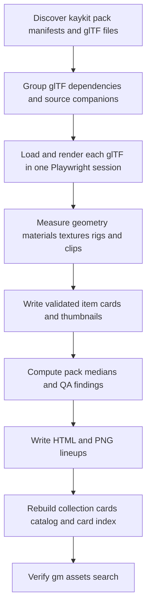

# KayKit Complete v7 Preprocessing - Plan

## Goal Capsule

- **Objective:** Make every glTF model in the 23-pack KayKit Complete v7 bundle discoverable and usable without opening source files by generating validated cards, measurements, rig and animation metadata, thumbnails, lineups, and compatibility metadata.
- **Authority:** GitHub issue #148 is the product contract. Repository rules govern package ownership, validation, generated asset handling, and PR evidence.
- **Execution profile:** Build deterministic, rerunnable tooling and test it against compact fixtures. Run the 23-pack preprocessing only on a host that has `assets-local/bundles/kaykit-complete/7/bundle.json` and the imported packs.
- **Stop conditions:** Do not commit anything under `assets-local/`, do not invent results from an unavailable library, do not duplicate #41's style-family implementation, and do not block per-model thumbnails on #143's scene renderer.
- **Tail ownership:** The implementation owns focused tests, repository gates, a full-diff code review, PR evidence, and exact post-deploy commands for the real library run.

---

## Product Contract

### Summary

KayKit Complete v7 already supplies glTF plus source formats, textures, and animation packs, but agents cannot inspect the library efficiently from filenames alone.
This change turns the imported bytes into the existing C3 card and CLI surfaces while preserving glTF as the single canonical item for each model.

### Problem Frame

`build_collection_cards.py` can create a pack-level draft card, but no current tool validates each KayKit glTF, measures its geometry, groups FBX and OBJ variants, inventories referenced textures, identifies compatible rigs, renders thumbnails, or creates model lineups.
The workspace also lacks the private `assets-local/` library, so correctness must be established with fixtures and the real run must remain an explicit post-deploy check.

### Requirements

**Cards and rights**

- R1. The canonical licence table recognizes KayKit as `CC0-1.0` with `License.txt` as the reference, and collection-card generation handles every `kaykit-*` pack.
- R2. Each discovered glTF produces exactly one item card whose source files include the glTF, its buffers and referenced textures, plus matching FBX and OBJ files as companion variants rather than separate assets.
- R3. Every item card records validated geometry facts, bounds, pivot classification, material and texture names, and rig metadata when present; models above OGM-026's 300,000-triangle mobile scene budget carry the existing `oversized-for-mobile` flag.

**Animations and visual previews**

- R4. Character Animations, Adventurers, and Skeletons cards list every clip with its name, duration, canonical action, loop behavior, and target `rig_id`; characters that share the rig carry that same id and are discoverable with `--same-rig-as`.
- R5. A reusable headless three.js renderer writes one fixed-camera three-quarter PNG per model and produces `lineup.png` plus a labelled HTML lineup for every pack.

**Compatibility, QA, and search**

- R6. KayKit cards inherit one curated set id and compatibility list, and #41's `style-families.json` represents all 23 packs without duplicating #41's schema or loader work.
- R7. The preprocessing run writes a deterministic KayKit QA report covering load failures, suspect pivots, scale outliers, missing variants, and missing previews.
- R8. Rebuilding the card index makes KayKit models discoverable through `gm assets search`, including family-filtered searches.

### Acceptance Examples

- AE1. Given a model with `Models/gltf/barrel.gltf`, `Models/fbx/barrel.fbx`, an external buffer, and an atlas texture, when preprocessing runs, then one barrel card names all five relevant files and no FBX- or OBJ-only barrel card exists.
- AE2. Given two character glTF files with the same bone names and parent links, when preprocessing runs, then both cards carry the same `rig_id` and `gm assets search --same-rig-as <card-id>` returns both.
- AE3. Given a glTF that three.js cannot load, when preprocessing runs, then no successful measurement is fabricated, the model is named in the QA report, and the overall command exits non-zero after completing the remaining models.
- AE4. Given the real KayKit library is absent, when local validation runs, then fixture tests pass and the PR records the exact real-library commands as post-deploy checks without claiming they ran.

### Scope Boundaries

- The glTF is authoritative; source FBX, OBJ, blend, and related material files are companions only.
- The renderer creates per-model previews and pack lineups, not #143's curated thumbnail scene.
- No source asset, generated thumbnail, item card, lineup, catalog, or index under `assets-local/` is committed.
- No paid service, remote model, or provider key is used.
- Existing contract families are reused. Contract schema changes belong only to the already-declared #41 dependency when needed for `describe.set` and `compatible_with`.

---

## Planning Contract

### Key Technical Decisions

- KTD1. Use one Python orchestrator under `scripts/assets/` for deterministic discovery, hashing, card assembly, QA, and HTML generation because the existing asset migrations and fixture tests already use isolated standard-library Python.
- KTD2. Use one long-lived Playwright Chromium process with three.js for validation and rendering, then use Sharp to compose bounded screenshot tiles into one lineup because browser `GLTFLoader` resolves external buffers and textures exactly as the product renderer does and avoids one browser launch per model.
- KTD3. Derive `rig_id` from sorted bone names plus parent links and derive clip canonical names and loop defaults from a documented synonym table, matching the existing C3 contract.
- KTD4. Classify pivot and scale anomalies from measured bounds and per-pack medians, then surface findings rather than mutating source transforms.
- KTD5. Keep compatibility curation separate from measurement: code records polycount band, flat-atlas texture style, and scale evidence; the style-family data records the human visual judgment required by Kevin's rule.
- KTD6. Preserve generated outputs under `assets-local/` and commit only tooling, tests, the licence alias, style-family curation after #41 is ready, and the generated QA notes required by the ticket.

### High-Level Technical Design

### Constraints and Sequencing

- #41 owns the style-family schema and data file. Independent preprocessing code and tests proceed first; only the KayKit data entry is integrated after #41 emits readiness or merges.
- #143 may later supply a shared scene-rendering primitive. This ticket keeps its model renderer small and reusable but does not wait for the pilot.
- The browser server binds only to `127.0.0.1`, rejects path traversal, and serves only the selected extracted pack root plus pinned local three.js modules.
- The real run is intentionally outside the agent workspace because `assets-local/` is absent and must remain uncommitted.

### Risks and Dependencies

- A 28,000-file library can make naive repeated scans and browser launches prohibitively slow. Discovery scans each pack once and rendering reuses one browser context.
- KayKit folder naming may not align glTF, FBX, and OBJ variants perfectly. Grouping normalizes known format-directory segments and reports ambiguous or missing matches.
- glTF animation data has no universal loop flag. A checked-in mapping handles known one-shot actions and defaults locomotion and idle actions to looping; unknown clips are marked for QA.
- Extremely large lineups can exceed browser screenshot dimensions. The renderer screenshots bounded pages and composes them vertically with Sharp, which is already pinned in the workspace.
- #41 may revise the style-set shape during rework. KayKit integration follows its final exported schema rather than the currently observed draft branch.

---

## Implementation Units

### U1. Licence and collection-card compatibility

- **Goal:** Make the existing collection migration recognize KayKit and preserve stable KayKit collection metadata.
- **Requirements:** R1.
- **Files:** Modify `packages/asset-cards/src/licenses.ts`, `packages/asset-cards/data/licenses.json`, `scripts/assets/build_collection_cards.py`, and `scripts/assets/test_build_collection_cards.py` only where current generic behavior needs KayKit-specific coverage.
- **Approach:** Add the KayKit vendor alias to the CC0 row, regenerate the emitted JSON, and add a fixture pack proving the generic writer produces a CC0 collection card with model counts and stable reruns.
- **Test scenarios:** The alias resolves case-insensitively; a KayKit pack validates; a second collection-card run is byte-identical; an unknown licence still fails closed.
- **Verification:** `pnpm --filter @ogm/asset-cards test`.

### U2. Headless glTF analyzer and renderer

- **Goal:** Load each canonical glTF through three.js once, return machine-readable measurements, and write deterministic thumbnails.
- **Requirements:** R3, R4, R5, R7.
- **Files:** Create `apps/web/tools/render-gltf.mjs`, `apps/web/tools/render-gltf-page.html`, and focused tests/fixtures under `apps/web/tools/`; modify `apps/web/package.json` and `pnpm-lock.yaml` only to declare the already-pinned `three` and `sharp` versions.
- **Approach:** Start a loopback-only static server, launch pinned Playwright Chromium with repository GPU flags, reuse one page, load models through `GLTFLoader`, traverse meshes and skeletons, frame a neutral three-quarter camera from bounds, and capture transparent-disabled PNG output.
- **Test scenarios:** An embedded triangle glTF returns one triangle and correct bounds; an external-buffer glTF resolves through the server; a malformed glTF yields a structured failure; two repeated jobs reuse one browser; traversal attempts receive 404; a PNG is written at the requested size.
- **Verification:** `pnpm --filter @ogm/web test -- render-gltf` and one direct fixture CLI invocation.

### U3. KayKit preprocessing orchestration

- **Goal:** Convert analyzer results into canonical cards, rig-sharing metadata, QA notes, and pack lineups.
- **Requirements:** R2, R3, R4, R5, R7, R8.
- **Files:** Create `scripts/assets/preprocess_kaykit.py`, `scripts/assets/test_preprocess_kaykit.py`, and compact fixtures under `scripts/assets/testdata/kaykit/`; update `docs/plans/ogm-v1-build/asset-qa/kaykit.md` only with generated real-run findings.
- **Approach:** Discover current extracted versions, normalize relative model keys across format directories, parse glTF JSON dependencies, hash every source file, batch analyzer jobs, compute rig signatures and clip mappings, validate cards before atomic writes, derive pack-relative median scale findings, generate accessible lineup HTML, and request a bounded composite screenshot from the renderer.
- **Test scenarios:** Canonical grouping includes glTF/bin/textures plus source companions; cards pass the contract validator; same-rig characters share an id; one-shot and looping clip names map correctly; failures and scale/pivot outliers appear in stable QA Markdown; reruns do not rewrite unchanged cards; missing assets root fails with an actionable message.
- **Verification:** `python3 -I scripts/assets/test_preprocess_kaykit.py` and `pnpm --filter @ogm/asset-cards test`.

### U4. Style-family and catalog integration

- **Goal:** Add the complete KayKit set to #41's final compatibility model and prove CLI discovery on the real library.
- **Requirements:** R6, R8.
- **Files:** Modify `packages/asset-cards/data/style-families.json` and the relevant #41 tests after the blocker is ready; do not recreate its schema or loader.
- **Approach:** Add all 23 pack ids as one `kaykit` set with measured traits and the visually confirmed compatibility links to Synty POLYGON, Kenney 3D, and Quaternius candidates. Rebuild cards, catalog, and index before running the ticket's search examples.
- **Test scenarios:** The final family schema accepts the set; every KayKit pack id exists in the catalog fixture; no pack appears in two families; every `compatible_with` id exists; family-filtered search includes the expected KayKit models.
- **Verification:** `pnpm --filter @ogm/asset-cards test` plus the post-deploy catalog and `gm assets search` checks.

---

## Verification Contract

| Gate | Applicability | Command or evidence | Done signal |
|---|---|---|---|
| Python preprocessing behavior | U1, U3 | `python3 -I scripts/assets/test_build_collection_cards.py` and `python3 -I scripts/assets/test_preprocess_kaykit.py` | All fixture tests pass and each new test fails without its production behavior. |
| Browser renderer behavior | U2 | `pnpm --filter @ogm/web test -- render-gltf` | Analyzer, sandboxing, and screenshot cases pass with pinned Chromium. |
| Asset-card behavior | U1, U3, U4 | `pnpm --filter @ogm/asset-cards test` | Licence, validation, indexing, and family tests pass. |
| Workspace static gates | All | `pnpm lint`, `pnpm typecheck`, and `pnpm build` | Commands exit 0. |
| Workspace tests | Dependency/runtime changes | `pnpm test` | Full suite exits 0 because package and lockfile surfaces changed. |
| Real KayKit generation | U3, U4 | Post-deploy run against `assets-local/bundles/kaykit-complete/7/bundle.json` | 23 collection cards and lineups exist; every glTF has one card and thumbnail; QA lists all failures; index has no KayKit card errors. |
| CLI discovery | U4 | Post-deploy `gm assets search skeleton` and `gm assets search barrel --family chunky-low-poly` | Both commands return KayKit hits with preview and compatibility metadata. |

---

## Definition of Done

- R1-R8 are implemented or explicitly represented by an honest post-deploy check when private assets are required.
- Every committed fixture-derived card validates against `@ogm/contracts` and every real-run card is validated before write.
- The renderer is deterministic, loopback-only, rerunnable, and uses no paid or remote service.
- The PR contains no `assets-local/` paths, generated bytes, source assets, keys, serials, or download links.
- #41's final style-family shape is used without duplicating blocker-owned implementation.
- The full branch diff has no blocking `ce-code-review` findings.
- Abandoned experiments, temporary stubs, and generated local files are absent from the final diff.
