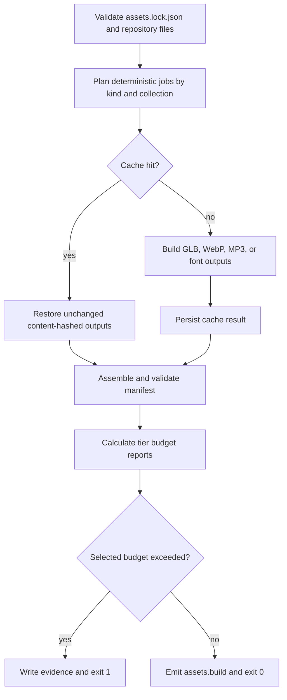

# Asset Build Pipeline - Plan

## Goal Capsule

- **Objective:** Add `gm build assets` so a valid game lock produces deterministic, tiered, content-hashed runtime assets, a schema-valid manifest, cache reuse, and an enforceable mobile budget.
- **Authority:** The OGM-063 ticket and frozen research define behavior; the existing CLI, lock, and manifest contracts define integration details.
- **Stop conditions:** Do not change the manifest contract, runtime loader, pack import, or frozen OGM V1 planning pack.
- **Execution profile:** Build and test within `@ogm/gm-cli`; pin direct build dependencies already present in the workspace lockfile.
- **Tail ownership:** This change owns generated artifacts and budget evidence. Ticket #182 owns adding card metadata to the lock and typed manifest contract.

---

## Product Contract

### Summary

`gm build assets` validates `assets.lock.json`, transforms supported source kinds into runtime formats, writes `public/assets/manifest.json`, and refuses over-budget mobile builds while preserving deterministic outputs and cache hits.

### Problem Frame

Game repositories currently carry source assets but have no build step that reduces requests, creates device tiers, embeds compression, or gives the runtime authoritative file names. The build must operate only on repository-owned lock entries and preserve their licence decisions.

### Requirements

**Build outputs**

- R1. A successful build writes content-hashed GLB, WebP, MP3, or font files plus a manifest accepted by `assetManifestSchema`.
- R2. Kit models in one collection share a meshopt-compressed GLB with one named mesh and bounds per asset, while non-kit models produce desktop, mobile, and low files with decreasing triangle counts.
- R3. Pixel-art and sprite WebP conversion preserves source dimensions, audio uses the ticket's ffmpeg recipe, fonts are copied, and every manifest asset carries the lockfile licence mapping.

**Determinism and compatibility**

- R4. Identical inputs and recipes produce stable file names, and a second build restores results from `.gm/cache/assets` without rewriting unchanged outputs.
- R5. If a lock entry contains optional `meta`, the manifest writer carries the value unchanged; downstream interpretation remains outside this ticket.
- R6. `--ktx2` exits with usage code 2 and names `toktx` when the executable is unavailable.

**Budgets and failures**

- R7. The build reports bytes, file count, triangles, GPU texture memory, and maximum texture size per tier.
- R8. A mobile build exits 1 and identifies every exceeded limit for 2 MiB download bytes, 30 files, 300,000 triangles, 100 MiB GPU textures, and 1,024-pixel textures.
- R9. A corrupt asset is identified after independent jobs finish, the command exits 1 without replacing the manifest, and `--strict` instead stops at the first asset failure.

### Scope Boundaries

- The runtime loader, tier selection, frame-time downgrade, and verify browser flow remain outside this change.
- KTX2 encoding, Draco, FBX conversion, pack import normalization, and edits to `packages/contracts/src/assets.ts` remain outside this change.
- Generated files stay under the selected repository output directory and `.gm/cache/assets`; the build never reads `assets-local/`.

---

## Planning Contract

### Key Technical Decisions

- KTD1. Reuse the existing command scanner with `packages/gm-cli/src/commands/build/assets.ts`; place implementation modules below `commands/build/assets/`, which the scanner ignores as helpers.
- KTD2. Treat the parsed lock as the only source of ids, paths, licences, rights, and optional metadata. Infer media kind from repository paths, and inspect locked GLBs for triangle counts, rigs, and shared texture hashes when planning kit groups rather than reaching back into `assets-local/`.
- KTD3. Cache complete job results by combined source digest and a stable recipe digest containing tool versions and tier settings. Unchanged writes compare bytes first so cache restoration preserves mtimes.
- KTD4. Keep budget calculation pure over the assembled manifest plus build-only texture measurements, then write one stable report beside the manifest and use the same object for CLI output and the gate.

### High-Level Technical Design

### Risks and Dependencies

- glTF Transform 4.5.1 defers meshopt encoding until write time, so the shared `NodeIO` must register both the extension set and meshoptimizer encoder/decoder dependencies.
- Simplification cannot guarantee an exact ratio for every topology; tests use a simplifiable grid and assert monotonic output rather than exact counts.
- ffmpeg is a host executable. The audio test has an explicit named skip when it is absent, while other asset cases still run.
- Ticket #182 may add typed metadata later. This implementation isolates pass-through to one manifest field so that follow-up remains additive.

---

## Implementation Units

### U1. Deterministic planning, cache, and shared build types

- **Goal:** Convert the lock into safe, stable build jobs and reusable cached results.
- **Requirements:** R4, R5, R9; KTD2, KTD3.
- **Files:** `packages/gm-cli/src/commands/build/assets/plan.ts`, `packages/gm-cli/src/commands/build/assets/cache.ts`, `packages/gm-cli/src/commands/build/assets/types.ts`, `packages/gm-cli/src/commands/build/assets/files.ts`.
- **Approach:** Validate repository-contained paths, classify supported extensions, inspect GLB geometry for kit eligibility, group small unrigged models with a shared texture by collection, hash all job inputs plus the stable recipe, and avoid replacing byte-identical files.
- **Test scenarios:** Two small unrigged models with the same texture form one kit job; a larger model and media entries form separate jobs; optional metadata survives planning by reference-equivalent JSON; a second build leaves output mtimes unchanged; an unsafe output path is refused.
- **Verification:** Covered by `packages/gm-cli/test/build-assets.test.ts` and package typecheck.

### U2. Geometry and media builders

- **Goal:** Produce compressed GLB tiers and shared WebP, MP3, and font outputs.
- **Requirements:** R1, R2, R3, R6; KTD3.
- **Files:** `packages/gm-cli/src/commands/build/assets/gltf.ts`, `packages/gm-cli/src/commands/build/assets/kit.ts`, `packages/gm-cli/src/commands/build/assets/model.ts`, `packages/gm-cli/src/commands/build/assets/image.ts`, `packages/gm-cli/src/commands/build/assets/audio.ts`, `packages/gm-cli/src/commands/build/assets/font.ts`.
- **Approach:** Use one registered glTF I/O configuration; merge and name kit meshes before meshopt; independently transform model tiers; preserve sprite dimensions through sharp; invoke ffmpeg with an argument array; content-hash encoded bytes before naming.
- **Test scenarios:** A two-model kit yields one GLB with both ids as mesh names and meshopt required; a grid model has decreasing tier triangles; a sprite WebP retains dimensions; WAV produces MP3 when ffmpeg exists; `--ktx2` names the missing tool.
- **Verification:** Inspect generated GLBs with glTF Transform and generated images with sharp in `packages/gm-cli/test/build-assets.test.ts`.

### U3. Manifest, budgets, and CLI orchestration

- **Goal:** Expose the complete build through the existing CLI contract.
- **Requirements:** R1, R4, R5, R7, R8, R9; KTD1, KTD4.
- **Files:** `packages/gm-cli/src/commands/build/assets.ts`, `packages/gm-cli/src/commands/build/assets/manifest.ts`, `packages/gm-cli/src/commands/build/assets/budget.ts`, `packages/gm-cli/test/build-assets.test.ts`, `packages/gm-cli/package.json`, `pnpm-lock.yaml`.
- **Approach:** Run the existing asset check first, parse flags, execute jobs with strict or partial failure handling, validate the stable manifest, write budget evidence, emit `assets.build`, and choose the exit code from the selected budget report.
- **Test scenarios:** The fixture game builds end to end and validates; licences and metadata match the lock; a large image reports both byte and texture-size excess; JSON output and the activity event carry the same report summary; a corrupt GLB lets independent jobs finish without replacing the manifest, while `--strict` stops immediately.
- **Verification:** Run the focused package test, package build, and workspace typecheck selected by the ticket.

---

## Verification Contract

| Gate | Command | Done signal |
|---|---|---|
| Focused behavior | `pnpm --filter @ogm/gm-cli test -- build-assets.test.ts` | All build pipeline scenarios pass; audio is explicitly skipped only when ffmpeg is absent. |
| Package suite | `pnpm --filter @ogm/gm-cli test` | Existing and new CLI tests pass. |
| Package build | `pnpm --filter @ogm/gm-cli build` | TypeScript project build succeeds. |
| Workspace contracts | `pnpm -r typecheck` | All workspace typechecks succeed. |

---

## Definition of Done

- U1-U3 are implemented without changing the frozen planning pack or manifest contract.
- Every generated manifest validates, every referenced file exists, and recorded byte sizes equal disk sizes.
- Cache reuse preserves output mtimes for identical inputs and recipes.
- The mobile budget failure lists every exceeded metric and exits 1 after writing evidence.
- The focused tests fail when their production behavior is removed, all selected validation passes, and abandoned experimental code is absent from the diff.
