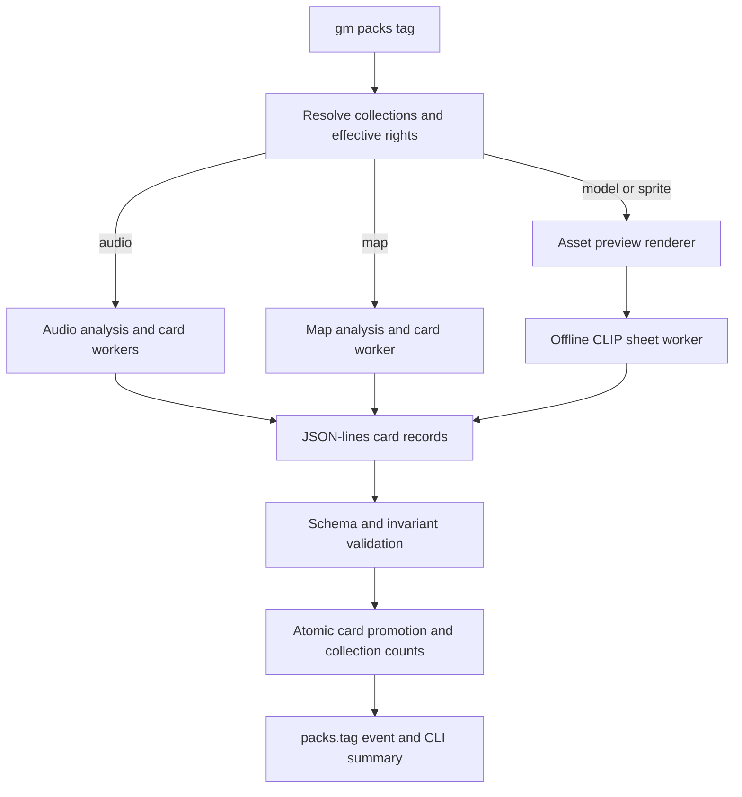
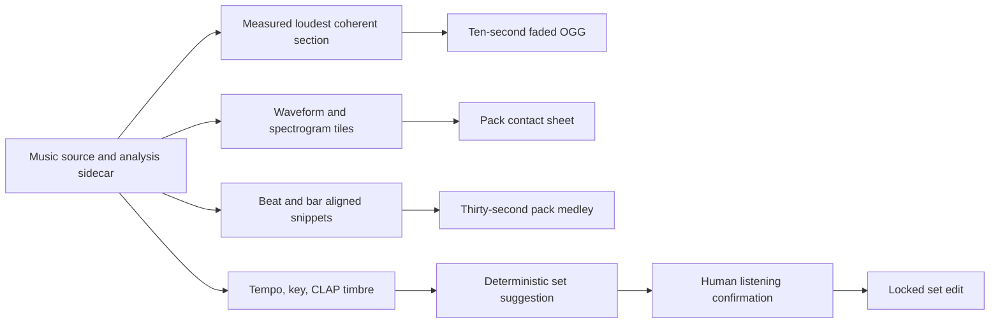

# Local Asset Taggers and Audio Preview Tiers - Plan

## Goal Capsule

- **Objective:** Ship one offline `gm packs tag` pipeline for audio, maps, models, and sprites, including searchable audio cards, audio preview tiers, deterministic compatibility sets, rendered contact sheets, and local CLIP tagging.
- **Authority:** GitHub issue #77 and its repository-owner comments define product behavior; the frozen OGM-065 research plan and the music preprocessing plan define the technical baseline; repository instructions and current contracts override refreshable path details.
- **Execution profile:** Cross-cutting TypeScript and Python work with local models, browser rendering, strict rights checks, bounded concurrency, atomic card writes, and no paid or hosted services.
- **Stop conditions:** Do not publish raw assets, previews, or calibration audio; do not download model weights during a run; do not ship a temporary OGM-064 stub; do not mark the PR ready while direct blocker #76 is unmerged unless Aiur has repaired the dependency state.
- **Tail ownership:** The implementation owns focused and repository-wide automated gates, full-diff review, PR evidence, and exact post-deploy steps for unavailable private packs and human listening.

---

## Product Contract

### Summary

Add a local-only tagging command that preserves the existing audio and map measurements, renders model and sprite sheets, validates every promoted card, and produces bounded machine-readable progress. Extend the audio pass with searchable human hints, ten-second track previews, a pack waveform/spectrogram sheet, a pack medley, and measured compatibility-set suggestions that a human confirms by listening.

### Problem Frame

Agents choose assets from C3 cards rather than opening source files. The repository already has strong audio and map workers, measured model and sprite cards, card search, and safe intake, but there is no single command that runs those taggers, no local contact-sheet tagger for visual assets, and no preview package for model sheets.

The first intended audio target is a private Drive pack of about 46 dark retro WAV chiptune tracks. The pack is imported outside Git under `assets-local/packs/drive-barbarian-chiptune/`, but private assets are not mounted in this issue workspace. The implementation must therefore prove behavior with generated fixtures and record the real-pack run and listening pass as post-deploy checks.

### Requirements

#### Worker and orchestration contract

- R1. `gm packs tag --kind audio|map|model|sprite` accepts `--only`, `--workers`, `--limit`, and `--json`, streams worker records, validates every written card, updates collection counts, and emits `packs.tag` activity.
- R2. Audio and map workers add a JSON mode without changing existing measurements, label vocabularies, or lift thresholds; U1 keeps existing per-card content unchanged, while U3 deliberately extends audio cards with the new hints, previews, and compatibility suggestions. Per-card records carry `card`, `status`, and `flags`, while summaries go to stderr.
- R3. Every worker runs through `nice -n 10`, receives an allowlisted environment containing only the required paths plus offline model flags and no provider credential, and uses at most `max(1, floor(logical cores / 3))` workers.

#### Visual tagging

- R4. Models receive deterministic six-view WebP sheets and collection sheets; sprites receive nearest-neighbour WebP sheets for pixel art; previews use the public or private prefix implied by effective redistribution rights.
- R5. The sheet tagger runs CLIP ViT-L/14 from the local cache, lift-ranks only C3 enum labels, derives open-vocabulary objects only from filenames, preserves locked fields, reports confidence, and never changes rights, license, or source fields.

#### Audio cards and preview tiers

- R6. Audio cards remain searchable by measured and judged fields, and repository-owner genre/context hints are copied from `pack.json` into explicit human-hint fields rather than represented as measured facts.
- R7. Tier A produces one content-addressed OGG preview of up to ten seconds per track from its loudest coherent measured section with short fades, plus one waveform-and-spectrogram contact sheet per pack.
- R8. Tier B produces one content-addressed thirty-second OGG medley per pack, representing every track exactly once with a snippet that begins on a measured bar boundary when available; dense packs shorten each slot rather than dropping tracks.
- R9. Music cards receive deterministic compatibility-set suggestions based on measured tempo/key plus local-model CLAP timbre similarity, with provenance naming both inputs; a human listening pass confirms or corrects those suggestions as locked edits.

#### Safety and integrity

- R10. A collection without effective `vision-input` rights is skipped with a reason, and the command exits 2 when nothing is eligible; `processing: local-only` permits only the local model path.
- R11. Worker or schema failure names the responsible card, leaves the prior card intact, and exits non-zero; model provenance outside the contract allowlist and model-written rights remain blocking failures.
- R12. No network call, paid service, provider key, raw private asset, or private preview enters the repository or PR evidence.

### Acceptance Examples

- AE1. Given a collection without `vision-input`, when it is the only target of `gm packs tag`, then the command explains the rights refusal and exits 2 without spawning a worker.
- AE2. Given `--workers 32` on a twelve-thread host, when a worker is spawned, then the reported and forwarded worker count is four and the process is started under `nice -n 10`.
- AE3. Given a worker line naming an invalid card, when validation runs, then the command names that card, preserves its previous file, and exits 1 without updating collection counts.
- AE4. Given a private music pack with human hints, when the audio pass completes, then `gm assets search music dark chiptune` finds its tagged cards, each card has a private clip of up to ten seconds, and the collection card has a private waveform/spectrogram sheet and medley.
- AE5. Given multiple alternates of one chiptune sequence, when measured grouping runs, then tempo, key, and timbre produce stable set suggestions and the human listening step can lock corrections without a later tag pass overwriting them.
- AE6. Given a model card with locked human descriptive fields, when sheet tagging runs, then unlocked enum fields may change but locked values and rights/license/source are byte-equivalent to their inputs.
- AE7. Given no cached CLIP weights, when a tagger starts, then it fails with the expected local cache/model identifier and never attempts a download.
- AE8. Given a redistribution-none collection, when any visual or audio preview is generated, then every key begins with `private/previews/` and no preview is written under the public prefix.

### Scope Boundaries

- Keep the frozen `docs/plans/ogm-v1-build/` planning pack unchanged.
- Do not add paid or hosted vision/audio models, new label families, semantic search embeddings, map layout extraction, blob-store import, UI chrome, or verify-engine capture behavior.
- Do not change audio/map measurements or tune existing label thresholds as part of this ticket.
- Do not process FBX-only assets; they retain `needs-conversion`.
- Do not commit or publish private source assets, generated private previews, calibration media, or anything under `assets-local/`.

#### Deferred to Follow-Up Work

- Blob-store publication of previews and map-search integration remain OGM-067 work.
- Verify capture consolidation remains OGM-090 work.
- Threshold calibration beyond the required owner review remains a later curation task based on locked human edits.

---

## Planning Contract

### Key Technical Decisions

- KTD1. **Keep heavy analysis in Python workers behind a narrow JSON-lines protocol.** The current audio and map implementations already own model loading, DSP, lift-ranking, and atomic writes; TypeScript orchestrates them rather than reimplementing scientific code.
- KTD2. **Use existing C3 preview slots by level.** Per-asset `previews.clip` holds the up-to-ten-second audio preview, collection `previews.sheet` holds the primary waveform/spectrogram or visual collection sheet, and collection `previews.clip` holds the medley. Visual assets continue using `previews.sheet` and `previews.thumb`. When a visual collection needs more than forty-eight cells, the renderer returns every deterministic page key in CLI/event output and stores page one in the singular C3 `previews.sheet` slot; repeat runs reproduce the additional keys without adding a new schema family.
- KTD3. **Add explicit descriptive hints and index them as judgment input.** `describe.hints` stores short human/vendor guidance with human or collection provenance, while measured audio remains under `audio.*`; search indexes the hints with other descriptive words.
- KTD4. **Make audio set generation deterministic and reviewable.** A NumPy-only, pack-local complete-link grouping normalizes tempo octaves and admits a pair only when tempo differs by at most 8%, keys are identical/relative/adjacent on the circle of fifths, and normalized CLAP cosine similarity is at least 0.80. Tracks with missing reliable key or tempo remain ungrouped unless they are explicit alternate cuts of the same source. Sorted card ids break ties; groups of two or more receive ids derived from the sorted member content hashes. Provenance records measured tempo/key and the local CLAP model, and a later run never overwrites locked human set provenance. These conservative defaults may be calibrated only from the required listening evidence.
- KTD5. **Generate audio derivatives from measured sections.** The preview uses the loudest coherent section already recorded in the sidecar; a medley divides thirty seconds across every track, starts each slot on a measured bar when available, and uses a deterministic time-aligned fallback when meter or beats are absent.
- KTD6. **Own browser rendering in `@ogm/asset-previews`.** The package pins the repository's Playwright, three, and sharp versions, uses system Chromium with the established ANGLE/EGL or SwiftShader flags, and caps live browser contexts at two.
- KTD7. **Keep CLIP fully offline.** Python taggers set the Hugging Face and transformers offline modes, load only the existing local model identifiers, and treat a missing cache as a named operational failure.
- KTD8. **Validate before promotion.** Workers write `.part` files and rename only after schema/invariant checks; the TypeScript command independently re-reads and validates every reported card before counts and events change. In JSON orchestration mode, workers do not write collection counts: the CLI alone reconciles and atomically commits counts after every child exits successfully.
- KTD9. **Make partial runs convergent rather than pretending the pack is transactional.** A valid card may be promoted before a later file fails, but collection counts change only after terminal success; rerunning skips current derivatives and reconciles the collection from validated cards.

### Assumptions

- The private chiptune pack's `pack.json` exposes `hints` as human-authored strings or keyed string/list values; the loader will normalize those shapes without interpreting them as measurements because the actual private manifest is unavailable here.
- OGM-064 issue #76 remains the owner of upstream build-tier/manifest behavior. This ticket may build callers and fixtures against current card/import interfaces but will consume blocker code only after an explicit corroborated `unblocked` event.
- `/usr/bin/chromium`, `ffmpeg`, and `ffprobe` exist on the production workstation; automated unit tests use generated media and stubs where a system binary or private pack would otherwise be required.
- The existing C3 `describe.set` concept can represent audio compatibility sets when its schema description is generalized from visual-only wording; no new top-level set contract is needed.

### High-Level Technical Design





### System-Wide Impact

- **Contracts and search:** `describe.hints` is additive but regenerates shared TypeScript types and changes text scoring. Existing cards remain valid and hints do not become facets.
- **Agent action parity:** `gm packs tag` is the complete automation surface for the same local pipeline an operator would run; no separate UI-only action or hidden manual mutation is introduced.
- **Persistent files:** Workers write cards and previews inside `assets-local/`. Per-card writes are atomic, collection counts are terminal-success state, and repeat runs converge from content hashes after interruption.
- **Privacy:** Effective collection rights determine preview visibility at runtime. Vendor-name heuristics are removed from the authorization path so a newly imported private pack cannot leak through an unfamiliar id.
- **Trust boundaries:** Worker-reported card paths are canonicalized beneath the selected collection's cards directory before any read. The renderer serves only its bundled page and the selected local asset bytes, rejects traversal and external glTF resources, and aborts every HTTP(S) request.
- **Process lifecycle:** The CLI owns child shutdown, stdout line limits, bounded stderr capture, browser-context cleanup, and non-zero propagation. An invalid stream record terminates the child and prevents count/event success updates.

### Output Structure

```text
packages/asset-previews/
  package.json
  tsconfig.json
  src/
    index.ts
    browser.ts
    sheet.ts
    collection.ts
    sprite.ts
    page.ts
  test/
    keys.test.ts
    sheet.test.ts
scripts/py/tag/
  README.md
  tag_sheets.py
  test_tag_sheets.py
scripts/py/audio/
  previews.py
  test_previews.py
```

### Risks and Dependencies

- **Direct blocker:** OGM-064 / issue #76 may change the exact tier/manifest integration surface. Keep this PR draft and reconcile only on the explicit Aiur readiness signal.
- **Private acceptance inputs:** The chiptune pack and Mini Dungeon calibration assets are absent from this checkout. Generated fixtures prove automation; exact real-pack and listening steps must appear as post-deploy checks in the PR body.
- **Model-cache availability:** Tests must not download weights. Pure-function tests cover ranking and merging; a real cached-model smoke is conditional and a missing cache is recorded accurately.
- **GPU variability:** ANGLE/EGL may regress. The package reports the renderer and keeps a SwiftShader path with the same functional assertions.
- **Long audio runtime:** CLAP and DSP are expensive. `nice`, worker clamping, content hashes, and skip-on-current-sidecar behavior bound repeat work.
- **Memory and backpressure:** Each heavy worker can hold model weights and embeddings while card lines stream. Limit live model processes, parse stdout incrementally with a maximum record size, and cap diagnostic buffers so a corrupt worker cannot grow CLI memory without bound.
- **Schema surface:** Adding `describe.hints` and generalizing `describe.set` touch shared contracts. Keep changes additive, regenerate types, and run the full suite because package manifests and the lockfile change.

---

## Implementation Units

### U1. Stabilize the worker JSON-lines contract

- **Goal:** Make each existing Python stage safe to orchestrate without changing its analysis decisions.
- **Requirements:** R1, R2, R11; AE3.
- **Dependencies:** None.
- **Files:** Modify `scripts/py/audio/analyze.py`, `scripts/py/audio/build_audio_cards.py`, `scripts/py/audio/test_analyze.py`, `scripts/py/audio/test_build_audio_cards.py`, `scripts/py/maps/tag_maps.py`, and `scripts/py/maps/test_tag_maps.py`.
- **Approach:** Add `--json`; reserve stdout for line records in JSON mode; send summaries and diagnostics to stderr; emit one `card/status/flags` record after every successful card promotion and structured progress records for non-card analysis stages; make failures non-zero. Candidate cards are validated from `.part` paths before rename. JSON mode suppresses the workers' existing collection-count writes so the orchestrating CLI is the sole terminal-success count writer; legacy non-JSON mode retains its current count behavior.
- **Execution note:** Characterize current worker output and card content before changing control flow, then add failing protocol tests.
- **Patterns to follow:** Existing `.part` writes in `scripts/py/maps/tag_maps.py`, current JSON progress in `scripts/py/audio/analyze.py`, and the T05 worker record from the ticket.
- **Test scenarios:**
  1. A valid audio card promotion emits exactly one parseable record containing `card`, `status`, and `flags`.
  2. Map analysis progress remains distinguishable from map-card records and does not contaminate stdout summaries.
  3. JSON mode sends summaries to stderr; legacy non-JSON mode retains its current human output.
  4. A schema failure emits a structured invalid-card record, exits non-zero, and preserves the previous card.
  5. A later worker failure may leave already-validated cards promoted, but JSON mode leaves the prior collection counts untouched for the CLI to reconcile on rerun.
- **Verification:** Existing Python assertions remain green and new tests prove the line contract without loading local models.

### U2. Represent and search human audio hints

- **Goal:** Preserve owner/vendor context as explicit non-measured metadata and make it useful to search.
- **Requirements:** R6, R9; AE4, AE5.
- **Dependencies:** None.
- **Files:** Modify `packages/contracts/schemas/asset-card.schema.json`, generated card types under `packages/contracts/src/card.generated.ts`, `packages/contracts/test/card.test.ts`, `packages/asset-cards/src/search.ts`, `packages/asset-cards/test/search.test.ts`, and relevant fixture cards.
- **Approach:** Add bounded `describe.hints` strings, generalize `describe.set` wording to compatibility sets, validate provenance, and include hints in text scoring without turning them into facets or measured values.
- **Patterns to follow:** Additive schema evolution in `packages/contracts`, descriptive-field scoring in `packages/asset-cards/src/search.ts`, and append-only contract exports.
- **Test scenarios:**
  1. A tagged audio card with human hints validates and a query for `dark chiptune` finds it.
  2. Hints do not appear in `audio.*` or imply code/model provenance.
  3. Invalid hint shapes, overlong values, and duplicate values fail validation.
  4. Existing cards without hints retain identical search behavior.
- **Verification:** Contract generation is clean; contract and asset-card search tests pass.

### U3. Build audio preview tiers and compatibility sets

- **Goal:** Produce the two requested audio preview tiers and stable set suggestions from existing analysis data.
- **Requirements:** R6, R7, R8, R9, R11, R12; AE4, AE5, AE8.
- **Dependencies:** U1, U2.
- **Files:** Create `scripts/py/audio/previews.py` and `scripts/py/audio/test_previews.py`; modify `scripts/py/audio/analyze.py`, `scripts/py/audio/build_audio_cards.py`, `scripts/py/audio/test_analyze.py`, and `scripts/py/audio/test_build_audio_cards.py`.
- **Approach:** Determine music from existing card subkinds and normalized pack hints rather than pack-id prefixes; resolve private/public preview placement from collection rights; generate content-addressed OGG clips with ffmpeg; draw waveform/spectrogram tiles from the already-loaded audio; divide a fixed thirty-second medley across all tracks with bar-aligned starts; normalize manifest hints with bounded values and honest collection/human/vendor provenance; and apply KTD4's complete-link set algorithm. Human corrections edit `describe.set` plus `provenance["describe.set"] = { by: "human", locked: true, ... }`, then pass the normal card validator; later tag passes preserve that pair byte-for-byte.
- **Execution note:** Implement selection/grouping as pure functions first; exercise ffmpeg integration with tiny generated WAV fixtures.
- **Patterns to follow:** Existing excerpt selection, private prefix selection, waveform generation, CLAP embedding sidecars, and atomic output paths in the audio workers.
- **Test scenarios:**
  1. A long track selects the loudest coherent ten-second interval and applies non-zero fade-in/fade-out envelopes.
  2. A track shorter than ten seconds remains valid and is not padded with unrelated audio.
  3. A pack sheet contains one labeled row per track with waveform and spectrogram content.
  4. Medley snippets align to measured bars when beats/meter exist and use deterministic time alignment when they do not.
  5. A one-track pack and a forty-six-track pack both produce deterministic thirty-second medleys in which every track is represented exactly once.
  6. A pack named `drive-barbarian-chiptune` with root-level numbered WAV files is classified as music from its imported card/hints evidence rather than misclassified as SFX by its id or folder layout.
  7. Similar tracks cluster together while incompatible tempo/key/timbre inputs separate; reruns produce the same set ids.
  8. Locked human set provenance and locked hints survive a rerun.
  9. Redistribution-none outputs use only private keys and interrupted generation leaves no final partial file.
- **Verification:** Pure and generated-audio tests pass without private assets; card fixtures show correct preview and set fields.

### U4. Add deterministic model and sprite preview rendering

- **Goal:** Provide visual inputs for local tagging with bounded browser use and predictable keys.
- **Requirements:** R4, R11, R12; AE8.
- **Dependencies:** None.
- **Files:** Create `packages/asset-previews/package.json`, `packages/asset-previews/tsconfig.json`, `packages/asset-previews/src/index.ts`, `packages/asset-previews/src/browser.ts`, `packages/asset-previews/src/page.ts`, `packages/asset-previews/src/sheet.ts`, `packages/asset-previews/src/collection.ts`, `packages/asset-previews/src/sprite.ts`, `packages/asset-previews/test/keys.test.ts`, and `packages/asset-previews/test/sheet.test.ts`; update `pnpm-lock.yaml`.
- **Approach:** Export the ticket contract `renderSheet(glb, out, options)`, `renderCollectionSheet(thumbs, out)`, `spriteSheet(png, out, options)`, and `View`. Route a bundled local three.js page inside Playwright, frame six camera views from the GLB bounds, report WebGL renderer text, transcode canvases with sharp, compose collection grids in Node, and use nearest-neighbour scaling for pixel-art sprites. The route layer serves only the fixed page and the explicitly selected local asset bytes, rejects traversal/external glTF resources, and aborts HTTP(S); no CDN or pack-supplied HTML is loaded. A semaphore caps browser contexts at two.
- **Patterns to follow:** GPU flags and renderer reporting in `packages/gm-verify/src/browser.ts`, generated GLB fixtures in `packages/asset-measure/test/gltf.test.ts`, and content-addressed key placement in `packages/gm-cli/src/packs/previews.ts`.
- **Test scenarios:**
  1. A generated triangle GLB produces a 3-by-2 WebP whose rendered cells contain non-background pixels.
  2. Default launch reports ANGLE/EGL renderer information; forced software mode produces a sheet and reports SwiftShader or software rendering.
  3. Public and private rights choose the correct key prefix.
  4. Fifty thumbnails split into sheets of at most forty-eight items.
  5. Pixel-art input scales with nearest-neighbour edges and non-pixel input does not opt into that behavior.
  6. Concurrent calls never exceed two browser contexts and contexts close after success or failure.
  7. A model that names an external texture or a page request for HTTP(S) is refused without network access.
- **Verification:** Unit tests pass by default; opt-in GPU and SwiftShader test runs produce valid WebP output and renderer evidence where Chromium is available.

### U5. Add the offline CLIP contact-sheet tagger

- **Goal:** Promote model and sprite cards from measured to tagged using honest, schema-safe local judgments.
- **Requirements:** R5, R10, R11, R12; AE6, AE7.
- **Dependencies:** U1, U2, U4.
- **Files:** Create `scripts/py/tag/README.md`, `scripts/py/tag/tag_sheets.py`, and `scripts/py/tag/test_tag_sheets.py`; modify `scripts/py/workers.json`.
- **Approach:** Separate pure lift/merge/status functions from cached-model loading; batch sheet embeddings; compare the C3 groups `environments`, `settings`, `roles`, `materials`, `condition`, and `moods` for VFX only; keep filename noun extraction deterministic; merge around locked provenance; write atomically; emit worker records. Lift is `p(label | card) / mean p(label)` across at least twenty cards when available, falling back from a limited run to every eligible card in the selected collection; a smaller collection uses its full eligible set and reports that baseline count rather than silently using the one-card limit. Retain lift at least 1.5 with caps of four environments, two settings, four roles, three materials, and one condition.
- **Patterns to follow:** Lift-ranking and filename-first decisions in `scripts/py/maps/tag_maps.py` and `scripts/py/audio/build_audio_cards.py`, plus the audio worker's local model cache.
- **Test scenarios:**
  1. Lift selection keeps only labels above threshold, respects per-group caps, and never emits `proposed_tags`.
  2. Description, objects, and roles produce `tagged`; a missing descriptive core leaves `measured`.
  3. Confidence below 0.6 adds `low-confidence` and higher confidence removes only the tagger-owned flag.
  4. Locked fields are unchanged and rights, license, source, and measured blocks deep-equal their inputs.
  5. Objects come from filename nouns even when mocked CLIP scores suggest another object.
  6. Offline cache failure reports the model identifier/cache expectation and makes no network request.
- **Verification:** Pure tests pass in the shared audio environment without loading weights; conditional cached-model smoke is recorded separately.

### U6. Orchestrate tagging through `gm packs tag`

- **Goal:** Expose one safe command that selects collections, launches workers, validates results, and reports activity.
- **Requirements:** R1, R3, R10, R11, R12; AE1, AE2, AE3, AE7, AE8.
- **Dependencies:** U1, U3, U4, U5.
- **Files:** Create `packages/gm-cli/src/commands/packs/tag.ts`, `packages/gm-cli/src/packs/workers.ts`, and `packages/gm-cli/test/packs-tag.test.ts`; modify `packages/gm-cli/package.json`, `packages/gm-cli/tsconfig.json`, `docs/reference/cli.md`, `docs/reference/local-asset-library.md`, and `pnpm-lock.yaml`.
- **Approach:** Discover collections and cards from the asset root, mapping CLI `map` to C3 `kind: inspiration, subkind: map`, resolve effective rights, filter by kind/glob/limit, preflight required binaries/cache paths, render missing visual sheets, and spawn the configured Python worker under `nice`. Build the child environment from the explicit allowlist `PATH`, `HOME`, `OGM_ASSETS_ROOT`, `GM_EVENTS_FILE`, `HF_HUB_OFFLINE=1`, `TRANSFORMERS_OFFLINE=1`, and bounded worker-thread settings; do not copy the parent environment. Parse size-bounded stdout records incrementally, cap stderr diagnostics, require each reported card's real path to remain under the selected collection's cards directory, terminate on malformed/invalid output, wait for child cleanup, validate reported cards and invariant checks, reconcile counts only after terminal success, and emit one summary event.
- **Execution note:** Drive the command from stub-worker integration tests before exercising real subprocesses.
- **Patterns to follow:** Directory-scanned commands, `GmCommand` error semantics, `requireAssetsRoot`, `ctx.emit`, current pack importer/card utilities, and scripts/py worker configuration.
- **Test scenarios:**
  1. Covers AE1 with no worker spawn and exit 2.
  2. Covers AE2 with both requested and effective worker counts visible in JSON output.
  3. Covers AE3 for malformed JSON, invalid schema, non-zero worker exit, and a missing reported card.
  4. A successful audio stub run performs analysis/card stages, validates records, updates counts, and emits `packs.tag` once.
  5. Model and sprite paths render only missing sheets and pass the resulting card list to the sheet worker.
  6. The child receives exactly the allowlisted environment; an arbitrary unexpected parent variable and representative provider-secret variables are absent while required paths and offline flags remain.
  7. `--only`, `--limit`, and JSON/human output select and report the same cards.
  8. A child that emits an oversized or unterminated line is terminated, diagnostic memory stays bounded, counts remain unchanged, and a rerun converges from already-valid card outputs.
  9. `--kind map` selects `inspiration/map` cards, and a worker-reported absolute, traversing, symlink-escaped, or wrong-collection card path is rejected before read.
- **Verification:** The CLI test suite passes, help text documents every flag, and reference docs match the shipped command.

### U7. Integrate the OGM-064 seam and prove the complete flow

- **Goal:** Replace any caller-side assumptions with the validated blocker API and demonstrate end-to-end behavior without publishing private artifacts.
- **Requirements:** R1-R12; AE1-AE8.
- **Dependencies:** U1-U6 and the explicit final `unblocked` signal from issue #76.
- **Files:** Modify only the affected caller/fixture files identified by the blocker diff; update `packages/gm-cli/test/packs-tag.test.ts` and package tests if the real API changes the seam.
- **Approach:** Fetch the corroborated blocker ref/SHA, inspect its exports and diff, stack against it while open, remove any local-only placeholder, run affected tests, and keep the PR draft until dependency policy permits readiness.
- **Test scenarios:**
  1. Current OGM-064 measured model/sprite/audio cards are accepted without schema downgrades.
  2. Existing thumbnails coexist with generated sheets and audio previews without key collisions.
  3. Counts and statuses remain correct across reruns and partial pre-existing previews.
  4. The post-deploy real chiptune flow produces searchable cards, preview tiers, and reviewable set suggestions; the operator listening pass confirms suggestions or writes and validates locked human `describe.set` corrections before rerunning to prove preservation.
- **Verification:** Automated gates pass on the integrated branch; private/manual checks are listed verbatim in the PR and never claimed as run from this workspace.

---

## Verification Contract

| Gate | Scope and done signal |
|---|---|
| Python workers | `scripts/py/audio/.venv/bin/python -m pytest scripts/py/audio scripts/py/maps scripts/py/tag -p no:cacheprovider -q` passes without downloading models. |
| Contracts and search | `pnpm --filter @ogm/contracts test` and `pnpm --filter @ogm/asset-cards test` pass with new hint/search fixtures. |
| Preview package | `pnpm --filter @ogm/asset-previews test` passes; opt-in ANGLE/EGL and SwiftShader runs produce non-empty WebP sheets and renderer evidence. |
| CLI | `pnpm --filter @ogm/gm-cli test -- tag` passes all rights, resource, streaming, validation, and environment cases. |
| Repository gates | Because manifests and `pnpm-lock.yaml` change, run `pnpm lint`, `pnpm typecheck`, `pnpm test`, and `pnpm build`. |
| Real private packs | Record exact post-deploy `gm packs tag`, search, Mini Dungeon calibration, chiptune preview/medley, and listening steps in the PR body; do not mark them as executed in this workspace. |
| Review | Run `ce-code-review` on the full diff against `main`, fix every blocking finding, and record all required personas/findings in the PR `## Review` section. |

---

## Definition of Done

- All requirements and applicable acceptance examples are implemented, with automated tests that fail without the production behavior they guard.
- Worker stdout is contract-clean in JSON mode; summaries, diagnostics, and invalid-card details have deterministic channels and exit codes.
- Audio hints are visibly non-measured, preview tiers are content-addressed and rights-safe, and set suggestions survive reruns without overwriting locked edits.
- Model/sprite rendering works under the primary GPU path and has a verified software fallback or an accurately recorded workspace blocker.
- No process receives provider credentials or network-capable model options; missing caches fail closed.
- Every written card passes schema and invariant validation before collection counts or events are updated.
- CLI and local-library documentation describe the new command, preview files, private paths, hints, and manual review boundary.
- No private asset or generated private media is staged; no abandoned stubs, experiments, `.part` files, or unused dependencies remain in the diff.
- The PR body starts with `Closes #77`, contains current local-test SHA/base evidence, exact post-deploy checks, and the required review report; the PR is marked ready only when blocker and CI handoff rules permit it.
