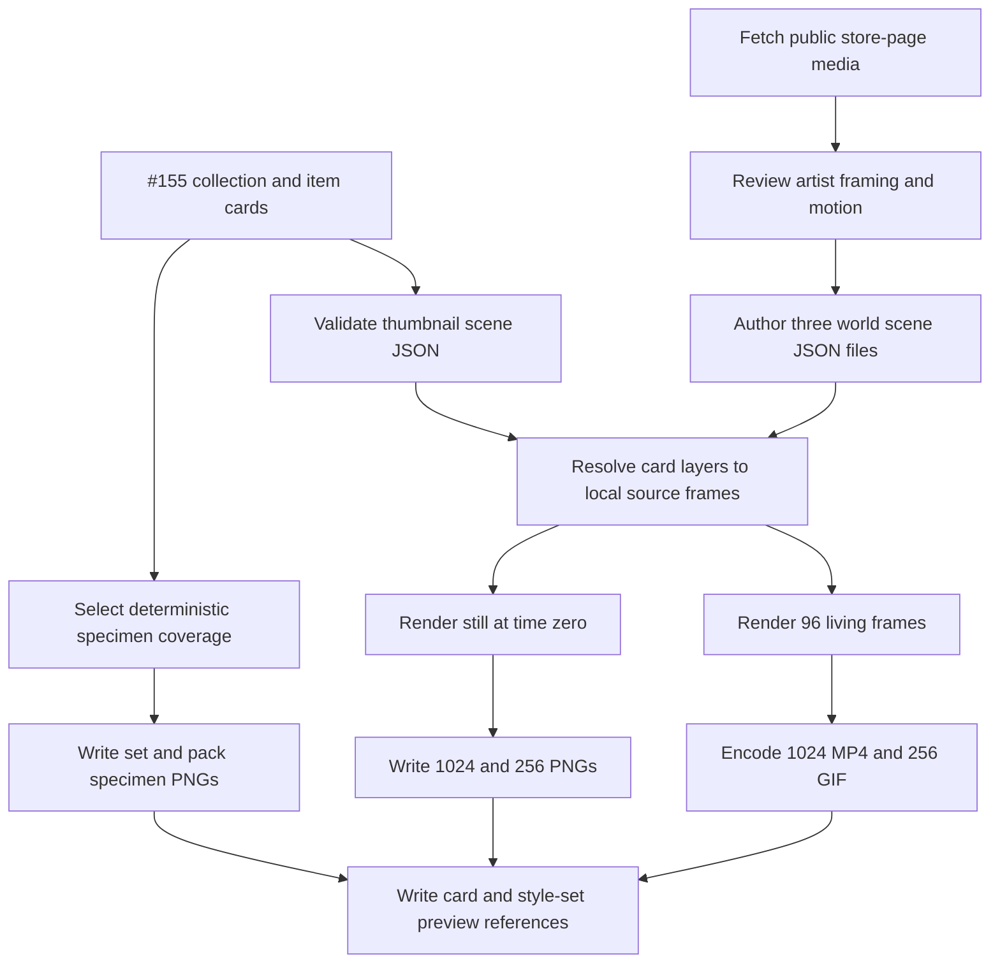

# SmallScaleInt Thumbnail Scenes - Plan

## Goal Capsule

- **Objective:** Establish the reusable specimen, still-diorama, and living-diorama pipeline by rendering the SmallScaleInt set and every pack from deterministic card-backed scene data.
- **Authority:** GitHub issue #143 and its CODEOWNER comments define the product contract. Repository rules govern private assets, contract ownership, validation, and PR evidence.
- **Execution profile:** Implement and test contracts, store-media intake, and rendering with compact fixtures first. Integrate #155's real cards and sheets only after its validated branch is ready, then run the real SmallScaleInt generation locally.
- **Stop conditions:** Do not commit anything under `assets-local/`, do not copy or reimplement #155's card generator, do not add paid services or credentials, and do not claim a hands-on picker or physical-device check ran in the issue workspace.
- **Tail ownership:** The implementation owns focused tests, deterministic output inspection, docs and QA notes, full-diff code review, PR evidence, and exact post-deploy checks for anything the workspace cannot publish or exercise.

---

## Product Contract

### Summary

SmallScaleInt is the pilot for the illustrations shown by the style picker.
The pilot must produce one automatic specimen sheet for the set and each pack, one deterministic still and four-second living diorama for each of the fantasy, modern-zombie, and creatures worlds, and the contract every later asset set follows.

### Problem Frame

The current style-family catalog can group packs into compatibility sets but exposes only per-pack thumbnails.
Asset cards have generic preview slots, and the repository has a 3D model renderer, but there is no contract for a card-backed 2D scene, no deterministic set illustration pipeline, no vendor-media fallback, and no documented Tier A/B policy.
Ticket #155 owns SmallScaleInt collection/item cards, world metadata, and sheet discovery, so this ticket must consume that output rather than infer the same asset structure again.

### Requirements

**Preview contract and references**

- R1. `packages/contracts` defines and emits one strict thumbnail-scene contract whose target carries the compatibility set id, world, fixed 2:1 camera, palette background, source-baked lighting, deterministic layer order, card id, position, action, direction, frame, and loop selection.
- R2. Asset-card collection previews support `specimen`, `diorama`, `loop`, and vendor `store` paths without allowing URLs or credentials, and provenance marks store fallback media as `vendor-metadata`.
- R3. The SmallScaleInt set entry references its set specimen and all three world still/loop outputs, while every SmallScaleInt collection card references its pack specimen, matching world diorama and loop, and store fallback when fetched.

**Deterministic rendering**

- R4. One loopback-only headless canvas tool accepts a set or pack id plus a scene JSON, resolves only local card/source paths beneath the selected asset root, and writes the required outputs without a paid or remote rendering service.
- R5. Specimen generation chooses representatives from cards deterministically, covers every available world, pack, and category for a set and every available category for a pack, draws native pixels with nearest-neighbour integer scaling on a fixed neutral grid, and renders no text.
- R6. Each world scene renders square 1024- and 256-pixel PNGs with its own tiles as ground, three to six props, and two or three characters including one centred hero and one enemy.
- R7. The same scene renders a seamless four-second, 24-fps H.264 MP4 at 1024 pixels and a 256-pixel looping GIF; character and animated-prop layers advance through card-defined clips while static layers remain fixed.

**Vendor reference, documentation, and curation**

- R8. Before scene composition, the tool fetches each pack's public itch.io screenshots and GIFs into `assets-local/packs/<id>/store/` with a local JSON manifest containing the page URL, fetch date, media provenance, hashes, and selected fallback; no purchase/download URL is committed or logged.
- R9. Scene composition uses the artist's store media as the visual reference for framing, character/tile pairings, and motion, while generated dioramas remain the preferred picker illustration.
- R10. `docs/reference/thumbnail-scenes.md` defines Tiers A, B, and C, exact render constants, output names, specimen coverage, card/style-set references, rerun commands, and the later-set survey findings from the ticket.
- R11. `docs/plans/ogm-v1-build/asset-qa/smallscaleint.md` records what the three rendered worlds reveal about scale, palette, silhouettes, animation, tiles, and any pack mismatches.
- R12. The PR provides three generated stills and one loop for review; when the workspace cannot upload those ignored local outputs, its `## Local tests` section instead records the exact attachment operation as a truthful `Post-deploy check`.

### Acceptance Examples

- AE1. Given two cards that cover the same world, pack, and category, when the specimen selector runs twice with input cards in different orders, then it chooses the same representative and emits byte-identical grid pixels.
- AE2. Given a valid fantasy scene, when the renderer captures time zero and the 96 animation frames, then the stills use each layer's declared frame, the video is exactly four seconds at 1024×1024, and the GIF is 256×256 and loops.
- AE3. Given a scene that names a path outside the selected asset root, a remote URL, a missing card, or an action absent from that card, when rendering starts, then it fails before writing partial final outputs.
- AE4. Given a pack with fetched vendor media but no generated diorama, when collection previews are generated, then `previews.store` points at the local selected fallback and its provenance is `vendor-metadata`; once a diorama exists, consumers prefer `previews.diorama`.
- AE5. Given #155 has not emitted a validated readiness signal, when independent implementation proceeds, then no placeholder card schema or SmallScaleInt pack metadata is pushed in its place.

### Scope Boundaries

- Tier C trailer rendering belongs to its later ticket; this plan documents it but does not implement it.
- The style-picker screen itself belongs to OGM-074/#93; this ticket only supplies catalog/card references and its fixed visual assets.
- SmallScaleInt source art, vendor media, generated specimens, scene JSON, stills, frames, MP4s, GIFs, cards, and indexes remain under ignored `assets-local/`.
- This pilot does not render KayKit, Synty, Kenney, LimeZu, TinyRPG, or Quaternius outputs; the spec records which later sets may crop shipped art and which need rendered dioramas.

---

## Planning Contract

### Key Technical Decisions

- KTD1. Use a headless canvas page under `apps/web/tools/` driven by Playwright, with Sharp for deterministic image assembly and ffmpeg for MP4/GIF encoding. This follows the existing `render-gltf` and capture patterns, preserves the repository's Chromium flags, and avoids introducing Pillow, which is absent on this host.
- KTD2. Resolve scene layers through versioned asset-card ids and #155's sprite metadata rather than raw ad hoc crop rectangles. The scene stores the visual selection and transform while the card remains the source of sheet paths, frame geometry, directions, and clip timing.
- KTD3. Fix the virtual camera at a 128×64 pixel 2:1 grid with origin `[512, 256]`; project `(x, y, z)` to `[512 + (x - y) × 64, 256 + (x + y) × 32 - z × 32]`. Pixel snapping, nearest-neighbour scaling, opacity 1, and source-baked lighting with no renderer tint are invariant.
- KTD4. Render 96 source frames at 24 fps for a four-second loop, encode H.264 with `yuv420p` and fast-start metadata, and derive the 256-pixel GIF from the same frame sequence. Temporary frames are staged beside the output and removed only after both encodes succeed.
- KTD5. Treat store screenshots and GIFs as local vendor metadata, never as game-shipped assets. The fetcher accepts only HTTPS creator pages on an exact `*.itch.io` host and HTTPS media on `img.itch.zone`; follows only allowlisted redirects; sends no credentials; bounds redirects, response bytes, media count, and time; verifies image content type and signature; records hashes and original media URLs only in ignored local metadata; and never follows or stores purchase links.
- KTD6. Generate specimens with a deterministic greedy coverage pass over world, pack, and card category, then tie-break by stable card id. Pack specimens use category coverage only; unavailable categories create no blank or invented cells.

### High-Level Technical Design

### Constraints and Sequencing

- #155 is the direct blocker for SmallScaleInt pack/world cards and sprite-sheet metadata. U1-U3 can proceed independently; U4 begins only after the corroborated `agent.unblocked` ref and SHA are available.
- The renderer binds only to `127.0.0.1`, blocks all browser egress, canonicalizes inputs and outputs beneath the selected asset root, and stages output before atomic replacement.
- Canonical path checks reject symlink escapes for both source reads and output roots. Store fetches preserve the prior complete local manifest on any partial failure and never log response bodies or URLs containing query credentials.
- The set schema requires one ground layer, three to six prop layers, two to three character layers, exactly one hero, and at least one enemy. Effects may be present but do not satisfy prop counts.
- The fixed camera is logical rather than a light simulation because SmallScaleInt sprites already contain their final pixel lighting. The lighting contract records source-baked/no-tint behavior so later renderers do not silently relight the set.

### Risks and Dependencies

- SmallScaleInt contains multiple native resolutions and both sheet and loose-frame layouts. Integer scaling and card metadata must preserve hard pixels without assuming every pack shares a frame size.
- A four-second loop may not be an integer multiple of every source clip. Each layer wraps independently from its declared phase; output duration remains exact and the first frame is the successor of the last at the encode boundary.
- Public itch.io pages may change markup or reject a request. Fetch failures are per-pack findings, preserve existing local media, and do not fabricate `previews.store`.
- The source library is private and large. Fixture tests prove behavior in CI; real generation uses ignored local data and records truthful post-deploy checks if the workspace cannot publish attachments.

---

## Implementation Units

### U1. Thumbnail-scene and preview contracts

- **Goal:** Give renderers, cards, and the style catalog one validated vocabulary for scenes and illustration references.
- **Requirements:** R1-R3.
- **Dependencies:** None for the generic scene contract; #155 before applying SmallScaleInt card/world fixtures.
- **Files:** Create `packages/contracts/src/thumbnail-scene.ts`, `packages/contracts/schemas/thumbnail-scene.v1.json`, `packages/contracts/fixtures/thumbnail-scene.v1.json`, and `packages/contracts/test/thumbnail-scene.test.ts`; append the export in `packages/contracts/src/index.ts`; modify `packages/contracts/schemas/asset-card.schema.json`, `packages/contracts/src/card.generated.ts`, `packages/contracts/test/card.test.ts`, and `packages/contracts/test/emit-families.test.ts`.
- **Approach:** Define strict Zod schemas for target, camera, lighting, layer selection, card reference, grid transform, semantic role, and optional playback. Use a refinement for the scene composition counts. Extend the existing plural `previews` block instead of introducing a parallel `preview` object.
- **Execution note:** Add failing contract and emitted-schema tests before adding production schemas.
- **Test scenarios:** A complete scene and committed JSON fixture parse through both Zod and emitted JSON Schema; remote/absolute/traversal paths are rejected; duplicate layer ids fail; missing hero/enemy or out-of-range prop/character counts fail; a collection card accepts all four new preview keys; a vendor fallback with `vendor-metadata` provenance validates.
- **Verification:** Contracts build, emit, and fixture tests pass with no stale generated types.

### U2. Store-media intake and deterministic specimen selection

- **Goal:** Preserve the artist's public visual references locally and turn card coverage into repeatable set/pack specimen inputs.
- **Requirements:** R5, R8, R9.
- **Dependencies:** U1 for preview field names; #155 only for the final real card corpus.
- **Files:** Create `apps/web/tools/thumbnail-scene.mjs`, `apps/web/e2e/thumbnail-scene.test.ts`, and compact PNG/card/page fixtures within the test file's temporary roots; modify `apps/web/package.json` only to include the new focused browser test in the existing browser-test script.
- **Approach:** Discover each SmallScaleInt page from the vendor's public creator listing, then pass the reviewed page URL explicitly to the fetcher; persist the resulting page-to-pack mapping only in ignored local metadata. Parse pages with bounded, credential-free fetches; allow only HTTPS `*.itch.io` page redirects and `img.itch.zone` image responses; validate media type and signature; hash bytes; preserve stable filenames; and atomically write `store/media.json`. Select specimen cards with a pure deterministic coverage function, resolve the declared frame from each card, and compose a fixed native-pixel grid through Sharp with nearest-neighbour integer scaling and no labels.
- **Test scenarios:** Store-page parsing ignores purchase links and off-domain media; non-HTTPS, cross-host redirects, oversized responses, excessive media, invalid image signatures, and timeouts fail closed; repeated fetches preserve unchanged bytes; a failed page leaves prior media intact; fallback selection prefers a GIF then screenshot deterministically; shuffled cards produce the same specimen selection; every available coverage dimension is represented; a target pack with no renderable card fails with the pack id instead of silently omitting its specimen; transparent sprites remain crisp after integer upscale; traversal and symlink escapes fail.
- **Verification:** Focused Vitest cases pass without contacting the network, and fixture specimens have stable hashes across reruns.

### U3. Headless still and living scene renderer

- **Goal:** Render a validated scene to both Tier A and Tier B output families from the same layer resolution path.
- **Requirements:** R4, R6, R7.
- **Dependencies:** U1 and the shared helpers from U2.
- **Files:** Create `apps/web/tools/thumbnail-scene-page.html`; continue `apps/web/tools/thumbnail-scene.mjs` and `apps/web/e2e/thumbnail-scene.test.ts`; update `docs/reference/local-asset-library.md` with the operator command and output roots.
- **Approach:** Reuse the `render-gltf` loopback server and Chromium launch policy, block browser egress, draw source frames to canvas with smoothing disabled, and project grid coordinates with KTD3. Capture time zero at 1024, downscale with nearest-neighbour to 256, render 96 frames, then invoke ffmpeg with bounded arguments and atomic output replacement.
- **Test scenarios:** A fixture scene produces 1024- and 256-pixel PNGs at the expected projected pixels; z-order is stable regardless of JSON layer order; time-zero uses declared frames; loop layers advance and static layers do not; 96 frames are requested; ffmpeg arguments require H.264/yuv420p and a looping 256 GIF; missing ffmpeg returns the repository install hint while preserving completed stills; a failed frame or encode leaves no partial final video.
- **Verification:** The focused browser-renderer test passes with the repository GPU flags, and ffprobe confirms the fixture video dimensions, codec, frame rate, and four-second duration when ffmpeg is present.

### U4. SmallScaleInt integration, scene curation, and local generation

- **Goal:** Consume #155's validated cards, author the three artist-grounded scenes, generate every required local output, and connect them to cards and the SmallScaleInt set.
- **Requirements:** R2-R9, AE1-AE5.
- **Dependencies:** U1-U3 and #155's final validated ref/SHA.
- **Files:** Integrate #155's `scripts/assets/smallscaleint.py` and related contract/data changes; modify only the final `packages/asset-cards/data/style-families.json`, `packages/asset-cards/src/families.ts`, `packages/asset-cards/test/families.test.ts`, and `scripts/assets/build_collection_cards.py` surfaces needed for preview references. Generated files live under `assets-local/sets/smallscaleint/` and `assets-local/packs/smallscaleint-*/` only.
- **Approach:** Fetch store media first, review it for each world, then author `diorama.fantasy.scene.json`, `diorama.modern-zombie.scene.json`, and `diorama.creatures.scene.json` with one centred hero, at least one enemy, three to six props, and world-owned ground tiles. Run card/specimen generation, render all outputs, and atomically update collection-card and curated style-set preview references. Keep local/private preview keys out of the existing public catalog response; a later authenticated importer may turn eligible blobs into signed URLs.
- **Test scenarios:** Every SmallScaleInt pack receives `specimen.png`, and generation fails with the exact pack id rather than omitting a pack with no renderable cards; the set specimen covers all three worlds and all represented card categories; each scene references only cards whose `describe.set` is `smallscaleint` and whose world matches; all three output families exist with exact names and dimensions; every collection card points to existing local preview files; the set schema rejects a missing world preview; public catalog serialization does not expose style-set or card-local preview keys.
- **Verification:** All generated cards validate, the card index rebuild succeeds, the renderer reruns without diffs, and automated image/video probes report the expected output count and media properties.

### U5. Reusable specification and QA evidence

- **Goal:** Make the pilot reproducible for later asset sets and record concrete curation findings from the real renders.
- **Requirements:** R10-R12.
- **Dependencies:** U4 for observed QA evidence.
- **Files:** Create `docs/reference/thumbnail-scenes.md` and `docs/plans/ogm-v1-build/asset-qa/smallscaleint.md`; update no other frozen planning-pack file.
- **Approach:** Document the exact contract and output conventions, specimen algorithm, set/card precedence, security and rights rules, rerender workflow, and the ticket's later-set survey. Keep QA observations specific to the generated SmallScaleInt outputs and avoid claiming visual approval that only Kevin can provide. Attach three stills and one loop to the PR when the workspace permits; otherwise add an exact `Post-deploy check` naming the operator and GitHub attachment steps.
- **Test scenarios:** Test expectation: none -- these files document already-tested contracts and observed local output.
- **Verification:** Every documented field, filename, size, and command matches the implementation; the QA file names all three worlds and any unresolved visual concern.

---

## Verification Contract

| Gate | Applicability | Command or evidence | Done signal |
|---|---|---|---|
| Contract behavior | U1 | `pnpm --filter @ogm/contracts test` and `pnpm --filter @ogm/contracts check` | Scene/card schemas, fixtures, generated types, and emitted JSON are current. |
| Browser renderer behavior | U2, U3 | `pnpm --filter @ogm/web exec vitest run e2e/thumbnail-scene.test.ts` with the repository Chromium flags | Intake, specimen, sandboxing, still, animation, and encoding cases pass. |
| Asset-card integration | U1, U4 | `pnpm --filter @ogm/asset-cards test` | #155 cards and all preview references validate and index correctly. |
| Catalog privacy | U4 | `pnpm --filter @ogm/api test -- catalog` | The public response continues to omit private style-set and card-local preview keys. |
| Workspace static gates | All | `pnpm lint`, `pnpm typecheck`, and `pnpm build` | Commands exit 0. |
| Real private-library generation | U4, U5 | Run the documented set command against the ignored SmallScaleInt corpus | 27 specimens, 6 stills, 3 MP4s, 3 GIFs, and 3 scene JSON files exist; rerun hashes are stable. |
| Human curation | U4, U5 | Post-deploy review of the generated images and loop | Kevin confirms the pilot framing before later sets adopt the spec. |

---

## Definition of Done

- R1-R12 are implemented, or a workspace-impossible publication/hardware action is recorded as an exact `Post-deploy check` without claiming it ran.
- The three scene JSON files validate and deterministically reproduce every still and loop from card-backed local sources.
- The set and every SmallScaleInt pack have specimen coverage, and all required card/style-set references point to existing ignored outputs.
- Store media stays local, carries vendor provenance, excludes purchase URLs, and is never treated as game-shippable content.
- The PR contains no `assets-local/` bytes, source art, vendor media, download links, credentials, or licence serials.
- The reusable spec matches the implementation and the QA note records observations rather than unsupported approval.
- The full branch diff has no blocking `ce-code-review` findings.
- Abandoned experiments, temporary stubs, staged frames, and partial encodes are absent from the final diff and ignored output roots.
