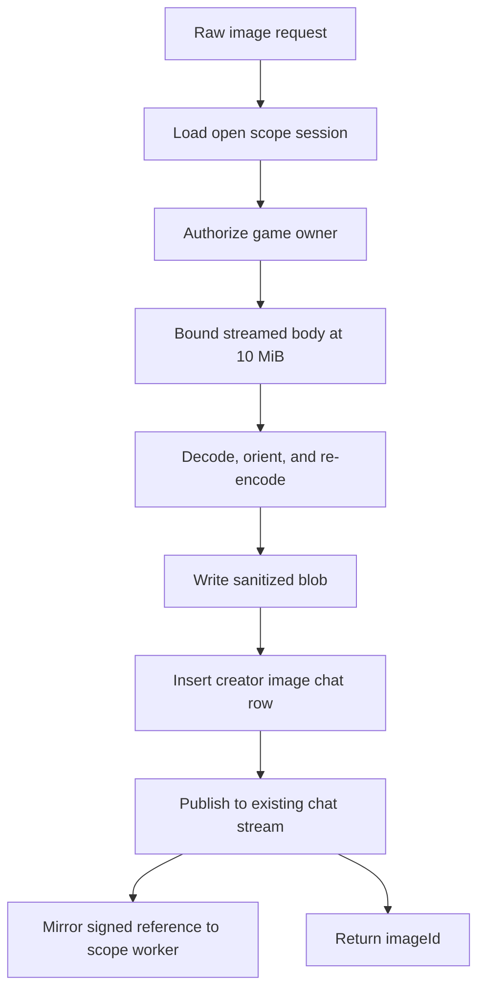

# Creator Image Upload - Plan

## Goal Capsule

- **Objective:** Give the creation flow an authenticated image upload for an open scope session that enforces the 10 MiB creator cap, removes EXIF server-side, and returns a chat-compatible image reference.
- **Authority:** Issue #214 and OGM-074 requirement R25 define behavior; existing scope ownership, build-chat message, blob-store, and route conventions define implementation shape.
- **Stop conditions:** Stop if the route cannot prove the session owner or if the stored blob retains source metadata.
- **Execution profile:** One API behavior unit plus its transport documentation; no migration, new package, or new dependency.
- **Tail ownership:** Focused API tests, package gates, full-diff review, PR evidence, and CI remain part of delivery.

---

## Product Contract

### Summary

Add a scope-session image endpoint that stores a sanitized creator image as the session's existing chat job message.
The response names that message id explicitly as `imageId`, matching issue #93's `uploadImage` transport contract.

### Problem Frame

The creation flow can prepare a photo but the landed scope and build-chat APIs accept only text from creators.
Without a server-owned upload path, the client cannot enforce authorization at the session boundary or rely on EXIF removal as the privacy guarantee required by OGM-074.

### Requirements

**Upload and privacy**

- R1. Accept a raw request body only when its declared media type is an image and its decoded content is a supported image.
- R2. Reject a body above 10 MiB using both the declared length and a bounded streamed read when the length is absent or false, and rate-limit repeated uploads before reading or decoding them.
- R3. Apply source orientation, re-encode the pixels, and persist an output with no EXIF or other source metadata.

**Authorization and chat integration**

- R4. Require an authenticated creator who owns the scope session's game and reject another creator's session.
- R5. Associate the stored image with the scope session's chat job and return `{ imageId }`, where `imageId` is the resulting creator image message id delivered through the existing chat stream and mirrored to the scope worker as a signed image reference.
- R6. Accept uploads only while the scope session is open.

**Transport and evidence**

- R7. Document the exact route, headers, raw body, success response, and error boundaries for issue #93's web transport.
- R8. Cover a valid image, non-image rejection, size rejection, EXIF removal, cross-creator denial, and closed-session rejection with focused API tests.

### Acceptance Examples

- AE1. Given the session owner uploads a JPEG containing EXIF, when the route stores it, then the response contains the creator image message id and the stored blob has no EXIF.
- AE2. Given an authenticated creator uploads to another creator's session, when authorization runs, then no blob or chat row is created.
- AE3. Given a request declares more than 10 MiB or streams more than 10 MiB, when the route reads it, then it is rejected before persistence.
- AE4. Given a non-image media type or undecodable image bytes, when uploaded, then the route rejects the request and creates no chat row.

### Scope Boundaries

- The route does not redesign the creation UI or modify issue #93's branch.
- The route does not add a second media table, change the build-chat schema, or add a database migration.
- Direct blob-store access from the no-network worker sandbox is outside this ticket; the existing Aiur mirror supplies the worker with a time-limited signed image reference.
- General creator media upload for non-scope build jobs is deferred; this contract is owned by an open scope session.

---

## Planning Contract

### Key Technical Decisions

- KTD1. Mount the upload under the existing scope-session resource, because the game and session ids provide the strongest ownership boundary and match OGM-074's expected transport.
- KTD2. Store the upload as a normal pending creator `image` build-chat row for the session's existing job and return its id as `imageId`, so SSE, signing, dimensions, worker mirroring, and message ids reuse landed behavior instead of creating a parallel media reference system.
- KTD3. Use a raw image body with the media type in `Content-Type`, because the endpoint accepts exactly one binary object and multipart parsing adds no contract value.
- KTD4. Re-encode to WebP after automatic orientation. Sharp removes metadata by default when producing a new buffer, while a metadata-only probe followed by storing the original bytes would not satisfy the privacy guarantee.

### Assumptions

- The upload itself appends and mirrors the creator image message. Issue #93 uploads images before posting any accompanying text and uses `imageId` for reconciliation; no pending-upload table or second attachment lifecycle is required.
- WebP is suitable for creator drawings and photos after the client has already bounded the long edge, and a canonical output format avoids serving browser-incompatible source formats.
- The existing Sharp security defaults remain enabled for untrusted input; this plan does not relax pixel or decoder limits.

### High-Level Technical Design

### System-Wide Impact

- **Authentication and authorization:** The API's existing authentication middleware runs before the handler; the handler then loads the session and reuses game-owner authorization before reading or decoding the binary body. A cross-creator request therefore cannot consume image-processing or storage resources. A dependency-scoped limiter also rejects repeated uploads before body processing.
- **Data flow:** Only the canonical re-encoded bytes enter blob storage. The chat row references that blob through the existing content hash; chat serialization signs browser URLs, and the existing Aiur mirror signs a fresh worker URL when the scope ticket is available. Source bytes, filenames, and source metadata are never written to the database or response.
- **Failure behavior:** Validation and decode failures happen before storage and chat insertion. If blob storage succeeds but the later SQLite insert fails, the content-addressed blob may be temporarily unreferenced and is left for existing blob garbage collection; the route must not delete a shared hash that another row may already reference.
- **Runtime coupling:** Scope routes may call build-chat's media/store/runtime seams, but build-chat does not import scope code. This preserves the existing one-way dependency and avoids a second message or media abstraction.
- **Downstream consumers:** Existing SSE subscribers receive the new image row through the same hub publication path as text and agent images. No contract or schema version changes are required because `BuildChatMessage` already represents creator image messages.

### Risks and Dependencies

- **Content-type spoofing:** `image/*` is only an early rejection signal; Sharp must successfully decode and re-encode the content before it is accepted.
- **Resource exhaustion:** Enforce the compressed-byte cap before buffering when `Content-Length` is trustworthy and again while streaming. Keep Sharp's untrusted-input pixel and decoder limits enabled rather than overriding them.
- **Privacy regressions:** Apply orientation to pixels before output, then emit a fresh WebP without any metadata-preservation option. Verify the stored blob itself, not only the response fields.
- **Partial persistence:** Blob storage and SQLite cannot share a transaction. Insert and publish only after sanitation and blob storage succeed; never publish a message before its row exists. Treat an unreferenced content-addressed blob as garbage-collection work, not a reason to risk deleting a shared object.
- **Contract drift with issue #93:** The API README is the integration handoff. Its route, headers, error statuses, and response example must be copied from the tested behavior after implementation rather than written from the plan alone.

### Sources and Research

- `docs/plans/ogm-v1-build/tickets/OGM-074.md` and `OGM-074-plan.md` on the `research` branch define the 10 MiB client cap, the server-side EXIF guarantee, and the expected scope-session image route.
- `services/api/src/scope/routes.ts` owns session lookup and game-owner authorization.
- `services/api/src/build-chat/{media,routes,store}.ts` own Sharp probing, blob writes, chat rows, signing, and stream publication.
- Sharp's official output documentation states that newly emitted buffers remove metadata by default; its security guidance treats input as untrusted and retains decode limits.

---

## Implementation Units

### U1. Sanitize and persist scope-session images

- **Goal:** Implement the complete authenticated upload behavior and prove every required rejection and privacy property.
- **Requirements:** R1-R6, R8; AE1-AE4; KTD1-KTD4.
- **Dependencies:** None.
- **Files:** Modify `services/api/src/build-chat/{aiur-mirror,media,routes}.ts`, `services/api/src/scope/routes.ts`, `services/api/test/build-chat/aiur-mirror.test.ts`, and `services/api/test/scope/routes.test.ts`.
- **Approach:** Add a creator-image media helper that decodes, auto-orients, re-encodes, stores, and returns dimensions plus blob hash. Add a scope-session route that authenticates, loads the named session, runs the existing owner authorization, requires `open`, applies a per-session creator upload limit, and only then checks media type and both size boundaries. After sanitation, create a pending creator image chat row for `session.job_id`, publish it, ask the existing mirror to deliver a signed reference to the worker, and return `{ imageId: row.id }`.
- **Execution note:** Start with the route tests so the valid, privacy, boundary, and authorization cases fail before production code changes.
- **Patterns to follow:** Bounded streaming from `services/api/src/reports/routes.ts`; session authorization from `services/api/src/scope/routes.ts`; media persistence and signing from `services/api/src/build-chat/{media,routes,store}.ts`.
- **Test scenarios:**
  1. Covers AE1. Upload a generated JPEG with EXIF as the owner; assert an `imageId` response, a pending creator image chat row, worker-mirror invocation, WebP blob metadata, stored dimensions, and absent EXIF on the stored bytes. A focused mirror test asserts that image rows become signed worker references.
  2. Covers AE2. Upload the same image as a different creator in the family; assert denial and unchanged blob/chat storage.
  3. Covers AE3. Send a declared oversized request and a chunked body that crosses the cap; assert both are rejected without persistence.
  4. Covers AE4. Send `text/plain` bytes and invalid bytes declared as an image; assert both are rejected without persistence.
  5. Upload after the session is abandoned; assert the closed session is rejected without persistence.
  6. Exhaust the per-session creator upload allowance with a tiny valid image; assert the next request is rejected before blob storage.
- **Verification:** The focused scope-route and mirror suites pass, the returned `imageId` resolves to the existing build-chat response path, the worker receives a signed reference, and the stored blob is demonstrably metadata-free.

### U2. Publish the web transport contract

- **Goal:** Give issue #93 one exact endpoint and response shape to implement against.
- **Requirements:** R7.
- **Dependencies:** U1.
- **Files:** Modify `services/api/README.md`.
- **Approach:** Add a concise scope-session image subsection with the route, authenticated raw-body request, 10 MiB cap, image media-type requirement, `{ imageId }` response, its immediate chat-stream semantics, and relevant error cases.
- **Patterns to follow:** The README's existing build-chat route documentation and repository preference for concise existing-page edits.
- **Test expectation:** None; this unit documents the behavior already covered by U1.
- **Verification:** The documented contract matches the tested route exactly and names the response id as the web transport's image reference.

---

## Verification Contract

- `pnpm --filter @ogm/api exec vitest run test/scope/routes.test.ts test/build-chat/media.test.ts test/build-chat/aiur-mirror.test.ts test/reports-route.test.ts` proves the changed route, direct media/mirror callers, and shared bounded-body reader.
- `pnpm --filter @ogm/api lint` checks the changed API source and tests.
- `pnpm --filter @ogm/api typecheck` checks the route, media, blob, and message types together.
- `pnpm --filter @ogm/api build` verifies emitted production code.
- `pnpm exec prettier --check services/api/src/app/read-body.ts services/api/src/build-chat/aiur-mirror.ts services/api/src/build-chat/media.ts services/api/src/build-chat/routes.ts services/api/src/reports/routes.ts services/api/src/scope/routes.ts services/api/test/build-chat/aiur-mirror.test.ts services/api/test/scope/routes.test.ts services/api/README.md` checks only the touched files under the partial local-test policy.
- The new behavioral tests must fail when the production change is reverted in a unique isolated worktree, then pass at the implementation head.

---

## Definition of Done

- The authenticated scope-session upload passes every acceptance example and stores only sanitized output bytes.
- Another creator cannot upload to the session, and rejected requests create neither blobs nor chat rows.
- The response exposes an existing build-chat image message id as `{ imageId }`, and the same row reaches the scope worker as a signed reference, matching issue #93's upload transport.
- The API README contract and implementation agree on route, body, cap, response, and errors.
- Focused tests, lint, typecheck, build, formatting, full-diff code review, PR evidence, and required CI are complete.
- Experimental or abandoned implementation code is absent from the final diff.
