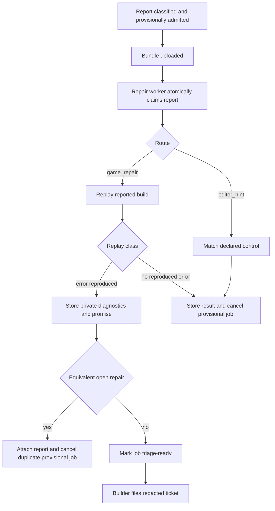

# Repair loop triage, promises, and gm-repair

## Goal Capsule

- **Objective:** Replay routed game reports deterministically, file repair work only for reproduced console errors, and preserve each reproduced failure as a permanent promise test.
- **Authority:** GitHub issue 91 and `docs/plans/ogm-v1-build/tickets/OGM-096-plan.md` on `origin/research` define behavior; current `main` contracts define integration details; the prototype has no affected UI.
- **Stop conditions:** No ticket or diagnostics body leaks creator text, screenshots, frames, saves, or names; editor hints never create jobs; non-reproducible reports never create issues or consume repair work; no published release tree is modified.
- **Execution profile:** Cross-cutting TypeScript change across verification, report persistence, builder intake, a new repair worker, and the shipped skill pack.
- **Tail ownership:** Local package and repository gates prove automated behavior; the physical planted-crash flow remains an explicit post-deploy operator check.

---

## Product Contract

### Summary

A repair worker claims reports routed to `game_repair` or `editor_hint` from the loopback API. Game-repair reports are replayed from their seed, keyframe, and logical actions against the reported build. A reproduced console error yields private diagnostics, a failing promise artifact, and one redacted repair ticket. Equivalent replays attach to an existing open repair job. Other replay classes are stored without filing work. Editor-fixable complaints yield a structured control hint and never file a job ticket.

### Problem Frame

OGM-015 already classifies reports and provisionally admits `game_repair` jobs, while OGM-031 files admitted jobs and OGM-036 exposes private diagnostics through the after-create bundle. Filing immediately would expose work before the crash has been reproduced, but delaying admission would remove the stable job ID required by the ticket contract. The repair loop therefore preserves provisional admission and makes triage readiness a prerequisite for builder filing. A provisional job that does not reproduce is cancelled before any issue is created, releasing its reservation without agent spend.

### Requirements

**Replay**

- R1. A valid bundle restores the keyframe, applies its seed, advances to each action tick, injects the logical action frame, captures console errors, and returns the final text state and a replay-script path.
- R2. Replay classifies matching console failures as `reproduces_with_error`, successful runs as `reproduces_no_error`, and missing actions or keyframes as `not_reproducible`; deadlines return `timeout` without hanging the worker.
- R3. State or probe drift without a reproduced error is `reproduces_no_error` with a mismatch reason, not a worker crash.

**Triage and privacy**

- R4. Only `reproduces_with_error` may carry a repair ticket or promise artifact; `editor_hint` may carry only a declared-control hint; all other outcomes are stored without a GitHub write.
- R5. Repair ticket text contains release, post-replay signature, replay class, `gm-report:<id>`, `gm-job:<uuid>`, the required skills, and exact acceptance text, while excluding report words, screenshots, saves, frames, and state.
- R6. Private diagnostics mark creator words as untrusted and are stored in the blob store; only their opaque key enters the after-create bundle, and neither raw diagnostics nor signed URLs are logged.
- R7. Equivalent post-replay signatures dedupe into the already-open repair job even when the intake signatures differed. The signature is a hash of bounded normalized error and replay-state evidence; raw state and error text are not persisted in the index.
- R8. A report bundle over 200 KB or a failed bundle fetch is stored with a reason and does not file repair work. A stale processing claim becomes eligible again after the configured wall-clock window so a crashed worker cannot strand it.

**Promise and repair guidance**

- R9. Triage generates `promises/<signature>.spec.ts` plus its replay JSON without modifying a published build. The spec imports only `@gm/sdk/test` and its replay JSON; `gm test` computes the replay outcome against the current test build before Vitest runs, so the spec fails before the repair and passes afterwards.
- R10. `repair.config.json` is the single source for two attempts, one-third reservation, and a ten-minute wall clock; a missing file warns and uses those documented defaults.
- R11. The shipped `gm-repair` skill is at most 80 lines and directs the worker to read diagnostics first, prove the promise failure, fix the first new console error, keep L0-L1 green, preserve published releases, and record the behavior change.

### Scope Boundaries

- The report button, UI card, report classification rules, capacity policy, daemon startup, and editor transaction application remain owned by their existing tickets.
- The repair worker does not hold GitHub or Aiur credentials and binds no port.
- Existing SDK rolling action/keyframe capture now satisfies the research plan's formerly deferred recorder gap; this ticket consumes it and does not redesign it.
- OGM-036 owns physical after-create materialization. This ticket supplies the diagnostics key and tests the bundle-facing contract; the complete physical flow is verified post-deploy.

### Acceptance Examples

- AE1. Given a bundle that throws `TypeError: cannot read vy` at tick 11, replay returns `reproduces_with_error`, the private diagnostics include a promise artifact, and builder intake files exactly one redacted repair ticket.
- AE2. Given the same failure through two intake signatures but the same normalized replay error and equivalent final state, the second report returns `dedupedInto` for the first job and does not file another issue.
- AE3. Given a bundle without actions, replay returns `not_reproducible` with `no_actions`, the provisional job is cancelled, and no ticket exists.
- AE4. Given “enemy too fast” and an `enemy.speed` slider control, triage returns a `decrease` editor hint and never creates or files a repair job.
- AE5. Given creator words containing a name plus a screenshot and save state, neither the ticket body nor work-facing metadata contains those values.

---

## Planning Contract

### Key Technical Decisions

- KTD1. **Gate filing, not admission.** Keep OGM-015's provisional job ID so ticket markers and reservation policy remain authoritative. `services/builder/src/intake/file-job.ts` defers repair jobs until their report has a completed error triage. The API cancels provisional jobs for non-reproductions before filing and re-emits an admitted job change when a reproduction becomes ready.
- KTD2. **Persist a compact triage envelope on reports.** Add nullable triage state, claim time, post-replay signature, and JSON result columns to `reports` rather than a second lifecycle table. Atomic claim/update helpers make polling restart-safe and support post-replay dedupe; a processing claim older than `wallClockMinutes` is claimable again.
- KTD3. **Keep private bytes outside tickets and published builds.** The worker uploads diagnostics/promise artifacts through the internal API to the existing blob store. `TriageResult` and the after-create bundle contain only opaque keys and redacted metadata.
- KTD4. **Make the API authoritative for dedupe.** The worker asks for an open post-replay match before composing a ticket, and completion rechecks atomically so concurrent equivalent reports cannot file two tickets. The lookup key hashes a bounded normalized first error plus canonical replay-state evidence and never exposes either input.
- KTD5. **Reuse gm-verify's browser driver.** Replay serves the reported build on loopback, uses `openGame` and `HookDriver`, and adds only the missing seed/restore operations. All time advancement remains deterministic and logical.
- KTD6. **Stage promise artifacts in diagnostics.** Promise generation returns bounded file contents and paths for the repair workspace; it never writes into `<gamesRoot>/<game>/<build>`. The repair skill materializes the artifact in its branch before fixing the error.
- KTD7. **Let `gm test` bridge replay to a two-import promise spec.** `@gm/sdk/test` provides a Vitest-facing promise helper. The existing gm-verify promise gate replays each generated JSON against the current test build, writes a private temporary result map, and gives only that path to Vitest. The spec hashes its replay JSON to select its result and asserts that the expected error is absent; no generated source imports Playwright, gm-verify, or private bundle content.

### High-Level Flow

### Sequencing

1. Land the replay/types surface first so triage can depend on a stable result contract.
2. Add report persistence and internal claim/complete APIs before the worker loop.
3. Add the repair package's pure triage modules, then its HTTP polling shell and builder filing gate.
4. Add the skill and promise fixture validation after the diagnostics shape is fixed.
5. Retimestamp the migration after integrating the current `main`, regenerate its journal snapshot, then run the full repository gates.

### Risks and Mitigations

- A repair job can reach builder intake before its bundle is uploaded. Intake returns a nonterminal `triage` deferral, and the existing admitted-job sweep plus a completion event retries it.
- Concurrent workers can claim or complete the same report. Claim is a compare-and-set transaction; completion is idempotent and dedupe is rechecked at the API boundary.
- Browser errors may be thrown from hook evaluation instead of emitted as console events. Replay records both the console collector and caught evaluation errors before classifying.
- Generated TypeScript could become an injection path through signatures or errors. Paths use a strict lowercase-hex signature, and expected errors are serialized with `JSON.stringify` rather than interpolated as source.
- A compromised repair-service bearer could attempt oversized internal requests or forged controls. Internal claim, diagnostics, lookup, and completion bodies use strict bounded schemas; diagnostics are capped at 200 KB; editor-hint reasons use fixed platform text and validated control IDs rather than manifest labels or help text.
- The prerequisite diagnostics hook is not physically runnable in this workspace. Automated tests prove the API/builder contracts, and the PR records the exact physical post-deploy exercise without claiming it ran.

---

## Implementation Units

### U1. Deterministic replay engine

- **Goal:** Implement the browser replay and stable replay-script contract.
- **Files:** `packages/gm-verify/src/replay.ts`, `packages/gm-verify/src/hooks.ts`, `packages/gm-verify/src/gates/l1-smoke.ts`, `packages/gm-verify/src/index.ts`, `packages/gm-verify/fixtures/stub-game/index.html`, `packages/gm-verify/test/replay.browser.test.ts`, `packages/gm-verify/test/l1-promises.test.ts`, `packages/gm-verify/package.json`, `packages/sdk/src/test/promise.ts`, `packages/sdk/src/test/index.ts`, `packages/sdk/src/test/promise.test.ts`, and `packages/sdk/package.json`.
- **Patterns:** Follow `packages/gm-verify/src/gates/l1-smoke.ts` for loopback serving, browser lifecycle, action timing, and cleanup; follow `packages/gm-verify/src/inputs.ts` for action frames.
- **Test scenarios:** Reproduced crash contains the expected error; no-actions and no-keyframe refusals; matching final state without error; mismatched final state; deadline timeout; replay JSON contains only seed, keyframe, actions, and expected error; `gm test` gives Vitest a private replay-result map and the generated two-import spec fails with the planted crash then passes after its removal.
- **Covers:** R1-R3, AE1, AE3.

### U2. Restart-safe triage API and filing gate

- **Goal:** Persist claims/results, protect internal routes, cancel non-reproductions, dedupe error replays, and let builder file only ready repair work.
- **Files:** `packages/contracts/src/reports.ts`, `packages/contracts/src/api.ts`, `packages/db/src/schema/reports.ts`, a new timestamped `packages/db/migrations/*_report_triage.sql` plus generated metadata, `services/api/src/reports/triage.ts`, `services/api/src/reports/routes.ts`, `services/api/src/reports/repair.ts`, `services/api/src/app/principal.ts`, `services/builder/src/intake/file-job.ts`, `services/builder/src/intake/render.ts`, and focused API/builder tests.
- **Patterns:** Follow `services/api/src/reports/store.ts` for immediate transactions, `services/api/src/reports/routes.ts` for bundle URLs and internal data boundaries, and `services/builder/src/intake/file-job.ts` for idempotent issue filing.
- **Test scenarios:** only the repair service can claim, upload diagnostics, look up dedupe, or complete; strict schemas and 200 KB limits reject malformed/oversized input; one worker wins a claim; an expired claim is reclaimed; completion is idempotent; a non-reproduction cancels before filing; a reproduction wakes intake; two post-replay equivalents dedupe; raw private fields never enter the issue input; builder restart finds and files the same ready ticket once.
- **Covers:** R4-R8, AE1-AE5.

### U3. Repair worker, editor hints, tickets, and promises

- **Goal:** Add the polling worker and pure domain modules that fetch, replay, classify, redact, stage diagnostics, and report triage completion.
- **Files:** `services/repair/package.json`, `services/repair/tsconfig.json`, `services/repair/repair.config.json`, `services/repair/src/config.ts`, `services/repair/src/api.ts`, `services/repair/src/editor-hint.ts`, `services/repair/src/ticket-body.ts`, `services/repair/src/promise-gen.ts`, `services/repair/src/triage.ts`, `services/repair/src/worker.ts`, `services/repair/src/index.ts`, plus `services/repair/test/*.test.ts` and bounded fixtures.
- **Patterns:** Follow `services/builder/src/events/index.ts` for single-flight polling and dependency injection; read `OGM_API_INTERNAL_URL`, `OGM_INTERNAL_TOKEN`, and `OGM_GAMES_ROOT` only through `@ogm/config`; use exact workspace dependency versions.
- **Test scenarios:** required and forbidden ticket fields; “enemy too fast” maps to a declared slider decrease with a fixed reason that does not copy manifest prose; equivalent results dedupe; generated promise source has exactly two imports; missing config warns and returns defaults; fetch error and 200 KB overflow store without work; worker performs one claim at a time and survives an item failure without logging the signed URL or private payload.
- **Covers:** R4-R10, AE1-AE5.

### U4. Shipped repair skill and operator-facing references

- **Goal:** Ship concise repair instructions and keep environment/config references accurate.
- **Files:** `skills/gm-repair/SKILL.md`, `skills/gm-repair/package.json`, `skills/gm-repair/tsconfig.json`, `skills/gm-repair/skill.test.ts`, `packages/config/src/names.ts`, and the existing concise config/runbook page if registering the repair unit makes it inaccurate. No new environment name is introduced.
- **Patterns:** Follow `skills/gm-verify/SKILL.md` and the existing skill lint package; point migration guidance at `skills/vendor/phaser` and `skills/vendor/threejs` without copying vendor prose.
- **Test scenarios:** skill is at most 80 lines, names every required safety/triage instruction, and contains no secret or external download instruction; environment registry recognizes the repair unit and its existing shared variables.
- **Covers:** R10-R11.

---

## Verification Contract

| Scope | Command | Done signal |
|---|---|---|
| Replay | `pnpm --filter @ogm/gm-verify test` | Replay unit cases pass. |
| Replay browser | `pnpm --filter @ogm/gm-verify test:browser` with the repository Chromium flags/environment | Crash, success, missing-input, and timeout browser cases pass. |
| Repair worker | `pnpm --filter @ogm/repair test` | Ticket privacy, hint, dedupe, promise, config, size, and worker cases pass. |
| Builder/API/DB | Focused Vitest files for every changed source and direct caller | Triage persistence, auth, lifecycle, and filing cases pass. |
| Skill | `pnpm --filter @ogm/skill-gm-repair test` | Skill lint and 80-line ceiling pass. |
| Repository | `pnpm lint`, `pnpm typecheck`, `pnpm test`, `pnpm build` | Every documented repository gate passes on the committed head. |
| Manual-only | Plant a crash in a draft game, submit it through the report button, wait for triage, confirm the redacted game-repo issue, let the worker load `gm-repair`, and confirm its PR makes the promise test green | Recorded as an unrun post-deploy check naming the operator and required machine. |

---

## Definition of Done

- Replay, triage, dedupe, privacy, editor hint, promise, config fallback, and skill requirements have direct regression tests that fail without their production change.
- No ticket-facing output contains creator words, screenshots, state, frames, or save data; diagnostics use an opaque private key.
- A non-reproduction or editor hint creates no game-repo issue, and any provisional repair reservation is released before agent work.
- A reproduced error files one idempotent ticket with the required markers, skills, and acceptance text, and an equivalent replay attaches to it; an expired worker claim can be recovered without duplicate filing.
- The promise artifact is staged for the repair branch and is not written into the published release tree.
- The new migration is last after current `main`, uses the next journal index, and has a generated snapshot linked to the previous snapshot.
- The branch passes the focused tests and all four repository gates, the full diff has no blocking review finding, and the PR body records the exact unrun physical post-deploy check.
