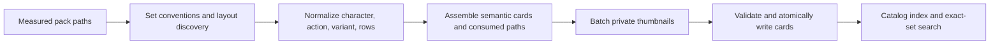

# Fix SmallScaleInt Asset Pipeline - Plan

## Goal Capsule

- **Objective:** Make the 26 imported SmallScaleInt packs produce correctly labelled, searchable, previewable semantic cards across every measured vendor layout while preserving archive and licence safety.
- **Authority:** GitHub issue #192 defines acceptance, and the frozen 26-pack QA report on `research` supplies the measured layout facts.
- **Stop conditions:** Do not commit licensed assets, edit the frozen V1 planning pack, run either character-creator app, or broaden this work into character composition.
- **Execution profile:** Extend the existing Python reader and synthetic fixtures, then make the narrow asset-card and CLI changes required for exact-set search.
- **Tail ownership:** The asset-library operator performs the real 26-pack rebuild, pixel comparison, search smoke, and fantasy Unity extraction after deployment.

---

## Product Contract

### Summary

SmallScaleInt cards must reflect the measured sheet row order, collapse shadow variants into one action, consume source sheets once, recognize every known character layout, carry 12 fps and usable thumbnails, support exact-set search, and extract both Unity creator packages within the existing safety bounds.

### Problem Frame

The first full corpus run completed without builder errors but exposed semantic corruption hidden by synthetic fixtures: six direction labels were wrong, thousands of shadowless actions and hundreds of sheet sequences were duplicated, several pack layouts produced no real characters, nearly all animation rates and all thumbnails were absent, and the fantasy creator exceeded a conservative member cap despite staying under the byte cap.

### Requirements

- R1. Sheet-backed actions use the measured row order `E, SE, S, SW, W, NW, N, NE`, sourced from one set-conventions table separate from direction-folder order.
- R2. `_Shadowless` stems and singular or plural shadow folders become variants of the base action, and every sheet consumed by a character card is excluded from sequence cards.
- R3. Tileset character sheets, top-down strips, root-action frames, sheets-only knight packs, and loose/demo sheet packs produce character cards with real actions, while projectile packs remain item sequences.
- R4. Every emitted animation carries 12 fps when unique Unity metadata does not provide a more specific rate, and every emitted item card carries a private content-addressed thumbnail.
- R5. `gm assets search knight attack` matches numbered vendor character titles and sprite action names, and `--set smallscaleint` restricts results to that curated compatibility set.
- R6. Isolated-mode extraction works directly, accepts at least 157,266 bounded Unity members without weakening byte, path, link, duplicate, or atomic-install checks, and records the hand-written modern creator part order.
- R7. SmallScaleInt intake defaults to `LicenseRef-smallscaleint-itch`; any explicit unknown licence still fails before installation.

### Scope Boundaries

- The frozen QA report is evidence only and is not edited in this branch; new post-fix counts belong in the PR body.
- Character composition and ticket #183's Phaser adapter remain outside this change.
- Collection tagging, cross-vendor compatibility, and creator-part card generation remain deferred.
- Licensed-corpus and physical asset-library checks are post-deploy checks and must not be claimed as local results.

---

## Planning Contract

### Key Technical Decisions

- KTD1. Keep corpus exceptions in a small SmallScaleInt layout module with a conventions table keyed by exact pack id or layout family so generic words such as `character` cannot reclassify projectile packs and the existing reader does not grow past the repository's file-size guard.
- KTD2. Represent discovered sheets with their measured row count and normalized variant before card assembly; card assembly owns geometry validation, consumption, fallback fps, and title preservation.
- KTD3. Batch thumbnail generation through the workspace's pinned `sharp` dependency, using the first south-facing frame or the first south-row sheet cell and writing content-addressed WebP files under `private/previews`.
- KTD4. Add exact-set filtering to the shared search query while resolving membership from the curated family registry, not potentially stale stored card metadata.
- KTD5. Raise only the Unity member-count ceiling to 250,000; retain the 4 GiB byte ceiling and all existing streaming and path checks.

### High-Level Technical Design

### Assumptions

- The 26-pack QA report is the authoritative corpus observation when synthetic fixtures and prior prose disagree.
- Existing `sharp` installation is available whenever the collection builder runs because the same package test/build workflow already owns that exact dependency.
- A 12 fps fallback is set-wide because all 78 observed Unity animation files use that rate and acceptance requires fps on every animated card.

### Risks and Dependencies

- Broad PNG heuristics can turn props into characters; exact pack/layout allowlists and negative projectile fixtures contain that risk.
- Thumbnail generation adds a cross-language batch boundary; root-contained paths, deterministic jobs, atomic file replacement, and a focused failure-path test prevent traversal or partial cards from referring to missing output.
- The real fantasy creator and 12 GB corpus are unavailable in issue workspaces, so synthetic tests prove structure while the PR body preserves exact operator checks.

---

## Implementation Units

### U1. Recognize the measured character layouts

- **Goal:** Produce one correct semantic character/action model for every measured SmallScaleInt layout without re-emitting source sheets.
- **Requirements:** R1, R2, R3, R4; KTD1, KTD2.
- **Dependencies:** None.
- **Files:** `scripts/assets/smallscaleint.py`, `scripts/assets/smallscaleint_layouts.py`, `scripts/assets/test_smallscaleint.py`.
- **Approach:** Separate directory direction order from sheet row order, normalize variant folder/stem spellings, attach layout row counts during discovery, allow only measured pack-specific root and strip forms, consume both frame and sheet paths, default animation fps to 12, and preserve numbered ids while exposing searchable display titles.
- **Execution note:** Add characterization fixtures for each real-corpus path shape before changing the parser.
- **Test scenarios:** An eight-row knight sheet maps row two to south; `Walk_Shadowless.png` pairs with `Walk.png`; consumed sheets produce no `sequences/spritesheets-*` card; tileset, top-down strip, root-action, sheets-only, loose, and demo layouts each produce actions; projectile layouts do not produce a character; all animations carry fps.
- **Verification:** The focused Python reader suite passes and every new behavior test fails against the pre-change parser.

### U2. Generate thumbnails and expose searchable set semantics

- **Goal:** Give every SmallScaleInt item card a usable preview and make exact set/action queries work through `gm assets search`.
- **Requirements:** R4, R5; KTD3, KTD4.
- **Dependencies:** U1.
- **Files:** `scripts/assets/smallscaleint.py`, `scripts/assets/smallscaleint_thumbnails.py`, `scripts/assets/build_collection_cards.py`, `packages/asset-cards/scripts/build-smallscaleint-thumbnails.mjs`, `packages/asset-cards/src/types.ts`, `packages/asset-cards/src/search.ts`, `packages/asset-cards/test/search.test.ts`, `packages/gm-cli/src/assets-query.ts`, `packages/gm-cli/test/search-family.test.ts`, `docs/reference/cli.md`.
- **Approach:** Derive deterministic thumbnail jobs from card animation metadata, require input and output paths to remain below the asset root, crop south-facing sheet cells when needed, batch them through sharp before validation, split numeric vendor prefixes during search tokenization, and add a curated `set` query filter shared by CLI and library callers.
- **Test scenarios:** Every card receives an existing private preview; a sheet preview job crops row two; `1Knight` plus action `Attack` matches `knight attack`; `--set` keeps only the requested curated set both with and without a game lock; a thumbnail-render failure leaves cards unwritten.
- **Verification:** Python collection-builder tests, asset-card search tests, and CLI family-search tests pass; CLI reference documents `--set`.

### U3. Harden intake and creator extraction for the observed corpus

- **Goal:** Let both creator packages enter the pipeline with the correct licence and explicit composition order while preserving safety.
- **Requirements:** R6, R7; KTD5.
- **Dependencies:** None.
- **Files:** `scripts/assets/smallscaleint.py`, `scripts/assets/smallscaleint_unity.py`, `scripts/assets/install_itch_pack.py`, `scripts/assets/test_smallscaleint.py`, `scripts/assets/test_build_collection_cards.py`.
- **Approach:** Make the CLI import its sibling under isolated mode, raise the member ceiling to the measured-safe bound, add the modern part-prefix order to the layer manifest, and choose the canonical SmallScaleInt licence when intake receives a SmallScaleInt pack without an explicit override.
- **Test scenarios:** Direct isolated-mode help succeeds; the configured ceiling covers the measured 157,266 members and a tiny archive still proves count enforcement under a temporarily lowered ceiling; path/link/duplicate rejection remains green; the modern manifest carries the hand-written order; SmallScaleInt intake writes the canonical licence and an unknown explicit id fails before extraction.
- **Verification:** Focused Unity and intake tests pass without creating a partial destination on any failure.

---

## Verification Contract

| Gate | Command | Done signal |
|---|---|---|
| Reader, intake, and Unity behavior | `python3 -I scripts/assets/test_smallscaleint.py -v` and `python3 -I scripts/assets/test_build_collection_cards.py -v` | All synthetic corpus and safety scenarios pass. |
| Asset search and family registry | `pnpm --filter @ogm/asset-cards test` | Python integration plus Vitest search/family suites pass. |
| CLI set filtering | `pnpm --filter @ogm/gm-cli test -- search-family.test.ts` | Exact-set behavior passes with locked and unlocked fixtures. |
| Workspace quality gates | `pnpm lint`, `pnpm typecheck`, `pnpm test`, and `pnpm build` | Required repository gates pass or any inherited unrelated failure is reported with evidence. |
| Diff hygiene | `git diff --check origin/main...HEAD` | No whitespace errors or frozen-plan edits. |

Post-deploy verification is recorded verbatim in the PR body: rebuild all 26 packs; compare both knight `Walk` sheets pixel-for-pixel in all directions; confirm no shadowless action twins or spritesheet sequences; inspect per-pack character/fps/thumb counts; run locked and unlocked search; and extract the fantasy Unity package on the asset-library host.

---

## Definition of Done

- U1-U3 are implemented with regression coverage and no licensed bytes or generated `assets-local` output in the diff.
- Every acceptance behavior is automated where the workspace can reproduce it, and every real-corpus step is listed as an unclaimed post-deploy check in the PR body.
- The PR body records updated expected count deltas from the synthetic/structural model and asks the asset-library operator to replace them with the authoritative 26-pack rerun counts.
- Focused tests and repository gates are recorded exactly, the full-diff review has no blocking finding, and abandoned implementation experiments are removed.
