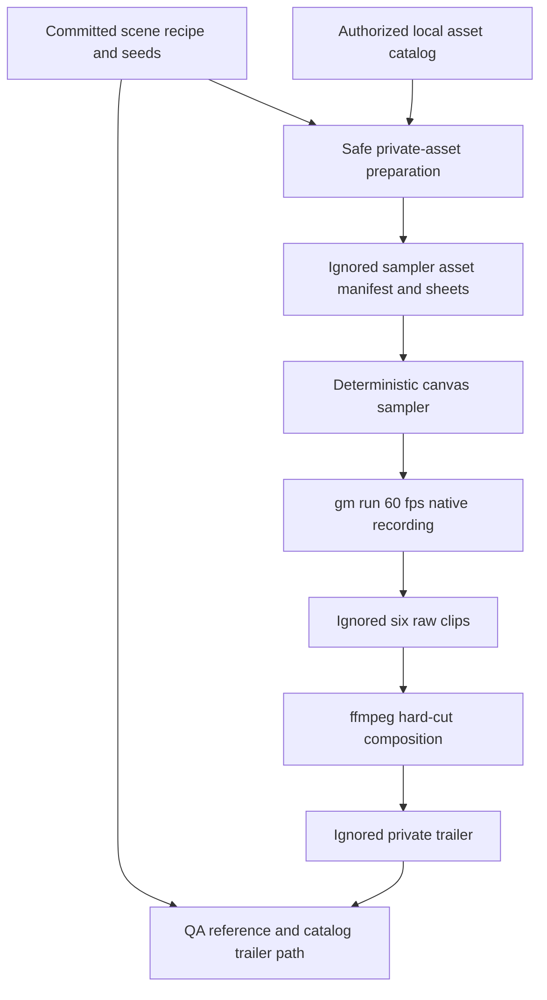

# SmallScaleInt Style Trailer - Plan

## Goal Capsule

- **Objective:** Ship a deterministic six-beat SmallScaleInt sampler and the tooling needed to capture a 20–30 second private style trailer at native 3x scale and 60 fps.
- **Authority:** Issue #156 and repository instructions govern scope; existing private-asset policy and the frozen planning-pack rule govern where media and QA evidence may live.
- **Stop conditions:** Stop before committing vendor media, exposing a private preview through a public API, editing the frozen `docs/plans/ogm-v1-build/` pack, or claiming a hands-on check that did not run.
- **Execution profile:** Code implementation plus local private-media generation, automated verification, visual review, code review, and PR/CI handoff.
- **Tail ownership:** The implementing agent owns fixes through green required CI and records inaccessible physical-device or operator checks as exact post-deploy steps in the PR.

---

## Product Contract

### Summary

Build a repository-owned sampler that stages six deterministic SmallScaleInt scenes, extend the existing verification recorder just enough to capture those scenes at the required fidelity, and register the resulting private trailer path in style-set metadata.
The committed diff contains recipes, behavior, tests, and QA notes; the private video, raw clips, and vendor media remain ignored under `assets-local/`.

### Problem Frame

SmallScaleInt is cataloged and has private specimen/diorama previews, but it lacks the Tier C cross-world motion proof needed to judge whether the family reads as a coherent game style.
The current `gm run --record` path is deterministic but fixes clips at 30 fps and a 960-pixel phone encode, so it cannot express the ticket's native 3x/60 fps acceptance contract.
The source pack is licensed for local use and its previews are intentionally excluded from the public catalog API, which makes a committed sampler recipe and an ignored local render the safe evidence shape.

### Requirements

#### Sampler behavior

- R1. A sampler game under `games/samplers/smallscaleint` locks creation to `isometric-2d`, `iso`, and the `smallscaleint` style set.
- R2. The sampler contains six selectable deterministic beats: village arrival, knight-versus-orc combat, desert chest loot, rural zombie flight, interior ambush, and creature graze-to-charge.
- R3. Each beat is driven by a named seed and timeline so repeated renders at the same time produce the same camera, actor state, and frame selection.
- R4. The sampler prepares only explicitly selected private card and game-SFX sources from a caller-supplied local asset root and never commits those source bytes.

#### Capture and trailer

- R5. `gm run` accepts an explicit recording frame rate and a native-pixel encode option while preserving the existing 30 fps, 960-pixel default.
- R6. Six raw clips are captured at 60 fps from a 3x logical viewport, then concatenated with hard cuts and deterministic in-game cue audio into a 20–30 second H.264 MP4 with no titles or music.
- R7. The trailer and clips live under ignored `assets-local/sets/smallscaleint/`, and the public repository contains no vendor media or private preview attachment.

#### Catalog and QA

- R8. The SmallScaleInt style set declares `sets/smallscaleint/trailer.mp4` as its private trailer preview without adding preview fields to the public style-family API.
- R9. A concise non-frozen QA page records mismatched scale, anchors, direction naming, sheet geometry, missing assets, and capture limitations found while building all six beats.
- R10. Every hands-on check unavailable in the workspace is preserved verbatim as a PR `Post-deploy check`, with the required operator or hardware named.

### Acceptance Examples

- AE1. **Given** prepared private sampler assets and seed `15601`, **when** the village beat renders at the same timestamp twice, **then** the knight, villagers, animation frames, and camera match pixel-for-pixel.
- AE2. **Given** `gm run --record 4s --record-fps 60 --record-native`, **when** capture completes, **then** the clip contains 240 frames and retains the desktop viewport dimensions instead of scaling to 960 pixels.
- AE3. **Given** no local private assets, **when** the repository installs, tests, and builds, **then** the public checkout still succeeds and does not download or embed SmallScaleInt media.
- AE4. **Given** the catalog is loaded, **when** internal metadata is inspected, **then** SmallScaleInt names its trailer while the public style-family response still omits all preview paths.
- AE5. **Given** the scene cue manifest and authorized local SFX, **when** the trailer is composed twice, **then** both outputs place the same in-game effects at the same timeline offsets and contain no music stream or text overlay.

### Success Criteria

- The committed sampler recipe covers all six requested beats and can be rebuilt from an explicitly supplied local SmallScaleInt catalog root.
- The ignored final trailer is 20–30 seconds, 60 fps, native 3x resolution, H.264/yuv420p, hard-cut only, and free of text or music.
- Visual inspection finds no broken sprite crops, traversal outside the asset root, nondeterministic scene state, or accidental public preview exposure.

### Scope Boundaries

- Do not redesign any product screen or add navigation/chrome.
- Do not add browser-audio recording to `gm-verify`; compose the same deterministic game cues from the sampler's local SFX manifest after video capture and record the capture limitation in QA.
- Do not copy SmallScaleInt source media into tracked game files or attach the private trailer to a public GitHub issue/PR.
- Do not edit `docs/plans/ogm-v1-build/asset-qa/smallscaleint.md`; the planning pack is frozen, so current QA belongs in a new page under `docs/reference/`.
- Do not generalize the sampler into a cross-style scene authoring framework.

---

## Planning Contract

### Key Technical Decisions

- KTD1. Extend `gm-verify`'s existing frame-by-frame recorder with explicit fps and native-output controls, preserving current defaults and queue serialization.
- KTD2. Keep scene descriptions as committed data and rendering logic as a small canvas runtime; private source sheets are prepared into an ignored sampler directory by a safe-path script.
- KTD3. Use the existing style-set `previews` object and add an optional `trailer` path because the catalog contract is plural and already enforces private/public separation.
- KTD4. Compose clips and the sampler's deterministic in-game cue track with an argv-based ffmpeg script and checked metadata, avoiding shell interpolation, title filters, and music inputs.
- KTD5. Treat missing compatible SmallScaleInt orc art and deterministic WebAudio capture as QA evidence, not authorization to import another style or broaden recorder scope.

### Assumptions

- A1. The ticket's `style_family: isometric` maps to the repository's canonical `isometric-2d` family id and `iso` POV.
- A2. A 480x300 logical canvas filling the existing 1440x900 desktop viewport satisfies native pixel scale x3.
- A3. Local SmallScaleInt source cards are available to authorized operators through an asset root outside Git; CI validates recipe behavior with generated fixtures.
- A4. The local asset library contains redistributable-within-the-game SFX suitable for deterministic movement, combat, loot, threat, and creature cues; the preparation step must fail closed if the selected locked sources are unavailable.

### High-Level Technical Design

### Implementation Constraints

- Resolve and validate every requested source path beneath the caller's asset root before reading or copying it.
- Bind any sampler server to `127.0.0.1` and never log an environment value.
- Preserve default recorder output byte-for-byte at the argument level when new flags are absent.
- Keep public API serialization unchanged; `previews` remain internal catalog metadata.
- Keep generated clips, prepared sheets, and contact sheets ignored.

### Sequencing

U1 establishes capture semantics before the sampler depends on them.
U2 builds the deterministic scene and private-asset boundary.
U3 adds internal catalog metadata independently of media generation.
U4 generates and inspects the actual artifacts, records QA, and closes the evidence loop after U1–U3.

### Risks and Dependencies

- The asset library may be readable but not writable in the issue workspace; preparation therefore copies only selected sources into ignored workspace storage.
- SmallScaleInt combines packs with differing anchors, directional conventions, and perspectives; the scene recipe must normalize these per actor and QA must preserve mismatches rather than hide them.
- Software Chromium can make 60 fps capture slow; the shared build gate is authoritative and long-running capture is waited out rather than retried.
- `gm-verify` frame capture does not currently record WebAudio; adding real audio muxing would be a separate capture-system change.
- Issues #45 and #143 supplied the recorder and private thumbnail pipeline and are already closed.

---

## Implementation Units

### U1. Native 60 fps deterministic recording

- **Goal:** Add opt-in recording fidelity controls without changing existing captures.
- **Requirements:** R5, R6; AE2.
- **Files:** `packages/gm-cli/src/commands/run/index.ts`, `packages/gm-cli/test/run.test.ts`, `packages/gm-verify/src/capture.ts`, `packages/gm-verify/test/capture.test.ts`, queue/request contract tests, `docs/reference/cli.md`.
- **Approach:** Parse bounded `--record-fps` and boolean `--record-native` flags into the existing `RecordOptions`; carry them through direct and queued runs; select the existing phone filter or a native yuv420p filter in `clipArgs`.
- **Test scenarios:** Defaults remain 30 fps/960 pixels; 60 fps is accepted; invalid fps values fail with usage guidance; native output omits rescaling but retains H.264, yuv420p, television range, and faststart; queue requests preserve both controls.
- **Verification:** Focused gm-cli and gm-verify Vitest suites plus typecheck/build for both packages.
- **Dependencies:** None.

### U2. Deterministic six-beat sampler

- **Goal:** Create a buildable sampler whose committed recipe can stage all requested worlds without tracked private media.
- **Requirements:** R1–R4, R7; AE1, AE3.
- **Files:** `games/samplers/smallscaleint/`, `pnpm-workspace.yaml`, `pnpm-lock.yaml` if the new workspace importer changes it.
- **Approach:** Scaffold with `gm new game-2d`, lock canonical family/POV/set metadata, define six data-driven timelines and seeds, render through deterministic hooks, and add a safe preparation script that reads selected card sheets from `OGM_ASSETS_ROOT` into an ignored public directory.
- **Test scenarios:** Same seed/time yields identical state; each beat reaches its named transition; path traversal and missing cards fail closed; absent private assets do not break install/test/build; generated fixture sheets exercise crop and direction handling.
- **Verification:** Sampler Vitest tests, build, and focused browser verification with the repository's Chromium flags.
- **Dependencies:** U1 for final capture only; implementation and unit tests may proceed independently.

### U3. Internal trailer preview metadata

- **Goal:** Point the SmallScaleInt set at its private trailer while preserving catalog privacy.
- **Requirements:** R8; AE4.
- **Files:** `packages/asset-cards/src/families.ts`, `packages/asset-cards/data/style-families.json`, `packages/asset-cards/test/families.test.ts`.
- **Approach:** Add an optional validated `trailer` field to internal set previews, populate only SmallScaleInt, and assert public serialization still excludes preview metadata.
- **Test scenarios:** Valid trailer parses; traversal and malformed paths fail; SmallScaleInt resolves the expected path; public API shape has no `previews` or `trailer` field.
- **Verification:** Asset-cards Vitest suite, typecheck, and build.
- **Dependencies:** None.

### U4. Private artifact generation and QA record

- **Goal:** Produce the six clips and final trailer locally, inspect the result, and preserve reproducible evidence without committing media.
- **Requirements:** R6, R7, R9, R10; AE1, AE2.
- **Files:** `games/samplers/smallscaleint/scripts/compose-trailer.mjs`, `docs/reference/smallscaleint-style-trailer.md`, ignored `assets-local/sets/smallscaleint/` outputs.
- **Approach:** Prepare authorized sources, capture one deterministic clip per scene, probe each clip, concatenate in the requested narrative order, build the cue track from the scene manifest and selected game SFX, inspect a contact sheet and final phone-playable MP4, then write factual pack/capture findings and exact manual follow-ups.
- **Test scenarios:** Composition rejects missing/wrong-size/wrong-fps clips or missing locked SFX; final duration stays 20–30 seconds; streams contain H.264 video and the deterministic game-cue audio only; output contains no text overlays or music; ignored media stays absent from Git status.
- **Verification:** Script tests, `ffprobe` metadata, frame contact sheet inspection, full relevant repository gates, and `git status --ignored`/`git check-ignore` evidence.
- **Dependencies:** U1, U2, U3.

---

## Verification Contract

| Gate | Command or check | Covers | Done signal |
|---|---|---|---|
| Install | `pnpm install --frozen-lockfile` | U1–U4 | Lockfile resolves every workspace without network-selected versions |
| Recorder tests | `pnpm --filter @ogm/gm-cli test` and `pnpm --filter @ogm/gm-verify test` | U1 | New controls and preserved defaults pass |
| Sampler tests | `pnpm --filter @ogm/sampler-smallscaleint test` | U2, U4 | Timelines, safe preparation, and composition tests pass |
| Catalog tests | `pnpm --filter @ogm/asset-cards test` | U3 | Internal path validates and public API stays private |
| Static gates | Focused package lint/typecheck/build, then repository `pnpm lint`, `pnpm typecheck`, and `pnpm build` when shared workspace/build files require full selection | U1–U4 | Commands exit zero |
| Artifact metadata | `ffprobe` final and raw clips | U1, U4 | 60 fps, native dimensions, 20–30 second final duration, expected streams/codecs |
| Visual QA | `gm-verify` contact sheet and final MP4 inspection | U2, U4 | Six beats read clearly with stable crops, layers, and hard cuts |
| Privacy | `git status --short --ignored` plus `git check-ignore` for every generated media path | U2–U4 | Media is ignored and no vendor byte is staged |
| Review | `ce-code-review` against `main` after all code changes | U1–U4 | No blocking findings remain; PR body records personas and dispositions |

Manual-only checks that the workspace cannot perform are not blockers.
They are copied to the PR as exact `Post-deploy check:` lines and are never reported as executed.

---

## Definition of Done

- U1 is done when direct and queued `gm run` captures accept 60 fps/native output, invalid inputs fail clearly, and defaults remain compatible.
- U2 is done when the six deterministic scene recipes build and test in a public checkout, while authorized local preparation can supply private media without tracked copies.
- U3 is done when internal SmallScaleInt metadata names the trailer and public catalog consumers cannot observe preview paths.
- U4 is done when ignored raw clips and a 20–30 second trailer with deterministic game SFX have been generated or any inaccessible hands-on generation step is precisely preserved as a post-deploy check, with QA findings grounded in inspected output.
- Required focused and repository-wide gates selected by the partial-test policy pass, every new test is demonstrated to guard production behavior, and blocking code-review findings are fixed.
- The PR starts with `Closes #156`, includes current full-SHA local-test evidence and a `## Review` section, is marked ready, and reaches the required CI handoff state.
- The final diff contains no abandoned experiments, private media, secrets, download links, or edits to the frozen planning pack.
