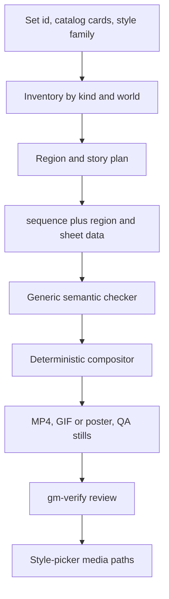

# Reusable Set Showcase Pipeline - Plan

## Goal Capsule

- **Objective:** Make a new asset set reproducibly yield cohesive living-diorama and sprite-sheet preview media from catalog cards, without shipping private source assets or running a compositor in the client.
- **Authority:** Issue #343 and its CODEOWNER addition define the product outcome; repository instructions and the SmallScaleInt research record define safety and integration constraints; this plan governs implementation details.
- **Execution profile:** Three dependency-ordered units covering generic tools, agent guidance, and a LimeZu Modern dry-run.
- **Stop conditions:** Stop before committing private asset bytes, generated media, secrets, download links, or changes to the frozen `docs/plans/ogm-v1-build/` pack. Reconcile v3 conventions only after ticket #342 emits its explicit readiness signal.
- **Tail ownership:** The implementing agent owns focused tests, skill validation, visual QA evidence, code review, PR readiness, and CI handoff.

---

## Product Contract

### Summary

Add a reusable showcase skill and deterministic repository tools that turn set metadata and private host assets into pre-rendered, looping region and sprite-sheet media. Prove the workflow on a single LimeZu Modern top-down region while keeping all licensed bytes and rendered outputs outside Git.

### Problem Frame

The SmallScaleInt showcase proved the visual format but its authoring, checking, rendering, and assembly tools live inside one private set directory and encode SmallScaleInt assumptions. A fresh agent cannot apply that knowledge to another set without rediscovering schema, coverage, story, camera, media, and QA rules.

The browser must consume finished media rather than reproduce the asset pipeline. This keeps private source assets and expensive compositing out of the client while preserving phone-compatible playback.

### Requirements

#### Reusable authoring contract

- R1. The `gm-set-showcase` skill accepts a set id, catalog cards, and style family, then routes an agent through inventory, region planning, story beats, sequence authoring, validation, rendering, QA, and publication.
- R2. `sequence.json` records region order, `tile_sprites`, `sheet_sprites`, and staged `story` actors, actions, targets, and timing without hard-coding one vendor or perspective.
- R3. Isometric showcases use continuous 45-degree region seams; top-down showcases use grid seams; both fill every square camera view with world content and follow a naturally walking hero.
- R4. Region stories stage coherent interactions with targets and reactions, never air attacks, arbitrary nearby loops, or repeated decorative props.

#### Validation and media

- R5. Generic checks reject tile/sheet overlap, missing pack coverage, invalid references or animation metadata, repeated props, incomplete stories, and empty camera coverage.
- R6. Rendering keeps region and sheet tracks on one tempo, rotates through every available direction, and produces per-region and per-sheet QA stills.
- R7. Final deliverables are pre-rendered looping H.264 MP4 files with yuv420p and faststart plus GIF or poster fallbacks; browser publication plays media inline and muted and never loads the compositor, a game engine, or a preview canvas.

#### Reuse and proof

- R8. `gm-asset-intake` invokes showcase preprocessing for every new set, and `gm-assets` links agents to the showcase workflow when a set needs creator-facing previews.
- R9. The skill includes the SmallScaleInt worked example and a LimeZu Modern top-down dry-run with an inventory/region plan, `sequence.json`, one rendered region, and truthful visual QA.
- R10. Paid source files and generated showcase media remain host-local and ignored; committed tests use synthetic fixtures that exercise the same contracts.

### Acceptance Examples

- AE1. Given catalog cards from a new isometric set, an agent can divide cards by world and kind, author full-bleed 45-degree regions with target-bearing story beats, and produce synchronized square media without reading SmallScaleInt-specific code.
- AE2. Given LimeZu Modern top-down cards and authorized host assets, the dry-run validates one grid-seamed street region and renders a looping walking-hero preview plus its corresponding rotating sheet.
- AE3. Given a region whose sheet repeats an on-map sprite or whose story actor attacks no target, the checker exits nonzero and identifies the offending region and reference.
- AE4. Given published showcase metadata, the style-picker detail receives only MP4/GIF/poster paths and playback attributes; no runtime compositor or asset source path enters the client contract.

### Scope Boundaries

- The PR does not redesign the style picker, add client chrome, or change its fixed flow.
- The PR does not commit vendor assets, private media, or a public download path.
- The PR does not generalize gameplay, collision, map generation, or asset-card schemas beyond what showcase generation needs.
- The SmallScaleInt private configuration remains an example and validation source, not production data copied into the repository.

---

## Planning Contract

### Key Technical Decisions

- KTD1. Separate generic code from set-authored data. Repository tools accept explicit roots and config paths; set-specific sequences, cards, media, and cache files stay beneath each private set directory.
- KTD2. Validate semantic coverage before expensive rendering. The checker owns pack coverage, overlap, repeat, story-target, and viewport-fill invariants, while the renderer assumes a validated sequence.
- KTD3. Publish only baked media. The style-picker consumes H.264/GIF/poster outputs and never imports compositor code, matching the CODEOWNER clarification on issue #343.
- KTD4. Keep automated proof synthetic and behavioral. Tests build small cards and images that fail without the generic validator/renderer changes; the LimeZu host run supplies the real visual proof without tracking licensed bytes.

### Assumptions

- Ticket #342 may revise the host-local v3 schema or compositor behavior. This plan assumes the v2 tools are a safe extraction baseline but requires diffing and reconciling the explicit #342 unblock before finalizing U1 or the worked SmallScaleInt reference.
- The issue workspace may read authorized LimeZu cards and assets from the host library but must not commit or publish them. If the real render cannot run here, its exact command and visual checks become `Post-deploy check:` evidence rather than a claimed local pass.
- Existing style-picker publication has an asset-path integration seam outside this ticket. The skill documents the handoff and output contract; it does not add a new client compositor or redesign.

### High-Level Technical Design

### Implementation Constraints

- Bind any helper server to `127.0.0.1` and resolve every asset path beneath the explicit asset root.
- Accept isometric and top-down projection/layout data; do not infer vendor geometry at runtime when cards or set conventions provide it.
- Use one deterministic timeline for region and sheet frames so reorderable stops remain synchronized.
- Stage outputs before replacement and key caches by source/config content so interrupted renders preserve prior media.
- Keep all generated output, private cards, and vendor bytes outside tracked paths.

### Sequencing

U1 establishes generic contracts and behavioral fixtures. U2 documents those contracts and wires discoverability. U3 applies them to LimeZu Modern, feeds any proven corrections back into U1/U2, and captures visual evidence.

### Risks and Dependencies

- #342 is a direct dependency for final v3 behavior; an early extraction can drift if its private tools change before readiness.
- Real-corpus render time is expensive under fleet load; validate first, render one LimeZu region for the dry-run, and wait on output/done files rather than parsing logs.
- Card geometry varies across sets; the generic format must express pivots, frame layouts, direction order, and projection rather than retaining SmallScaleInt constants.
- ffmpeg availability varies. Automated tests should isolate encoding decisions where practical, and media-producing tests must skip or use a fake encoder when ffmpeg is unavailable.

---

## Implementation Units

### U1. Extract the generic showcase toolchain

- **Goal:** Move reusable checker, compositor, renderer, and media assembly behavior into set-neutral repository tools.
- **Requirements:** R2–R7, R10; AE1, AE3, AE4.
- **Dependencies:** Explicit #342 readiness before final reconciliation; independent extraction and fixtures may proceed first.
- **Files:** `scripts/assets/showcase/`, `scripts/assets/showcase/test/`.
- **Approach:** Replace hard-coded set ids, directory discovery, projection, hero, coverage, and media settings with validated inputs. Preserve content-addressed segment caching, staged writes, deterministic frame sampling, H.264 faststart output, and GIF/poster generation. Add synthetic cards/images/sequences that exercise isometric and top-down branches.
- **Patterns to follow:** `apps/web/tools/thumbnail-scene.mjs` for safe root resolution and card semantics; the host-local SmallScaleInt `tool/` source for proven rendering/caching behavior; repository Node tests for deterministic fixtures.
- **Test scenarios:** A valid one-region top-down fixture passes and renders a square still; duplicate tile/sheet refs fail; an uncovered pack fails; repeated props fail; a story actor without target/reaction fails; traversal outside the asset root fails; top-down and isometric camera bounds contain no empty pixels; encoder args contain H.264, yuv420p, faststart, and looping fallback settings.
- **Verification:** Focused Node tests pass, the checker exits nonzero for each broken fixture, and generated test output is temporary or ignored.

### U2. Teach agents the end-to-end showcase workflow

- **Goal:** Create a concise entrypoint with progressive references, then link it from asset intake and asset search guidance.
- **Requirements:** R1–R10; AE1, AE3, AE4.
- **Dependencies:** U1 contract names and CLI surface.
- **Files:** `.claude/skills/gm-set-showcase/SKILL.md`, `.claude/skills/gm-set-showcase/references/`, `.claude/skills/gm-asset-intake/SKILL.md`, `.claude/skills/gm-assets/SKILL.md`.
- **Approach:** Keep inputs, phase routing, hard invariants, and stopping conditions in `SKILL.md`; put sequence schema, planning/QA checklists, SmallScaleInt example, and publication contract in focused references. Add intake step 7b after preprocessing and a short discoverability link in `gm-assets`.
- **Patterns to follow:** Existing game-maker skills use discriminating frontmatter, imperative instructions, and references only for conditional detail. `gm-verify` owns visual inspection and truthful delivery claims.
- **Test scenarios:** Skill validation accepts frontmatter and links; every referenced file exists; a cold-read dry-run can identify required inputs, author the sequence, find the generic commands, and state what cannot be published; no instruction names a real host/user path or permits committing private media.
- **Verification:** The skill creator quick validator and any repository skill lint/eval pass, and link checks find no missing reference.

### U3. Prove the workflow on LimeZu Modern

- **Goal:** Demonstrate that the generic contract works outside SmallScaleInt with one cohesive top-down region.
- **Requirements:** R3, R4, R6, R7, R9, R10; AE2.
- **Dependencies:** U1, U2, and authorized host-local LimeZu cards/assets.
- **Files:** `.claude/skills/gm-set-showcase/references/limezu-modern-example.md`, host-local ignored `assets-local/sets/limezu-modern/showcase/` artifacts.
- **Approach:** Inventory LimeZu Modern by world and kind, choose a street story with a walking hero and a target-bearing interaction, author a one-region grid-seamed sequence and relevant non-overlapping sheet, validate, render one loop, and inspect start/middle/end plus a timeline. Record only ids, decisions, and factual QA findings in the worked reference.
- **Patterns to follow:** `skills/gm-set-limezu-modern/` provides measured top-down conventions; `gm-assets` governs source selection; `gm-verify` governs visual proof and phone-ready media.
- **Test scenarios:** The real sequence passes generic checks; the region is square and full-bleed; story actors face valid targets; the hero walks at natural animation speed; sheet sprites are absent from the region; output loops cleanly; `ffprobe` reports H.264/yuv420p/faststart-compatible MP4; generated assets stay ignored.
- **Verification:** One real region render is visually inspected when the workspace can access the authorized corpus; otherwise the exact hands-on run is recorded as an unclaimed post-deploy check.

---

## Verification Contract

| Gate | Command or check | Covers | Done signal |
|---|---|---|---|
| Generic tool tests | `node --test scripts/assets/showcase/test/*.test.mjs` | U1 | Valid fixtures pass and each invalid invariant fails with a specific diagnostic |
| Skill validation | Skill-creator quick validation plus repository skill lint/eval if present | U2 | Frontmatter, naming, references, and unfinished-placeholder checks pass |
| LimeZu dry-run | Generic check/render commands against host-local `assets-local/sets/limezu-modern/showcase/` | U3 | Plan and sequence validate; one square region loop and sheet loop render |
| Visual QA | Start/middle/end stills, motion timeline, and output probe reviewed per `gm-verify` | U3 | No empty space, air attack, repeated sprite, crop, direction, pacing, or loop-wrap defect remains |
| Repository gates | Relevant focused tests plus `pnpm lint`, `pnpm typecheck`, `pnpm test`, and `pnpm build` if shared configuration changes require full selection | U1–U3 | Selected commands exit zero under the partial-test policy |
| Review | `ce-code-review` over the full branch diff against `main` | U1–U3 | No blocking findings remain and the PR records personas and dispositions |

Manual-only checks are copied to the PR as exact `Post-deploy check:` lines and are never reported as executed.

---

## Definition of Done

- U1 is done when set-neutral tooling validates, renders, caches, and assembles both layout families with synthetic behavioral coverage and no private paths or bytes.
- U2 is done when a fresh agent can discover the skill, follow its inputs and references, and reach a validated pre-rendered-media handoff without hidden SmallScaleInt knowledge.
- U3 is done when the LimeZu plan and sequence are committed, one authorized region is rendered and inspected when accessible, and every private/generated path remains ignored.
- The final output contract is looping H.264 MP4 plus GIF/poster fallback per region and sheet, with no client compositor, engine, or canvas preview.
- The #342 v3 readiness signal has been inspected and any applicable differences are reconciled before push.
- Focused tests and required repository gates pass, every new test guards production behavior, skill validation is clean, and blocking code-review findings are fixed.
- The PR starts with `Closes #343`, contains current full-SHA local-test evidence and `## Review`, is marked ready, and reaches the required CI handoff state.
- The final diff contains no private asset bytes, generated media, secrets, real host names, download links, frozen planning-pack edits, or abandoned experiments.
