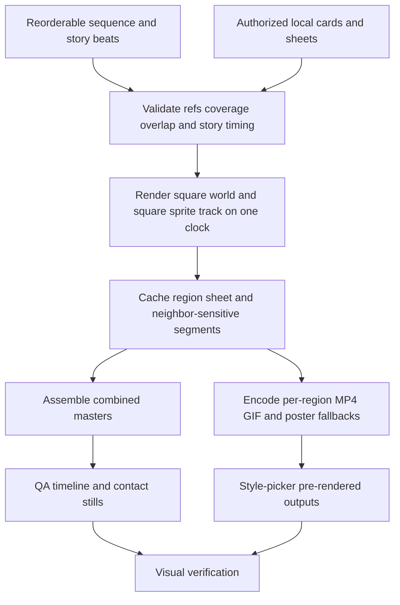

# SmallScaleInt Showcase V3 - Plan

## Goal Capsule

- **Objective:** Replace the SmallScaleInt v2 showcase with a square, full-bleed, story-driven eight-region walk and synchronized sprite-sheet track, then package every preview as pre-rendered looping media.
- **Authority:** Issue #342, its CODEOWNER clarification, the v2 record in `docs/plans/ogm-v1-build/asset-qa/smallscaleint-tiers.md` on `research`, and repository asset-rights rules govern scope.
- **Stop conditions:** Stop before committing SmallScaleInt bytes, adding client-side compositing or game rendering, changing the fixed style-picker design, or claiming an unperformed physical-device check.
- **Execution profile:** Tracked skill and documentation changes plus ignored host-local compositor, content, render, and QA work.
- **Tail ownership:** The implementing agent owns automated checks, visual inspection, review fixes, and PR/CI handoff; unavailable physical-iOS checks become exact `Post-deploy check:` entries.

---

## Product Contract

### Summary

Extend the existing ignored SmallScaleInt showcase pipeline so a walking hero crosses eight connected, oversized isometric regions in a square camera while staged story beats play around them.
Publish only pre-rendered looping MP4, GIF, and poster outputs for the style picker, and commit reusable asset-showcase guidance rather than licensed media or set-specific compositor data.

### Problem Frame

The v2 showcase proves synchronized, reorderable tile and sprite-sheet tracks, but its runner moves slowly through isolated square tiles whose diagonal row view can reveal empty background.
Actors loop attacks or idle near one another without targets or reactions, which makes the scenes look like unrelated asset samples instead of worlds a creator can imagine using.
The v2 page consumes pre-rendered video, but the reusable repository guidance does not yet make that publication boundary, the story schema, or the full-bleed QA contract explicit for the next asset set.

### Requirements

#### Continuous world and motion

- R1. The tile track is a square viewport matching the square sprite-sheet track, with a camera that follows the hero.
- R2. Six ordered regions form one continuous isometric world across diamond-grid seams; every region extends beyond the viewport and no output frame exposes an empty background.
- R3. The hero uses a walk cycle at a natural visual speed, while each stop remains 7.5 seconds by shortening traversal distance instead of slowing animation.

#### Story staging and asset coverage

- R4. Every stop records `story` beats with actors, action, target, and timing, and the compositor stages facing, contact, reaction, death or hold behavior from those beats.
- R5. The eight regions read as purposeful scenes: combatants strike visible targets, the modern streets have parked cars and buildings, the interior stages a break-in, villagers work, animals graze, dinosaurs interact, and boundaries are dressed with walls, fences, roads, vehicles, or cut-aways.
- R6. Every SmallScaleInt pack appears at least once, no plain prop repeats across regions, and no sheet sprite duplicates a sprite visible in its synchronized region.

#### Deterministic delivery and verification

- R7. `sequence.json` remains reorderable, both tracks share one 60-second timeline, and content-addressed caching invalidates only affected region, neighbor, sheet, or assembly outputs.
- R8. The publication surface contains pre-rendered H.264/yuv420p/faststart looping MP4 plus GIF and poster fallbacks for each region and each sheet; style-picker clients never run the compositor, canvas renderer, or a game engine.
- R9. Start, middle, end, seam, contact, and death/reaction stills plus a full timeline are inspected before delivery, and `check.mjs` rejects stale story references, uncovered packs, repeats, overlap, invalid media manifests, or output-shape drift.
- R10. Licensed source media, authored region data, caches, renders, and style-picker page outputs remain ignored under `assets-local/`; tracked changes teach later agents how to reproduce the workflow for another asset library.

### Acceptance Examples

- AE1. **Given** any timestamp in the 60-second loop, **when** the square world frame is rendered, **then** the hero remains framed, neighboring regions meet along isometric seams, and every pixel is world content rather than compositor background.
- AE2. **Given** a 7.5-second stop, **when** the hero crosses it, **then** the hero uses the walk action at the normal cycle rate and travels a shorter path than v2 without slow-motion foot sliding.
- AE3. **Given** an attack beat with an actor, target, contact time, and reaction, **when** contact occurs, **then** the pair face one another, the attack plays once, the target reacts at contact, and no actor repeatedly attacks empty space.
- AE4. **Given** a reordered `stops` array, **when** the pipeline rebuilds, **then** both tracks and their per-stop fallbacks use the new order while unchanged content segments remain cacheable.
- AE5. **Given** a style-picker preview consumer, **when** it opens a region or sheet preview, **then** it receives a looping MP4 with poster/GIF fallback and executes no showcase compositor or gameplay renderer.
- AE6. **Given** an authorized local asset library, **when** `check.mjs` runs, **then** all packs are covered, all story references resolve, and region/sheet duplicates or repeated props fail closed.

### Success Criteria

- The hero walks through eight 7.5-second story regions in one square, full-bleed, continuous 60-second world loop.
- QA stills show visible targets, contact reactions, environmental storytelling, and no empty background, air attacks, crop failures, or motion-speed mismatch.
- Every region and sprite sheet has a looping MP4, GIF, and poster, and the combined style-picker media remains pre-rendered and phone-compatible.
- `check.mjs` and relevant tracked tests pass, while Git sees no licensed media or ignored showcase data.

### Scope Boundaries

- Do not redesign or add chrome to the style-picker page.
- Do not generalize the compositor into a product runtime or commit the SmallScaleInt implementation under a public source path.
- Do not modify the frozen `docs/plans/ogm-v1-build/` planning pack; update current reusable documentation under `docs/reference/`.
- Do not fetch, replace, or redistribute SmallScaleInt source packs.
- Do not add sound; v3 is a muted inline preview contract.

---

## Planning Contract

### Key Technical Decisions

- KTD1. Extend the v2 ignored compositor and data in place because it already owns SmallScaleInt frame resolution, deterministic 24 fps rendering, segment hashing, no-repeat checks, and synchronized tracks.
- KTD2. Render the square camera from region content in shared isometric world coordinates, selecting ground and actors across adjacent regions before clipping to the viewport; this makes seams diamond-grid boundaries instead of edges between opaque square canvases.
- KTD3. Give placed actors stable IDs and define story beats in `sequence.json`; the renderer derives facing and time-bounded action/reaction states from those beats while ambient loops remain item-level behavior.
- KTD4. Tie the hero's frame cadence to the vendor walk cycle and shorten the world-space path to fit 7.5 seconds, preserving natural animation rather than applying a slow playback rate.
- KTD5. Treat per-region and per-sheet media as the publication unit: MP4 is primary, GIF is animated fallback, and a poster is the first-frame/static fallback; run reference/story checks before rendering and media-manifest checks after assembly, while combined masters and QA sheets remain build evidence.
- KTD6. Add a focused `gm-asset-showcase` skill and route it from `gm-core`, with the durable media and QA contract summarized in `docs/reference/thumbnail-scenes.md`; set-specific data stays ignored.

### Assumptions

- A1. The existing host-local v2 showcase and authorized SmallScaleInt card index are available for read-only seeding into this issue workspace.
- A2. A square 1024-pixel master and 720-pixel phone encode preserve v2 sprite density and satisfy the fixed style-picker presentation without client changes.
- A3. The style-picker artifact will be republished from `showcase/out/` by the Executor, so this ticket replaces media at that contract path and does not deploy a site.
- A4. Physical iPhone Safari playback is unavailable in the agent workspace and will be recorded as a post-deploy check rather than blocking automated delivery.

### High-Level Technical Design

### Sequencing

U1 establishes the reusable tracked contract while U2 evolves the ignored compositor and validator.
U3 authors the eight regions against U2's story and world-space schema.
U4 performs the expensive full render and visual correction loop only after focused stills and validation are green.

### Risks and Dependencies

- The ignored compositor has no committed tests, so `check.mjs`, focused deterministic stills, and media probing must act as its executable contract.
- Story actions vary by asset; authoring must select actions that exist on each actor and reject beats that cannot express contact and reaction cleanly.
- Rendering all eight regions can be slow under shared fleet load; preserve cache keys, run one render at a time under `nice`, and wait for the active command rather than restarting it.
- Rights require every vendor byte and derived preview to remain private even though the recipes and reusable skill guidance are public.

---

## Implementation Units

### U1. Reusable asset-showcase skill and reference contract

- **Goal:** Teach future agents to produce cohesive, pre-rendered set showcases with the same authoring, media, and visual-QA guarantees.
- **Requirements:** R8–R10; AE5.
- **Dependencies:** None.
- **Files:** `skills/gm-asset-showcase/SKILL.md`, `skills/gm-core/SKILL.md`, `docs/reference/thumbnail-scenes.md`, `packages/gm-cli/test/gm-asset-showcase.test.ts`.
- **Approach:** Add a concise routed skill covering assets-first authoring, continuous-world rules, declarative story beats, deterministic capture, per-preview media fallbacks, rights boundaries, and look-before-delivery; keep vendor-specific paths and scene content out of the public guidance.
- **Patterns to follow:** Short first-party skills in `skills/gm-core/` and `skills/gm-verify/`, dynamic first-party routing coverage in `packages/gm-cli/test/gm-core.test.ts`, and private output rules in `docs/reference/thumbnail-scenes.md`.
- **Test scenarios:** The new skill is discoverable through `gm-core`; it requires MP4/GIF/poster outputs and forbids client rendering; it requires story targets/reactions and full-bleed square QA; it stays below the repository's concise-skill limit and contains no real host or private source path.
- **Verification:** Focused gm-cli skill tests and formatting checks pass, and the documentation agrees with the skill's output contract.

### U2. Full-bleed world, story, and media pipeline

- **Goal:** Upgrade the ignored v2 compositor and validator for square world-space rendering, walking motion, staged interactions, and per-preview delivery media.
- **Requirements:** R1–R4, R7–R9; AE1–AE5.
- **Dependencies:** None.
- **Files:** `assets-local/sets/smallscaleint/showcase/sequence.json`, `assets-local/sets/smallscaleint/showcase/tool/lib.mjs`, `assets-local/sets/smallscaleint/showcase/tool/render.mjs`, `assets-local/sets/smallscaleint/showcase/tool/check.mjs`, `assets-local/sets/smallscaleint/showcase/tool/assemble.mjs`, `assets-local/sets/smallscaleint/showcase/build-showcase.sh`.
- **Approach:** Replace square-tile pasting with a square follow-camera over shared isometric coordinates; add stable item IDs and story-state evaluation; switch the hero to walk with distance-derived traversal; extend hashes with story and neighbor inputs; run a pre-render content check, then encode MP4/GIF/poster files and run a post-assembly media-manifest audit for every region/sheet.
- **Execution note:** Prove the schema and seam math with deterministic start/mid/end stills for one stop before rendering the full loop.
- **Test scenarios:** Invalid actor/target IDs, timing outside the stop, unsupported actions, attacks without reactions, stale sprite lists, uncovered packs, repeated props, tile/sheet overlap, uncovered camera samples at a seam, region bounds smaller than the camera footprint, missing fallback files, non-square outputs, or non-faststart/H.264 media all fail; reordering changes track order without desynchronizing it; repeated still renders at the same timestamp are byte-identical.
- **Verification:** `check.mjs`, focused still rendering, `ffprobe`, image dimensions, file signatures, and cache-hit evidence establish the pipeline contract.

### U3. Six cohesive authored regions

- **Goal:** Turn the eight asset groups, including zombie-city and dinosaurs, into one connected world whose environmental dressing and interactions tell readable stories.
- **Requirements:** R2, R4–R7; AE1, AE3, AE4, AE6.
- **Dependencies:** U2.
- **Files:** `assets-local/sets/smallscaleint/showcase/sequence.json`, `assets-local/sets/smallscaleint/showcase/tiles/fantasy.json`, `assets-local/sets/smallscaleint/showcase/tiles/desert.json`, `assets-local/sets/smallscaleint/showcase/tiles/town.json`, `assets-local/sets/smallscaleint/showcase/tiles/modern-zombie.json`, `assets-local/sets/smallscaleint/showcase/tiles/interior.json`, `assets-local/sets/smallscaleint/showcase/tiles/graveyard.json`, synchronized files under `assets-local/sets/smallscaleint/showcase/sheets/`.
- **Approach:** Preserve pack coverage and sheet separation while repositioning props and stable-ID actors around region-specific beats: fantasy combat, desert confrontation, village work and grazing, modern street break-in, interior ambush, and graveyard battle; use roads, fences, walls, vehicles, buildings, and cut-aways to make each region larger than the camera.
- **Test scenarios:** Each attack has an on-screen target during contact; targets face attackers and react or die once; workers and grazers use non-combat loops; the street includes parked vehicles and a visible break-in; the interior reads through its cut-away; every seam remains dressed throughout the square camera path.
- **Verification:** Validator output proves coverage/no-repeat/no-overlap, and per-stop story stills prove the intended interaction and setting at the named times.

### U4. Full render, visual correction, and style-picker publication outputs

- **Goal:** Produce and inspect the complete private artifact, then leave exact media and handoff evidence for the Executor.
- **Requirements:** R1–R10; AE1–AE6.
- **Dependencies:** U1, U2, U3.
- **Files:** ignored outputs under `assets-local/sets/smallscaleint/showcase/out/` and the PR/workpad evidence; no licensed media enters the tracked diff.
- **Approach:** Render cached segments once, assemble the 60-second masters and per-stop fallbacks, inspect every QA still and timeline tile, fix the worst visible defect first, verify the publication directory contains only the declared media contract, and record end-to-end page playback and physical-iOS behavior as post-deploy checks because the v2 private page source is not present in this checkout.
- **Test scenarios:** All eight stop boundaries loop without a blank or jump; hero motion matches walk speed; story contact/reaction frames are legible; square frames stay full-bleed; all per-stop files loop and have posters; style-picker output contains no compositor source or client renderer.
- **Verification:** Visual inspection with `gm-verify` principles, media probing, `check.mjs`, ignored-file checks, tracked test gates, and final code review all pass.

---

## Verification Contract

| Gate | Command or check | Covers | Done signal |
|---|---|---|---|
| Skill contract | `pnpm --filter @ogm/gm-cli test` | U1 | Router and asset-showcase contract tests pass |
| Tracked static checks | Focused gm-cli lint/typecheck plus Prettier on changed tracked files | U1 | Changed public guidance and tests are clean |
| Showcase preflight | `assets-local/sets/smallscaleint/showcase/build-showcase.sh` pre-render validator phase | U2, U3 | References, story timing, region coverage, repeats, and overlap report no errors |
| Determinism | Render the same focused still timestamp twice and compare bytes | U2 | Outputs are identical |
| Media contract | Probe every region/sheet MP4 and inspect GIF/poster signatures and dimensions | U2, U4 | H.264, yuv420p, faststart, square dimensions, loop duration, and all fallbacks are present |
| Showcase postflight | Run the pipeline's post-assembly manifest audit | U2, U4 | Every declared region/sheet media file exists and no undeclared compositor or runtime source appears in the publication directory |
| Visual QA | Inspect start/mid/end, seams, contact/reaction close-ups, and the 60-second timeline | U3, U4 | No empty pixels, air attacks, crop failures, unreadable story beats, or walk-speed mismatch remain |
| Rights boundary | `git status --short --ignored` and `git check-ignore` on showcase outputs | U1–U4 | Every licensed or derived byte is ignored and absent from the tracked diff |
| Review | `ce-code-review` against `main` | U1–U4 | No blocking findings remain and PR review evidence records all dispositions |

Manual-only checks that the workspace cannot perform are copied to the PR as exact `Post-deploy check:` lines and are never reported as executed.

---

## Definition of Done

- U1 is done when a future agent can discover one public skill that describes the continuous-world, story, deterministic-media, rights, and visual-QA workflow, and focused tests guard those instructions.
- U2 is done when the ignored pipeline deterministically renders square full-bleed world and sheet tracks, validates story semantics, and emits the complete per-preview media contract.
- U3 is done when all eight regions satisfy pack coverage and no-repeat rules while stills show staged, targeted interactions and dressed settings across every seam.
- U4 is done when the 60-second artifact and all region/sheet MP4, GIF, and poster outputs exist under ignored `showcase/out/`, have been visually inspected, and contain no client renderer.
- Relevant focused tests and static checks pass, every new test is shown to guard production behavior, and no blocking code-review finding remains.
- The PR starts with `Closes #342`, contains current full-SHA local-test evidence and a `## Review` section, is marked ready, and completes required CI before human-review handoff.
- The final diff contains no abandoned experiments, private media, secrets, download links, real host paths, or frozen planning-pack edits.
