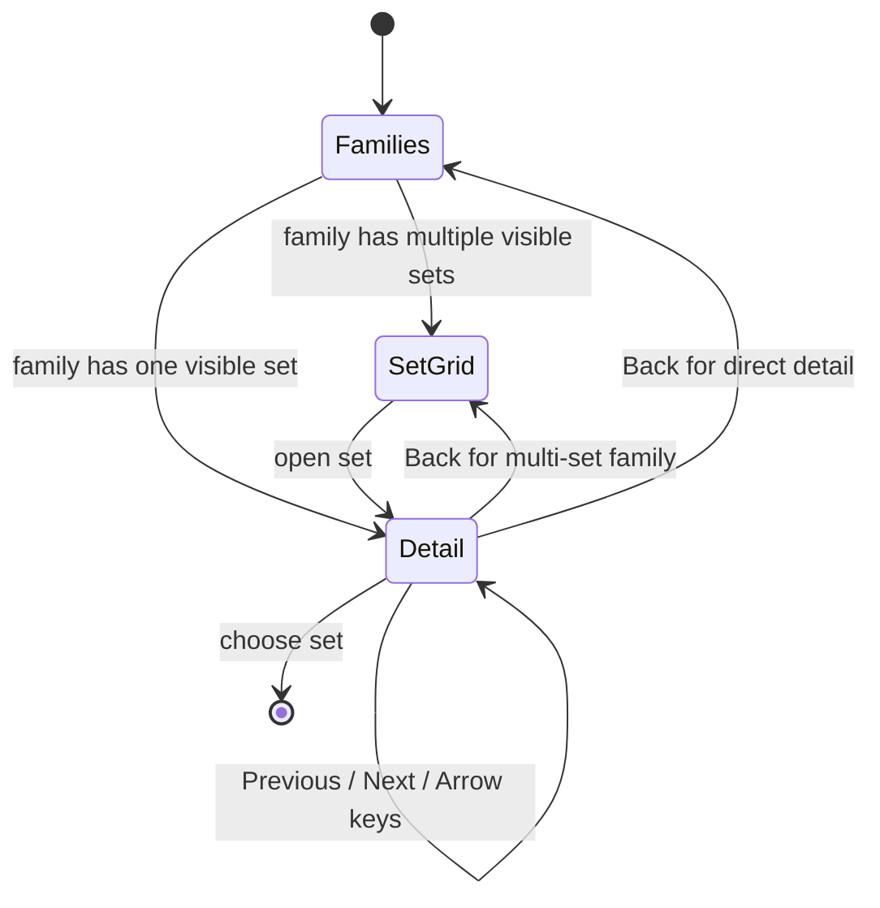
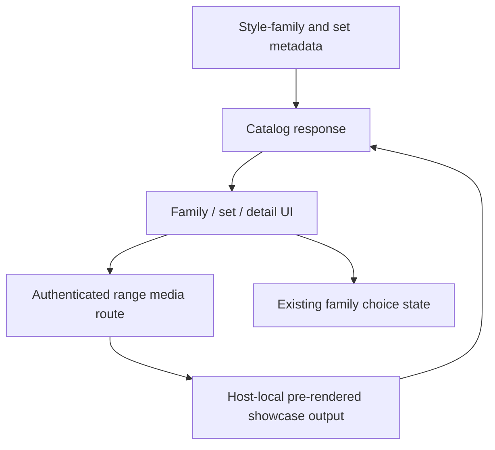

# Style Picker Showcase - Plan

## Goal Capsule

- **Objective:** Make the `/new` Style step start with representative family icons, then let creators inspect and select a concrete set through a grid and pre-rendered showcase detail.
- **Authority:** Issue #341 and its 2026-11-02 owner additions override older one-tile-per-set behavior; the landed prototype controls chrome, motion, and copy.
- **Stop conditions:** Do not add client compositing, canvas/game-engine previews, new navigation chrome, or committed private media.
- **Execution profile:** Extend the existing catalog and creation-flow components with focused API, component, and Playwright coverage.
- **Tail owner:** Required CI and human review validate the final pushed head.

---

## Product Contract

### Summary

The Style step presents family icons first, reveals relevant sets only after a family choice, and selects a set from a media-rich detail view without changing the surrounding creation flow.

### Problem Frame

The current screen flattens catalog sets into first-screen tiles and uses pack thumbnails as the style choice. That skips the intended family decision, cannot compare several Pixel art sets, and cannot show the living-diorama and sprite-sheet showcase produced for a set.

### Requirements

**Family and set navigation**

- R1. The first Style screen shows only Chunky low poly, Pixel art, Flat cartoon, Isometric, Sketch, and the existing Other tile, using representative icons rather than set thumbnails.
- R2. Choosing a multi-set family opens a square set grid; choosing a single-set or synthetic family choice opens its detail directly.
- R3. Detail provides icon-only Back, Previous, and Next controls with accessible names and existing minimum touch targets; Previous and Next wrap within the visible family and Left/Right arrow keys perform the same cycle when focus is not inside an editable control.
- R4. Back returns to the family grid for a direct detail and to the set grid for a multi-set family.

**Showcase and selection**

- R5. Set previews consume only pre-rendered host-local media from `sets/<set>/showcase/out/`: H.264 faststart MP4 tracks play muted, inline, and on a loop, with GIF/poster fallbacks visible until playback is ready and retained on failure; the client never runs a compositor, game engine, or canvas renderer.
- R6. A showcase detail keeps the diorama and sprite-sheet tracks synchronized, and stop thumbnails seek both tracks to the same region.
- R7. Sets without showcase outputs remain selectable through their best available still or pack-thumbnail fallback.
- R8. Choosing the set from detail records the same set id that the existing creation flow sends into game creation and point-of-view filtering.

**Responsive behavior and proof**

- R9. Desktop keeps the two showcase tracks side by side; phone stacks them and places navigation arrows at the media sides without changing prototype chrome or adding helper text. Returning from detail restores focus to the set or family control that opened it.
- R10. Component tests cover family, grid, detail, Back, Previous, Next, wrap, keyboard, fallback, and selection behavior; Playwright covers Pixel art to SmallScaleInt detail to selection on phone.

### Scope Boundaries

- Showcase generation, asset compositing, and paid source media remain outside this PR.
- The existing `/new` step order, choice state, scope chat, and game-creation request shape remain unchanged.
- The style-family catalog stays public, while host-local showcase bytes require an authenticated creator request.

---

## Planning Contract

### Key Technical Decisions

- KTD1. Add explicit picker-family aliases to set metadata so SmallScaleInt can remain an `isometric-2d` set while also appearing under Pixel art; avoid a client-only set-id exception.
- KTD2. Derive showcase metadata from the conventional `showcase/out/media` filenames plus the sibling `showcase/sequence.json` only when files exist. Return authenticated, range-capable catalog media URLs so video seeking works without publishing private media through the public catalog response.
- KTD3. Keep picker depth as local state inside the Style step. The URL still represents the creation step, while family, set-grid, and detail form an internal state machine that resets when leaving Style.
- KTD4. Use the existing icon library and option-tile tokens for family choices. Set grids and detail reuse the same surfaces rather than introducing modal chrome from outside the prototype.
- KTD5. Treat video synchronization as progressive enhancement over complete pre-rendered fallbacks: the leading video owns the clock, the sheet track follows only when drift exceeds a small tolerance, and either failed video reveals its GIF/poster.

### High-Level Technical Design

### Assumptions

- The generated showcase keeps the landed conventional names for H.264 faststart tile and sheet MP4s plus ordered per-stop GIFs; absent or renamed files degrade to stills rather than blocking the catalog.
- A set can be visible under more than one picker family without changing its canonical style family or the selected set id.

### Risks and Dependencies

- Range handling is load-bearing for seeking; API tests must cover full and partial media responses.
- Private vendor-derived previews must not become anonymous static files; catalog metadata may name authenticated URLs, but the media route must enforce a signed-in user.
- The output of issue #342 may replace the current SmallScaleInt media in place. This plan consumes the conventional directory and should not depend on its current visual content.

---

## Implementation Units

### U1. Expose picker aliases and safe showcase media

- **Goal:** Give the web client explicit family membership and only the pre-rendered showcase files that exist on the asset host.
- **Requirements:** R5, R6, R7; KTD1, KTD2.
- **Dependencies:** None.
- **Files:** `packages/asset-cards/src/families.ts`, `packages/asset-cards/data/style-families.json`, `packages/asset-cards/test/families.test.ts`, `services/api/src/catalog/routes.ts`, `services/api/test/catalog.test.ts`.
- **Approach:** Extend set metadata and the API set shape with picker-family aliases and optional showcase tracks/stops. Discover conventional output files below the configured assets root, return URLs only for present files, and serve only catalog-known, discovered regular files whose canonical path remains within that set's showcase output directory. The route requires authentication and returns correct MIME types, private cache headers, and byte ranges.
- **Patterns to follow:** Existing strict family schemas, catalog serialization, `requirePrincipal`, and blob/media response tests.
- **Test scenarios:**
  1. A set alias to Pixel art validates and appears in the API without changing its canonical family.
  2. A complete showcase directory returns tile/sheet videos and ordered stop fallbacks with cumulative offsets.
  3. Missing output files omit showcase metadata and leave the set usable through thumbnails.
  4. Anonymous, unknown-set, traversal-shaped, and undiscovered-file requests are refused.
  5. Full and byte-range requests return the expected content, MIME type, length, and range headers; malformed or unsatisfiable ranges return 416.
- **Verification:** The catalog contract contains no filesystem paths and media bytes are reachable only through the authenticated route.

### U2. Implement the family-to-detail Style interaction

- **Goal:** Replace the flattened set tiles with the designed family, set-grid, and detail states while preserving selection semantics.
- **Requirements:** R1-R9; KTD3-KTD5.
- **Dependencies:** U1.
- **Files:** `apps/web/src/routes/new/catalog.ts`, `apps/web/src/routes/new/FamilyStep.tsx`, `apps/web/src/routes/new/StyleStep.tsx`, `apps/web/src/routes/new/NewGameScreen.tsx`, `apps/web/src/routes/new/new.css`, `apps/web/src/routes/new/StyleStep.test.tsx`, `apps/web/src/routes/new/NewGameScreen.test.tsx`.
- **Approach:** Keep selection owned by `NewGameScreen`, but give a dedicated Style component transient navigation state. Map family ids to existing icons, build visible set lists from canonical plus picker-family membership, render pre-rendered media with fallback state, synchronize videos from the lead clock, and seek both on stop activation.
- **Execution note:** Start with failing component scenarios for state transitions and selection so the tests prove the new behavior rather than only its markup.
- **Patterns to follow:** `OptionTile`, `Icon`, the current family retry state, and the existing prototype tile/responsive tokens.
- **Test scenarios:**
  1. Initial render contains family icons and Other but no set names or thumbnails.
  2. Pixel art opens a grid containing its canonical sets plus SmallScaleInt; Isometric opens SmallScaleInt directly.
  3. Opening a set shows detail; Back returns to and focuses the correct parent; accessible Previous, Next, Left, and Right controls wrap through the current family while editable controls retain their arrow keys.
  4. Videos request muted inline looping playback; fallbacks remain visible until playback is ready, video errors preserve them, and absent showcase metadata shows a pack still.
  5. Activating a stop seeks both media tracks to its offset.
  6. Choosing SmallScaleInt sets `choices.family.picks` to `smallscaleint`, closes the detail, and enables the existing Next path.
- **Verification:** The surrounding header, step dots, wording, footer, and non-Style steps remain unchanged on desktop and phone.

### U3. Prove the end-to-end phone path

- **Goal:** Verify the real browser interaction from family icon through set detail into game creation state.
- **Requirements:** R8-R10.
- **Dependencies:** U1, U2.
- **Files:** `apps/web/e2e/fixtures/style-families.json`, `apps/web/e2e/fixtures/new-routes.ts`, `apps/web/e2e/new.spec.ts`.
- **Approach:** Expand the catalog fixture with Pixel art, picker aliases, pre-rendered showcase URLs, and route-backed media. Change the phone journey to choose Pixel art, open SmallScaleInt detail, select it, and continue through the existing admission flow.
- **Test scenarios:**
  1. The phone starts Style with family icons only.
  2. Pixel art reveals SmallScaleInt only after activation, and its detail uses route-served media rather than canvas.
  3. Selecting SmallScaleInt persists through point-of-view choice, scope creation, and admission assertions.
- **Verification:** The focused Playwright new-game spec passes on the configured phone project with software GL when required.

---

## Verification Contract

| Gate | Scope | Done signal |
|---|---|---|
| Asset-card unit tests | Changed schema/data and alias behavior | Focused family tests pass |
| API unit tests | Catalog discovery, authorization, and byte ranges | Focused catalog tests pass |
| Web component tests | Style state machine, media fallbacks, and selection | Focused `/new` Vitest tests pass |
| Browser test | Phone Pixel art → SmallScaleInt → select flow | Focused Playwright `new` spec passes |
| Physical iPhone smoke | Inline muted loop playback and synchronized stop seeking | Post-deploy operator verifies both showcase tracks stay inline and loop, then taps a stop and confirms both tracks seek together |
| Static gates | Directly changed packages and callers | Relevant lint, typecheck, and build commands pass |
| Full-diff review | Branch against `main` | `ce-code-review` reports no blocking findings |

---

## Definition of Done

- The initial Style screen contains only the intended family icons and Other.
- Multi-set and single-set families enter the correct grid/detail state with working Back, wrap navigation, and keyboard controls.
- Showcase media is pre-rendered, authenticated, range-seekable, synchronized, and backed by GIF/poster or still fallbacks.
- Selecting a detail records the canonical set id and the existing game-creation journey passes on phone.
- Focused tests, relevant static gates, and full-diff review are green.
- No private media, `assets-local/` content, dead-end experiments, or unrelated cleanup remains in the diff.
