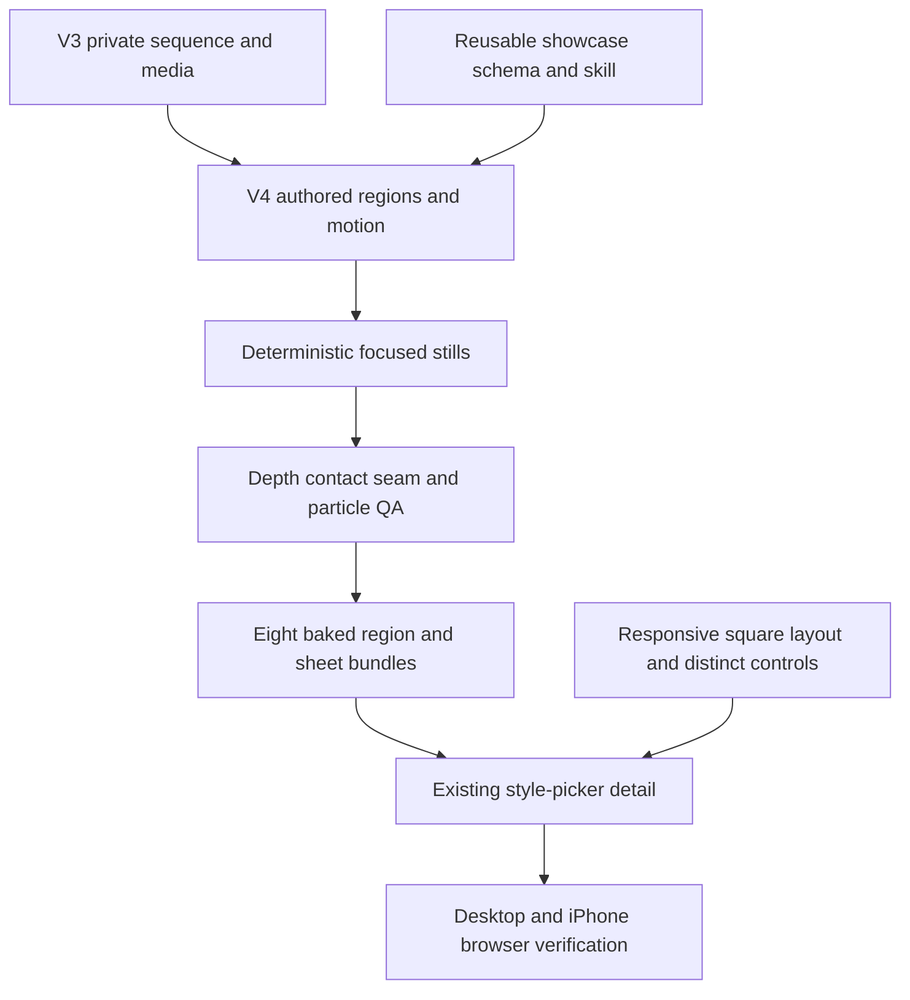

# SmallScaleInt Showcase V4 - Plan

## Goal Capsule

- **Objective:** Rebuild the SmallScaleInt showcase so every stop reads as dense, coherent gameplay; harden the reusable showcase contract; and make the existing style-picker detail fit its two square previews, thumbnail rail, and distinct navigation controls on iPhone-sized screens.
- **Authority:** Issue #371, the merged v3 artifact from #342, the reusable workflow from #343, the fixed `/new` design from #341, and repository rights and test rules govern scope.
- **Execution profile:** Tracked style-picker, reusable showcase, tests, and plan changes plus ignored host-local sequence, compositor, QA, and baked media work.
- **Stop conditions:** Do not commit SmallScaleInt source or derived media, redesign the fixed creation flow, add client-side compositing, modify the frozen `docs/plans/ogm-v1-build/` pack, publish externally, or claim physical-iPhone verification that did not run.
- **Tail ownership:** The implementing agent owns automated checks, direct visual inspection, review fixes, PR/CI handoff, and exact post-deploy steps for any physical-device check.

---

## Product Contract

### Summary

Replace the sparse v3 world with eight deliberately composed gameplay scenes whose ground, architecture, movement, combat, weather, and occlusion behave like a real isometric game.
Preserve the eight synchronized sprite sheets and baked-media delivery boundary while teaching future showcase authors the stricter rules.
Keep the existing Style screen flow and visual language, but make its detail layout contain two square previews, the full thumbnail rail, and visibly different region-versus-set navigation on narrow iPhone viewports.

### Problem Frame

V3 satisfies the mechanical media and story contracts, but its stills expose large empty areas, incoherent ground patches, floating or misaligned props, simplistic depth ordering, an offset portal effect, obvious repeated rain, and combat reactions too weak to read as contact.
Its hero covers too little ground during each 7.5-second stop and therefore appears to teleport at region seams.
The style-picker detail also uses a widescreen aspect ratio for square media and overlays visually similar arrow controls, so the complete detail does not fit or explain itself at the creator's iPhone ratio.

### Requirements

#### Gameplay composition

- R1. Every region uses one coherent ground language with matching roads, borders, curbs, paths, and transitions; the graveyard is rebuilt from compatible tiles with no arbitrary neighboring patterns.
- R2. Every region contains at least twice its v3 number of placed scene elements (ground cells, particles, and paired-sheet sprites do not count): fantasy >=44, desert >=40, dinosaurs >=28, town >=44, modern-zombie >=40, zombie-city >=32, interior >=56, and graveyard >=40. Density remains thematic and spatially legible: streets use buildings, cars, lamps, crates, and sidewalks; villages use stalls, fences, carts, and work areas; graveyards use paths, plots, walls, gates, and a mausoleum. Repeated wall, fence, curb, or plot segments count only when they form a purposeful structure rather than filler.
- R3. Interior regions read as cutaway rooms with connected walls, doors, windows, and furniture anchored against those walls; banners, signs, paintings, windows, and torches are mounted rather than floating.
- R4. Footprint-based depth order prevents interpenetration and nonsensical overlap; the hero, portal, story attacker, target, and contact effect remain readable, while deliberate foreground occlusion is reserved for believable cases such as counters hiding small objects.
- R5. Multi-part props share facing and anchors. The portal effect fills the arch opening, and no boulder, tree, building, or other prop blocks the portal.

#### Motion, reactions, and effects

- R6. The hero's source-authentic walk cadence and world-space distance cover each region continuously during its 7.5-second stop; the next stop begins at the same seam position without a teleport.
- R7. Every combat beat faces attacker and target toward one another, aligns contact with the source action's strike frame, and gives the target a clearly visible one-shot hit, stagger, knockback, or death response that matches the blow.
- R8. Rain and other particles fill the full square viewport and vary deterministic positions, speeds, phases, and lifetimes enough that their loop pattern is not visually obvious.

#### Style-picker and reusable contract

- R9. The Style screen continues to open with representative line-art family icons matching the established genre-tile treatment; set thumbnails remain hidden until a family is chosen.
- R10. At supported desktop and iPhone aspect ratios, the detail contains both square previews, the thumbnail rail, set-cycle controls, and the containing creation-screen actions without clipping or horizontal page overflow.
- R11. Region thumbnail controls and set-cycle controls are visually and semantically distinct while preserving the fixed Back/Previous/Next behavior, keyboard navigation, wording, tokens, and overall layout.
- R12. The reusable `gm-set-showcase` skill and project reference require coherent ground, purposeful density, cutaway interiors, mounted props, footprint depth, protected focal elements, aligned multi-part props, continuous distance-derived walks, timed hit reactions, and deterministic non-obvious particles.
- R13. V3 invariants remain: eight square stops, synchronized disjoint sprite sheets, every pack represented, reorderable data, H.264/faststart MP4 plus GIF/poster fallbacks, and no client compositor, game engine, or canvas preview.

### Acceptance Examples

- AE1. **Given** the graveyard start, contact, reaction, result, and seam stills, **when** they are inspected together, **then** one consistent path-and-plot layout fills the camera and no incompatible ground tile touches another without a transition.
- AE2. **Given** any scene frame, **when** placed elements are counted and compared with v3, **then** the count is at least doubled and every added element belongs to the region's gameplay story rather than acting as filler.
- AE3. **Given** the interior stop, **when** the hero crosses the room, **then** walls form a readable cutaway, wall-mounted art stays on a wall, furniture sits against plausible surfaces, and neither actor clips through furniture.
- AE4. **Given** the portal stop, **when** the camera passes it, **then** the effect and arch share facing and anchor, the effect fills the opening, and the complete portal remains visible.
- AE5. **Given** consecutive stop boundary frames, **when** the last v4 frame is compared with the first frame of the next stop, **then** the hero continues across the same seam without a discontinuous jump.
- AE6. **Given** a combat contact, **when** contact and the following frames are inspected, **then** the strike reaches the target, both actors face correctly, and the target's reaction visibly follows the blow once.
- AE7. **Given** the rain stop over a full loop, **when** a timeline is inspected, **then** drops cover the viewport and do not repeat in obvious synchronized rows or phases.
- AE8. **Given** a 390-by-844 iPhone viewport, **when** SmallScaleInt detail opens, **then** both square previews, the region rail, differentiated set controls, and the page's own navigation remain reachable without sideways page scrolling.

### Scope Boundaries

- Preserve the current `/new` Style flow, copy, tokens, and motion; this ticket repairs fit and control clarity rather than redesigning it.
- Keep set-specific authoring and media under ignored `assets-local/`; only set-neutral contracts, renderer behavior, UI behavior, tests, and this plan are tracked.
- Do not add sound, new style families, new SmallScaleInt packs, new page chrome, or a live preview renderer.
- Do not deploy or republish the private artifact; the Executor owns publication.

---

## Planning Contract

### Key Technical Decisions

- KTD1. Fork the recovered host-local v3 authoring source into a v4 sequence/tool revision before editing, preserving the published v3 receipt and allowing direct v3-versus-v4 counts and still comparisons.
- KTD2. Make authored footprint metadata and focal priority explicit in the host-local compositor, then sort by projected footprint depth plus narrow, documented priority exceptions for the runner, portal, and active story pair.
- KTD3. Derive travel from a continuous per-stop route and validate seam endpoints numerically; preserve the source walk frame rate and change path/layout distance rather than playback speed.
- KTD4. Represent effects as seeded emitters or anchored composite parts, so full-loop rendering stays deterministic while rain distribution and multi-part facing/offset remain auditable.
- KTD5. Treat the shipped UI as the style-picker artifact: render showcase tracks at their actual square ratio; bracket the thumbnail rail with compact rounded-square region controls; and keep the circular set-cycle controls in the title row with separate accessible names. This creates a stable location-and-shape distinction without changing the established flow or adding visible copy.
- KTD6. Strengthen the set-neutral skill only where the v4 findings generalize. Keep the existing `ogm.set-showcase/1` project format compatible and leave SmallScaleInt-specific card references, coordinates, counts, compositor behavior, and private media out of tracked code.

### High-Level Technical Design

### Sequencing

U1 pins the generalized authoring and review guidance before the private compositor adopts it.
U2 repairs the tracked style-picker layout independently of licensed media.
U3 builds each private region through focused still loops, beginning with the graveyard, portal, interior, one combat stop, and one rain stop before applying the proven patterns to all eight.
U4 performs the expensive full render and final desktop/phone QA only after validators and focused stills pass.

### Risks and Dependencies

- The host-local v3 compositor is set-specific and ignored, so executable checks, deterministic stills, v3-v4 count receipts, and visual timelines are the durable proof for its behavior.
- Doubling element counts can reduce legibility; protected focal zones and region-specific composition plans mitigate density turning into clutter.
- Footprint sorting can still fail for unusually tall or wide sprites; focused overlap stills and explicit anchors remain necessary even after the default order improves.
- Physical iPhone Safari and external artifact publication are unavailable in this workspace; exact operator checks remain post-deploy evidence rather than blockers.

---

## Implementation Units

### U1. Strengthen reusable showcase contracts

- **Goal:** Make future set showcases reject the generalized failure modes exposed by v3.
- **Requirements:** R4-R8, R12-R13; AE4-AE7.
- **Dependencies:** None.
- **Files:** `.claude/skills/gm-set-showcase/SKILL.md`, `.claude/skills/gm-set-showcase/references/planning.md`, `.claude/skills/gm-set-showcase/references/sequence.md`.
- **Approach:** Add concise planning, authoring, and review rules for footprint depth, protected focal zones, anchored composite and mounted props, cutaway interiors, purposeful density, seam-continuous travel, contact-timed reactions, and seeded full-viewport particles. Describe outcomes and inspection evidence rather than inventing mandatory schema fields for set-specific compositor features.
- **Patterns to follow:** Existing progressive disclosure between the short entrypoint and the planning/sequence references; preserve the `ogm.set-showcase/1` examples and compatibility.
- **Test scenarios:** A future author can tell from the skill where to plan density and focal zones, how to prove a seamless walk and contact reaction, how to anchor portal/interior parts, and how to inspect particle coverage without loading set-specific guidance.
- **Verification:** Skill Creator quick validation passes; references are reachable from the entrypoint; existing generic showcase tests remain green; direct review finds every R12 rule once in the narrowest relevant layer and no SmallScaleInt path or count in the reusable skill.

### U2. Fit and distinguish the style-picker detail

- **Goal:** Keep the fixed family-first flow while making the showcase detail complete and understandable on desktop and iPhone.
- **Requirements:** R9-R11, R13; AE8.
- **Dependencies:** None.
- **Files:** `apps/web/src/routes/new/StyleStep.tsx`, `apps/web/src/routes/new/new.css`, `apps/web/src/routes/new/StyleStep.test.tsx`, `apps/web/e2e/new.spec.ts`.
- **Approach:** Preserve line-art family tiles; use square preview boxes; bracket the thumbnail rail with compact rounded-square previous/next-region controls; keep circular previous/next-set controls in the title row; and constrain the detail body so all controls remain reachable within the creation-screen viewport. Scrolling remains available for the two stacked square previews on short phones; no preview or control is clipped and the page never scrolls sideways.
- **Patterns to follow:** Current `FamilyStep`, `Icon`, tap-token, focus-restoration, keyboard-cycle, and phone media-query behavior.
- **Test scenarios:** Region and set controls have distinct accessible names and classes; square preview structure persists across fallback/video states; previous/next set wrapping and thumbnail seeking still work; the 390-by-844 browser journey has two square previews, no page-level horizontal overflow, and reachable region/set controls.
- **Verification:** Focused Vitest and Playwright specs pass, and desktop/phone screenshots are inspected with `gm-verify`.

### U3. Rebuild the eight private gameplay regions

- **Goal:** Produce a v4 source sequence whose eight regions satisfy the composition, motion, reaction, and effect contracts before full media encoding.
- **Requirements:** R1-R8, R13; AE1-AE7.
- **Dependencies:** U1.
- **Files:** Ignored v4 sequence, tool, region, and sheet data under `assets-local/sets/smallscaleint/showcase/`.
- **Approach:** Preserve v3, inventory suitable installed SmallScaleInt ground/building/prop/effect candidates, make quick layout variants for the graveyard and interior, select the strongest composition, then author every region to at least twice its v3 item count with protected focal zones and continuous routes. Add footprint sorting, composite anchors, reaction timing, and deterministic particle emitters to the private renderer.
- **Execution note:** Work proof-first from named start/contact/reaction/result/seam stills; fix the largest visible defect in each region before expanding to the next.
- **Test scenarios:** V3-v4 count comparison passes for all regions; ground transition and focal-zone checks pass; seam endpoint deltas are zero; portal parts share facing/anchor; story pairs face and react; rain samples cover the square without identical phase bands; no sprite intersects a protected focal footprint.
- **Verification:** Private preflight, focused deterministic still rendering, numeric route/depth/effect checks, and direct inspection of every named still pass.

### U4. Render, package, and verify the complete artifact

- **Goal:** Replace the private style-picker media with the validated v4 artifact and leave truthful publication evidence.
- **Requirements:** R1-R13; AE1-AE8.
- **Dependencies:** U1-U3.
- **Files:** Ignored media and QA outputs under `assets-local/sets/smallscaleint/showcase/out/`, plus PR/workpad evidence.
- **Approach:** Render the eight cached region and sheet segments once, assemble MP4/GIF/poster bundles, run strict media postflight, inspect start/mid/end/contact/reaction/result/seam stills and full-loop timelines, exercise the tracked UI against representative local showcase fixtures, and record physical-iPhone and Executor-publication work as exact post-deploy checks.
- **Test scenarios:** All 16 bundles are square, loopable, declared, and phone-compatible; every stop boundary is continuous; no important focal element is hidden; the complete tracked detail fits desktop and phone; no private byte enters Git.
- **Verification:** Media probes, manifest audit, direct visual review, relevant repository gates, ignored-file checks, and full-diff code review all pass.

---

## Verification Contract

| Gate | Command or check | Covers | Done signal |
|---|---|---|---|
| Reusable showcase skill | Skill Creator quick validation plus `node --test scripts/assets/showcase/test/*.test.mjs` | U1 | Skill structure and unchanged generic project behavior pass |
| Web component behavior | `pnpm --filter @ogm/web exec vitest run src/routes/new/StyleStep.test.tsx` | U2 | Family, set, region, media, focus, and navigation behavior passes |
| Web browser behavior | Focused `/new` Playwright spec with the repository Chromium flags | U2, U4 | Desktop and 390-by-844 journeys pass without page overflow |
| Private preflight | V4 host-local checker against the real asset catalog | U3 | Counts, refs, ground, footprints, focal zones, routes, composites, stories, effects, pack coverage, and sheet separation pass |
| Private determinism | Render selected timestamps twice and compare hashes | U3 | Identical input and seed produce identical stills |
| Visual QA | Inspect per-region start/contact/reaction/result/seam stills and full timelines | U3, U4 | All acceptance examples are visibly satisfied |
| Media postflight | Probe every v4 MP4/GIF/poster and validate the manifest | U4 | Eight region and eight sheet bundles are square, looping, declared, and phone-compatible |
| Repository static gates | Relevant package lint/typecheck/build plus root formatting and host-name checks | U1, U2 | Every changed tracked surface is clean |
| Rights boundary | `git status --short --ignored`, `git check-ignore`, and tracked-file audit | U3, U4 | No SmallScaleInt source or derived media is tracked |
| Review | `ce-code-review` over the full diff against `main` | U1-U4 | No blocking finding remains and the PR records all dispositions |

Manual-only checks that the workspace cannot perform are copied to the PR as exact `Post-deploy check:` lines and are never reported as executed.

---

## Definition of Done

- U1 is done when the set-neutral skill/schema/tests encode the v4 composition, depth, continuity, reaction, composite, and particle lessons without SmallScaleInt-specific paths or media.
- U2 is done when the fixed style flow retains its line-art family screen and all detail controls fit and remain distinct on both desktop and 390-by-844 browser verification.
- U3 is done when all eight private regions have at least twice their v3 element count and every named still passes the ticket's visual checks.
- U4 is done when the private publication directory contains the complete validated v4 region/sheet media contract and all generated bytes remain ignored.
- Relevant focused tests and static checks pass, every behavior-bearing test is shown to guard its production change, and no blocking full-diff review finding remains.
- The PR starts with `Closes #371`, contains current full-SHA local-test evidence and a `## Review` section, is marked ready, and completes required CI before human-review handoff.
- The final diff contains no private media, secrets, download links, real host paths, frozen planning-pack edits, or unrelated UI redesign.
