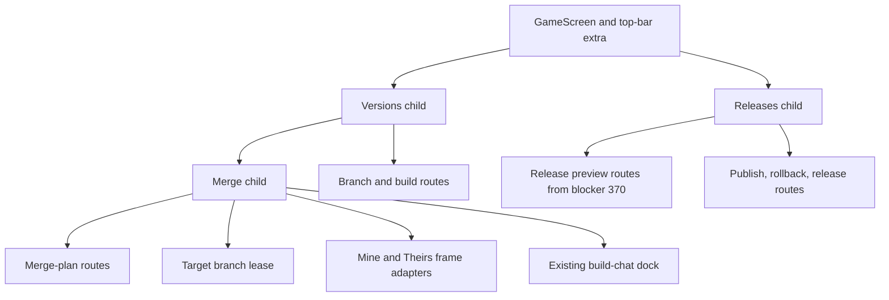
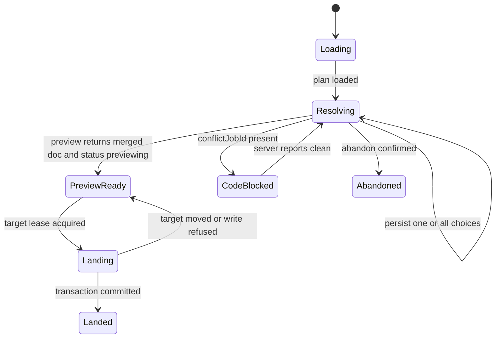

# Versions, Releases, and Merge Screens - Plan

## Goal Capsule

- **Objective:** Deliver prototype-faithful Versions, Releases, and Merge screens behind the game route, using the merged branch, release, merge, frame, and chat seams without moving domain logic into the browser.
- **Authority:** Issue #94 and the frozen OGM-077 research contract define behavior; the landed `studio-v0` and title-town prototype define layout, flow, motion, and copy; merged contracts and APIs define executable request shapes.
- **Execution profile:** Standard frontend work across three nested routes, shared query/mutation adapters, merge-resolution state, two game-frame previews, and focused Vitest and Playwright coverage.
- **Stop conditions:** Do not redesign the prototype, redefine contract families, write Git from the UI, add server-domain implementations owned by release or merge services, or edit the frozen OGM planning pack.
- **Tail ownership:** The implementation owns focused unit and browser tests, workspace typecheck/lint/build gates, full-diff review, blocker #370 integration, PR evidence, and CI handoff.

---

## Product Contract

### Summary

The game route gains three child screens that expose branch history, publishing and rollback, and conflict-by-conflict merge resolution while preserving the existing game-screen composition and server authority.

### Problem Frame

The branch, release, and merge services are implemented, but creators can only reach the game host and editor.
The browser must make server-owned state understandable and actionable without reimplementing version derivation, changelog assembly, affected-save counting, conflict classification, or merge landing.

### Requirements

**Versions**

- R37. Versions lists every branch with its server-derived version, latest build state, and lifecycle state; it supports create-from-head, switch, play, edit, archive, and both merge directions while enforcing the five-active-branch presentation rule.
- R37a. Non-main rows say "Builders work on the main version," archived rows remain visible but cannot be opened, and the current branch is marked.

**Releases**

- R90. Releases shows the published release and history, offers Publish only for a tested build on `main`, prefills an editable server-assembled changelog and derived next version, warns when repository content is public, and surfaces content-gate errors verbatim.
- R92. Rollback previews the affected-save count before confirmation and creates a new rollback release without deleting history.
- R92a. Release dialogs trap focus, close on Cancel or Escape when idle, keep the creator in place on a refusal, and distinguish loading, unavailable, empty-history, and success states.

**Merge**

- R38. Merge starts in either direction, shows automatic-change and real-conflict counts, supports per-conflict `ours`, `theirs`, `both`, or scalar-value choices, and provides "Keep all of mine."
- R38a. Preview requests a preview build, Land remains unavailable until every design conflict and any code conflict are resolved, Abandon preserves branch history, and code conflicts open the owning job chat.
- R38b. Each conflict compares labelled Mine and Theirs game previews, selects the affected entity when available, and falls back to still or text values when a frame cannot become ready.
- R38c. Conflict choices and cards are keyboard-navigable, route-level loading and errors remain visible, and all client writes use the existing session cookie without holding a GitHub credential or service token.

### Key Flows

- F1. Manage a version
  - **Trigger:** A creator opens Versions from the game top bar.
  - **Steps:** Load branches and builds, inspect the current row, then create, switch, play, edit, archive, or begin a merge.
  - **Outcome:** Navigation carries the selected branch in `v`, while branch mutations refetch authoritative state.
- F2. Publish or restore
  - **Trigger:** A creator opens Releases on `main` with a tested build or selects an older release.
  - **Steps:** Fetch the read-only preview, edit or inspect its consequences, confirm the write, and refresh published/release state.
  - **Outcome:** The game returns to the newly published pointer or the dialog stays open with the server refusal.
- F3. Resolve and land a merge
  - **Trigger:** A creator chooses a merge direction from a branch row.
  - **Steps:** Start or load a plan, compare each conflict, persist resolutions, request a preview build, acquire the target lease, then land or abandon.
  - **Outcome:** The server lands one transaction only after all conflicts are resolved.

### Acceptance Examples

- AE1. Given five active branches, Versions disables "New version from here" and shows `5 of 5`; given four active and one archived branch, it enables the action.
- AE2. Given a non-main branch, Publish is absent; given `main` with a tested build, Publish opens with the preview changelog and sends the creator's edited summary and items.
- AE3. Given rollback preview count `3`, the dialog says "3 saves" before enabling confirmation and sends no rollback request until the creator confirms.
- AE4. Given one unresolved `both_changed` conflict, "Keep all of mine" persists `ours` for that conflict and enables Preview when no code conflict remains; the successful preview then enables Land.
- AE5. Given a phone viewport, Publish, Land, Switch, and Play are at least 64 px; Archive and Abandon are at least 44 px; Mine and Theirs remain labelled for assistive technology.

### Scope Boundaries

**In scope**

- Nested game child routes, one additive top-bar extra, client adapters, dialogs, resolution state, side-by-side frame mounting, and focused unit/browser tests.
- Minimal changes to the game route needed to replace its versions/releases placeholders and register the optional merge child.

**Deferred to blocker #370**

- Read-only publish preview and rollback-impact preview routes that reuse release-service derivation, assembly, and save counting without side effects.

**Out of scope**

- Branch storage, version derivation, merge computation/classification, release folding, content-gate policy, save-status mutation, game/editor redesign, forks, and picker-card version badges.

### Product Contract Preservation

Product Contract unchanged from OGM-077.
The plan adapts stale route sketches to merged APIs while preserving all user-visible outcomes and acceptance checks.

---

## Planning Contract

### Key Technical Decisions

- KTD1. **Preserve the landed prototype composition.** Child screens reuse the game screen's tokens, typography, button language, motion limits, and full-screen hierarchy instead of adding navigation, panels, helper copy, or a new settings shell. (session-settled: user-directed — chosen over redesigning these screens: the landed prototype is the product design)
- KTD2. **Use merged request shapes as executable truth.** Branch creation sends the actual `{ name, fromBranchId }` body because the service forks at the selected branch head; the UI does not send the stale `fromRev` sketch rejected by the strict route parser.
- KTD3. **Keep release previews server-owned.** The client consumes blocker #370's read-only `publish-preview` and `rollback-preview` routes; it does not duplicate changelog assembly, version derivation, or save counting.
- KTD4. **Register nested screens through the existing game route.** The current router scans top-level screen modules and already owns child placeholders, so the nested modules export child elements and `routes/game/route.tsx` installs them without widening the global route collector.
- KTD5. **Keep merge choices in a pure reducer and persist every choice.** Local state makes re-render behavior deterministic, while each choice is posted to the plan before Preview can proceed; the server locks choices after the plan reaches `previewing`, and Land requires that successful preview status.
- KTD6. **Reuse the existing frame adapter.** Side-by-side previews mount through `mountGameFrame`, send the authoritative design snapshots, select the affected entity only after readiness, dispose on every unmount, and expose text fallback independently for each side.
- KTD7. **Acquire the existing target-branch lease for Land.** The merge route already requires `sessionId` and lease token, so the screen uses the editor API's lease adapter and releases the lease after the land attempt.
- KTD8. **Open code conflicts through the existing dock store.** The merge screen loads the current job list and asks `useDock` to open the referenced conflict job rather than adding a separate chat route.
- KTD9. **Edit the assembled changelog as one public text value.** The publish preview's summary and item text are rendered into one textarea; the edited value is posted as the release summary with an empty item list so the creator controls exactly the public words without inventing client-side note parsing.
- KTD10. **Keep credentials outside route state.** All adapters call the existing same-origin `api` helper with its session cookie; authorization remains server-side and no route accepts, stores, or logs a GitHub credential, service token, or lease token beyond the one Land request.

### High-Level Technical Design

The child screens remain projections over existing service contracts.

The merge lifecycle keeps server status and local resolution completeness distinct.

### Assumptions

- Blocker #370 lands the two caller contracts recorded on that issue before this PR is made ready.
- The current release list remains chronological and includes the build and snapshot identifiers needed for display and rollback selection.
- Source and target branch design snapshots are the Mine and Theirs comparison documents; the successful preview response supplies the resolved merged document and reuses the target build id for the final preview frame.
- A successful publish or rollback may return to the game route and reload published state because OGM-075's update indicator is effect-based rather than a shared React Query entry.

### Sequencing

U1 establishes typed adapters and pure rules.
U2 and U3 build the Versions and Releases surfaces independently.
U4 adds merge resolution, frames, lease-backed landing, and chat integration.
U5 proves the three screens together after the blocker API is integrated.

### Risks and Dependencies

- **Release previews are missing on main:** #370 is a declared blocker; caller scaffolding can proceed, but this PR stays draft until the real API is integrated.
- **Two live frames can be expensive:** text values render first, each frame owns its own readiness/fallback state, and mobile presentation remains stacked without hiding either label.
- **Server extras are not in the base Zod type:** client view types extend the consumed loose-object contracts only with server-returned display fields such as `version`; no contract family is redefined.
- **Target movement can invalidate a plan:** a 409 remains visible and refetches authoritative branches/plan state instead of pretending the landing succeeded.

---

## Implementation Units

### U1. Typed API Adapters and Pure State Rules

- **Goal:** Add typed branch, build, release-preview, release-write, merge-plan, and lease adapters plus pure eligibility and resolution helpers.
- **Requirements:** R37, R90, R92, R38, KTD2, KTD3, KTD5, KTD7.
- **Dependencies:** Blocker #370 defines the two release preview responses.
- **Files:** `apps/web/src/routes/game/versions/api.ts`, `apps/web/src/routes/game/versions/rules.ts`, `apps/web/src/routes/game/releases/api.ts`, `apps/web/src/routes/game/releases/rules.ts`, `apps/web/src/routes/game/merge/api.ts`, `apps/web/src/routes/game/merge/resolution.ts`, and colocated tests.
- **Approach:** Consume `Branch`, `Build`, `Release`, `MergePlan`, and `MergeConflict`; extend only response projections; encode path segments; keep API errors available to dialogs; invalidate/refetch through explicit query keys; model the merge preview response separately from `MergePlan` because it carries `{ previewBuildId, doc, rev }`.
- **Patterns to follow:** `apps/web/src/lib/api/client.ts`, `apps/web/src/routes/games/useBranches.ts`, `apps/web/src/routes/admin/api.ts`.
- **Execution note:** Start with failing pure tests for the active-branch cap, publish eligibility, all-mine, custom scalar persistence, and landability.
- **Test scenarios:**
  - Five active branches return false from `canCreateVersion`; four active plus two archived return true.
  - Publish eligibility is true only for the `main` branch with its latest `tested` build.
  - `allMine` resolves every conflict to `ours`; one missing resolution keeps Preview disabled; Land remains false until the plan is `previewing`; a custom `{ value }` survives a reducer round trip.
  - Encoded game, branch, plan, conflict, build, and release ids reach the exact merged API paths and request bodies.
  - Gate and pointer errors retain server response text or structured reasons for the dialog.
- **Verification:** Focused Vitest coverage proves pure invariants and request contracts without rendering a screen.

### U2. Versions Screen and Game Navigation Seam

- **Goal:** Replace the Versions placeholder with branch rows, create/archive dialogs, branch navigation, merge-direction actions, and one top-bar entry that also links to Releases.
- **Requirements:** R37, R37a, F1, AE1, KTD1, KTD4.
- **Dependencies:** U1.
- **Files:** `apps/web/src/routes/game/versions/route.tsx`, `apps/web/src/routes/game/versions/VersionsScreen.tsx`, `apps/web/src/routes/game/versions/VersionRow.tsx`, `apps/web/src/routes/game/versions/NewVersionDialog.tsx`, `apps/web/src/routes/game/versions/VersioningDialog.tsx`, `apps/web/src/routes/game/versions/VersionControls.tsx`, `apps/web/src/routes/game/versions/versioning.css`, `apps/web/src/routes/game/versions/VersionsScreen.test.tsx`, `apps/web/src/routes/game/versions/VersioningDialog.test.tsx`, `apps/web/src/routes/game/extras.ts`, `apps/web/src/routes/game/route.tsx`.
- **Approach:** Use the selected `v` query or main branch, preserve server order, show archived and merged rows, create from the selected branch id, and navigate Play/Edit/Switch back through the canonical game URL; render explicit loading, empty, and retryable error states inside the existing overlay hierarchy.
- **Patterns to follow:** `apps/web/src/routes/game/PlayEditBar.tsx`, `apps/web/src/features/room/RoomControls.tsx`, `apps/web/src/routes/games/GamesScreen.tsx`.
- **Test scenarios:**
  - Covers AE1. Render five active rows and expect disabled create plus `5 of 5`; replace one with archived and expect enabled create.
  - Mark the branch selected by `v`; switch, play, and edit produce the expected game URLs.
  - Confirm archive once, post to the exact route, and refetch; main exposes no archive action.
  - Non-main active rows show "Builders work on the main version"; archived rows expose no open actions.
  - Starting either merge direction navigates with source and target branch identifiers intact.
- **Verification:** The nested route renders inside the existing game shell and every row action has an accessible name and required target size.

### U3. Releases, Publish, and Rollback Dialogs

- **Goal:** Show published/history state, preview and edit a publish changelog, preview rollback impact, execute confirmed writes, and preserve server refusals verbatim.
- **Requirements:** R90, R92, F2, AE2, AE3, KTD1, KTD3.
- **Dependencies:** U1 and blocker #370.
- **Files:** `apps/web/src/routes/game/releases/route.tsx`, `apps/web/src/routes/game/releases/ReleasesScreen.tsx`, `apps/web/src/routes/game/releases/PublishDialog.tsx`, `apps/web/src/routes/game/releases/RollbackDialog.tsx`, `apps/web/src/routes/game/releases/ReleasesScreen.test.tsx`, `apps/web/src/routes/game/releases/PublishDialog.test.tsx`, `apps/web/src/routes/game/releases/RollbackDialog.test.tsx`.
- **Approach:** Select the current branch and its latest build from shared query data, fetch previews only after opening a dialog, keep confirm disabled while preview data is absent, serialize the preview changelog into one editable textarea, and keep dialogs open on failure; a shared dialog wrapper owns initial focus, Tab wrapping, Escape, and focus restoration.
- **Patterns to follow:** `apps/web/src/features/editor/ReapplyCard.tsx`, `apps/web/src/routes/game/UpdateIndicator.tsx`, `apps/web/src/lib/api/client.ts`.
- **Test scenarios:**
  - Covers AE2. Non-main has no Publish; tested main opens a prefilled dialog and posts the edited changelog.
  - Building, failed, missing, or non-main builds cannot publish.
  - A public repository warning appears only for `repoVisibility: 'public'`.
  - A gate refusal naming an asset and rule remains visible verbatim and the dialog stays open.
  - Covers AE3. Rollback confirm stays disabled during preview loading, shows `3 saves`, then posts only after confirmation.
  - A pointer-moved 409 refetches published/releases state and asks the creator to review again.
  - Tab and Shift+Tab remain inside either dialog, Escape closes only while idle, and focus returns to the invoking action.
- **Verification:** Dialog focus, loading, error, cancel, and success behavior are covered without mutating before confirmation.

### U4. Merge Resolution, Comparison Frames, and Landing

- **Goal:** Start/load merge plans, resolve every real conflict, compare Mine and Theirs, preview, open code-conflict chat, lease and land, or abandon.
- **Requirements:** R38, R38a, R38b, F3, AE4, KTD5, KTD6, KTD7, KTD8.
- **Dependencies:** U1 and U2 merge entry actions.
- **Files:** `apps/web/src/routes/game/merge/route.tsx`, `apps/web/src/routes/game/merge/MergeScreen.tsx`, `apps/web/src/routes/game/merge/ConflictCard.tsx`, `apps/web/src/routes/game/merge/SideBySide.tsx`, `apps/web/src/routes/game/merge/MergeScreen.test.tsx`, `apps/web/src/routes/game/merge/SideBySide.test.tsx`.
- **Approach:** Keep URL source/target only for plan creation, use the returned plan thereafter, load both branch snapshots, post each resolution while the plan is resolving, call Preview once after all conflicts resolve, lock choices at the server's `previewing` status, mount its returned merged document, and acquire/release the target lease around Land.
- **Patterns to follow:** `apps/web/src/features/editor/frame.ts`, `apps/web/src/features/editor/api.ts`, `apps/web/src/features/build-chat/dock.ts`.
- **Test scenarios:**
  - Covers AE4. One `both_changed` conflict shows false/true values; all-mine posts `ours` and enables Preview when code is clean; a successful Preview then enables Land.
  - `delete_vs_edit` exposes Both; `both_changed` omits Both; a scalar conflict exposes Value and preserves the typed value after re-render.
  - One frame becoming ready selects the entity; the other frame failing shows its text fallback without removing the ready frame.
  - Preview returns a merged document, revision, and preview build id, moves the plan to `previewing`, and enables Land; a failed preview leaves the plan resolving and reports the failure.
  - A code conflict opens the referenced job chat and keeps Land disabled until the server reports clean.
  - Land acquires the target lease, sends session and token, releases after completion, and handles target-moved failure without navigating away.
- **Verification:** Reducer, component, frame lifecycle, API, and lease tests prove one-transaction landing is unreachable from incomplete state.

### U5. Browser Contract and Responsive Evidence

- **Goal:** Prove the three child routes and mutation bodies together against mocked API responses on desktop and phone.
- **Requirements:** AE1, AE2, AE3, AE4, AE5.
- **Dependencies:** U2, U3, U4, blocker #370 integrated.
- **Files:** `apps/web/e2e/versions-releases-merge.spec.ts`, `apps/web/e2e/fixtures/versioning-routes.ts`, `apps/web/e2e/fixtures/merge-ae3.json`.
- **Approach:** Install signed-in mocks with in-memory branch, release, merge, preview, and land state; use the existing cross-origin bridge fixture for preview-frame readiness; assert outgoing JSON rather than implementation details.
- **Patterns to follow:** `apps/web/e2e/game-editor.spec.ts`, `apps/web/e2e/support/mock-game-api.ts`, `apps/web/e2e/fixtures/games-routes.ts`.
- **Test scenarios:**
  - Versions lists three derived numbers and disables creation at five active branches.
  - Main publish opens from preview data and sends the edited changelog; non-main has no Publish.
  - Rollback displays `3 saves` before the POST is permitted.
  - The AE3 merge fixture renders one `both_changed` card, all-mine enables Land, and Land sends the resolved plan.
  - Covers AE5. Phone target boxes meet 64 px primary and 44 px secondary minimums without overflowing the viewport.
- **Verification:** Both Playwright projects pass with the repository's GPU flags and the mocked route fixture records the expected writes.

---

## Verification Contract

| Gate | Command | Coverage | Done signal |
|---|---|---|---|
| Focused unit tests | `pnpm --filter @ogm/web test -- routes/game/versions routes/game/releases routes/game/merge` | U1-U4 rules, dialogs, reducers, frames, requests | All selected Vitest files pass and each new behavior test fails without its production change |
| Focused browser tests | `pnpm --filter @ogm/web e2e -- versions-releases-merge` | U5 desktop/phone flows and request bodies | Both Playwright projects pass with no unmocked API request |
| Workspace types | `pnpm -r typecheck` | Consumed contracts and cross-package references | All workspace typechecks pass |
| Workspace lint | `pnpm -r lint` | Repository style and unsafe frontend patterns | All workspace lint tasks pass |
| Web build | `pnpm --filter @ogm/web build` | Production route discovery and bundle integration | TypeScript and Vite build complete |
| Full-diff review | `ce-code-review` against `main` | Correctness, tests, project standards, maintainability, accessibility | No blocking finding remains; every non-blocking finding is recorded in the PR |

The local-tests policy is partial: run changed tests, their direct source mirrors, route integration tests, the focused browser spec, and the ticket-required workspace typecheck/lint gates.

---

## Definition of Done

- U1-U5 satisfy their verification outcomes and every acceptance example has an automated assertion.
- Blocker #370's real preview API is integrated; no placeholder endpoint, fake production value, temporary stub, or TODO remains.
- Versions, Releases, and Merge preserve prototype layout, flow, motion, and copy and add no new application chrome.
- Version numbers, changelog assembly, rollback counts, merge classification, and Git writes remain server-owned.
- Every frame, poll, query, dialog, and lease cleans up on unmount, cancellation, or route change.
- Primary and secondary targets meet the ticket's phone-size requirements and dialog/frame labels are accessible.
- Dialogs trap and restore focus, conflict controls are keyboard-operable, route loading/empty/error states are visible, and phone comparison frames stack without dropping Mine or Theirs labels.
- Same-origin session cookies remain the only browser credential; no GitHub credential, service token, or secret appears in client state, URLs, fixtures, or logs.
- The diff contains no abandoned experiment, duplicated contract, secret, provider key, generated asset, or planning-pack edit.
- The PR body records the tested head, base SHA, exact command results, blocker integration, review personas/findings, and any prototype-versus-ticket route-shape drift.
