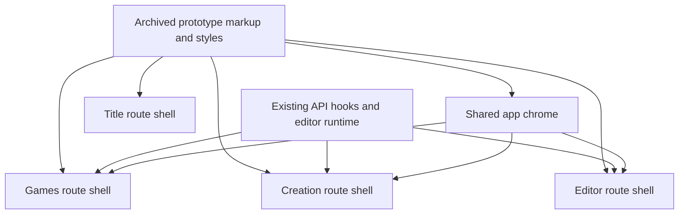
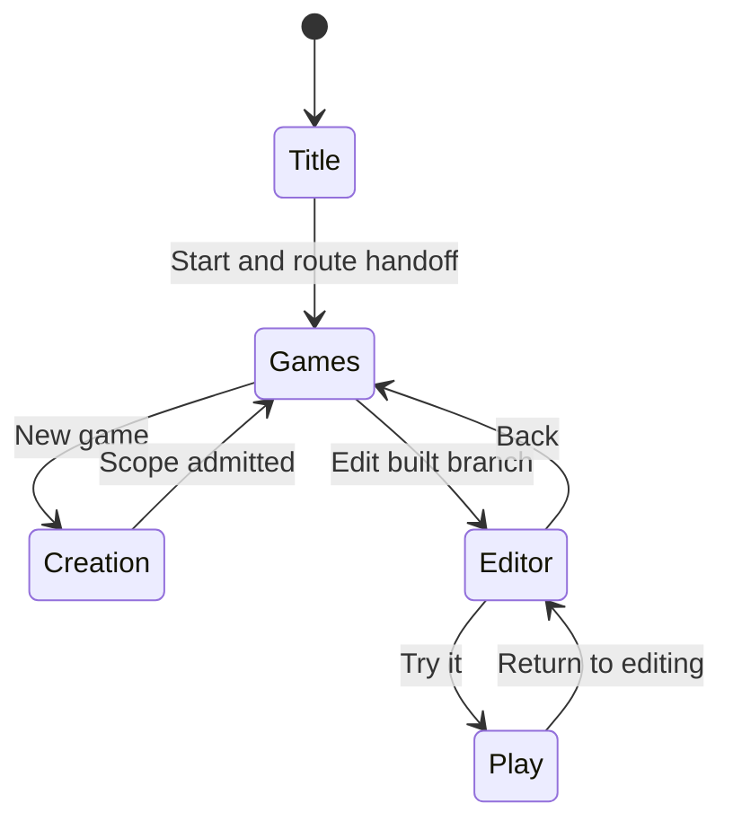
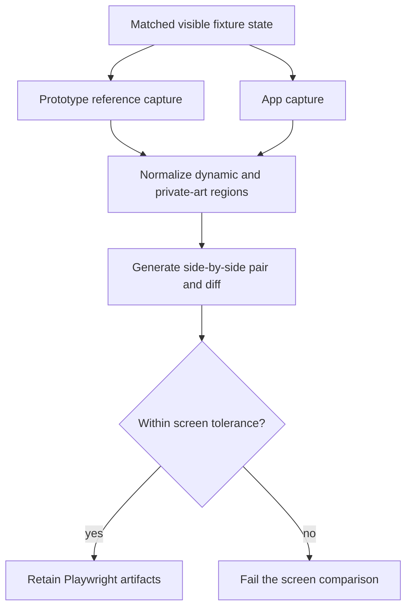

# Prototype UI Fidelity - Plan

## Goal Capsule

- **Objective:** Make the title, games, creation, and editor surfaces use the archived prototypes' layout, motion, copy, and chrome while retaining the real application data and behavior already implemented in `apps/web`.
- **Product authority:** The unwrapped project rule “Design is fixed” and the archived `prototypes/studio-v0/` and `prototypes/ui-v0/` sources govern appearance; current `apps/web` APIs, contracts, accessibility behavior, and tests govern application logic.
- **Execution profile:** Land screen-scoped changes in dependency order, keeping shared chrome and visual proof separate enough to review without redesigning the product.
- **Stop conditions:** Stop for a conflict that would require changing product flow, public API contracts, or asset-licence boundaries; do not stop for routine CSS or component-boundary choices.
- **Tail ownership:** The implementation includes focused unit/browser validation, two-viewport comparison artifacts, code review, PR evidence, and exact post-deploy checks for anything the workspace cannot exercise on `makeopen.games`.

---

## Product Contract

### Summary

This plan replaces the generic visual shells in `apps/web` with the archived prototype presentation while leaving the working title-town bridge, game APIs, creation admission flow, editor transactions, and build chat behavior in place.
The result is one coherent studio flow with real data, no production sample games, and automated visual regression evidence for phone and desktop.

### Problem Frame

The MVP already implements the four required surfaces, but their React shells diverge from the prototypes that established the product's approved look and motion.
The title lacks the prototype's entrance and exit timing, the app chrome omits or repositions global controls, the library and wizard retain generic replacements, and the editor's floating dark controls do not match the paper-panel shell in `prototypes/ui-v0`.
The task is a fidelity migration, not a new flow: logic should survive while markup and styling adopt the proven presentation.

### Requirements

**Title and global chrome**

- R1. The title keeps the existing live town bridge but matches the studio prototype's logo sizing, Start treatment, entrance motion, 450 ms top-layer fade, sound button and volume-pill behavior, and reduced-motion fallback. While the title remains open, the complete town sequence loops indefinitely back to the kaiju opening without remounting, cutting, dimming, interrupting audio, or disabling Start/sound controls.
- R2. Non-title screens show the prototype's small logo, living dark backdrop, sound button and volume pill, progress control, and bug-report control in the prototype positions without overlapping primary actions.
- R3. Generated title-town assets remain host-local and the public source tree gains no Synty, SmallScaleInt, private music, or other licence-restricted output.

**Games and creation**

- R4. The games route uses the prototype spotlight, card grid, responsive breakpoints, cover treatment, and Play/Edit/New game actions with the real games, branches, jobs, covers, and thumbnails returned by the API.
- R5. The games route has no production fallback or import from `prototypes/studio-v0/data.js`; loading, error, and empty states use the prototype visual language.
- R6. The creation route matches the prototype's header, progress markers, option tiles, custom-entry form, summary chips, chat, and navigation while retaining the existing genre, vibe, style family, world, players, POV, attachment, scope-session, and admission behavior.
- R7. The family-first Style step keeps the behavior accepted in issues 341 and 372 and is restyled inside the prototype wizard without adding helper text or losing phone viewport fit.

**Editor**

- R8. Edit mode uses the prototype editor shell: paper top bar, category rail, stage, item tray/palette, inspector, HUD, pause/settings surfaces, and build-chat dock around the existing iframe bridge and editor transaction logic.
- R9. Play/edit transitions preserve the current real mode changes, lease/read-only handling, save/update indicators, touch controls, and settings behavior while matching the prototype's panel motion and responsive layout.

**Verification and cleanup**

- R10. Every surface has deterministic phone `390x844` and desktop `1280x800` comparison coverage using the same synthetic data on the prototype and app sides, with comparison pairs retained as Playwright artifacts.
- R11. Each screen has a screenshot-regression assertion that fails when its approved shell drifts beyond the documented tolerance; dynamic/private artwork is neutralized or masked in CI so the assertion measures the public UI shell.
- R12. Generic replacement markup and styles made redundant by the prototype shell are removed, while reusable logic, API adapters, contracts, focus behavior, and tests remain.
- R13. Keyboard, gamepad, touch target, safe-area, reduced-motion, and accessible-name behavior already covered by the app remains green after the visual migration.

### Key Flows

- F1. Title to library
  - **Trigger:** A creator opens the root route and activates Start.
  - **Steps:** Poster paints first, the town becomes live underneath it, audio unlocks immediately, the title top layer fades, and routing continues to the authenticated or sign-in destination.
  - **Outcome:** No black frame, dim cross-fade, late audio start, or interaction during the leaving transition.
  - **Covered by:** R1, R2, R3, R13
- F2. Browse and open a game
  - **Trigger:** A signed-in creator opens Games and selects an API-backed card.
  - **Steps:** The spotlight adopts that game's real metadata and cover, branch availability controls Play/Edit, and closing restores focus to the selected card.
  - **Outcome:** The prototype composition is preserved without sample games or fake actions.
  - **Covered by:** R4, R5, R13
- F3. Create a game
  - **Trigger:** A creator chooses New game.
  - **Steps:** The creator moves through the prototype-styled option steps, selects a real style set, supplies optional custom choices and attachments, agrees scope in chat, and submits the real admission request.
  - **Outcome:** Existing creation behavior remains intact behind the prototype form and chat shell.
  - **Covered by:** R6, R7, R13
- F4. Edit and play
  - **Trigger:** A creator opens Edit for a built branch.
  - **Steps:** The bridge loads inside the paper editor shell, palette and inspector actions create real transactions, play mode dismisses edit chrome, and pause/settings/build chat remain available in their approved places.
  - **Outcome:** The prototype editor layout hosts the current editor runtime without weakening lease, save, or bridge behavior.
  - **Covered by:** R8, R9, R13

### Acceptance Examples

- AE1. Given the title at either required viewport, when the town reports ready and later reaches the sequence boundary, then only the poster fades, the kaiju opening begins again over the continuously live render and audio, and the logo, Start button, and sound control remain usable in the prototype geometry.
- AE2. Given three API games, when one is spotlighted, then the app and prototype comparison fixtures show the same titles and selection while Play/Edit use the API branch build and no production sample-data module is loaded.
- AE3. Given an empty games response, when the route settles, then the empty state offers New game in the prototype's visual language and renders no sample cards.
- AE4. Given the creation fixture at any option step, when a choice or custom value is added, then prototype-styled selection, summary, Back, Skip/Next, and talk-step behavior reflect the same real creation state.
- AE5. Given edit mode on phone and desktop, when a palette item is selected and placed, then the prototype-styled rail, tray, stage, inspector, and top bar remain in view and the existing transaction reaches the API.
- AE6. Given reduced motion, when any approved screen enters, leaves, or changes panels, then state changes remain immediate and usable without long animation.

### Success Criteria

- The five named UI state pairs—title, games, creation option, creation talk, and editor—are available at `390x844` and `1280x800`, with any intentional non-pixel differences listed in the PR.
- The comparison suite and the existing title, games, new-game, editor, router, sound, input, build-chat, and bug-report coverage pass.
- Production code does not reference `prototypes/studio-v0/data.js` or add a fake game fallback.
- No restricted asset or host-local build output is tracked.
- The deployed-site checks are recorded as post-deploy checks when they cannot run in the issue workspace.

### Scope Boundaries

**In scope**

- Visual shell, markup, responsive layout, motion, and copy changes needed to match the archived prototypes.
- Small component extraction or consolidation required to share global logo, sound, background, and control placement.
- Deterministic synthetic browser fixtures and comparison tooling for the approved surfaces.

**Out of scope**

- New game concepts, new creation steps, redesigned navigation, additional helper text, or changes to the prototype's approved visual direction.
- API, database, contract, job, bridge-protocol, or asset-catalog behavior changes unless a visual component exposes an existing value already returned by those systems.
- Editing frozen prototype source, committing generated pack assets, deploying to Netlify, or changing unrelated authentication/admin/settings screens.

---

## Planning Contract

### Key Technical Decisions

- KTD1. Treat prototype code as a read-only visual oracle and implement the shell in React components and route CSS. This preserves the frozen archive and prevents production behavior from depending on prototype sample data.
- KTD2. Preserve current feature components and state hooks wherever they own real behavior; change their DOM shape only where the prototype layout requires it. This keeps API and editor correctness tests authoritative.
- KTD3. Put global logo, living background, sound, progress, and bug controls in application chrome, while the title route keeps its dedicated full-screen composition. Route ownership prevents editor and title-specific controls from fighting fixed global positions.
- KTD4. Use screen-scoped commits on the authoritative `aiur/401` branch unless the Executor's sequencing answer requires literal stacked PRs. Four literal closing PRs would otherwise conflict with the single-ticket lifecycle.
- KTD5. Build visual comparisons from deterministic fixtures, reduced motion or controlled time, neutral artwork, and named viewport dimensions. The reference server exposes only tracked prototype files; browser-route interception replaces missing licensed/generated URLs with deterministic placeholders, and app API fixtures mirror the prototype's visible labels and state. Generated/private art is validated through local or post-deploy capture rather than committed baselines.
- KTD6. Reuse Playwright, the existing API fixtures, and the existing `sharp` dependency for pair/diff artifacts; add no image-comparison package.

### Assumptions

- The Executor will accept screen-scoped commits in one PR as the default interpretation of “sub-PR per screen” unless the non-blocking sequencing decision says otherwise.
- CI comparison assertions may mask or neutralize town, game-cover, showcase, and embedded-game pixels when those pixels come from generated or private assets; geometry, chrome, typography, and public interaction states remain compared.
- The existing real-data component boundaries are sound and do not need API-contract changes to render the prototype shell.
- The archived studio and UI prototype DOM/CSS remains the visual oracle. Reference capture does not depend on running either prototype's build scripts or on `assets-local/`; missing image, model, audio, and town URLs are intercepted or masked before readiness assertions.

### High-Level Technical Design

The diagrams describe the implementation relationships; the prose and unit contracts remain authoritative.

### Sequencing

Shared chrome and test utilities land before route-specific styling.
The title and games slices establish the studio-v0 token and motion patterns, creation reuses them, and the editor applies the separate light paper theme from ui-v0 without changing the embedded game.
Visual comparison coverage closes each slice and the final verification unit runs the cross-screen proof together.

### Risks and Dependencies

- **Archived pages request untracked licensed/generated assets.** The reference harness serves tracked files only and substitutes deterministic responses at the browser boundary. It never invokes prototype build scripts, copies from `assets-local/`, or writes beneath `prototypes/`.
- **The prototype and app use different data shapes.** Reference scenarios choose fixed visible labels/states already expressible by the prototype, while API mocks return the corresponding real contract shape to the app. Before capture, assertions verify the same selected title, step, and mode on both sides.
- **Pixel diffs can measure dynamic content instead of the shell.** Town, cover art, and embedded-game rectangles are replaced or masked consistently on both images. Typography, geometry, controls, focus states, colors, and public motion endpoints remain inside the compared region.
- **Responsive shell work can regress keyboard, gamepad, touch, or focus behavior.** Existing behavioral tests remain authoritative; new comparisons supplement them and do not replace input, accessible-name, bridge, or transaction coverage.
- **Global fixed controls can overlap route-owned actions.** U1 establishes measured non-overlap assertions before route migrations, and every route comparison runs at both acceptance viewports.
- **Literal stacked PRs conflict with a single Aiur ticket lifecycle.** Unless the pending Executor sequencing answer says otherwise, screen-scoped commits provide review boundaries in one ticket-closing PR; no visual slice is declared complete without its own comparison and focused behavior tests.

### Sources and Research

- `prototypes/studio-v0/index.html`, `app.js`, `icons.js`, and `data.js` define the approved title, library, creation, global chrome, and fake-data boundary.
- `prototypes/ui-v0/site/index.html` and `style.css` define the editor shell and responsive panel motion.
- `apps/web/src/routes/title/`, `games/`, and `new/` own the current real route behavior.
- `apps/web/src/features/editor/`, `apps/web/src/routes/game/`, and `apps/web/src/features/build-chat/` own the current editor, HUD/settings, bridge, and chat behavior.
- `apps/web/e2e/title.spec.ts`, `games.spec.ts`, `new.spec.ts`, and `game-editor.spec.ts` provide the focused browser fixtures and acceptance paths.
- Commit `2697451c` ported the title-town runtime; commit `e7aaa78d` began prototype alignment for Games; commits `1f4fae09` and `db998987` established the accepted family-first Style behavior; commit `96855c9c` completed manifest-driven editor controls.

---

## Implementation Units

### U1. Shared studio chrome and deterministic visual fixtures

- **Goal:** Establish the prototype tokens, living background, shared logo/sound/control placement, and comparison infrastructure used by the four route slices.
- **Requirements:** R2, R3, R10, R11, R13; KTD1, KTD3, KTD5, KTD6.
- **Dependencies:** None.
- **Files:** Modify `apps/web/src/app/router.tsx`, `apps/web/src/app/chrome.css`, `apps/web/src/tokens.css`, `apps/web/src/features/bug-report/bug.css`, `apps/web/src/features/build-chat/dock.css`, `apps/web/src/app/router.test.tsx`, and `apps/web/playwright.config.ts`; create focused chrome/background components and tests under `apps/web/src/app/`; create prototype-serving and visual-comparison helpers under `apps/web/e2e/support/`.
- **Approach:** Port the living background and fixed-control geometry into reusable app chrome, extract the sound button and expanding volume pill from the title without duplicating sound state, render a real linked small logo outside the title, and reserve non-overlapping fixed slots for sound, build progress, and bug reporting. Serve only tracked prototype files on an unused strict loopback port. Intercept missing asset URLs with deterministic placeholders and drive each reference page to a named visible state; do not run archive build scripts or read `assets-local/` in tests.
- **Execution note:** Add a comparison assertion that fails against the current generic chrome before completing route styling.
- **Patterns to follow:** `apps/web/src/app/router.tsx` route-owned chrome; `apps/web/src/lib/sound/` external-store state; `apps/web/e2e/support/mock-game-api.ts` fixture interception; `apps/web/e2e/support/serve-bridge-game.ts` loopback-only support server.
- **Test scenarios:**
  - A non-title app route renders the linked small logo, sound control, bug control, and build-progress slot with distinct non-overlapping bounds at both required viewports.
  - Sound state, accessible labels, volume-pill expansion, range changes, and outside-click collapse stay synchronized between title and app chrome, including tap-to-unlock and mute/unmute paths.
  - No build job leaves the progress control absent without moving sound or bug into a primary-action region; an active job moves controls to the prototype arrangement.
  - The prototype support server binds `127.0.0.1` on a unique strict port, serves tracked reference files, rejects path traversal, and never serves ignored asset-library content.
  - Reference readiness fails when its asserted title, wizard step, selected item, or editor mode does not match the app fixture state.
  - The comparison helper retains reference, app, pair, and diff artifacts and fails when a known geometry delta exceeds a named per-screen tolerance.
- **Verification:** Shared chrome has stable bounds and accessible controls on phone/desktop; support tooling is deterministic and loopback-only; no restricted asset becomes tracked.

### U2. Title fidelity and seamless transition

- **Goal:** Make the React title composition and transition match the studio title while preserving the town bridge and route destinations.
- **Requirements:** R1, R3, R10, R11, R13; F1; AE1; KTD1, KTD2, KTD5.
- **Dependencies:** U1.
- **Files:** Modify `apps/web/src/routes/title/TitleScreen.tsx`, `TitleTown.tsx`, `title.css`, `TitleTown.test.tsx`, `apps/web/e2e/title.spec.ts`, and the initial poster markup in `apps/web/index.html`; add the title comparison case to the visual suite.
- **Approach:** Match prototype grid rows, safe-area padding, logo constraints, sticker button, entrance animations, sound nudge, and short-screen rules. Start audio and confirmation feedback on activation, guard double activation, keep the live town underneath while only the title layer fades, and navigate after the prototype delay with a zero-delay reduced-motion path.
- **Patterns to follow:** `prototypes/studio-v0/index.html` title block; `prototypes/studio-v0/app.js` `startFromTitle`; existing `TitleTown` poster/live message validation and teardown.
- **Test scenarios:**
  - Start activates once, unlocks/cues sound, applies the leaving state, and navigates after 450 ms while repeated activation is ignored.
  - Reduced motion removes the delay while retaining the correct destination for signed-in and signed-out sessions.
  - Poster-first paint, town-ready source validation, audio relay, tap relay, visibility pause/resume, and teardown remain green.
  - Crossing the full scene-cycle boundary restarts the kaiju visual timeline once, keeps scene audio on the same cycle clock, and does not replace the iframe or disable Start/sound controls; repeated boundaries continue to behave the same way.
  - Phone, desktop, and short-landscape title geometry match the reference after dynamic town pixels are neutralized.
- **Verification:** The title comparison passes at both required viewports and existing bridge tests prove no town or sound regression.

### U3. Real-data Games screen in the prototype shell

- **Goal:** Replace the generic games layout with the prototype spotlight and card floor while preserving real data and navigation.
- **Requirements:** R4, R5, R10, R11, R12, R13; F2; AE2, AE3; KTD1, KTD2, KTD5.
- **Dependencies:** U1.
- **Files:** Modify `apps/web/src/routes/games/GamesScreen.tsx`, `Spotlight.tsx`, `Tile.tsx`, `Cover.tsx`, `games.css`, `GamesScreen.test.tsx`, `apps/web/e2e/fixtures/games.json`, and `apps/web/e2e/games.spec.ts`; add the games comparison case.
- **Approach:** Reshape existing API-backed components to the prototype spotlight-copy/media/actions composition and edge-to-edge card grid. Keep branch gating, jobs, FLIP motion, grid navigation, focus restoration, and API cover rendering; style error and empty states as first-class prototype states rather than inserting fake cards.
- **Patterns to follow:** `prototypes/studio-v0/index.html` library blocks and responsive rules; `prototypes/studio-v0/app.js` library selection behavior; existing `useGames`, `useBranches`, `useActiveJobs`, and grid-navigation hooks.
- **Test scenarios:**
  - API game order, active-job promotion, selected spotlight, branch gating, Play/Edit routes, Escape close, and focus restoration remain correct.
  - A game with a real cover renders it in card and spotlight media; a missing cover uses a deterministic generated placeholder without inventing a game.
  - Empty and request-failure responses render the prototype-styled states and only the real New game action.
  - Phone and desktop comparisons use fixture games aligned to the prototype reference and pass after dynamic cover regions are normalized.
- **Verification:** Existing Games unit/browser tests pass, no production code imports sample games, and the two viewport comparisons pass.

### U4. Prototype creation forms over the real scope flow

- **Goal:** Apply the prototype wizard, option, form, summary, and chat presentation to the existing creation route.
- **Requirements:** R6, R7, R10, R11, R12, R13; F3; AE4, AE6; KTD1, KTD2, KTD5.
- **Dependencies:** U1, U3.
- **Files:** Modify `apps/web/src/routes/new/NewGameScreen.tsx`, `OptionTile.tsx`, `OtherTile.tsx`, `FamilyStep.tsx`, `StyleStep.tsx`, `new.css`, their focused tests, `apps/web/src/features/scope-chat/ScopeChat.tsx` and its styling/tests where needed, and `apps/web/e2e/new.spec.ts`; add creation comparison cases for an option step and the talk step.
- **Approach:** Match the prototype bar header, checkered divider, tinted tiles, checked state, custom-entry sheet, summary chips, button copy, and embedded chat while keeping the current step catalog and API mutation flow. Treat the accepted family/set detail as nested content inside the Art/Style step and preserve its all-controls-in-view constraints.
- **Patterns to follow:** `prototypes/studio-v0/index.html` wizard/talk/form styles; `prototypes/studio-v0/app.js` step navigation and summary rendering; current `useCreateGame`, `StyleStep`, and scope-chat admission tests.
- **Test scenarios:**
  - Each option step displays the correct current/done markers, tint, selected choices, Skip/Next label, and Back behavior from existing state.
  - Other via typing and voice, custom-value editing/removal, attachment submission, scope messages, Finish, allowance failure, and queue admission remain functional.
  - Style family, set grid, detail, distinct scene/style controls, selection, and phone/landscape viewport fit remain green.
  - Option-step and talk-step comparisons pass at both required viewports with deterministic fixtures.
- **Verification:** Creation unit tests and the end-to-end admission path pass; comparison artifacts show prototype-equivalent form and chat shells without new copy.

### U5. Prototype editor shell around the existing runtime

- **Goal:** Replace floating generic editor controls with the ui-v0 paper layout while retaining bridge, transactions, HUD, settings, and chat behavior.
- **Requirements:** R8, R9, R10, R11, R12, R13; F4; AE5, AE6; KTD1, KTD2, KTD3, KTD5.
- **Dependencies:** U1, U3.
- **Files:** Modify `apps/web/src/routes/game/GameScreen.tsx`, `game.css`, `PlayEditBar.tsx`, `PlatformHud.tsx`, `apps/web/src/features/editor/EditorChrome.tsx`, `Rail.tsx`, `Palette.tsx`, `Inspector.tsx`, `Tools.tsx`, `editor.css`, related component tests, build-chat/editor integration styling, and `apps/web/e2e/game-editor.spec.ts`; add the editor comparison case.
- **Approach:** Compose a desktop grid with prototype top bar, rail, stage, inspector, and tray, then collapse to the prototype phone grid. Map current manifest categories, palette items, inspector widgets, undo/redo, snap, save/update status, play/edit, settings, and build chat into those regions without moving ownership of state or protocol events. Use the existing iframe and canvas overlays as the stage and keep play mode's chrome-dismissal motion.
- **Patterns to follow:** `prototypes/ui-v0/site/index.html` editor markup; `prototypes/ui-v0/site/style.css` desktop, phone, intro, and playing states; existing `EditorChrome`, `GameScreen`, `PlatformHud`, settings/HUD modules, and transaction tests.
- **Test scenarios:**
  - Manifest categories and items render in the correct rail/tray regions and preserve place/select, keyboard focus, undo/redo, snap, duplicate, remove, and control-widget behavior.
  - Save, conflict replay, lease loss, read-only state, update indicator, and bridge-origin rejection remain unchanged.
  - Play mode hides edit panels, preserves stage/HUD/settings, and returning to edit restores panels without remounting or losing state unexpectedly.
  - Phone keeps top bar, stage, horizontal rail, and tray in view; inspector appears as the prototype overlay only when content is available.
  - Editor comparisons pass at both required viewports after embedded-game pixels are normalized.
- **Verification:** Focused editor and game-route units pass, the cross-origin editor browser path passes on phone and desktop, and visual comparisons confirm the paper shell.

### U6. Cross-screen proof, cleanup, and handoff evidence

- **Goal:** Prove the four surfaces together, remove replaced generic shell code, and prepare review evidence without claiming unavailable deployed checks.
- **Requirements:** R10, R11, R12, R13; AE1-AE6; KTD4, KTD5, KTD6.
- **Dependencies:** U1, U2, U3, U4, U5.
- **Files:** Finalize the visual suite and fixtures under `apps/web/e2e/`; remove redundant app shell styles/components identified by the final diff; update the PR body and workpad rather than adding product documentation that does not exist today.
- **Approach:** Run each screen at the two exact acceptance viewports with the same fixture state on reference and app sides, retain pair/diff artifacts, document intentional normalized regions, and audit the full diff for fake data, generated assets, host names, accidental prototype edits, and dead replacement styles.
- **Patterns to follow:** Existing Playwright project setup, local-test policy, root PR evidence rules, and the `ce-code-review` full-diff requirement.
- **Test scenarios:**
  - The suite produces ten reference/app comparison pairs—title, games, creation option, creation talk, and editor at both viewports—and fails independently by state and viewport when a known shell delta is injected.
  - All current focused behavior tests still pass after generic shell cleanup.
  - Repository searches find no production sample-game import, tracked generated/private output, frozen prototype modification, or real host/user path.
  - PR evidence lists every actual automated command and records exact post-deploy checks for live `makeopen.games` fidelity and Executor pair review.
- **Verification:** The scoped unit/browser/type/lint/build gates pass, comparison artifacts are attached or retained, review has no blocking findings, and the ready PR body contains current SHA/base evidence.

---

## Verification Contract

| Gate | Scope | Done signal |
|---|---|---|
| Focused unit tests | Changed tests plus mirror tests for shared chrome, title, games, new, scope chat, game route, editor, build chat, sound, input, and bug report | Vitest passes with each new test demonstrated to fail without its production change |
| Focused browser tests | Title, games, new, editor, build chat, and prototype-fidelity specs in Chromium with the repository GPU flags | Both Playwright projects pass; only ffmpeg-dependent cases may use the documented availability skip |
| Visual comparisons | Title, games, creation option, creation talk, and editor at `390x844` and `1280x800` | Each named assertion passes and retains reference, app, pair, and diff artifacts |
| Static checks | `@ogm/web` lint, typecheck, and build plus any direct workspace dependency build invoked by its scripts | No lint, type, bundle, strict-port, or host-name violation |
| Asset/frozen-surface audit | Git diff and tracked-file searches | No change under `prototypes/`, no `assets-local/`, generated public town/art output, secret, download link, licence serial, or real host path is staged |
| Full-diff review | `ce-code-review` against `main` | All blocking findings fixed and re-reviewed; PR `## Review` records personas and dispositions |
| PR handoff | Current pushed head and base evidence | PR is ready, not draft; required checks are tracked through `agent:ci-wait`; human-review waits for the full required set on the current head |

Manual or deployed checks that cannot run in the issue workspace are recorded exactly as `Post-deploy check:` entries under `## Local tests`; they are never reported as passed locally.

---

## Definition of Done

- U1 is done when shared chrome matches the prototype positions, remains accessible, and deterministic comparison support is secure and reproducible.
- U2 is done when title layout, motion, sound, and seamless transition match the reference without regressing the town bridge.
- U3 is done when the library uses only API-backed games in the prototype shell and its empty/error states are complete.
- U4 is done when every creation step and scope chat use the prototype presentation while the real admission flow remains green.
- U5 is done when edit/play mode uses the ui-v0 shell on phone and desktop without changing editor protocol or state ownership.
- U6 is done when all ten viewport/state comparisons and focused behavior gates pass, pair artifacts are reviewable, and intentional normalized regions are documented.
- No abandoned experiment, duplicate component, dead generic style, temporary fixture, generated private asset, or scratch artifact remains in the diff.
- The PR starts with `Closes #401`, contains current `## Local tests` and `## Review` evidence, is marked ready, and reaches the correct Aiur state transition.
- The PR body lists `Post-deploy check: open title, games, creation, and editor on makeopen.games at 390×844 and 1280×800, compare against the attached prototype pairs, and confirm no listed difference remains (operator: Executor review before Kevin tests).` if that live check was not performed in the workspace.
