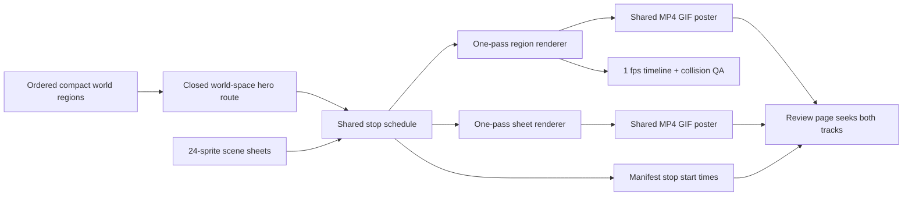

# SmallScaleInt Showcase V6 - Continuous World Plan

## Goal Capsule

- **Objective:** Rebuild the private SmallScaleInt showcase as one compact continuous world with one slow, cadence-matched walking hero, synchronized full-loop region and sprite-sheet tracks, and seekable scene stops, while making that delivery shape the reusable default for future set showcases.
- **Authority:** Issue #431, the accepted v5 eight-scene stories, the v4 sprite-sheet treatment, the merged generic showcase tooling, and repository asset/licensing boundaries govern scope.
- **Execution profile:** Tracked set-neutral schema, renderer, validator, tests, and skill guidance plus ignored host-local v6 authoring, generated media, QA evidence, and review-page changes.
- **Stop conditions:** Do not commit SmallScaleInt source or generated media, redesign tracked product UI, alter the eight accepted stories, add licensed assets to fixtures, edit the frozen V1 planning pack, deploy, or claim hardware/operator verification that did not run.
- **Tail ownership:** The implementing agent owns automated checks, visual inspection, review fixes, PR/CI handoff, and exact post-deploy steps for checks outside the workspace.

---

## Product Contract

### Summary

Replace v5's concatenated per-scene clips with a single closed world and a single uninterrupted hero walk through all eight established scenes.
Place those scenes twice as close, fill every transition with unique coherent content, synchronize one region track and one 24-sprite sheet track, and let the review page seek those tracks by manifest start time without burning any text into the media.

### Problem Frame

V5 proves the eight scene stories and visual themes, but each scene is rendered as an independent clip and concatenated afterward. The result has eight local routes instead of one world-space route, inconsistent apparent walking speeds, overly broad gaps between scene centres, and no manifest-level start-time contract for seeking one continuous video.

Its sprite-sheet tracks also regress from v4's denser 24-sprite presentation, especially for the dinosaur and farm scenes, and the media presentation permits labels that should remain review-page metadata rather than pixels in the deliverable. These are both artifact defects and reusable-workflow defects: fixing only the private render would leave the next set free to repeat them.

### Requirements

#### Continuous route and compact world

- R1. The eight accepted v5 scenes and stories remain in the same order: portal glade ambush, caravan camp raid, raptors crossing, market chase, morning farm chores, neon shop break-in, sleeping-house burglary, and graveyard ritual.
- R2. One hero walks one closed world-space route from scene 1 through scene 8 and back to scene 1. Rendering evaluates that route and world continuously; it never renders or concatenates per-scene video segments.
- R3. The hero uses one slower ground speed throughout the loop, matched to the source walk cadence. The measured world-to-screen speed for every scene interval is within 2% of the declared speed.
- R4. Scene centres are half the v5 separation. Every viewport and seam remains deliberately composed with no empty-ground gap, duplicated prop instance, clipped focal actor, or unexplained visual jump.
- R5. Existing v5 weather and story beats remain readable while seam content uses coherent props or animated sprites to connect adjacent themes.

#### Synchronized media and review

- R6. The region presentation is one square MP4/GIF loop no longer than 30 seconds, with a poster and a one-frame-per-second QA timeline.
- R7. The sprite-sheet presentation is one square synchronized MP4/GIF loop whose active scene shows exactly 24 distinct source sprites. Reuse the matching v4 sheet sources from `out/media-v4/` for fantasy, desert, town, zombie-city, interior, and graveyard; author new dinosaur and farm sheets in the same v4 grid and density treatment.
- R8. The manifest records a deterministic start time for each scene stop and identifies the shared region and sheet tracks. Clicking a scene in the review page seeks the already-loaded shared tracks instead of swapping video files.
- R9. The media, GIFs, posters, and QA timeline contain no burned-in labels, captions, scene numbers, titles, or other text. Human-readable scene names remain manifest and review-page metadata only.
- R10. The outline-options sheet remains available as a separate comparison artifact, and the square viewport, installed-pack coverage, weather, no-clipping, no-duplicate-prop, and rights-boundary requirements remain enforced.

#### Reusable workflow

- R11. The set-neutral project contract can represent a closed continuous route, compact ordered stops with start times, synchronized shared tracks, a declared speed, per-interval speed evidence, and text-free output without embedding SmallScaleInt identifiers or licensed bytes.
- R12. Set-neutral validation rejects discontinuous loops, non-monotonic or out-of-range stop times, per-interval speed drift over 2%, duplicate world instances, missing 24-sprite sheet membership, and unsupported text-overlay fields before the expensive render.
- R13. The reusable skill teaches future authors to compose one world, prove the return seam, preserve cadence at one ground speed, build filled transitions, publish shared tracks, and review the one-frame-per-second timeline.

### Acceptance Examples

- AE1. **Given** the one-frame-per-second timeline, **when** it is read from scene 1 through scene 8 and through the loop boundary, **then** one hero remains in one connected world without a cut, teleport, duplicate hero, or per-scene reset.
- AE2. **Given** the generated speed table, **when** each scene interval is compared with the declared ground speed, **then** every deviation is at most 2% and all intervals use the same walk-cycle cadence.
- AE3. **Given** each pair of adjacent stop centres, **when** their world distance is compared with v5, **then** it is half the prior spacing and the connecting viewport is filled with purposeful, non-duplicated content.
- AE4. **Given** the full-loop region and sheet tracks, **when** a scene button is selected, **then** both already-loaded videos seek to the stop's manifest start time and remain synchronized.
- AE5. **Given** any scene's active sheet interval, **when** its source membership is inspected, **then** exactly 24 distinct sprites appear in the v4 grid/density treatment, including newly authored dinosaur and farm sheets.
- AE6. **Given** the region track, sheet track, GIFs, posters, and timeline, **when** the pixels are inspected, **then** no labels, captions, scene numbers, or titles are burned in.
- AE7. **Given** the final artifact and repository status, **when** the manifest, probes, collision report, rights audit, and tracked files are checked, **then** the loop is square and at most 30 seconds, weather/story beats remain visible, collisions and duplicate props are absent, and no licensed or generated SmallScaleInt byte is tracked.

### Scope Boundaries

- Preserve v5's scene order, stories, weather, and accepted review-page visual design; change playback behavior only where one-video seeking requires it.
- Keep SmallScaleInt authoring, sprite references, generated media, review-page publication, and QA outputs under ignored `assets-local/`.
- Track only set-neutral contract/tool/test/skill changes and this implementation plan.
- Do not add new packs, sound, product navigation, client-side rendering, a game engine, or new visible review-page chrome.
- Do not deploy or externally publish the private artifact from this workspace.

---

## Planning Contract

### Assumptions

- The six matching v4 sheets are source authorities, but their authoring lists are normalized to the ticket's exact 24 distinct sprites when historical private data contains a different count. Dinosaur and farm are the only newly selected sheet memberships.
- Scene separation is measured between authored world-space stop centres, using v5's corresponding centre-to-centre distance as the baseline.
- “No text burned in” applies to media pixels. Scene names remain accessible review controls and manifest metadata because they are needed for navigation and are not part of the rendered artifact.
- Generated per-stop posters may be extracted from the shared tracks for thumbnails, but per-stop videos and GIFs are forbidden.

### Key Technical Decisions

- KTD1. Add a versioned continuous-world project contract while preserving the current per-stop contract for existing projects. The v6 mode makes global route, stop times, track identity, and sheet membership explicit instead of inferring continuity from separately rendered clips.
- KTD2. Model the route as a closed world-space polyline sampled by cumulative **projected ground distance** at one declared pixels-per-second speed. Stop start times derive from projected distance along that path, keeping the visible cadence, travel, validation, and seeking on one clock even when isometric direction changes, and making the scene-8-to-scene-1 return seam testable.
- KTD3. Render each shared track in one encoder pass from global time. Region and sheet frames use the same stop schedule; posters and QA timelines are extractions from those tracks rather than inputs to concatenation.
- KTD4. Keep human-readable metadata outside the canvas draw path. The schema rejects media overlay fields and the renderer exposes no text primitive, while tests inspect rendered fixtures for the absence of label-driven pixels.
- KTD5. Validate duplicate identity and sprite-sheet membership at the authored-data layer, collision/visibility at sampled global frames, and duration/codec/dimensions after encoding. Each gate addresses evidence the other layers cannot prove.
- KTD6. Author SmallScaleInt v6 as a cyclic compact layout rather than a linear strip with a wrap teleport. This gives the eighth-to-first transition a physical seam and makes the full route continuous without copying scene 1 at the end.

### High-Level Technical Design

### Sequencing

U1 introduces and proves the set-neutral contract before any licensed project depends on it.
U2 updates the reusable authoring and publication guidance to match that executable contract.
U3 translates the accepted private scenes into one compact cyclic world and builds the missing 24-sprite sheets with fast preflight and focused still review.
U4 performs the expensive one-pass encodes, publishes the private media/manifest, switches the private review page to seeking, and completes visual and rights QA.

### System-Wide Impact

- Existing `ogm.set-showcase/1` projects keep their per-stop behavior; the continuous contract takes a separate validation/render path and does not silently reinterpret old data.
- Project loading, route sampling, scene projection, collision sampling, encoding, manifest generation, postflight verification, examples, and skill instructions all consume the same stop schedule.
- A validator failure stops rendering with scene/interval context; an encoding or media-probe failure prevents publication and leaves prior published private output intact until replacement succeeds.
- The review-page change is private host-local work, so no tracked web application or frozen prototype is changed.
- No new dependency, service, secret, external upload, provider key, or paid resource is required.

### Risks and Dependencies

- A cyclic world can bring non-adjacent scenes into a camera frustum. Layout preflight plus full-loop timeline inspection must prove only intended neighbors appear and every transition remains filled.
- Isometric projection changes the relation between tile distance and visible distance as the route turns. The contract therefore declares visible ground speed in projected pixels per second and samples each segment by projected length, directly matching the ticket's measurable speed rather than normalizing away direction changes.
- Exactly 24 useful dinosaur and farm sprites may require selecting frames or characters from installed v4-era source sheets. The rights catalog and source identity receipts remain authoritative; no downloaded or synthesized licensed substitute enters the repo.
- A full-loop encode is slower than per-stop iteration. Focused timestamp rendering, cached asset loading, and preflight gates keep most fixes ahead of the expensive pass.
- Physical-device playback and external publication are unavailable in this workspace; any such acceptance step is recorded as an exact post-deploy check rather than claimed locally.

### Open Questions

#### Resolved During Planning

- The return from scene 8 to scene 1 is a physical world transition on the closed route, not a video cut or position reset.
- UI labels remain allowed outside the video because the prohibition is specifically on burned-in media text.
- Existing v1 showcase projects remain supported; v6 does not require migrating previous private artifacts.

#### Deferred to Implementation

- The exact cyclic geometry, route speed, and stop durations are chosen from source cadence and v5 baseline measurements, then frozen by generated receipts once they satisfy the 2% and 30-second bounds.
- The exact installed dinosaur and farm sprite selections are chosen during rights-aware asset intake, with 24 distinct identities recorded per sheet.

---

## Implementation Units

### U1. Add the continuous-world project and renderer contract

- **Goal:** Make one-world, one-route, one-clock showcases executable and mechanically verifiable without breaking existing projects.
- **Requirements:** R2-R4, R6-R9, R11-R12; AE1-AE4, AE6.
- **Dependencies:** None.
- **Files:** `scripts/assets/showcase/assets.mjs`, `scripts/assets/showcase/model.mjs`, `scripts/assets/showcase/project.mjs`, `scripts/assets/showcase/scene.mjs`, `scripts/assets/showcase/collision.mjs`, `scripts/assets/showcase/render.mjs`, `scripts/assets/showcase/verify.mjs`, `scripts/assets/showcase/test/assets.test.mjs`, `scripts/assets/showcase/test/model.test.mjs`, `scripts/assets/showcase/test/collision.test.mjs`, `scripts/assets/showcase/test/render.test.mjs`.
- **Approach:** Add a versioned continuous contract with global regions, a closed route, one declared projected-pixel speed, ordered stops, shared track definitions, and 24-member sheet requirements. Build one global sampler used by scene projection, collision checks, render frames, speed receipts, manifest start times, and media verification. Extend the asset library only far enough to resolve catalog-backed, pack-relative raw sheet/character references through the same path-containment and installed-pack rules as existing references. Preserve the v1 load/render path behind explicit schema dispatch.
- **Patterns to follow:** Existing pure project normalization, deterministic scene sampling, synthetic fixture construction, ffmpeg availability skips, and manifest postflight checks.
- **Test scenarios:** A closed synthetic project normalizes to monotonic starts and returns to its first pose; constant-speed intervals pass at the 2% boundary and fail beyond it; open routes, duplicate world IDs, invalid starts, text overlays, wrong sheet counts, and discontinuous return seams fail with actionable context; safe pack-relative raw references resolve while absolute and escaping paths fail; one render invocation emits shared tracks and per-stop posters without per-stop videos; v1 fixtures remain green.
- **Verification:** The focused Node test suite passes with and without ffmpeg; a test that asserts shared-track output fails against the pre-change renderer; generated manifests and speed receipts agree on every stop time.

### U2. Make continuous delivery the reusable authoring default

- **Goal:** Ensure future set authors plan, build, inspect, and publish the same one-world artifact rather than falling back to clip concatenation.
- **Requirements:** R9, R11-R13; AE1-AE6.
- **Dependencies:** U1.
- **Files:** `.codex/skills/gm-set-showcase/SKILL.md`, `.codex/skills/gm-set-showcase/references/planning.md`, `.codex/skills/gm-set-showcase/references/sequence.md`, `.codex/skills/gm-set-showcase/references/publication.md`, and `.codex/skills/gm-set-showcase/references/smallscaleint-example.md`. Keep `.codex/skills/gm-set-showcase/references/examples/limezu-modern/` as the runnable v1 compatibility example; the continuous v2 executable fixture belongs with the renderer tests so it cannot drift from the checker.
- **Approach:** Rewrite the default flow around compact world composition, a closed path at one speed, synchronized shared tracks, stop-time seeking, 24-sprite sheets, text-free frames, return-seam proof, and a one-frame-per-second review timeline. Keep compatibility guidance for v1 projects clearly labeled instead of presenting clip concatenation as the modern path.
- **Patterns to follow:** Existing progressive disclosure, executable example references, rights-boundary language, and publication receipts.
- **Test scenarios:** A future author can identify where stop times come from, how to measure speed drift, how to fill seams without duplicates, how to review the return transition, and how to publish one region and one sheet video; every example reference resolves and contains no SmallScaleInt/private host path.
- **Verification:** Skill validation passes; the legacy example still loads through the compatibility path, the continuous test fixture loads through the v2 checker, and direct review finds no instruction to render or concatenate per-stop clips in the default flow.

### U3. Author and preflight the private SmallScaleInt v6 world

- **Goal:** Convert the accepted v5 stories into one compact cyclic world with one slow walk and eight synchronized 24-sprite sheets before full encoding.
- **Requirements:** R1-R5, R7, R9-R10; AE1-AE3, AE5-AE7.
- **Dependencies:** U1-U2.
- **Files:** Ignored v6 sequence, world-region, sheet, tool, and QA data under `assets-local/sets/smallscaleint/showcase/`, drawing from existing v5 scene sources and `out/media-v4/` receipts.
- **Approach:** Measure v5 centres and source walk cadence; select a slower constant ground speed and closed cyclic route under 30 seconds; place all centres at half spacing; adapt each story/weather beat into shared world coordinates; compose unique transition content; normalize the six matching v4 sheet memberships to 24 identities; and build new 24-identity dinosaur and farm sheets. Work proof-first with focused stills at stops and seams before encoding.
- **Patterns to follow:** Existing v5 story timing and weather, v4 sheet grid/density, source catalog identity receipts, deterministic placement, protected focal zones, and no-duplicate collision checks.
- **Test scenarios:** The private checker reports eight ordered stops, one closed route, exact half-spacing measurements, one speed with no interval over 2% drift, 24 unique identities per sheet, no duplicate world instance, no unsupported text field, no clipping/collision at sampled frames, and all accepted stories/weather represented.
- **Verification:** Private preflight, speed/spacing tables, focused seam and story stills, source-rights audit, and two deterministic sample renders pass before the full media run.

### U4. Render, publish privately, seek, and visually verify v6

- **Goal:** Replace the private published showcase with the validated continuous artifact and leave truthful playback and QA evidence.
- **Requirements:** R1-R13; AE1-AE7.
- **Dependencies:** U1-U3.
- **Files:** Ignored `assets-local/sets/smallscaleint/showcase/out/media/`, v6 QA outputs, and the private showcase review page.
- **Approach:** Encode the region and sheet loops once from global time, derive text-free posters/GIFs and stop thumbnails, generate the manifest with start times and speed evidence, preserve the outline-options sheet, and update the review page so scene buttons seek both loaded tracks. Inspect the 1 fps timeline plus stop/seam/story frames and only replace published private output after postflight passes.
- **Test scenarios:** Region and sheet videos stay loaded while all eight buttons seek to matching starts; a selection made before metadata loads is applied after both tracks become seekable; seeking preserves the existing play/pause state and synchronization; the 8-to-1 wrap is continuous; probes report square H.264/faststart media at or below 30 seconds; every sheet interval shows 24 sprites; pixel inspection finds no text, gaps, duplicate props, clipping, or lost weather/story beat; prior output is not partially overwritten on failure.
- **Verification:** Private renderer/checker/postflight commands pass, manifest references resolve, the review page plays and seeks the local artifact, all timeline frames are directly inspected with `gm-verify`, and Git proves every licensed/generated byte remains ignored.

---

## Verification Contract

| Gate | Command or check | Covers | Done signal |
|---|---|---|---|
| Generic model and collision tests | `node --test scripts/assets/showcase/test/model.test.mjs scripts/assets/showcase/test/collision.test.mjs` | U1 | Continuous and legacy fixtures enforce route, time, speed, duplicate, sheet, and return-seam rules |
| Generic render and story tests | `node --test scripts/assets/showcase/test/render.test.mjs scripts/assets/showcase/test/story.test.mjs` | U1 | Shared-track rendering and v1 compatibility pass; ffmpeg cases skip only when unavailable |
| Skill and examples | Skill validation, the generic checker against the tracked v2 test fixture, and the unchanged LimeZu v1 compatibility example | U2 | Guidance references resolve, the continuous fixture is executable, and legacy projects remain runnable |
| Private preflight | V6 checker against the real installed catalog and authored project | U3 | Stories, rights, centres, route, speed, sheets, duplicate identities, text fields, collisions, and pack coverage pass |
| Private determinism | Render selected stop/seam timestamps twice and compare hashes | U3 | Identical inputs produce identical frames |
| Media postflight | Probe shared MP4/GIF/poster outputs and validate manifest/start times | U4 | Two synchronized square loops are at most 30 seconds, seekable, and fully declared |
| Visual QA | Inspect 1 fps timelines plus stop, seam, contact, weather, and return frames | U3-U4 | One hero walks one filled world; no cut, text, gap, clipping, or duplicate prop is visible |
| Review-page playback | Exercise every scene button against local media | U4 | Both shared tracks remain loaded and seek to the same manifest time |
| Repository gates | `pnpm lint`, `pnpm typecheck`, `pnpm test`, and `pnpm build` as required by changed shared surfaces | U1-U2 | Tracked code and skill changes pass repository policy |
| Rights boundary | Tracked/ignored audit for `assets-local/`, secrets, host paths, and generated bytes | U3-U4 | No private or generated artifact is tracked |
| Full-diff review | `ce-code-review` against `main` | U1-U4 | Every blocking finding is fixed and all remaining findings are dispositioned in the PR |

Manual-only checks that the workspace cannot perform are copied verbatim to the PR as `Post-deploy check:` lines and are never reported as executed.

---

## Definition of Done

- U1 is done when the versioned continuous project path emits and verifies shared synchronized tracks from one global clock while the existing v1 fixtures remain green.
- U2 is done when the reusable skill and executable example make one-world rendering, return-seam proof, constant speed, 24-sprite sheets, shared-track publication, seeking, and text-free QA the default path.
- U3 is done when the ignored SmallScaleInt source proves all eight v5 stories in one compact cyclic world, every centre is half-spaced, all speed deviations are within 2%, and every scene has 24 distinct v4-style sprites.
- U4 is done when `out/media/` contains the validated shared region/sheet loops, fallbacks, posters, outline options, manifest start times, speed evidence, and 1 fps timeline, and the private review page seeks and plays them.
- Relevant focused tests and repository gates pass, every behavior-bearing new test demonstrably fails without its production change, and no blocking full-diff review finding remains.
- The PR starts with `Closes #431`, contains current full-SHA local-test evidence and a `## Review` section, is marked ready, and completes the exact-head required-check set before human-review handoff.
- The final diff contains no private media, secrets, download links, real host paths, frozen planning-pack edits, unrelated product UI changes, or deployment.
