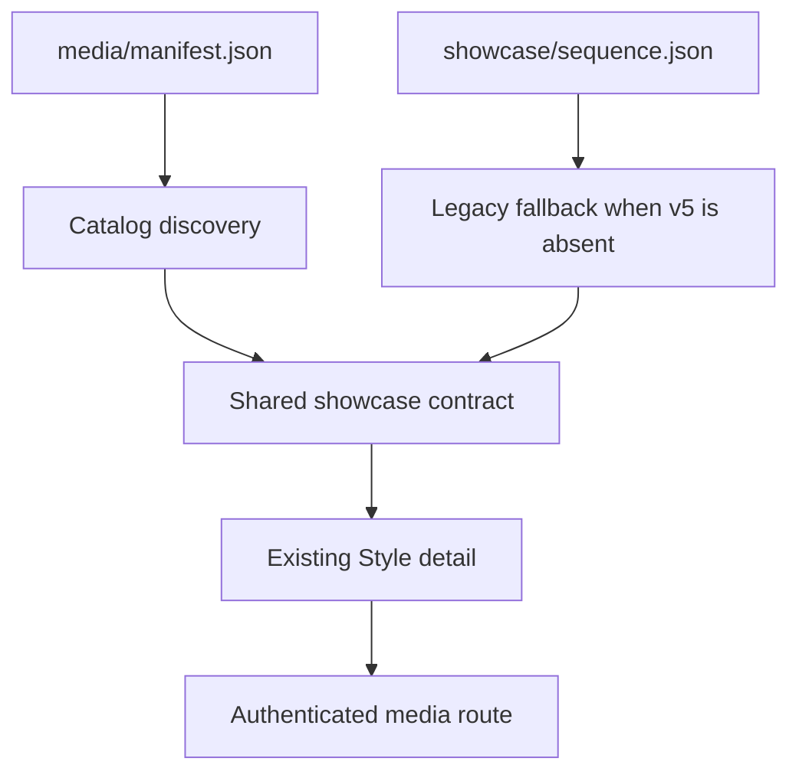

# SmallScaleInt V5 Style Picker - Plan

## Goal Capsule

- **Objective:** Make the existing `/new` Style detail consume the host library's version 5 SmallScaleInt manifest so all eight scenes use reachable per-stop media and the outline comparison appears after them.
- **Authority:** Ticket #430 is a narrow follow-on to the family-first picker plan; the landed picker layout and the host-local v5 manifest define the interaction and data shape.
- **Stop conditions:** Do not commit or upload SmallScaleInt media, change the surrounding creation flow, redesign the picker, or remove compatibility with sets that still publish `sequence.json`.
- **Execution profile:** Add shared contracts, normalize both manifest generations in the API, adapt the existing detail player, and prove the phone path with focused automated and visual checks.
- **Tail owner:** Required CI and human review validate the pushed head; the production-host reachability check remains an exact post-deploy step.

---

## Product Contract

### Summary

The catalog prefers `showcase/out/media/manifest.json` when a set publishes the v5 schema and otherwise retains the existing `showcase/sequence.json` discovery path. The Style detail plays the selected scene's region and sheet beside each other, keeps them synchronized, exposes GIF and poster fallbacks, and appends the outline-options sheet to the scene rail without changing picker chrome.

### Problem Frame

The API currently reads only the legacy six-stop sequence and looks for aggregate v2 media names. The host library now has eight v5 stops and per-stop region/sheet files, so the live catalog returns stale metadata and most referenced media does not exist.

### Requirements

- R1. A valid `ogm.smallscaleint-showcase/5` manifest takes precedence over a sibling legacy sequence and yields exactly its eight ordered scene stops.
- R2. Every v5 scene exposes authenticated URLs for its declared region and sheet MP4, GIF, and poster files; only discovered regular files inside the set's media directory enter the route allowlist.
- R3. The v5 outline-options sheet is exposed separately in the API contract and rendered as the final rail control, while the scene-stop count remains eight.
- R4. Sets without a v5 manifest continue to use `sequence.json`, aggregate region/sheet tracks, cumulative offsets, and available GIF fallbacks.
- R5. A present but malformed v5 manifest fails closed instead of silently serving stale sequence data.
- R6. The existing Style detail swaps both media tracks when a scene changes, keeps the sheet clock aligned to the region clock, shows GIF with poster backup until video is playable, and keeps the final scene's region visible while showing outline options.
- R7. Existing family, grid, selection, navigation, responsive layout, copy, and creation-flow behavior remain unchanged.
- R8. Focused contract, API, component, and browser evidence covers both discovery shapes and the phone-size v5 fantasy view without committing host media.

### Scope Boundaries

- Showcase generation and host deployment are outside this code change.
- The API response contains URLs and metadata only, never local filesystem paths or paid media bytes.
- No new dependencies, catalog families, picker panels, labels, or helper text are introduced.

---

## Planning Contract

### Key Technical Decisions

- KTD1. Put manifest input schemas and the normalized showcase response type in `@ogm/contracts`; `@ogm/asset-cards`, the API, and the web app consume that shared showcase type while asset-cards continues to compose the wider family response.
- KTD2. Preserve one normalized response with legacy aggregate tracks plus optional per-stop media and outline metadata. This keeps existing sets compatible while letting the player prefer per-stop sources when present.
- KTD3. Treat a v5 manifest's filenames as untrusted input: constrain them to leaf media filenames, then reuse canonical-path and regular-file checks before generating a URL. Accept unrelated top-level generator metadata while validating the consumed stop, media, and outline fields strictly.
- KTD4. Keep outline options separate from the eight scene stops in the contract, then append one derived control in the UI. This satisfies the eight-stop catalog acceptance while preserving the review page's final outline control.
- KTD5. Re-key media tracks by their effective source so fallback readiness and playback state reset for each v5 stop; legacy aggregate sources retain cumulative seeking.

### High-Level Technical Design

### Assumptions

- V5 media names are leaf filenames relative to `showcase/out/media`, as in the current host manifest.
- The outline sheet has the same duration as the scene loops, so it can remain synchronized with the final scene's region track.
- Production reachability cannot be claimed from the issue workspace; the PR records that exact post-deploy check.

---

## Implementation Units

### U1. Define and parse both showcase contracts

- **Goal:** Establish one validated boundary for legacy sequence input, v5 manifest input, and the catalog's normalized showcase output.
- **Requirements:** R1-R5.
- **Dependencies:** None.
- **Files:** `packages/contracts/src/style-showcase.ts`, `packages/contracts/src/index.ts`, `packages/contracts/test/style-showcase.test.ts`, `packages/asset-cards/src/families.ts`.
- **Patterns:** Follow the strict Zod contracts and inferred exported types already used in `packages/contracts/src`; keep the contracts index append-only.
- **Test scenarios:**
  1. A minimal valid legacy sequence parses with ordered positive-duration stops.
  2. A representative v5 manifest parses eight per-stop media records plus outline options while permitting unrelated generator metadata.
  3. Traversal-shaped filenames, duplicate stop ids, invalid durations, and a wrong v5 schema fail validation.
  4. The normalized response accepts legacy aggregate tracks and v5 per-stop tracks without filesystem paths.

### U2. Prefer v5 media in catalog discovery

- **Goal:** Return reachable v5 metadata and media while retaining safe legacy behavior.
- **Requirements:** R1-R5.
- **Dependencies:** U1.
- **Files:** `services/api/src/catalog/routes.ts`, `services/api/test/catalog.test.ts`.
- **Patterns:** Reuse `safeDirectory`, `safeFile`, the discovered-file allowlist, authenticated route, range handling, and synthetic library fixtures.
- **Test scenarios:**
  1. A v5 fixture with a sibling legacy sequence returns eight v5 scenes and outline metadata, proving precedence.
  2. Each declared per-stop MP4, GIF, and poster URL is reachable through the authenticated media route and absent files are not allowlisted.
  3. A legacy-only fixture preserves aggregate tracks, cumulative offsets, and fallbacks.
  4. A malformed present v5 manifest omits the showcase rather than falling back; escaping directories and undiscovered files remain refused.

### U3. Play per-stop media in the existing Style detail

- **Goal:** Match the v5 review-page behavior inside the landed picker without changing its layout.
- **Requirements:** R3, R6-R8.
- **Dependencies:** U1, U2.
- **Files:** `apps/web/src/routes/new/catalog.ts`, `apps/web/src/routes/new/StyleStep.tsx`, `apps/web/src/routes/new/StyleStep.test.tsx`, `apps/web/e2e/fixtures/style-families.json`, `apps/web/e2e/new.spec.ts`.
- **Patterns:** Extend the current `ShowcaseDetail`/`ShowcaseTrack` player, current media synchronization threshold, and existing phone creation-flow fixture.
- **Test scenarios:**
  1. Selecting a v5 scene swaps both video sources and updates GIF/poster fallbacks.
  2. The sheet track follows region drift, and readiness resets when sources change.
  3. Outline options are the last control, retain the eighth region, and switch only the sheet media.
  4. Legacy aggregate media still seeks both tracks to cumulative offsets.
  5. Phone browser coverage opens SmallScaleInt and observes the v5 fantasy scene without changing the surrounding picker flow.

---

## Verification Contract

| Gate | Scope | Done signal |
|---|---|---|
| Contract tests | Legacy, v5, normalized response schemas | Focused `@ogm/contracts` test passes |
| API tests | Discovery precedence, allowlist, reachable media, legacy fallback | Focused `@ogm/api` catalog test passes |
| Web tests | Per-stop source switching, fallbacks, sync, outline behavior | Focused `@ogm/web` StyleStep test passes |
| Browser proof | Phone-size SmallScaleInt detail | Focused Playwright path passes and a local screenshot shows v5 fantasy when host media is available |
| Static gates | Contracts, API, web, and direct callers | Relevant lint, typecheck, and build commands pass |
| Full-diff review | Branch against `main` | `ce-code-review` reports no blocking findings |

---

## Definition of Done

- The catalog prefers the v5 manifest, lists eight SmallScaleInt scene stops, exposes reachable declared media, and appends outline metadata without committing media.
- Legacy sequence-only sets still render through the same API and picker.
- The existing Style detail shows synchronized per-stop region and sheet playback with GIF/poster fallback and final outline selection.
- Focused automated checks, phone visual evidence, static gates, and full-diff review are green.
- The PR records the exact production-host API and phone screenshot checks as unrun post-deploy checks.
