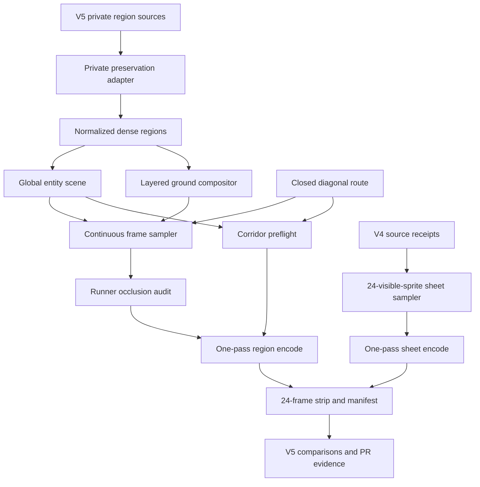
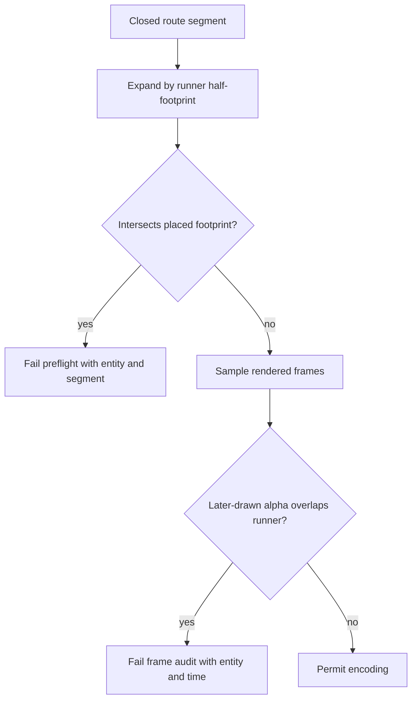

# SmallScaleInt V6 Scene Preservation Repair - Plan

## Goal Capsule

- **Objective:** Repair the continuous SmallScaleInt v6 showcase by preserving the authored v5 regions, joining them into one compact closed walk, and proving scene fidelity, path safety, sheet provenance, weather direction, and constant speed before publication.
- **Authority:** Issue #431 and its 2026-11-03 CODEOWNER review comments override the failed visual assumptions in the merged v6 implementation; the v5 private region sources and v4 sheet renders are the visual baselines.
- **Execution profile:** Characterize and extend the tracked set-neutral compositor, validator, tests, and `gm-set-showcase` guidance, then rebuild and verify ignored SmallScaleInt authoring and media under `assets-local/`.
- **Stop conditions:** Do not simplify v5 regions into sparse prop samples, alter `out/media-v5`, commit licensed/generated bytes, redesign tracked UI, edit the frozen V1 planning pack, deploy, or claim physical-device verification that did not run.
- **Tail ownership:** The implementing agent owns the private rerender, direct visual inspection, strip evidence, full-diff review, PR/CI handoff, and exact post-deploy steps for unavailable hardware checks.

---

## Product Contract

### Summary

Replace the failed sparse v6 world with a continuous composition derived from all eight finished v5 regions.
Keep their terrain, structures, props, actors, density, stories, and weather as the baseline while correcting incoherent buildings and upward precipitation.
Join the regions along one closed diagonal route at half v5 spacing, keep the route unobstructed, and synchronize a v4-style 24-sprite sheet track.

### Problem Frame

The merged v6 renderer reduced each scene to roughly 11–14 sprites on one repeated grass tile.
Its isometric fill leaves a lattice of transparent diamond holes, and neighboring props leak into the wrong scenes because the compact world lacks authored composition boundaries.
The result no longer resembles v5's portal glade, desert camp, dinosaur crossing, town market, farm, city, interior, or graveyard.

The repair cannot be another round of sparse hand-selection.
V5 already contains the required region composition in private JSON and scene modules, with roughly 30–60 placed elements per scene and distinct ground treatments.
The reusable renderer needs a normalized layered-ground path that can preserve that authored data and mechanically reject blocked or visually occluded hero routes.

### Requirements

#### Region fidelity and composition

- R1. Derive all eight v6 regions from `assets-local/sets/smallscaleint/showcase/v5/regions/`, preserving each region's terrain, structures, props, actors, density, story, and theme unless a later review requirement names a correction.
- R2. Correct every building so walls meet at corners, one roof covers the structure, and doors sit in walls; prefer a whole-building sprite where the installed pack provides one.
- R3. Place region centres along one closed diagonal route at half v5's centre spacing and fill every seam with ground transitions that blend both neighbors without empty grass, transparent holes, or incompatible tiles touching abruptly.
- R4. Preserve distinct v5-authored instances even when they reuse one source design; reject duplicate stable IDs, accidental repeated placements, and non-neighbor scene content in the current camera view rather than globally de-duplicating asset references.

#### Walk, path safety, and weather

- R5. One hero walks through scenes 1–8 and physically returns to scene 1 at one cadence-matched projected speed; every interval stays within 2% and the complete loop is at most 30 seconds.
- R6. A preflight corridor audit checks the full closed path polyline against every placed non-runner footprint and fails before encoding when any footprint intersects the hero-width corridor.
- R7. A frame audit fails when any sprite is drawn in front of and overlaps the walking hero, and its report identifies the frame, stop, and entity.
- R8. Rain and snow travel downward on screen with deterministic wind drift and never rise; other weather retains its intended motion and the complete weather loop remains deterministic.

#### Sheets, media, and evidence

- R9. The six matching sheet stops preserve v4 source order and visual treatment, normalized to exactly 24 visible sprites in the v4 grid density; dinosaur and farm use new 24-sprite selections with the same layout and scale.
- R10. Region and sheet MP4, GIF, poster, and timeline media contain no burned text; human-readable names remain manifest and review-page metadata.
- R11. `assets-local/sets/smallscaleint/showcase/out/media-v5/` remains byte-for-byte untouched while the repaired shared tracks, posters, manifest, and timeline publish to `out/media/`.
- R12. One 24-frame strip, region comparison stills, building close-ups, weather motion evidence, the speed table, and the corridor/occlusion report form the visual handoff; the 24-frame strip appears in the PR body for Executor review.
- R13. The private review page keeps one region and one sheet track loaded and seeks both to each manifest stop time without changing the fixed screen design.

#### Reusable workflow

- R14. The set-neutral project contract and compositor represent layered isometric ground mosaics, deterministic seam patches, dense authored regions, and a clear route corridor without embedding SmallScaleInt identifiers or licensed bytes.
- R15. `gm-set-showcase` teaches preservation-first migration from accepted regions, coherent structures, downward precipitation, corridor proof, close-up inspection, and comparison-strip review for future sets.

### Acceptance Examples

- AE1. **Given** the repaired 24-frame strip beside v5 evidence, **when** each stop and seam is inspected, **then** all eight v5-quality scenes remain recognizable, ground is continuous and textured, and no prop from another scene appears.
- AE2. **Given** the complete closed path and all placed footprints, **when** preflight runs, **then** the corridor report names zero intersections and the renderer refuses a fixture whose solid, actor, wall, tree, vehicle, or building crosses the corridor.
- AE3. **Given** every rendered frame, **when** the runner overlaps another sprite's alpha pixels, **then** the runner is never behind that sprite and any violation fails with the responsible entity and timestamp.
- AE4. **Given** consecutive rain or snow samples before wraparound, **when** particle positions are compared, **then** vertical travel is downward and horizontal travel reflects deterministic wind drift.
- AE5. **Given** each farm or other building close-up, **when** its shell is inspected, **then** walls join, the roof covers the shell, and every visible door is mounted in a wall.
- AE6. **Given** every stop interval, **when** projected route distance is divided by elapsed time, **then** every measured speed is within 2% of one declared speed.
- AE7. **Given** the synchronized sheet track and source receipt, **when** each stop is inspected, **then** exactly 24 visible designs use v4 grid density and the six matching stops trace to v4 selections.
- AE8. **Given** the repaired output and repository status, **when** publication and rights boundaries are audited, **then** `media-v5` is unchanged and no SmallScaleInt source or generated media is tracked.

### Scope Boundaries

- Preserve the eight accepted scene themes, order, stories, square viewport, outline-options artifact, and fixed review-page design.
- Keep SmallScaleInt conversion code, normalized project JSON, generated media, QA frames, and source receipts under ignored `assets-local/`.
- Track only set-neutral renderer, validator, tests, skill guidance, and this repair plan.
- Do not add packs, sound, navigation, client-side composition, or a runtime game engine.
- Do not solve unrelated sampler, catalog, adapter, or site work in this PR.

---

## Planning Contract

### Assumptions

- “Start from v5 unchanged” means v5 content, ground language, density, and story composition are the source baseline; the explicit house, weather, spacing, path-safety, and sheet comments are allowed corrections.
- The v4 visual treatment is a five-column density and scale reference with exactly 24 visible sources for v6, even where private v4 authoring contains a 25th source or fewer than 24 sources.
- V4 normalization preserves source order, truncates only tail entries beyond 24, and fills a short sheet from unused same-theme v4-era sources before considering another theme; every removed or added source is named in the receipt.
- Route spacing is measured between comparable v5 scene centres in projected screen space, and each new adjacent-centre distance is half its v5 baseline.
- Source membership receipts compare normalized asset references rather than generated pixels, while direct visual QA remains the authority for layout, density, and scale.

### Key Technical Decisions

- KTD1. Preserve v5 through a private normalization adapter rather than selecting a small subset of props by hand. The adapter maps the heterogeneous v5 region formats into one richer set-neutral continuous composition while leaving the v5 source tree and media untouched.
- KTD2. Expand continuous ground from one repeated tile to ordered isometric cell layers: a full underlay, fill ranges, explicit cell patches or bands, and seam layers. This retains roads, rivers, soil, floors, and graveyard earth and removes the alpha-hole lattice caused by repeating a decorative diamond as opaque coverage.
- KTD3. Keep one global projected-space route and translate normalized region-local coordinates to each stop origin. Region bounds are validation constraints rather than render-time clipping: placement and route geometry must keep non-neighbor content outside the frustum so structures do not pop at artificial clip edges.
- KTD4. Define the clear corridor as the closed route polyline expanded by half the runner footprint, then test it against every non-runner footprint before frame rendering. Sampled alpha/depth auditing separately catches tall art that does not cross the ground footprint but still draws over the hero.
- KTD5. Make precipitation motion testable as deterministic particle trajectories whose screen-space vertical component is positive between ordinary samples. Wind changes horizontal position only; loop wrapping is excluded from the monotonic sample assertion.
- KTD6. Use a 5-by-5 v4-density sheet layout with exactly 24 occupied cells and one intentional empty cell. Preserve the first 24 v4 sources when a sheet is long; when it is short, append unused same-theme v4-era sources, then broader v4-era sources only as needed. Dinosaur and farm follow the same rights, distinctness, scale, and receipt rules.
- KTD7. Interpret duplicate protection at instance level. Stable IDs and placements are globally unique, but a source design may back several intentional v5 actors or props; the receipt distinguishes those authored uses from accidental copies instead of deleting them by normalized design key.
- KTD8. Treat comparison evidence as a publication gate. A render is not ready because its schema and codecs pass; it is ready only after v5 side-by-side stills, building close-ups, motion timelines, and the full strip have been inspected with `gm-verify`.

### High-Level Technical Design

### Sequencing

U1 pins the visual regression and safety failures with set-neutral characterization fixtures.
U2 adds the reusable layered composition and route-safety gates.
U3 corrects precipitation motion and updates the skill contract.
U4 rebuilds the ignored v6 project from v5 sources and v4 sheet receipts.
U5 renders, compares, publishes, and records the final evidence.

### System-Wide Impact

- Existing `ogm.set-showcase/1` projects and simple v2 single-ground projects keep their current behavior; layered composition is additive to the continuous contract.
- Project validation, asset reference manifests, ground drawing, global entity preparation, collision reporting, rendering, and skill guidance consume the richer region shape.
- Corridor and occlusion failures stop before or during QA and prevent staged publication from replacing the current manifest.
- No new dependency, service, secret, paid resource, or public host is introduced.

### Risks and Dependencies

- The eight v5 regions use several private schemas and custom scene modules. The adapter must preserve source coordinates and semantics without moving set-specific branching into tracked generic code.
- Dense regions make collision and occlusion scans more expensive. Preflight geometry should reject path blockers before full-frame alpha scans, and only camera-visible entities should enter per-frame pixel checks.
- Half spacing can expose non-neighbor regions in a square camera. Bounds, route geometry, and strip inspection must be tuned together rather than hiding leaks with clipping.
- A visually coherent house may require a whole-building asset or reassembly of v5 parts. Close-up evidence is required because reference counts and collision checks cannot prove architectural coherence.
- The v4 private JSON has inconsistent source counts. The v6 receipt must record the deterministic 24-source normalization instead of assuming historical file length equals the ticket contract.

---

## Implementation Units

### U1. Characterize preserved composition and path safety

- **Goal:** Reproduce the ground-hole, sparse-region, blocked-path, runner-occlusion, and upward-precipitation defects in small set-neutral fixtures before changing production code.
- **Requirements:** R1-R8, R14; AE1-AE4.
- **Dependencies:** None.
- **Files:** `scripts/assets/showcase/test/render.test.mjs`, `scripts/assets/showcase/test/model.test.mjs`, `scripts/assets/showcase/test/collision.test.mjs`, `scripts/assets/showcase/test/weather.test.mjs`, and synthetic fixture helpers colocated with those tests.
- **Approach:** Add synthetic layered isometric cells with transparent tile margins, dense entities across two adjacent stops, one corridor blocker, one tall later-drawn occluder, and seeded rain/snow trajectories. Keep licensed SmallScaleInt bytes out of fixtures.
- **Execution note:** Begin with failing characterization coverage for the visible regression and each new fail-fast invariant.
- **Patterns to follow:** Existing generated PNG catalog fixtures, ffmpeg availability skips, exact issue-code assertions, and `Aiur.TestCleanup`-independent Node temporary cleanup.
- **Test scenarios:** Covers AE1: a layered diamond fixture renders opaque textured corners and explicit road cells; removing the layered compositor reproduces transparent holes. Covers AE2: a footprint touching the expanded corridor boundary passes, while one crossing it reports the entity and segment. Covers AE3: a tall sprite drawn after the runner reports alpha occlusion even when ground footprints do not overlap. Covers AE4: seeded rain and snow advance downward with horizontal drift and return exactly at loop wrap. A dense two-stop fixture keeps a non-neighbor entity outside the current camera.
- **Verification:** Every new assertion fails against the merged implementation for the intended reason and passes only after U2 or U3.

### U2. Add layered ground and clear-route enforcement

- **Goal:** Preserve authored isometric terrain and dense scenes while making an unobstructed, unoccluded closed walk a renderer invariant.
- **Requirements:** R1, R3-R7, R11-R14; AE1-AE3, AE6, AE8.
- **Dependencies:** U1.
- **Files:** `scripts/assets/showcase/model.mjs`, `scripts/assets/showcase/render.mjs`, `scripts/assets/showcase/continuous-scene.mjs`, `scripts/assets/showcase/collision.mjs`, `scripts/assets/showcase/assets.mjs`, `scripts/assets/showcase/test/model.test.mjs`, `scripts/assets/showcase/test/render.test.mjs`, and `scripts/assets/showcase/test/collision.test.mjs`.
- **Approach:** Normalize optional cell geometry and ordered ground layers, resolve every ground reference through the existing contained asset library, render layers at translated stop origins, and include their references in manifest/pack validation. Replace global design-key rejection with stable-instance and accidental-placement checks that preserve intentional v5 reuse. Add segment-versus-expanded-footprint preflight for every closed-route segment and a runner-specific later-drawn alpha audit to the frame collision report.
- **Patterns to follow:** Current v1/v2 schema dispatch, deterministic route sampling, staged publication, collision issue codes, camera-visible entity filtering, and synthetic catalog fixtures.
- **Test scenarios:** Existing simple ground projects remain valid; malformed ranges, cell coordinates, missing refs, and out-of-bounds layer definitions fail with paths; layered cells render in declared order without alpha holes; two intentional instances of one design remain while duplicate IDs or colocated copies fail; a closing-segment blocker is detected; moving entities are checked across their complete path; the report prints corridor and runner-occlusion summary counts; render aborts before encoding or publication when either count is nonzero.
- **Verification:** Focused model, collision, asset, and render tests pass, legacy fixtures are unchanged, and the generated report is stable enough to quote in PR evidence.

### U3. Correct weather motion and preservation guidance

- **Goal:** Make downward precipitation and preservation-first authoring part of both executable behavior and the reusable showcase workflow.
- **Requirements:** R2, R8, R12, R15; AE4-AE5.
- **Dependencies:** U1.
- **Files:** `scripts/assets/showcase/weather.mjs`, `scripts/assets/showcase/test/weather.test.mjs`, `.codex/skills/gm-set-showcase/SKILL.md`, `.codex/skills/gm-set-showcase/references/planning.md`, `.codex/skills/gm-set-showcase/references/sequence.md`, `.codex/skills/gm-set-showcase/references/publication.md`, and `.codex/skills/gm-set-showcase/references/smallscaleint-example.md`.
- **Approach:** Add snow to the supported precipitation family, keep rain/snow vertical travel downward, and expose deterministic trajectory evidence to tests without coupling tests to pixel-color guesses. Update guidance to preserve accepted source regions, require coherent building shells, run corridor/occlusion checks, and compare close-ups and strips before publication.
- **Patterns to follow:** Seeded loop-safe weather, progressive skill references, no-text media, and truthful manual-device reporting.
- **Test scenarios:** Rain and snow differ visually but both fall; wind drift is nonzero and deterministic; particles do not reverse between ordinary samples; exact loop frames match; invalid weather still fails validation; skill examples name the corridor and close-up gates without SmallScaleInt media paths escaping `assets-local/`.
- **Verification:** Focused weather and model tests plus skill validation pass, and no guidance permits sparse re-authoring when an accepted source region exists.

### U4. Normalize v5 regions and v4 sheets into repaired v6 authoring

- **Goal:** Build the private continuous project from the actual v5 compositions and verified v4 sheet sources without modifying either baseline.
- **Requirements:** R1-R13; AE1, AE5-AE8.
- **Dependencies:** U2-U3.
- **Files:** Ignored authoring, normalized regions, sheets, receipts, and QA tools under `assets-local/sets/smallscaleint/showcase/v6/`; read-only sources under `assets-local/sets/smallscaleint/showcase/v5/`, `assets-local/sets/smallscaleint/showcase/v4/`, `assets-local/sets/smallscaleint/showcase/out/media-v5/`, and `assets-local/sets/smallscaleint/showcase/out/media-v4/`.
- **Approach:** Convert every v5 ground range, band, path, patch, item, prop, actor, and named solid group to the normalized v2 shape; translate complete regions to half-spaced route origins; author neighbor-aware seam cells; correct incoherent buildings; and generate deterministic v4/dinosaur/farm sheet receipts with 24 occupied 5-by-5 cells.
- **Patterns to follow:** V5 source coordinates and story timing, v5 visual reference frames, v4 sheet order and density, catalog-backed refs, stable IDs, and ignored host-local publication.
- **Test scenarios:** The adapter reports source and normalized element counts per region with no unexplained loss; all ground refs and placed refs resolve; every v5 story actor/target and intentional repeated source use remains; stable instance IDs and placements are unique; every building receipt lists one coherent shell; adjacent and closing spacing is exactly half baseline; every sheet receipt contains 24 unique visible designs and names each truncation or supplement relative to v4.
- **Verification:** Private preflight prints eight preservation counts, the half-spacing table, zero corridor intersections, zero runner occlusions, and eight valid sheet receipts before any full encode.

### U5. Render, compare, publish, and hand off the repaired media

- **Goal:** Replace the failed current media only after the repaired world meets mechanical and visual acceptance.
- **Requirements:** R1-R15; AE1-AE8.
- **Dependencies:** U4.
- **Files:** Ignored outputs and review artifacts under `assets-local/sets/smallscaleint/showcase/v6/qa/`, `assets-local/sets/smallscaleint/showcase/out/media/`, and `assets-local/sets/smallscaleint/showcase/review/`; PR body evidence generated from those local artifacts.
- **Approach:** Render the shared tracks once, probe them, build the 24-frame strip and v5 comparisons, inspect every stop/seam/building/weather beat with `gm-verify`, exercise review-page seeking, and publish staged output with the manifest last. Preserve the old current output until every gate passes.
- **Patterns to follow:** Staged `publishStagedShowcase`, text-free timeline extraction, headless Chromium GPU flags, 390-by-844 and 1440-by-900 review-page checks, and `gm-verify` truthful delivery notes.
- **Test scenarios:** All 24 strip frames show continuous textured ground and one hero; region-specific content stays within its scene; house close-ups pass; rain/snow fall; scene 8 returns physically to scene 1; speed deviations remain within 2%; each sheet interval contains 24 v4-density sprites; all eight controls seek both tracks while playing and paused; a failed probe leaves current media and manifest unchanged.
- **Verification:** The final strip is embedded in the PR body, the corridor/occlusion output and speed table are quoted under local evidence, the CODEOWNER reviews the strip before merge, and Git confirms `media-v5` plus all private/generated bytes remain untracked and unchanged.

---

## Verification Contract

| Gate | Command or check | Covers | Done signal |
|---|---|---|---|
| Model and asset fixtures | `pnpm exec vitest run --config scripts/assets/showcase/vitest.config.mjs scripts/assets/showcase/test/model.test.mjs scripts/assets/showcase/test/assets.test.mjs` | U1-U2 | Layered ground and reference manifests validate without regressing v1/simple-v2 projects |
| Collision and route safety | `pnpm exec vitest run --config scripts/assets/showcase/vitest.config.mjs scripts/assets/showcase/test/collision.test.mjs` | U1-U2 | Corridor and runner-occlusion fixtures fail or pass at their exact boundaries and reports are stable |
| Render integration | `pnpm exec vitest run --config scripts/assets/showcase/vitest.config.mjs scripts/assets/showcase/test/render.test.mjs` | U1-U2 | Full-bleed layered diamonds and staged abort behavior pass; ffmpeg cases skip only when unavailable |
| Weather motion | `pnpm exec vitest run --config scripts/assets/showcase/vitest.config.mjs scripts/assets/showcase/test/weather.test.mjs` | U1-U3 | Rain and snow move down with deterministic drift and wrap exactly |
| Skill contract | Repository skill validation for `gm-set-showcase` | U3 | Preservation, structure, corridor, motion, strip, and device-reporting rules are present and internally consistent |
| Private preservation preflight | V6 checker and adapter receipts against the installed SmallScaleInt catalog | U4 | Eight source-count receipts, half-spacing, source ownership, 24-source sheets, zero corridor hits, and zero occlusions pass |
| Media postflight | Private renderer, ffprobe/media verifier, manifest check, and `media-v5` digest comparison | U5 | Two square synchronized loops are at most 30 seconds, seekable, text-free, and published without changing v5 |
| Visual QA | `gm-verify` on v5 comparisons, all building close-ups, weather samples, every stop/seam, and the 24-frame strip | U4-U5 | V5-quality scenes, coherent structures, continuous ground, correct ownership, downward weather, and a clear hero read in every frame |
| Review-page playback | Headless Chromium at desktop and phone sizes with the required GPU flags | U5 | Both tracks stay loaded and every stop seeks in sync while preserving play/pause state |
| Repository policy | `pnpm lint`, `pnpm typecheck`, `pnpm test`, and `pnpm build` selected according to the partial local-test policy | U1-U3 | Tracked code and skill changes pass the required repository gates or truthful blockers are recorded |
| Rights and diff boundary | Git ignored/tracked audit plus exact diff against `main` | U4-U5 | No licensed/generated byte, secret, download link, host path, frozen-plan edit, or unrelated change enters the PR |
| Full-diff review | `ce-code-review` against `main` | U1-U5 | Every blocking finding is fixed and remaining findings are dispositioned in `## Review` |

Manual-only checks that this workspace cannot perform are copied verbatim to the PR as `Post-deploy check:` lines and are never reported as executed.

---

## Definition of Done

- U1 is done when tests reproduce every named merged-v6 regression and fail without the corresponding production repair.
- U2 is done when the generic compositor renders layered isometric ground without holes and prevents both path intersections and later-drawn runner occlusion before publication.
- U3 is done when rain and snow always fall with deterministic wind drift and the reusable skill makes preservation-first visual review mandatory.
- U4 is done when all eight ignored regions trace to v5 composition counts, spacing is half baseline, buildings are coherent, the route report is clean, and every sheet has a verified 24-source v4-density receipt.
- U5 is done when the shared media, manifest, strip, comparisons, close-ups, speed table, safety report, review page, and untouched-v5 digest all pass direct inspection and the strip is in the PR body.
- Abandoned sparse-authoring or experimental compositor paths are removed from the tracked diff and ignored v6 working project before completion.
- Relevant focused tests and required repository gates pass, every new behavior-bearing test fails without its production change, and no blocking full-diff review finding remains.
- The PR starts with `Closes #431`, carries exact-head local-test and review evidence, is marked ready, and completes the required-check set before human-review handoff.
- The final diff contains no SmallScaleInt bytes, generated media, secrets, real host paths, frozen planning-pack edits, unrelated UI changes, or deployment.
