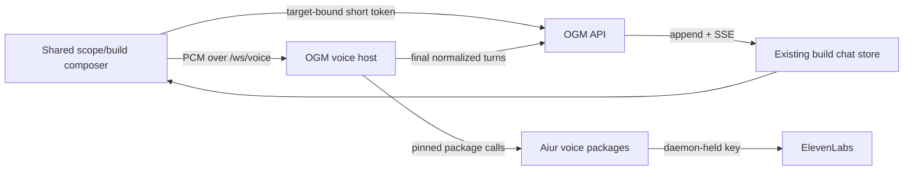
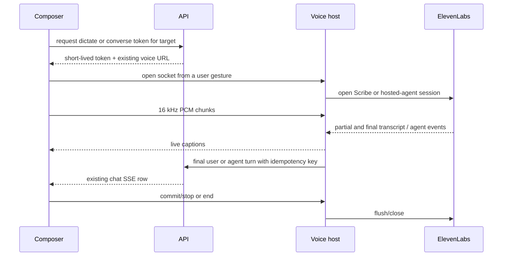

# Aiur-backed ElevenLabs Voice Integration - Plan

## Goal Capsule

- **Objective:** Turn on the existing one-way dictation and two-way creator voice surfaces with ElevenLabs, using pinned Aiur packages for provider behavior and keeping OGM-specific authorization, chat delivery, and browser UI in this repository.
- **Authority:** Issue #465 defines the provider, browser, transcript, host, cost-disclosure, and phone-video acceptance; the frozen OGM voice architecture and the landed studio prototype define the service and UI boundaries.
- **Execution profile:** First consume three focused Aiur package fixes, then wire authenticated dictation, durable chat transcript delivery, live host configuration, and focused browser/service tests.
- **Stop conditions:** Do not copy Aiur internals, expose provider keys to a browser, add paid providers or new chrome, deploy, authorize spend, commit host env files, or write real host names.
- **Tail ownership:** The implementation owns the Aiur pin audit, automated gates, full-diff review, PR evidence, and exact post-deploy phone and live-provider checks.

---

## Product Contract

### Summary

The shared build/scope composer will use ElevenLabs Scribe for press-to-talk dictation in Safari, Chrome, and Firefox. Its existing two-way button will connect to an ElevenLabs hosted agent through the loopback voice host. Final user and agent turns will be appended to the same chat stream, so ending a call returns to a transcript that remains in the conversation.

### Problem Frame

OGM already has browser PCM capture, a two-way wire client, an authenticated voice-token route, a loopback voice host, public ingress, and chat storage. Dictation still depends on browser speech recognition, which excludes Firefox and selects a browser vendor rather than the configured provider. The host is pinned before Aiur's transcript-free cleanup fix, its ElevenLabs hosted-agent id is not configurable through the package, and final two-way turns exist only as temporary captions.

### Requirements

- R1. The PR records an explicit reuse matrix: `voice_converse` and the extracted Scribe transcriber are pinned Aiur dependencies; OGM retains target authorization, API/chat delivery, environment wiring, and browser presentation.
- R2. One-way press-to-talk sends 16 kHz PCM to a daemon-held ElevenLabs Scribe connection, keeps partial/final text editable in the existing composer on iPhone Safari and desktop Chrome/Firefox, and cannot run past the host's bounded press-to-talk window.
- R3. The existing scope/build voice action starts and ends an ElevenLabs hosted-agent conversation without exposing the provider key or agent id to the browser.
- R4. Every bounded final user and agent turn is idempotently appended as a text row to the target chat during the conversation; ending or losing the socket leaves delivered rows visible through the existing stream.
- R5. The existing voice-host release builds, binds only to loopback, runs through `ogm-voice-host.service`, and serves both modes behind the existing `/ws/voice` ingress path.
- R6. Setup and run documentation names the API/host URL wiring, live provider and agent-id settings, durable provider-cleanup root, service commands, provider audio/transcript retention boundaries, and the actions that consume ElevenLabs transcription or conversational-AI credits.
- R7. Automated tests cover authorization, target binding, dictation lifecycle, transcript idempotency, browser cleanup, fake-provider conversation flow, and configuration without using a real provider key.
- R8. Manual acceptance is recorded, not claimed locally: phone video must show one dictated message and one two-way exchange whose text remains after the call.

### Scope Boundaries

- The frozen `docs/plans/ogm-v1-build/` pack and the studio/title-town layouts are not edited.
- The browser continues to use OGM's vendored wire contract because Aiur has no published TypeScript client package.
- A provider key alone never starts work; only a creator gesture opens a dictation or conversation session, and batch narration remains separately opt-in.
- Host env values and service starts are post-deploy operator work. The repository ships names, validation, setup instructions, and tests, never values.
- Provider cleanup and transport/provider defects belong upstream; OGM keeps only target-specific policy and delivery adapters.

---

## Planning Contract

### Key Technical Decisions

- KTD1. Pin `voice_converse` to Aiur results that include transcript-free provider cleanup, Bandit opcode compatibility, and hosted-agent id configuration. Remove `OgmVoice.NoCleanup` and the opcode-only wrapper after the package owns those behaviors; retain OGM's token-target authorization and confirmed-draft delivery hooks.
- KTD2. Consume the Scribe implementation produced by `aiur-team/aiur#7482` as a sparse pinned Elixir dependency. OGM supplies a thin WebSocket owner that authenticates the `dictate` scope, forwards PCM/commit/stop commands, and converts neutral partial/final/error events to its browser wire.
- KTD3. Reuse the existing public `OGM_VOICE_WS_URL` and `/ws/voice` ingress. A non-secret mode selector routes a separately scoped token to dictation; conversation remains the default, so no second public origin or tunnel rule is introduced.
- KTD4. Keep provider credentials and the hosted-agent identifier in `voice-host.env`. The API mints short-lived target-bound tokens; the browser receives only a token and public socket URL.
- KTD5. Add an independent voice-host transcript subscriber for every two-way session. It forwards final normalized turns to an authenticated internal API route, which validates the signed target and uses deterministic ids so retries cannot duplicate rows.
- KTD6. Store scope voice turns in the scope session's existing build-chat job. User transcript rows are not mirrored back into Aiur as new instructions, because the hosted agent already heard them; only confirmed instruction drafts continue through the established delivery path.
- KTD7. Preserve the prototype's controls and layout. Cost clarity belongs in the existing action labels/status affordance and operator docs, without a new panel, modal, or navigation surface.
- KTD8. Bound paid and attacker-controlled work at the host. Dictation has a 120-second server deadline, package frame/backlog ceilings, one active session per token nonce, and creator-scoped token-issuance throttling; conversations retain `voice_converse` session/minute limits.
- KTD9. Keep no audio or provider transcript on the voice host. Set ElevenLabs `record_voice: false`, enable durable provider-conversation cleanup under `OGM_VOICE_CLEANUP_ROOT`, and document that only final bounded text rows enter OGM's normal durable chat history.

### Component Flow

### Session Sequences

### Risks and Dependencies

- The Scribe package extraction is tracked by `aiur-team/aiur#7482`; Bandit opcode compatibility by `#7483`; and hosted-agent id configuration by `#7484`. OGM may build independent contracts and delivery paths first, but does not duplicate their package-owned implementations.
- ElevenLabs provider event boundaries may resend or revise final text. The API idempotency contract uses conversation, actor, and provider turn identity where available; the host assigns a stable per-conversation user-turn sequence otherwise.
- Mobile Safari may suspend audio capture when the page backgrounds. The client stops tracks and closes the socket on pointer cancellation, visibility loss, unmount, and explicit end, while delivered final rows remain in chat.
- Transcript delivery can race socket closure. The independent subscriber continues through the package's ended event and drains its ordered HTTP queue before stopping.
- Provider or API failure can otherwise leave a relay alive indefinitely. Delivery retries are bounded and ordered; exhaustion emits a non-secret error/metric and terminates without blocking the conversation supervisor.
- Package pin changes affect an Elixir lockfile and runtime service, so validation includes the full voice-host test suite and repository-wide gates rather than only UI tests.

---

## Implementation Units

### U1. Consume Aiur package fixes and simplify the host

- **Goal:** Make Aiur the single owner of reusable provider cleanup, Bandit socket compatibility, hosted-agent configuration, and Scribe transcription.
- **Requirements:** R1, R3, R5, R7; KTD1, KTD2, KTD4.
- **Dependencies:** Aiur issues #7482, #7483, and #7484.
- **Files:** `services/voice-host/mix.exs`, `services/voice-host/mix.lock`, `services/voice-host/lib/ogm_voice/application.ex`, `services/voice-host/lib/ogm_voice/config.ex`, `services/voice-host/lib/ogm_voice/transport.ex`, `services/voice-host/lib/ogm_voice/no_cleanup.ex`, and corresponding tests.
- **Approach:** Pin immutable Aiur commits, inspect the resulting public APIs, configure transcript-free cleanup under a dedicated durable `OGM_VOICE_CLEANUP_ROOT`, map `ELEVENLABS_AGENT_ID` into the package, and delete only superseded OGM shims.
- **Patterns to follow:** Existing sparse `voice_converse` dependency, zero-arity credential functions, loopback listeners, and `OgmVoice.Target` validation.
- **Test scenarios:** Package config accepts the live provider, agent id, and durable cleanup root; refuses blank required live configuration without leaking values; starts cleanup in transcript-none mode; preserves `record_voice: false`; and accepts Bandit's real inbound callback shape.
- **Verification:** `mix deps.get`, compile, format, and all `services/voice-host` tests pass against the exact pins; deleted shim tests fail on the old pins.

### U2. Authenticated Scribe dictation path

- **Goal:** Replace browser-vendor dictation with a target-bound ElevenLabs Scribe stream while preserving the `DictationPort` interaction.
- **Requirements:** R2, R5, R7; KTD2 through KTD4.
- **Dependencies:** U1.
- **Files:** `packages/contracts/src/voice.ts`, `services/api/src/voice/routes.ts`, `services/api/src/voice/token.ts`, voice route tests, new dictation transport modules/tests under `services/voice-host/lib/ogm_voice/`, `packages/voice-client/src/dictation.ts`, its tests, and `apps/web/src/features/build-chat/Composer.tsx` with existing composer tests.
- **Approach:** Mint a throttled `dictate`-scope token after the same target authorization as conversation, start browser PCM capture and token acquisition together on the creator gesture, stream through the host's Scribe package owner, and map partial/final events into the editable textarea. A release recorded before socket readiness is replayed as one commit after buffered audio; success waits for the package's final/timeout signal, while permission, token, provider, cancellation, and teardown paths stop tracks and close the socket through the existing notice state.
- **Patterns to follow:** `VoiceClient`, `audio/capture.ts`, token HMAC vectors, and the existing shared composer used by scope and build chat.
- **Test scenarios:**
  1. Unsupported browser speech APIs do not hide the mic because capture uses `getUserMedia` and Web Audio.
  2. Pointer/keyboard press starts once, release commits once, final text remains editable, and cancel/unmount closes capture and socket.
  3. Missing, expired, wrong-scope, wrong-creator, target-replay, nonce-replay, and throttled token requests are refused before a transcriber starts.
  4. Partial, final, provider error, early-release backlog, oversized backlog, and 120-second deadline behavior match the Aiur package contract with a fake transport.
- **Verification:** Focused Vitest, API route tests, voice-host transport tests, and the voice-client Playwright Chromium fake-server spec pass without provider network access.

### U3. Persistent two-way transcript delivery

- **Goal:** Append final creator and builder turns to the target chat independently of the browser socket lifecycle.
- **Requirements:** R3, R4, R7; KTD5, KTD6.
- **Dependencies:** U1.
- **Files:** `packages/contracts/src/voice.ts`, a new `services/api/src/voice/transcript.ts`, `services/api/src/voice/routes.ts`, API transcript tests, new relay modules/tests under `services/voice-host/lib/ogm_voice/`, and `services/voice-host/lib/ogm_voice/transport.ex`.
- **Approach:** Register a relay after `start_session`, subscribe it directly to normalized package events, serialize final turns to the internal API, validate target ownership/job membership again, reject oversized text/identifiers, derive row ids from target key plus conversation/actor/turn identity, insert creator/agent text rows without Aiur mirroring, and publish the existing chat hub.
- **Patterns to follow:** `OgmVoice.Delivery`, `/internal/voice/instruct`, `insertChatRow`, target validation in voice token/instruct routes, and existing SSE publication.
- **Test scenarios:**
  1. Final user and agent events create ordered creator/agent text rows for build and scope targets.
  2. Partial events create no rows; duplicate/retried finals create one row.
  3. A forged or stale target, wrong internal secret, and target/job mismatch create no rows.
  4. Empty/oversized text and oversized conversation or turn identifiers are rejected before storage.
  5. Ending the browser socket while a final delivery is in flight still drains the row before the relay exits; a failing API exhausts bounded retries without leaking content into logs.
- **Verification:** API and fake-provider end-to-end tests observe both rows through the existing chat query/stream, and the old behavior fails the new assertions.

### U4. Live configuration, cost clarity, and host documentation

- **Goal:** Make the existing release operable with the already-provisioned ElevenLabs key and agent id, without committing values or changing the prototype layout.
- **Requirements:** R5, R6, R8; KTD4, KTD7.
- **Dependencies:** U1 through U3.
- **Files:** `packages/config/src/names.ts`, `.env.example`, `apps/site/content/setup.yaml`, generated `SETUP.md`, `services/voice-host/README.md`, `docs/ops/runbook.md`, and focused UI/setup/config tests.
- **Approach:** Document `OGM_VOICE_PROVIDER=elevenlabs_agents`, `ELEVENLABS_AGENT_ID`, `OGM_VOICE_CLEANUP_ROOT`, the existing public/internal URLs, build/restart/health commands, and that dictation, two-way conversations, and narration consume distinct provider credits. State that provider audio storage is disabled and cleanup is durable while final chat text follows normal OGM retention. Keep values in mode-0600 unit env files and preserve fake-provider/no-spend setup as the default template.
- **Patterns to follow:** Generated setup YAML, config name registry, existing service runbook tables, and existing composer action/status styling.
- **Test scenarios:** Setup generation remains exact, env registry assigns every name to the correct unit, live configuration validation names missing variables without values, and action copy identifies paid behavior without new layout elements.
- **Verification:** Site/setup tests, config tests, lint, typecheck, and generated-file diff checks pass; no real host, key, agent id, or env file enters Git.

---

## Verification Contract

| Gate | Scope | Done signal |
|---|---|---|
| Voice package | Full `services/voice-host` test suite | Exact Aiur pins compile; fake Scribe and fake conversation paths cover auth, lifecycle, relay, cleanup, and close races. |
| API | Voice token, transcript, instruct, build-chat, and scope-route tests | Target validation and idempotent rows pass for both target kinds. |
| Browser packages | `@ogm/voice-client` unit/browser tests and changed web composer/scope tests | PCM dictation and two-way cleanup work without Web Speech API or live provider access. |
| Repository gates | Root lint, typecheck, test, and build | Shared contracts/config/runtime changes do not regress other workspaces. |
| Review | Full branch diff against `main` | `ce-code-review` reports no blocking findings and the PR records every persona/finding disposition. |
| Post-deploy | Physical iPhone plus desktop Chrome and Firefox | Operator records phone video of dictation and a two-way exchange, then confirms the transcript remains after ending the call. |

---

## Definition of Done

- The PR links the three focused upstream Aiur issues and names the immutable package commits it consumes.
- Browser dictation uses server-side ElevenLabs Scribe and works without `SpeechRecognition` feature detection.
- Two-way user and agent finals appear once in the existing scope/build chat and remain after the call UI closes.
- The live provider is fully configurable through documented env names while secrets stay daemon-held and real values stay uncommitted.
- Fake-provider automated gates pass, every new test is shown to fail without its production change, and full required CI passes on the pushed head.
- The PR body contains exact post-deploy phone/video, host-env, service-start, and live-credit checks without claiming they ran in the issue workspace.
