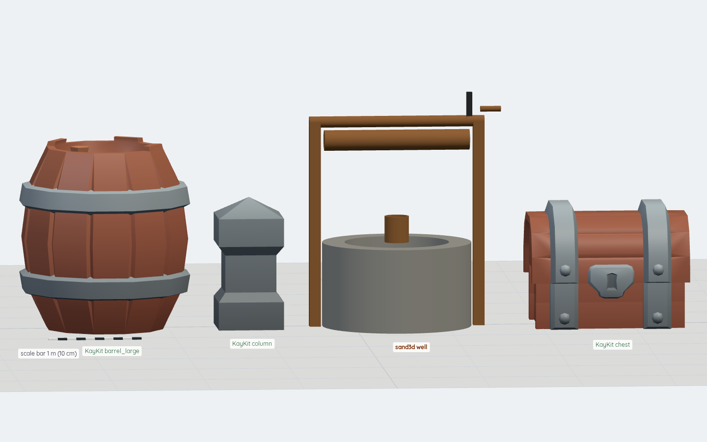
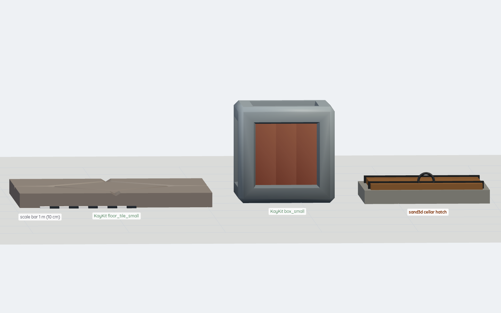
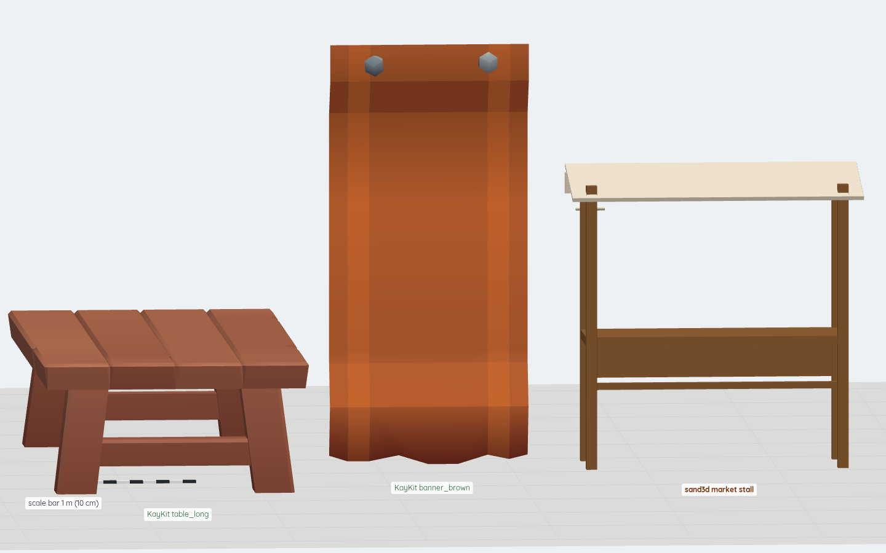
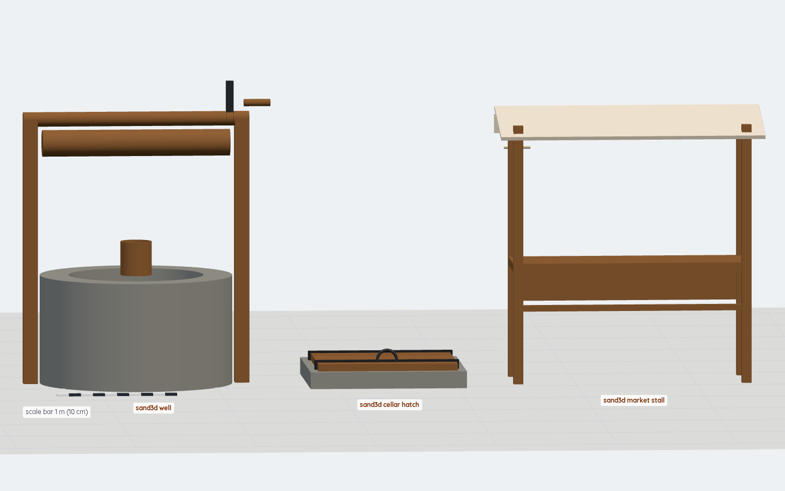
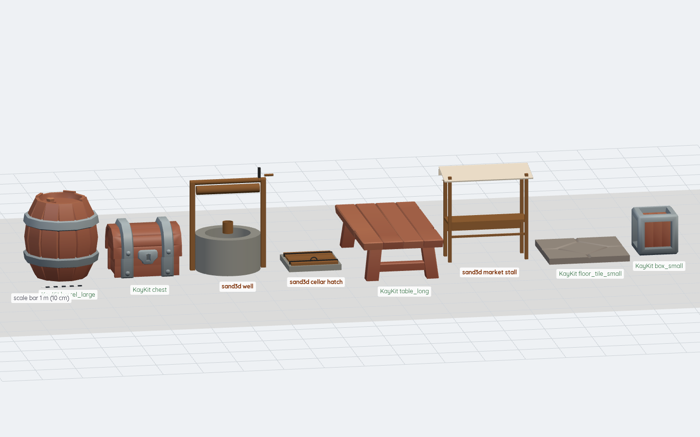
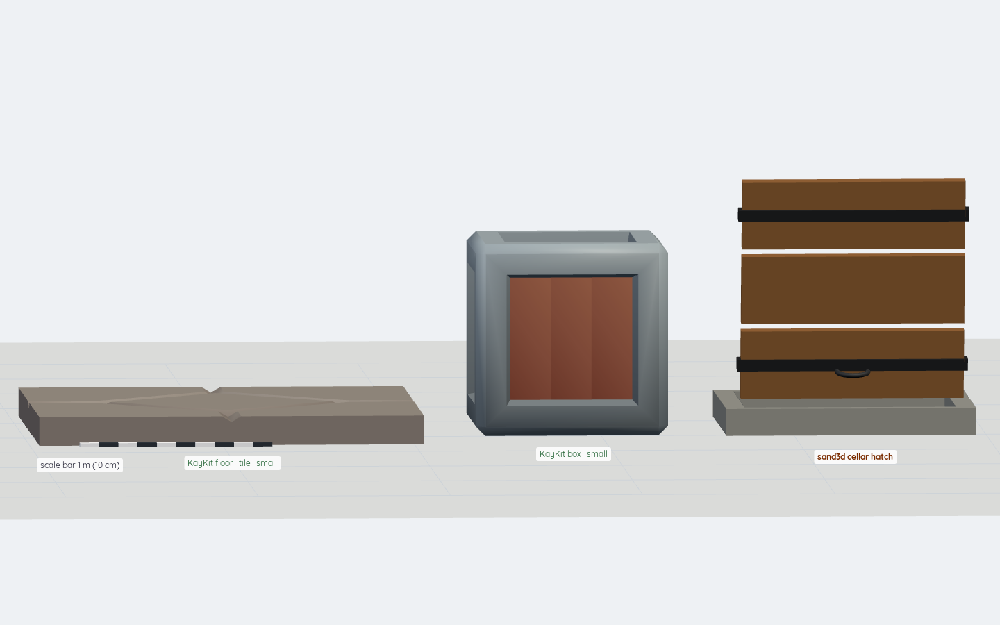

# sand3d for procedural props: spike verdict

Date: 2026-11-06. Ticket #546 (Kevin: "research this and see if it's useful to us").
Subject: [Sandflow-ai/sand3d](https://github.com/Sandflow-ai/sand3d) 1.6.3, Apache-2.0 — 3D modelling in Python over
Blender's `bpy`, built for LLMs: short programs, named parts and joints, GLB with the joints in node extras.

The gap it would fill is `gm-props-procedural` in `docs/research/v0.4/B14-skills/gaps.md` §7: nothing exists for
procedural prop generation in bpy or three. Packs first stays the rule; this is only for props no owned pack has.

**Verdict: adopt with limits.** It does what it claims — the API doc is small enough to write a working prop from in
one pass, the output lands in three.js with joints a runtime can drive, and it runs locally with no cloud and no spend.
The limits are the install weight (1.0 GB venv on Python 3.13), flat materials instead of the pack's texture atlas,
no LOD or compression pass, and one rough edge in the joint metadata. Details below.

## 1. Install

| Item | Value |
|---|---|
| sand3d wheel | `sand3d-1.6.3-py3-none-any.whl`, 111,688 bytes (0.11 MB), pure Python |
| bpy wheel | `bpy-5.2.3-cp313-cp313-manylinux_2_28_x86_64.whl`, **402,843,256 bytes (403 MB)** |
| other deps | numpy 2.5.4 (16.7 MB), cython, requests, attrs, cattrs, zstandard, typing-extensions |
| wheelhouse | 410 MB; installed venv **1.0 GB** on disk |
| interpreter | CPython 3.13.5; `requires-python >=3.11, !=3.12.*, <3.14` (bpy 4.5 on 3.11, bpy 5.2 on 3.13) |
| verified import | `bpy 5.2.3 LTS`, `sand3d 1.6.3` |
| cost | no network at run time; offline install works (`pip install --no-index --find-links wheelhouse sand3d`) |

There is **no CLI**. A prop is a Python file that does `import sand3d as s3d`, calls `s3d.units("m")`, builds parts and
calls `s3d.export(root, "prop.glb")`. Wall time per prop including bpy start-up: 2.34 s, 2.41 s, 2.66 s for the three
below. Rebuilding the same program twice gives the same bytes: `well.glb` is
`sha256 c39c4276652b0a44bcec20f6a7fe25bc53c7ae129a22ae02bbb16277171a1083` both times. `s3d.fingerprint()` returns a
16-hex digest of the program source, which is the provenance handle for the export.

The wheel's Blender build ships without Draco and MeshOptimizer (`libbf_intern_draco_bridge.so` and
`libbf_intern_meshopt_bridge.so` are missing), so the exporter logs two errors and writes an uncompressed GLB. Any
mobile variant still needs the usual gltf-transform/meshopt pass after export.

This sandbox's system Blender CLI is broken (`liblapack.so.3` missing); it does not matter, because the bpy module
carries its own libraries and needs no system Blender.

## 2. Three programs written from `docs/api.md` alone

Rule for the test: the model writing the props read `docs/api.md` (11,135 bytes ≈ 2.8k tokens) and nothing else from
the repo — not `docs/guidelines.md`, not `programs/*.py`, not the README's examples. The only other input was how to
run a script (`python prop.py`). The model was this agent's own, not a separate worker: no worker endpoint was
available in this workspace, so "the worker's own model" here means the model that did the ticket. Token counts are
byte/4 estimates; nothing in this environment exposes the model's own token counter.

Props were picked as things KayKit Dungeon Remastered (CC0) does not have and a dungeon/village demo scene wants. The
pack's 203 GLBs were listed to check each absence; it has chests (with a separate `chest_lid` node), doors, tables,
barrels, shelves, torches and banners, but no well, no cellar hatch and no market stall.

| Prop | What it is | Joint | Attempts | Program size |
|---|---|---|---|---|
| `well` | stone kerb (revolved ring), two oak posts, beam, winding drum + crank handle, bucket on the kerb | `crank`, continuous, axis +X | 1 run after 1 rewrite | 1,696 bytes |
| `cellar_hatch` | stone frame pocketed to a 1.10 m opening, 3-board lid with steel straps and a ring handle | `hatch_lid`, revolute, axis +X, 0–100° | 1 run | 1,368 bytes |
| `market_stall` | four posts, counter + front board + rail, sloping cloth awning with a valance and a tie | none | 1 run | 1,573 bytes |

**Attempts, honestly.** Each program ran the first time it was executed: no API error, no failed boolean, no missing
import. The well was rewritten once *before* its first run, because the first draft reached for
`s3d.attach(s3d.Handle(drum), ...)` and `drum.face("side")` and the doc's own gate example only shows a joint read on a
`bbox`/anchor frame; the rewrite reads the pivot from an `assembly` anchor (`axle=s3d.Frame((0, 0, 2.00))`), which is
the documented form. That rewrite is the one real cost of the doc: it lists `attach`/`Handle` in the API table without
an example, so the model guessed and then corrected itself. Total program text 4,637 bytes ≈ 1.2k tokens for three
props, against ~2.8k tokens of API to read once.

What the API doc carried without further help: `units`, `box`/`cylinder`/`torus`/`revolve`, `at` (place), `copy`,
`transform(mirror=)`, `join`, `pocket`, `shell`, `material`, `group`, `assembly`, `joint`, `pose`, `export`,
`bbox`, `Frame`. Everything needed for these three props was in it.

## 3. Style match against KayKit

Rendered in three.js r186.1 — the version `templates/game-3d` pins — through an orthographic, to-scale lineup in the
style the asset skills use, each prop beside the nearest KayKit pieces, all standing on y = 0, 0.30 m gaps, with a 1 m
scale bar. KayKit pieces are the ones the pack actually ships; nothing was edited.







Measured with `scripts/assets/check_glb.py` and the renderer's own boxes:

| Piece | Size (m) | Tris | Meshes / materials |
|---|---|---|---|
| KayKit barrel_large | 1.80 × 2.00 | — | 2 / 1 |
| KayKit chest | 1.70 × 1.30 | — | 2 / 1 |
| KayKit column | 0.70 × 1.40 | — | — |
| KayKit table_long | 2.00 × 1.00 | — | — |
| KayKit floor_tile_small | 2.00 × 0.15 | — | — |
| sand3d well | 2.05 × 2.51 × 1.60 | 1,776 | 8 / 4 |
| sand3d cellar hatch | 1.30 × 0.31 × 1.30 | 4,696 | 7 / 3 |
| sand3d market stall | 2.20 × 2.25 × 0.88 | 232 | 10 / 4 |

**What matched.**

- **Palette.** Colours were picked by eye from the pack's look and then checked against what the renderer actually
  shows. The well's wood lands in the same quantised browns as the KayKit chest's band — `#6c4824` 6.7 %,
  `#784830` 5.0 %, `#783c30` 3.8 %, `#9c6048` 3.4 % in the well's band against `#784830` 9.3 %, `#9c6048` 4.8 %,
  `#783c30` 3.8 % in the chest's. The stall's cloth `#e4d8cc` is the same bucket as the KayKit banner's `#e4d8cc`.
  The stone greys `#6c6c6c`/`#6c6c60` appear in both the pack's column and my well's kerb.
- **Scale.** The kit is chunky: a 2.00 m floor tile, a 2.00 m barrel, a 1.30 m chest, a 4.00 m pillar. The props sit in
  that range rather than at real-world furniture size: a 2.51 m well next to a 2.00 m barrel and a 1.30 m chest, a
  0.31 m hatch lid in a 2.00 m tile, a 2.25 m stall beside a 2.00 m table. Nothing reads as a different scale.
- **Material language.** One flat colour per material, roughness set per surface, no textures — the pack's own look is
  a flat-shaded chunky kit, so the two sit together in a lineup.
- **Silhouette.** Boxes, cylinders and revolved rings, bevels only where the doc's chamfer/fillet earns them; no smooth
  blobs. The kit gate reports 232–4,696 tris per prop against its `low` budget of 20,000.

**What did not.**

- **The stall's wood is darker than the kit's table.** KayKit's `table_long` band is dominated by warm oranges
  (`#a85424` 12.9 %, `#b45424` 7.4 %); the stall's oak renders as `#6c4824` 22.7 %. The kit's own woods span both
  buckets (its chest and banners are the darker one), so it reads as a kit member but not as a table's sibling. Fix:
  sample the target pack's texture for one colour per family instead of choosing by eye.
- **No texture at all.** The pack's pieces share a 1024² palette atlas with edge wear baked in; my props are flat
  colour. At lineup distance they match; close up they read plainer. Fix: join per material and, if the look matters,
  map the prop's faces onto the pack's atlas or accept the flat look for background props.
- **Draw calls.** 8–10 meshes and 3–4 materials per prop, against 2 meshes and 1 material for a KayKit chest. Forty
  props in a scene costs 4–5× the draw calls of the pack's own pieces. Fix: `join` per material before export, or run
  gltf-transform afterwards.
- **One kit-gate failure.** `check_glb.py --budget low well.glb` fails: `not centred on x: centre is 0.0850 m` — the
  crank handle sticks out on one side. KayKit's own `chest.glb` and `keg.gltf.glb` fail the same test (0.0229 m and
  0.0244 m), so the centring rule is stricter than the pack's own convention. A prop with an asymmetric mechanism
  needs either a symmetric mechanism or the rule read as "origin at the footprint centre".

Set judgement per `scripts/assets/set_critic.py` (round 1): cohesion 7, reference fidelity 7, brief 8, mesh quality 7,
texture quality 6, assembly 6, scale 8, labels 8 — average 7.12, no category below 6, so the set clears the bar and the
critic says stop iterating and deliver. The five fixes it keeps are the four above plus "emit a LOD1".

Assembly scored 6 for a concrete reason: the awning panel is tilted 12° over posts whose tops all sit at 2.15 m, so it
clears the front pair and dips into the back pair instead of seating on all four.

## 4. Driving the joint from the extras in three.js

Every export carries its joints in node extras. Measured from `well.glb` and `hatch.glb`:

```json
{"s3d_joint": {"name": "hatch_lid", "type": "revolute", "value": 0.0, "axis": [1, 0, 0], "lower": 0.0, "upper": 1.7453292519943295}}
```

`value`, `lower` and `upper` are radians; `continuous` joints carry no bounds; the export holds the pose the program
stood in when `export` was called. The joint node sits under the parent part and the moving mesh hangs under it, so a
consumer finds the node, reads the extras, and rotates about `axis` at that node's origin.

```js
const gltf = await new GLTFLoader().loadAsync('hatch.glb');
gltf.scene.traverse((o) => {
  const j = o.userData.s3d_joint;
  if (!j) return;
  const q = new THREE.Quaternion().setFromAxisAngle(new THREE.Vector3(...j.axis).normalize(), THREE.MathUtils.degToRad(100));
  o.quaternion.multiply(q);   // compose AFTER the node's own rest rotation
});
```

That last line is the rough edge. The node's transform already holds the rest pose — for the hatch lid a 90° rotation —
so the animation is a rotation *composed on top of it*. Replacing the quaternion (`o.quaternion.copy(q)`) throws the
rest pose away. Composing after the rest rotation reproduces the designed sweep: a 1.16 m lid opened 100° about its
edge should reach 0.14 + 1.16·sin 100° ≈ 1.28 m and the render measures 1.351 m to the top of its ring handle. Negating
the axis gave a 1.153 m top, which is not the design. Nothing in `docs/api.md` states the composition rule; the
README's export table only says "the joints in each node's extras". It took three candidate orders and a measurement to
find it. A skill must say it.




`templates/game-3d` itself could not be run: its vite dev server needs node, and this sandbox has no node at all. The
GLB was loaded with the same three.js version the template pins (0.186.1) and the same GLTFLoader, in headless
Chromium over http, and the pose was driven from `userData.s3d_joint`.

## 5. Costs and risks

- **1.0 GB venv per worker**, 403 MB of it one bpy wheel. A worker that generates props needs its own venv; it cannot
  share the Node services' environment. Python 3.13 only (or 3.11 with bpy 4.5); Python 3.12 is excluded.
- **No compression, no LOD.** The wheel lacks Draco and MeshOptimizer; the pipeline's normal meshopt/KTX2 pass has to
  follow. `check_glb.py --require-lod1` would fail every sand3d prop as exported.
- **Flat materials only.** `material()` takes a kind, a hex colour and roughness/metallic/opacity/emission. It does not
  paint a texture, so matching a pack's atlas needs either a join-and-atlas step or acceptance of flat colour.
- **Draw calls** as above.
- **No characters or organics.** Not in this ticket's scope and the API does not aim at them: no skinning, no rig
  authoring, no animation clips. `joints` are mechanical (revolute, prismatic, continuous, free).
- **Licence.** Apache-2.0. Assets you generate are yours; the licence covers the tool, not the output. Keep the
  attribution line in whatever script or doc drives it.
- **Joints in extras are not a glTF convention.** The Khronos schema has no joint metadata for mechanical parts; a
  consumer outside our own three.js code has to be taught the key name. URDF is the export for engines that want a
  real mechanism description, and sand3d writes that too.

## 6. If adopted: the `gm-props-procedural` skill, in short

**When.** Packs first. Use this only for a prop no owned pack has and no free CC0 pack covers (search the catalog and
the pack's own file list first — KayKit Dungeon Remastered does have chests, doors, tables, barrels, shelves and
banners). Then for mechanism variants a static pack piece cannot give (a lid that opens, a crank that turns), and for
silhouettes the kit's modules cannot make.

**Style rules that matched KayKit.**

1. Measure the target kit first (`scripts/assets/check_glb.py --lineup` on its nearest pieces) and build to its module:
   KayKit Dungeon Remastered is 2.00 m to a floor tile, with furniture 1.0–2.0 m and pillars 4.00 m. A prop at
   real-world size looks shrunken beside it.
2. Take one flat colour per material family from the pack's own texture, not by eye; roughness 0.75–0.95 for wood and
   cloth, 0.45–0.55 for metal.
3. Primitives and revolved profiles with chamfers; no smooth fillets, no organic curves. Stay under the `low` budget
   (20,000 tris) — the three props here came in at 232–4,696.
4. Seat parts on each other (`pocket`, `shell`, `join`) instead of hovering them; give the mechanism its joint at the
   edge a real hinge would sit on.
5. Join per material before export, or the prop costs 4–5× a pack piece's draw calls.
6. Name parts and joints in the pack's own style (`hatch_lid`, `crank`, `kerb`), so a search for the pack's names finds
   the prop too.

**Export and provenance.** `s3d.units("m")` before anything else; `export(root, "<name>.glb")`; run
`check_glb.py --budget low --height <looked-up height>` on the result and fix what it reports; keep the program beside
the GLB with `s3d.fingerprint()` and the pack comparison in a note. A prop is then reproducible from the program, and
the lineup still is the evidence that it belongs in the set.

## 7. Reproduction

Everything below ran in a scratch venv. What is committed from this spike: this document, the evidence PNGs, and the
programs plus the lineup renderer under `docs/research/sand3d-props/` (its README has the exact commands).

```bash
python3 -m venv sand3d-venv && . sand3d-venv/bin/activate
pip download --only-binary=:all: --dest wheelhouse sand3d==1.6.3
pip install --no-index --find-links wheelhouse sand3d==1.6.3
git clone --depth 1 https://github.com/KayKit-Game-Assets/KayKit-Dungeon-Remastered.git kaykit-dungeon  # CC0
cd docs/research/sand3d-props && python well.py        # and hatch.py, stall.py; each writes its GLB here
python3 -I scripts/assets/check_glb.py --budget low well.glb hatch.glb stall.glb
python3 tools/shot.py "http://127.0.0.1:43190/lineup.html?set=well" well.png
```

The KayKit comparison needed a pack this workspace did not have: `assets-local/` is a symlink to the shared library
and its target does not exist in this sandbox, so the pack was cloned at commit
`b0ca9bd96a8072ab36a3a5464f00ed1e06a16d07` into a scratch directory for the renders only. Nothing from it is
committed.

## 8. What was not checked

- The lineups were judged from measured sizes, palette histograms and a coarse raster read of each render — there is
  no human eye and no vision model in this workspace. The PNGs are attached so the operator can overrule any of it.
- `templates/game-3d` was not run as an app (no node); only its three.js version and loader were used.
- No mobile variant was built or measured; the triangle and texture budgets are the gate's, not a device test.
- Nothing was tested inside a running game scene: the props were rendered in a standalone lineup, not spawned next to
  KayKit characters with lighting and fog from the game.
